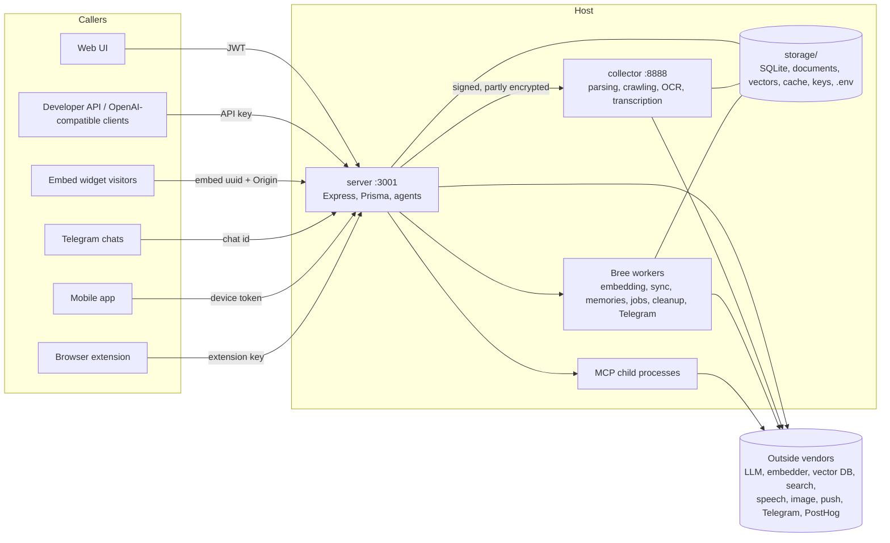
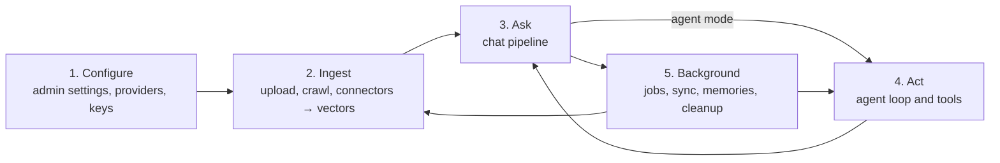

# System model

This is the whole system described abstractly before the detail in files 01–08: what
runs, who acts, what they act on, how state moves, and which rules the code relies on
but doesn't always keep. Commit `e82a80da`.

## 1. What AnythingLLM is

A self-hosted gateway that sits between people (or programs) and language models. It does
three jobs:

- **Retrieval-augmented chat:** it stores documents, turns them into vectors, and adds the
  most relevant passages to each prompt.
- **Agents:** it lets a model call tools (web, files, email, SQL, MCP servers, flows),
  either with a person approving or on a schedule.
- **Gateway:** it exposes all of this to the web UI and to six other channels.

Everything is organized around the **workspace**: a named container of documents, chat
settings and members.

## 2. Processes and trust boundaries

There are five trust boundaries. Each one gets its own section in the domain files:

| Boundary | What crosses it | How trust is established | Where it's weak |
|---|---|---|---|
| Caller → server | requests from 7 channels | JWT, API key, embed id, Telegram chat id, device token or extension key (see [05](05-external-channels.md) section 2) | API keys carry no identity (F-01); websocket uses only a UUID (F-04); devices act as admins (F-05) |
| Server → collector | file paths, URLs, connector options, provider keys | RSA-wrapped AES and a signature ([03](03-documents-and-ingestion.md) P-DOC-26) | plaintext keys, replayable, settings injectable from the browser (F-32, F-34) |
| Server → workers and child processes | job payloads; full `process.env` for MCP | same host | MCP children inherit every secret (F-26) |
| Host → outside vendors | prompts, document chunks, audio, search queries | provider API keys | depends on configuration; see `REVIEW-features-and-hipaa-risks.md` |
| Server → disk | everything | file permissions only | nothing is encrypted at rest by the app (F-49) |

## 3. Actors

| Actor | How they're identified | Attributed as | Map |
|---|---|---|---|
| Anonymous visitor | none | — | [01](01-auth-and-users.md) P-AUTH-01 |
| Single-user owner | instance password, or none | no user (`user = null`) | [01](01-auth-and-users.md) |
| `default` user | JWT | themselves | [01](01-auth-and-users.md), [02](02-workspaces-and-chat.md) |
| `manager` | JWT | themselves; sees every workspace | [01](01-auth-and-users.md) role matrix |
| `admin` | JWT | themselves; sees and configures everything | [01](01-auth-and-users.md), [06](06-admin-system-and-runtime.md) |
| API key holder | key exists | nobody, or a `userId` the caller picks | [05](05-external-channels.md) |
| Embed visitor | embed uuid, `Origin`, client session id | embed session | [05](05-external-channels.md) |
| Telegram chat | Telegram chat id | no user; one shared history | [05](05-external-channels.md) |
| Mobile device | device token | the admin who paired it | [05](05-external-channels.md) |
| Browser extension | extension key | the key owner (admin or manager) | [05](05-external-channels.md) |
| Scheduler and background workers | none | no user, no workspace | [04](04-agents-tools-and-automation.md), [06](06-admin-system-and-runtime.md) |

## 4. Resources and their lifecycles

| Resource | Lifecycle | Map |
|---|---|---|
| Instance | fresh → onboarded → single-user (open or with a password) → multi-user. There's no way back from multi-user. | [01](01-auth-and-users.md) §5, [06](06-admin-system-and-runtime.md) |
| User | invited or created → active ⇄ suspended → deleted (with leftovers, F-38) | [01](01-auth-and-users.md) §5 |
| Session token | issued → valid until expiry; can't be revoked (F-03) | [01](01-auth-and-users.md) |
| Workspace | created → configured → members attached → deleted (hard-deletes its chats) | [02](02-workspaces-and-chat.md) §5 |
| Thread | created → renamed or forked → deleted (chats hidden) | [02](02-workspaces-and-chat.md) |
| Chat message | prompt row written → reply filled → hidden (`include=false`) → hard-deleted only by an admin or a workspace delete | [02](02-workspaces-and-chat.md), [08](08-state-stores.md) |
| Document | source → raw file in hotdir → parsed JSON → chunks → vectors and cache → attached to workspaces → detached → purged | [03](03-documents-and-ingestion.md) §4 |
| Agent session | invocation row → websocket connected → loop of turns → closed | [04](04-agents-tools-and-automation.md) §5 |
| Tool call | proposed by the model → approved, auto-approved or skipped → effect → result | [04](04-agents-tools-and-automation.md) |
| Scheduled job run | queued → running → completed, failed or timed out | [04](04-agents-tools-and-automation.md) §5 |
| Memory | extracted from chats → stored → added to prompts → deleted by the user | [04](04-agents-tools-and-automation.md) |
| Configuration | env → `.env` → `system_settings` → workspace → request (see §6) | [06](06-admin-system-and-runtime.md) §2 |

## 5. The five flows

All the user paths in this map are instances of five flows:

1. **Configure** sets which vendors receive data, and several of its changes are
   destructive. [06](06-admin-system-and-runtime.md) P-ADMIN-06 to P-ADMIN-24.
2. **Ingest** makes copies of content in up to six places.
   [03](03-documents-and-ingestion.md).
3. **Ask** is a 13-stage pipeline: command parsing, agent hand-off, provider or router
   resolution, context assembly, LLM call, streaming, then persistence and cost.
   [02](02-workspaces-and-chat.md) §1 and P-CHAT-10.
4. **Act** is a loop: prompt → model → tool call → approval gate → effect → result →
   model. The approval gate is decided inside each tool, not by the loop.
   [04](04-agents-tools-and-automation.md) §2.
5. **Background** runs with no person present: embedding workers, document sync, memory
   extraction, scheduled agent runs, cleanup. [04](04-agents-tools-and-automation.md),
   [06](06-admin-system-and-runtime.md) P-ADMIN-29 to P-ADMIN-31.

## 6. State in layers

**Configuration precedence**, from lowest to highest: process environment → `server/.env`
(rewritten by `dumpENV`) → `system_settings` rows → workspace columns (provider, model,
router, prompt, mode) → per-request overrides (embed overrides, API `system` message,
reasoning effort). Detail and every setting with a destructive side effect:
[06](06-admin-system-and-runtime.md) §2.

**Data stores:**
- SQLite: 33 tables
- `storage/`: 21 directories
- the vector database
- about 45 in-memory Maps and caches
- outside services (vector DB vendors, MCP servers, Gmail and Calendar bridges, Outlook tokens)
- the browser: 24 `localStorage` keys

Where each kind of user data lands and what deletes it is in the
[08](08-state-stores.md) data lifecycle matrix.

## 7. Where side effects concentrate

308 ledger rows across the domain files ([11](11-side-effects-by-class.md)):

| Class | Rows | Main producers |
|---|---|---|
| DB | 112 | chat persistence, user and workspace admin, jobs |
| NET | 53 | LLM and embedder calls, collector, connectors, Telegram, push, PostHog |
| FS | 45 | document storage, generated files, `.env`, keys |
| LOG | 38 | event logs |
| TEL | 28 | telemetry events |
| CACHE | 27 | router cache, context windows, TTS, frontend `localStorage` |
| PROC | 15 | MCP servers, Bree workers, Puppeteer |
| ENV | 14 | `updateENV`, custom-models listing, `EncryptionManager` |
| VEC, WS, TIME, PUSH | 10, 10, 10, 6 | embeddings, agent socket, schedules, notifications |

## 8. Invariants the code relies on, and where they break

| Invariant | Holds where | Breaks where |
|---|---|---|
| Every action is attributed to an authenticated person | web UI, browser extension | API keys (F-01, F-06), OpenAI API (F-21), Telegram (F-20), mobile (F-05), scheduler (F-24), agent websocket (F-04) |
| The server enforces what the UI hides | almost every endpoint ([07](07-frontend-routes-and-flows.md#41-findings-ui-gate-vs-server-enforcement) §4.1) | Lemonade model endpoints (F-14) |
| Users see only their own data | threads are always filtered by `user_id` | admins and managers skip membership (F-15); global prompt variables (F-18); shared generated files (F-19); API reset (F-17) |
| Side-effecting tools need a person | file creation, email sending, calendar writes | most other tools (F-25), scheduled jobs (F-24), self-service whitelist (F-28) |
| Delete means gone | purge of a document, workspace delete | chats are hidden (F-37); detach keeps copies (F-39); user leftovers (F-38) |
| Config changes are atomic and reversible | single-key saves | partial `updateENV` (F-45), multi-user rollback (F-43), live-sync toggle (F-44), embedder change (F-47) |
| Outbound fetches stay off internal hosts | literal private IPv4 addresses | SSRF guard gaps (F-33), runtime settings injection (F-32), model-chosen URLs (F-29) |
| Secrets stay secret | password hashes in most responses | extension key listing (F-02), plaintext collector bodies (F-34), MCP env inheritance (F-26), settings table (F-49) |
| The audit log is a faithful record | logins, API actions | wrong actor and missing events (F-55), deletable (F-54) |

## 9. Modes

| Behavior | Single-user, no password | Single-user, password | Multi-user |
|---|---|---|---|
| Identity | none | shared password | one account per person |
| Role checks (`flexUserRoleValid`) | skipped | skipped | enforced |
| `user` on writes | `null` | `null` | the user |
| Telegram, scheduled jobs, `create-scheduled-job` skill | available | available | the skill is off, and the Telegram and scheduled-jobs pages are built for single-user mode ([07](07-frontend-routes-and-flows.md) P-UI-33, P-UI-34) |
| Daily message limit | n/a | n/a | per user, admins exempt |
| Way back | — | remove password | none |

## 10. Using this map for change work

- **Before changing an endpoint:** find it in the entry-point table of its domain file,
  then read its path for the state changes and side effects. Check
  [07](07-frontend-routes-and-flows.md) for the UI that calls it.
- **Before changing a table or storage folder:** read its row in
  [08](08-state-stores.md), then search [11](11-side-effects-by-class.md) for the table
  or folder name to find every writer.
- **Before adding a permission or role:** read [01](01-auth-and-users.md) role matrix,
  [02](02-workspaces-and-chat.md) §4 (scoping) and [07](07-frontend-routes-and-flows.md)
  §4.1 (UI and server guards).
- **Before adding a channel or tool:** compare with the trust table in
  [05](05-external-channels.md) §2 and the tool effect classes in
  [04](04-agents-tools-and-automation.md) §2.
