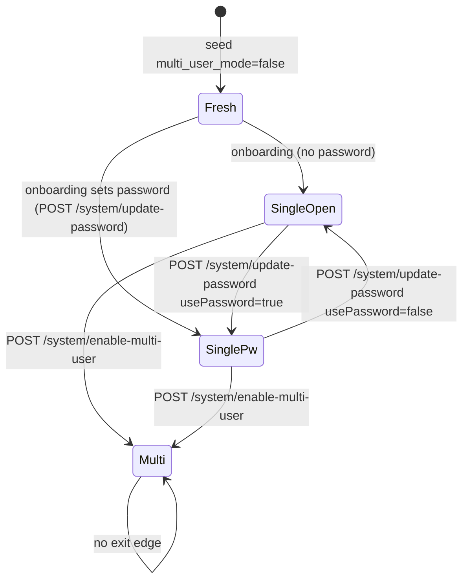

# 01 — Auth and users (`AUTH`)

This file covers identity, sessions and accounts. That means first-run setup, single-user mode with and without a password, the one-way switch to multi-user mode, password login, session JWTs and their validation, logout, Simple SSO temporary tokens, invites, user CRUD by admins and managers (in the UI and through the developer API), suspension, the daily message limit, the user's own profile and profile picture, recovery codes and password reset, developer API keys, browser extension keys, mobile device registration, and the role middleware. Other files own what roles grant *inside* workspaces (workspace membership, chat, documents), event-log viewing and system preferences (ADMIN), and chat streaming (CHAT). Verified against commit `e82a80da`.

**Sources:** `server/endpoints/system.js`, `server/endpoints/admin.js`, `server/endpoints/invite.js`, `server/endpoints/browserExtension.js`, `server/endpoints/mobile/{index,middleware/index,utils/index}.js`, `server/endpoints/api/{admin,auth,userManagement}/index.js`, `server/utils/http/index.js`, `server/utils/middleware/{validatedRequest,multiUserProtected,simpleSSOEnabled,validApiKey,validBrowserExtensionApiKey}.js`, `server/utils/helpers/admin/index.js`, `server/utils/helpers/dummyHashCompare.js`, `server/utils/PasswordRecovery/index.js`, `server/models/{user,invite,apiKeys,browserExtensionApiKey,mobileDevice,temporaryAuthToken,passwordRecovery,eventLogs,systemSettings}.js`, `server/prisma/schema.prisma`, `server/utils/files/multer.js`, `server/utils/files/pfp.js`, and on the frontend `frontend/src/{AuthContext.jsx,main.jsx,models/system.js}`, `frontend/src/components/PrivateRoute/index.jsx`, `frontend/src/components/Modals/Password/*`, `frontend/src/components/UserMenu/UserButton/index.jsx`, `frontend/src/pages/OnboardingFlow/Steps/UserSetup/index.jsx`, `frontend/src/pages/Login/SSO/simple.jsx`.

---

## 2. Mental model

### Actors

| Actor | How it is identified | Where it is checked |
|---|---|---|
| Anonymous browser | nothing | public routes only |
| Single-user operator | no credential (no password set), or a JWT carrying `p` (the encrypted instance password) | `server/utils/middleware/validatedRequest.js:16-71` |
| Multi-user user (`default`, `manager`, `admin`) | a JWT carrying `{id, username}`, re-loaded from `users` on every request | `server/utils/middleware/validatedRequest.js:74-111` |
| Developer API client | `api_keys.secret` bearer token (not tied to a role) | `server/utils/middleware/validApiKey.js:4-25` |
| Browser extension | `brx-…` key in `browser_extension_api_keys` | `server/utils/middleware/validBrowserExtensionApiKey.js:8-57` |
| Mobile app | `x-anythingllm-mobile-device-token` header matched to `desktop_mobile_devices.token` | `server/endpoints/mobile/middleware/index.js:12-42` |
| External SSO broker | a developer API key, used to mint `allm-tat-…` temporary tokens | `server/endpoints/api/userManagement/index.js:67-121` |

### Resources and stores

| Store | Purpose | Defined |
|---|---|---|
| `system_settings.multi_user_mode` | The instance mode flag. Seeded `"false"` and only ever written `true` (except during rollback) | `server/prisma/seed.js:6`, `server/endpoints/system.js:693-695` |
| `system_settings.onboarding_complete` | Whether the first-run wizard finished | `server/models/systemSettings.js:806-826` |
| `process.env.AUTH_TOKEN` / `JWT_SECRET` / `JWT_EXPIRY` | Single-user password, JWT signing key, session lifetime | `server/utils/helpers/updateENV.js:623-630` |
| `users` | Accounts: `role`, `suspended` (Int 0/1), `dailyMessageLimit`, `seen_recovery_codes`, `pfpFilename`, `bio` | `server/prisma/schema.prisma:61-90` |
| `invites` | Single-use signup codes with preselected workspaces | `server/prisma/schema.prisma:42-51` |
| `recovery_codes`, `password_reset_tokens` | Account recovery | `server/prisma/schema.prisma:92-111` |
| `temporary_auth_tokens` | One-shot login tokens: `allm-tat-` (Simple SSO) and `allm-oidc-` (Google sign-in callback) | `server/prisma/schema.prisma`, `server/models/temporaryAuthToken.js:14-17` |
| `user_identities` | External sign-in identities: `(provider, subject)` unique, `email`, `lastLoginAt`; cascade-deleted with the user | `server/prisma/schema.prisma:97`, `server/models/userIdentity.js` |
| `system_settings.oidc_*` | Google (OIDC) sign-in settings; `oidc_client_secret` encrypted. Each can be overridden by an `OIDC_*` env variable | `server/utils/auth/oidcSettings.js:37-84` |
| `api_keys` | Developer API keys. `createdBy` is a bare Int with **no relation** to `users` | `server/prisma/schema.prisma:18-25` |
| `browser_extension_api_keys` | Extension keys, cascade-deleted with the user | `server/prisma/schema.prisma:314-323` |
| `desktop_mobile_devices` | Mobile devices, cascade-deleted with the user | `server/prisma/schema.prisma:364-375` |
| `TemporaryMobileDeviceRequests` (in-memory `Map`) | 3-minute mobile registration tokens, lost on restart | `server/models/mobileDevice.js:19` |
| `event_logs` | Audit trail | `server/models/eventLogs.js:4-23` |

### Patterns

- **The instance mode is a state machine with one-way edges**: no settings, then single-user open, then single-user with a password, then multi-user. No code path sets `multi_user_mode` back to `false` except the error rollback in `server/endpoints/system.js:716-719`, and `protectedFields` keeps it out of generic settings updates (`server/models/systemSettings.js:41`).
- **Sessions are stateless JWTs (HS256 with `JWT_SECRET`)**: `makeJWT` (`server/utils/http/index.js:25-29`) defaults to `30d` when `JWT_EXPIRY` is unset. Nothing is stored server-side, so there is no revocation list. In multi-user mode the user row is re-read on every request (`server/utils/middleware/validatedRequest.js:93`), so **role and suspension changes take effect on the next request**. A password change does not end existing sessions.
- **Role checks are middleware guards** with two flavors (`server/utils/middleware/multiUserProtected.js`):
  - `strictMultiUserRoleValid(roles)`: returns 401 unless the instance is in multi-user mode **and** the user's role is in the list (`:29-50`).
  - `flexUserRoleValid(roles)`: always passes in single-user mode and checks the role in multi-user mode (`:58-84`).
  - `ROLES.all` (`"<all>"`) skips both checks. The default `DEFAULT_ROLES` is `[admin, admin]` (`:9`), so it is effectively admin-only.
- **Hierarchy rule for user management** (`server/utils/helpers/admin/index.js`): an admin can act on anyone and assign any role. A manager can act only on `manager`/`default` users and assign only `manager`/`default`.
- **Timing-equalization**: unknown usernames run a dummy bcrypt compare (`server/utils/helpers/dummyHashCompare.js:14-17`, used at `server/endpoints/system.js:226` and `server/utils/PasswordRecovery/index.js:51`).

### Invariants and where they are (or are not) enforced

| Invariant | Enforced? | Where |
|---|---|---|
| At least one **active** (unsuspended) admin exists after a role change, suspension or delete | **Yes** (fixed in `169b68a0`, F-09 / SMF-13) | `User._withActiveAdminGuard` (`server/models/user.js`) re-reads the target inside the transaction to decide whether the write removes an active admin, runs the write, then counts `role=admin, suspended=0` and throws `lastAdminError` when none remain. `User.update` uses it for every change to `role` or `suspended`, and `User.delete`/`deleteWithReason` for every delete, so a decision can't rest on a stale read taken before a concurrent promotion. `canModifyAdmin` (`server/utils/helpers/admin/index.js`) remains as an early, friendlier check. Only the enable-multi-user rollback passes `allowNoActiveAdmin` |
| Admin-count check is atomic | **Yes** | the guard is write-then-count inside one transaction; tested with concurrent suspends and deletes (`server/__tests__/models/userLastAdminGuard.test.js`) |
| Managers cannot raise anyone to admin, or touch admins | Yes, in the UI routes | `validRoleSelection`/`validCanModify` `server/utils/helpers/admin/index.js:7-50` |
| The developer API respects roles | **No.** Any API key acts as a super-admin | `server/endpoints/api/admin/index.js:85-136` (create any role), `:143-208` (update any user) |
| Usernames are unique and well-formed | Yes | DB unique `server/prisma/schema.prisma:63`. Regex and length checks `server/models/user.js:17,35-50` |
| Password complexity | Yes, on create, update and reset | `server/models/user.js:115-118,192-196,340-370` (env-driven `PASSWORD*` options) |
| An external identity links to an account only by `(provider, sub)`, never by email | Yes | `user_identities` unique `(provider, subject)`; `linkedUser` (`server/utils/auth/oidc.js:209`). Email is stored for display only |
| Google sign-in accepts only verified accounts in the allowed Workspace domains | Yes | `checkClaims` (`server/utils/auth/oidc.js:167-184`): `email_verified === true`, exact email domain, and `hd` in the allow list |
| Suspended users cannot authenticate | Mostly | Blocked in `validatedRequest.js:101`, `system.js:262`, `temporaryAuthToken.js:84`, Google callback (`server/utils/auth/oidc.js:298`, refusal `suspended`), `validBrowserExtensionApiKey.js:38`, `mobile/middleware/index.js:30,78`. **Not** blocked: API keys created by a suspended admin (`validApiKey.js` never looks at the creator), and password recovery for a suspended user (`PasswordRecovery/index.js:34-71`) |
| Multi-user mode cannot be turned off | Yes (no endpoint exists) | grep for `multi_user_mode` writes: only `server/endpoints/system.js:694,718` |

---

## 3. Entry points

Everything below is mounted on `apiRouter` (`/api` prefix; see `server/index.js:99-130`). "VR" is `validatedRequest`. "strict[...]" and "flex[...]" are the two role guards.

| ID | Channel | Method + path | Middleware chain | Handler (path:line) | Who can call |
|---|---|---|---|---|---|
| E-AUTH-01 | ui | GET `/onboarding` | none | `server/endpoints/system.js:102` | anyone |
| E-AUTH-02 | ui | POST `/onboarding` | VR | `server/endpoints/system.js:112` | any authenticated caller (any role) |
| E-AUTH-03 | ui | GET `/setup-complete` | none | `server/endpoints/system.js:125` | anyone (secrets returned as booleans) |
| E-AUTH-04 | ui | GET `/system/multi-user-mode` | none | `server/endpoints/system.js:727` | anyone |
| E-AUTH-05 | ui | GET `/system/check-token` | VR | `server/endpoints/system.js:135` | any session |
| E-AUTH-06 | ui | GET `/system/refresh-user` | VR | `server/endpoints/system.js:165` | any session |
| E-AUTH-07 | ui | POST `/request-token` | none | `server/endpoints/system.js:205` | anyone |
| E-AUTH-08 | ui | GET `/request-token/sso/simple?token=` | simpleSSOOrOidcToken | `server/endpoints/system.js:391` | anyone holding a temp token. Needs multi-user mode, plus `SIMPLE_SSO_ENABLED` for `allm-tat-` tokens or Google sign-in enabled for `allm-oidc-` tokens |
| E-AUTH-09 | ui | POST `/system/recover-account` | isMultiUserSetup | `server/endpoints/system.js:403` | anyone (multi-user only) |
| E-AUTH-10 | ui | POST `/system/reset-password` | isMultiUserSetup | `server/endpoints/system.js:428` | holder of a reset token |
| E-AUTH-11 | ui | POST `/system/update-password` | VR | `server/endpoints/system.js:619` | single-user only (returns 401 in multi-user mode, `:625`) |
| E-AUTH-12 | ui | POST `/system/enable-multi-user` | VR | `server/endpoints/system.js:665` | single-user caller |
| E-AUTH-13 | ui | POST `/system/user` | VR | `server/endpoints/system.js:1265` | multi-user, any role (self) |
| E-AUTH-14 | ui | GET `/system/pfp/:id` | VR, flex[all] | `server/endpoints/system.js:814` | self only (others get 204) |
| E-AUTH-15 | ui | POST `/system/upload-pfp` | VR, flex[all], handlePfpUpload | `server/endpoints/system.js:843` | multi-user self |
| E-AUTH-16 | ui | DELETE `/system/remove-pfp` | VR, flex[all] | `server/endpoints/system.js:934` | multi-user self |
| E-AUTH-17 | ui | GET `/system/api-keys` | VR | `server/endpoints/system.js:1044` | single-user only |
| E-AUTH-18 | ui | POST `/system/generate-api-key` | VR | `server/endpoints/system.js:1064` | single-user only |
| E-AUTH-19 | ui | DELETE `/system/api-key/:id` | VR | `server/endpoints/system.js:1096` | single-user only |
| E-AUTH-20 | ui | GET `/admin/users` | VR, strict[admin,manager] | `server/endpoints/admin.js:38` | admin, manager |
| E-AUTH-21 | ui | POST `/admin/users/new` | VR, strict[admin,manager] | `server/endpoints/admin.js:52` | admin, manager |
| E-AUTH-22 | ui | POST `/admin/user/:id` | VR, strict[admin,manager] | `server/endpoints/admin.js:88` | admin, manager |
| E-AUTH-23 | ui | DELETE `/admin/user/:id` | VR, strict[admin,manager] | `server/endpoints/admin.js:129` | admin, manager |
| E-AUTH-24 | ui | GET `/admin/invites` | VR, strict[admin,manager] | `server/endpoints/admin.js:162` | admin, manager |
| E-AUTH-25 | ui | POST `/admin/invite/new` | VR, strict[admin,manager], simpleSSOLoginDisabledMiddleware | `server/endpoints/admin.js:176` | admin, manager (blocked when SSO-only) |
| E-AUTH-26 | ui | DELETE `/admin/invite/:id` | VR, strict[admin,manager] | `server/endpoints/admin.js:208` | admin, manager |
| E-AUTH-27 | ui | GET `/admin/api-keys` | VR, strict[admin] | `server/endpoints/admin.js:503` | admin |
| E-AUTH-28 | ui | POST `/admin/generate-api-key` | VR, strict[admin] | `server/endpoints/admin.js:523` | admin |
| E-AUTH-29 | ui | DELETE `/admin/delete-api-key/:id` | VR, strict[admin] | `server/endpoints/admin.js:547` | admin |
| E-AUTH-30 | ui | GET `/invite/:code` | none | `server/endpoints/invite.js:12` | anyone |
| E-AUTH-31 | ui | POST `/invite/:code` | simpleSSOLoginDisabledMiddleware | `server/endpoints/invite.js:50` | anyone holding the code |
| E-AUTH-32 | ui | GET `/browser-extension/api-keys` | VR, flex[admin,manager] | `server/endpoints/browserExtension.js:155` | single-user; multi-user admin (all keys) or manager (own keys) |
| E-AUTH-33 | ui | POST `/browser-extension/api-keys/new` | VR, flex[admin,manager] | `server/endpoints/browserExtension.js:175` | same |
| E-AUTH-34 | ui | DELETE `/browser-extension/api-keys/:id` | VR, flex[admin,manager] | `server/endpoints/browserExtension.js:195` | same (a manager only for own keys, `:203-211`) |
| E-AUTH-35 | extension | GET `/browser-extension/check` | validBrowserExtensionApiKey | `server/endpoints/browserExtension.js:19` | key holder (multi-user: key owner must be admin or manager) |
| E-AUTH-36 | extension | DELETE `/browser-extension/disconnect` | validBrowserExtensionApiKey | `server/endpoints/browserExtension.js:44` | key holder |
| E-AUTH-37 | ui | GET `/mobile/devices` | VR, flex[admin] | `server/endpoints/mobile/index.js:19` | single-user; multi-user admin |
| E-AUTH-38 | ui | POST `/mobile/update/:id` | VR, flex[admin] | `server/endpoints/mobile/index.js:40` | same |
| E-AUTH-39 | ui | DELETE `/mobile/:id` | VR, flex[admin] | `server/endpoints/mobile/index.js:65` | same |
| E-AUTH-40 | ui | GET `/mobile/connect-info` | VR, flex[admin] | `server/endpoints/mobile/index.js:84` | same |
| E-AUTH-41 | mobile | GET `/mobile/auth` | validDeviceToken | `server/endpoints/mobile/index.js:103` | approved device |
| E-AUTH-42 | mobile | POST `/mobile/register` | validRegistrationToken | `server/endpoints/mobile/index.js:121` | holder of a 3-minute registration token |
| E-AUTH-43 | mobile | POST `/mobile/send/:command` | validDeviceToken | `server/endpoints/mobile/index.js:146` | approved device (chat handed off to CHAT) |
| E-AUTH-44 | api | GET `/v1/auth` | validApiKey | `server/endpoints/api/auth/index.js:6` | any API key |
| E-AUTH-45 | api | GET `/v1/users` | validApiKey | `server/endpoints/api/userManagement/index.js:12` | any API key (multi-user only) |
| E-AUTH-46 | api | GET `/v1/users/:id/issue-auth-token` | validApiKey, simpleSSOEnabled | `server/endpoints/api/userManagement/index.js:67` | any API key (multi-user mode and `SIMPLE_SSO_ENABLED`) |
| E-AUTH-47 | api | GET `/v1/admin/is-multi-user-mode` | validApiKey | `server/endpoints/api/admin/index.js:15` | any API key |
| E-AUTH-48 | api | GET `/v1/admin/users` | validApiKey | `server/endpoints/api/admin/index.js:41` | any API key (multi-user only) |
| E-AUTH-49 | api | POST `/v1/admin/users/new` | validApiKey | `server/endpoints/api/admin/index.js:85` | same |
| E-AUTH-50 | api | POST `/v1/admin/users/:id` | validApiKey | `server/endpoints/api/admin/index.js:143` | same |
| E-AUTH-51 | api | DELETE `/v1/admin/users/:id` | validApiKey | `server/endpoints/api/admin/index.js:215` | same |
| E-AUTH-52 | api | GET `/v1/admin/invites` | validApiKey | `server/endpoints/api/admin/index.js:270` | same |
| E-AUTH-53 | api | POST `/v1/admin/invite/new` | validApiKey | `server/endpoints/api/admin/index.js:316` | same (not blocked by SSO-only) |
| E-AUTH-54 | api | DELETE `/v1/admin/invite/:id` | validApiKey | `server/endpoints/api/admin/index.js:374` | same |
| E-AUTH-55 | ui | (client only) logout | none | `frontend/src/components/UserMenu/UserButton/index.jsx:95-102` | any |
| E-AUTH-56 | ui | (every protected route) session validation | VR | `server/utils/middleware/validatedRequest.js:8` | n/a |
| E-AUTH-57 | ui | GET `/auth/oidc/start[?invite=]` | none | `server/endpoints/auth/oidc.js:46` | anyone (Google sign-in enabled, multi-user) |
| E-AUTH-58 | ui | GET `/auth/oidc/callback` | none (state cookie + `state`/`nonce`/PKCE) | `server/endpoints/auth/oidc.js:68` | the browser returning from Google |
| E-AUTH-59 | ui | GET `/admin/oidc-settings` | VR, strict[admin] | `server/endpoints/auth/oidc.js:140` | admin |
| E-AUTH-60 | ui | POST `/admin/oidc-settings` | VR, strict[admin] | `server/endpoints/auth/oidc.js:155` | admin |

### Role matrix (server-enforced)

"Single, open" is single-user mode with no `AUTH_TOKEN`/`JWT_SECRET`, or `NODE_ENV=development`. "Single, password" needs a valid `p` JWT. 401 or 403 means the server refuses.

| Capability | Single, open | Single, password | Multi: default | Multi: manager | Multi: admin | Dev API key |
|---|---|---|---|---|---|---|
| Set, change or remove the instance password (E-AUTH-11) | anyone | token holder | 401 | 401 | 401 | n/a |
| Enable multi-user mode (E-AUTH-12) | **anyone** | token holder | no-op error | no-op error | no-op error | n/a |
| Own profile: username, password, bio (E-AUTH-13) | 500 (no user) | 500 (no user) | yes | yes | yes | n/a |
| Own profile picture (E-AUTH-14..16) | 500 on upload/remove | 500 | yes | yes | yes | n/a |
| List users (E-AUTH-20) | 401 | 401 | 401 | yes | yes | yes (E-AUTH-48) |
| Create user (E-AUTH-21) | 401 | 401 | 401 | role `manager`/`default` only | any role | **any role** (E-AUTH-49) |
| Edit user: role, suspension, limit, password (E-AUTH-22) | 401 | 401 | 401 | only `manager`/`default` targets, cannot assign admin | any target, last-admin demotion blocked | any target, last-admin demotion blocked |
| Delete user (E-AUTH-23) | 401 | 401 | 401 | only `manager`/`default` targets | **any, including self and the last admin** | **any** (E-AUTH-51) |
| Invites: list, create, disable | 401 | 401 | 401 | yes | yes | yes (E-AUTH-52..54) |
| Developer API keys | yes (`/system/*`) | yes | 401 | 401 | yes (`/admin/*`) | n/a |
| Browser extension keys | yes (all) | yes (all) | 401 | own keys | all keys | n/a |
| *Use* a browser extension key | yes | yes | 403 (role check at use) | yes | yes | n/a |
| Mobile devices and connect-info | yes | yes | 401 | **401** (but the UI route is `ManagerRoute`, `frontend/src/main.jsx:393`) | yes | n/a |
| Mint an SSO login token for any user, including admins (E-AUTH-46) | n/a | n/a | n/a | n/a | n/a | **yes** |
| Daily message limit applies | no | no | yes if set | yes if set | never | n/a |

Frontend route guards mirror this loosely. `AdminRoute` allows `role === "admin"` or single-user. `ManagerRoute` allows `role !== "default"` or single-user (`frontend/src/components/PrivateRoute/index.jsx:80-133`). `/settings/users`, `/settings/invites`, `/settings/security`, `/settings/browser-extension` and `/settings/mobile-connections` use `ManagerRoute`. `/settings/api-keys` and `/settings/event-logs` use `AdminRoute` (`frontend/src/main.jsx:178-393`).

---

## 4. User paths

### P-AUTH-01 — First-run and onboarding checks
- **Actor and preconditions:** an anonymous browser on a fresh or existing instance.
- **Steps:**
  1. `PrivateRoute`'s `useIsAuthenticated` calls `System.isOnboardingComplete()` and `System.keys()` (`frontend/src/components/PrivateRoute/index.jsx:23-24`).
  2. GET `/onboarding` → `SystemSettings.isOnboardingComplete` (`server/endpoints/system.js:102-110`, `server/models/systemSettings.js:806-814`).
  3. GET `/setup-complete` → `SystemSettings.currentSettings()`, which returns `RequiresAuth`, `AuthToken`, `JWTSecret` as booleans plus `MultiUserMode` (`server/endpoints/system.js:125-133`, `server/models/systemSettings.js:476-480`).
  4. If onboarding is incomplete, the frontend treats the visitor as authenticated and redirects to `/onboarding` (`frontend/src/components/PrivateRoute/index.jsx:28-32`).
  5. At the end of the wizard, `System.markOnboardingComplete()` (`frontend/src/pages/OnboardingFlow/Steps/LLMPreference/index.jsx:399`) → POST `/onboarding` → VR → `markOnboardingComplete` (`server/endpoints/system.js:112-120`, `server/models/systemSettings.js:816-826`).
- **Reads:** `system_settings`, `process.env`.
- **State changes:** `system_settings.onboarding_complete: (absent|false) → "true"`.
- **Side effects:** SE-AUTH-01 (DB), SE-AUTH-02 (TEL `onboarding_complete`).
- **Failure and edge paths:** `markOnboardingComplete` swallows errors and returns false, and the endpoint still returns 200 (`server/models/systemSettings.js:822-825`).
- **Notes:** POST `/onboarding` has no role guard. In multi-user mode any `default` user can call it, which does nothing because the flag is already true. The onboarding phase relies on the frontend only: while `onboarding_complete` is false and no password is set, every VR route is open (see P-AUTH-07).

### P-AUTH-02 — Single-user: set or change the instance password
- **Actor and preconditions:** single-user mode. Onboarding `UserSetup` (`frontend/src/pages/OnboardingFlow/Steps/UserSetup/index.jsx:136`) or `/settings/security` (`frontend/src/pages/GeneralSettings/Security/index.jsx:232`).
- **Steps:**
  1. POST `/system/update-password` `{usePassword:true,newPassword}` → VR (open if there is no password yet).
  2. The handler returns 401 if in multi-user mode (`server/endpoints/system.js:625-628`).
  3. It rejects all-asterisk passwords (`:641-647`).
  4. `updateENV({AuthToken,JWTSecret:v4()}, force=true)` (`:648-654`). The keys need force mode (`server/utils/helpers/updateENV.js:623-630`).
  5. The onboarding UI then calls `/request-token` and stores the token (`frontend/src/pages/OnboardingFlow/Steps/UserSetup/index.jsx:148-153`).
- **Reads:** `system_settings.multi_user_mode`.
- **State changes:** `env.AUTH_TOKEN: old → new`. `env.JWT_SECRET: old → new uuid`. `.env` is rewritten **(unverified: updateENV persistence internals not read)**.
- **Side effects:** SE-AUTH-03 (ENV).
- **Failure and edge paths:** an `updateENV` validation error returns `{success:false,error}` with status 200. `noRestrictedChars` applies to `AuthToken`.
- **Notes:** rotating `JWT_SECRET` invalidates **every** outstanding single-user token, including the caller's. On an open instance, whoever reaches the server first can set the password (first-run race by design).

### P-AUTH-03 — Single-user: remove the password
- **Steps:** POST `/system/update-password` `{usePassword:false}` → VR → `process.env.AUTH_TOKEN = ""`, `JWT_SECRET = ""`, and `dumpENV()` only when `NODE_ENV==="production"` (`server/endpoints/system.js:632-636`).
- **State changes:** `env.AUTH_TOKEN: x → ""`. `env.JWT_SECRET: x → ""`.
- **Side effects:** SE-AUTH-04 (ENV).
- **Notes:** outside production the change lives only in memory until something else dumps the env **(unverified whether dev restarts restore the old password)**. After this, VR lets every request through (`server/utils/middleware/validatedRequest.js:16-24`), and `makeJWT` throws if anything later tries to sign (`server/utils/http/index.js:26-27`).

### P-AUTH-04 — Single-user password login
- **Actor and preconditions:** single-user mode with `AUTH_TOKEN` set. `SingleUserAuth` modal (`frontend/src/components/Modals/Password/SingleUserAuth.jsx:34`).
- **Steps:**
  1. POST `/request-token` `{password}` (`server/endpoints/system.js:205`).
  2. Not multi-user, so the else-branch runs (`:320`): `bcrypt.compareSync(password, bcrypt.hashSync(AUTH_TOKEN,10))` (`:322-327`).
  3. On success, `makeJWT({p: EncryptionManager.encrypt(password)}, JWT_EXPIRY)` (`:345-351`).
- **Reads:** `env.AUTH_TOKEN`, `system_settings`.
- **State changes:** none (stateless token).
- **Side effects:** failure SE-AUTH-05 (LOG `failed_login_invalid_password` with `{ip, multiUserMode:false}`, `:328-331`). Success SE-AUTH-06 (TEL `login_event`, `:340`) and SE-AUTH-07 (LOG `login_event`, `:341-344`).
- **Failure and edge paths:** a wrong password returns **401** `[003]` (multi-user mode returns 200 instead). A non-string password, or `AUTH_TOKEN` unset, makes bcrypt throw, which becomes a 500 **(unverified: bcryptjs throws on undefined input)**.
- **Notes:** there is no rate limit or lockout on any login route. A grep for `rateLimit` finds only unrelated provider code. The token embeds the encrypted password, which VR re-checks on each request (P-AUTH-07).

### P-AUTH-05 — Enable multi-user mode
- **Actor and preconditions:** single-user mode. In open mode **any network caller** can do this, because VR passes. UI: onboarding `MyTeam` (`frontend/src/pages/OnboardingFlow/Steps/UserSetup/index.jsx:260`) or `/settings/security` (`frontend/src/pages/GeneralSettings/Security/index.jsx:59`).
- **Steps:**
  1. POST `/system/enable-multi-user` `{username,password}` → VR (`server/endpoints/system.js:665-668`).
  2. Returns `success:false` if already multi-user (`:670-676`).
  3. `User.create({role: admin})` (`:679-683`, `server/models/user.js:108-141`).
  4. `_updateSettings({multi_user_mode:true})` (`:693-695`).
  5. Migrations assign every `NULL`-owner row to the new admin: browser-ext keys, memories, chats, threads, parsed files, mobile devices, slash presets (`:696-702`; e.g. `server/models/workspaceChats.js:320-331`, `server/models/workspaceThread.js:135-139`, `server/models/mobileDevice.js:235-240`). `AgentSkillWhitelist.clearSingleUserWhitelist()` then deletes the single-user whitelist setting (`:703`, `server/models/agentSkillWhitelist.js:84-87`).
  6. `updateENV({JWTSecret: existing || v4()}, true)` (`:704-709`).
  7. Telemetry and an event log (`:710-713`).
  8. The UI immediately calls `/request-token` with the same credentials (`frontend/src/pages/OnboardingFlow/Steps/UserSetup/index.jsx:269-272`).
- **Reads:** `system_settings`.
- **State changes:** `users`: row created (`role=admin`). `system_settings.multi_user_mode: "false" → "true"`. `browser_extension_api_keys.user_id`, `memories.userId`, `workspace_chats.user_id`, `workspace_threads.user_id`, `workspace_parsed_files.userId`, `desktop_mobile_devices.userId`, `slash_command_presets.userId`: `NULL → adminId`. The single-user agent-skill whitelist `system_settings` row is deleted. `env.JWT_SECRET` is set if it was unset.
- **Side effects:** SE-AUTH-08..12.
- **Failure and edge paths:**
  - Bad username or password returns 400 with nothing written (`:685-691`).
  - **Any exception after the user is created runs `User.delete({})` (all users) and resets the flag** (`:715-719`). Because the migrations already re-parented rows to the admin, and `workspace_threads`, `memories`, `slash_command_presets`, `workspace_parsed_files`, `browser_extension_api_keys` and `desktop_mobile_devices` cascade on user delete (`server/prisma/schema.prisma:163,289,320,372,387,441`), the rollback **deletes those single-user rows**. Chats survive but get `user_id=null, include=false` (`server/models/user.js:313-319`), so they drop out of history.
  - Most migration helpers catch their own errors, so the catch is reached mainly from `updateENV`, telemetry or event logging (inferred).
- **Notes:** old single-user `p` tokens stop working because they carry no `id` (`server/utils/middleware/validatedRequest.js:85-91`). Developer API keys created in single-user mode (`createdBy=null`) **remain valid** and gain access to the multi-user developer admin API (P-AUTH-18).

### P-AUTH-06 — Multi-user password login (and first-login recovery codes)
- **Actor and preconditions:** multi-user mode, and not SSO-only (`SIMPLE_SSO_ENABLED` and `SIMPLE_SSO_NO_LOGIN` both set). `MultiUserAuth` modal (`frontend/src/components/Modals/Password/MultiUserAuth.jsx:200`).
- **Steps:**
  1. POST `/request-token` `{username,password}`.
  2. If SSO-only, returns 403 `[005]` (`server/endpoints/system.js:210-219`).
  3. `User._get({username})`, a full row including the hash (`:222`).
  4. Unknown user: `dummyHashCompare` and a log, then 200 `[001]` (`:224-242`).
  5. Wrong password: log, then 200 `[001]` (`:244-260`).
  6. Suspended: log, then 200 `[004]` (`:262-278`). The suspension check runs only after the password matches, so suspension is revealed only to someone with the right password.
  6a. Password sign-in turned off (Google sign-in on with `oidc_password_login_disabled`/`OIDC_ONLY`, `passwordLoginRestricted`, `server/utils/auth/oidcSettings.js:287`) and the user is not an admin: log `failed_login_password_disabled`, then 200 `[006]` (`server/endpoints/system.js:286-306`). Admins keep password sign-in and recovery codes as a break-glass path.
  7. Telemetry and log `login_event` (`:280-293`).
  8. `makeJWT({id,username}, JWT_EXPIRY)` (`:297-300`).
  9. If `!seen_recovery_codes`, `generateRecoveryCodes` creates 4 bcrypt-hashed UUIDs and sets `seen_recovery_codes=true`. The plaintext codes go back in the response (`:301-311`, `server/utils/PasswordRecovery/index.js:10-32`).
- **Reads:** `users`, `env`.
- **State changes:** `recovery_codes`: 4 rows created (first login, or the first login after a reset). `users.seen_recovery_codes: false → true`.
- **Side effects:** SE-AUTH-13 (LOG, three failure events), SE-AUTH-14 (TEL `login_event`), SE-AUTH-15 (LOG `login_event`), SE-AUTH-16 (DB `recovery_codes`, `users`).
- **Failure and edge paths:** `generateRecoveryCodes` throws if code creation or the user update fails, which becomes a 500 with no token (`server/utils/PasswordRecovery/index.js:24,29`). Codes created before a failed `_update` are left behind.
- **Notes:**
  - The telemetry property is wrong: the multi-user login sends `{multiUserMode:false}` (`server/endpoints/system.js:282`), while SSO login sends `true` (`:382`).
  - `failed_login_invalid_username` stores the *attempted* username in plaintext, which may be a mistyped password (`:229-232`).
  - `generateRecoveryCodes` appends codes and never clears earlier ones (see P-AUTH-22).

### P-AUTH-07 — Per-request session validation (`validatedRequest`)
- **Steps:**
  1. `SystemSettings.isMultiUserMode()` → `response.locals.multiUserMode` (`server/utils/middleware/validatedRequest.js:9-10`).
  2. **Multi-user:** a bearer token is required (`:78-83`). `decodeJWT` returns `{id:null}` on bad signature or expiry (`server/utils/http/index.js:60-65`). `User.get({id})`, which strips the password (`:93`). Missing user returns 401 (`:94-99`), suspended returns 401 (`:101-106`). Then `locals.user = user` and `UserMetaCache.setFromRequest(request, user.id)` (`:108-110`).
  3. **Single-user:** passes through if `NODE_ENV==="development"` or `AUTH_TOKEN` or `JWT_SECRET` is unset (`:16-24`). Otherwise it needs a token whose decrypted `p` matches the regex `\w{32}:\w{32}` (`:44-51`), then `bcrypt.compareSync(decrypt(p), bcrypt.hashSync(AUTH_TOKEN,10))` (`:58-68`).
- **Reads:** `system_settings`, `users`, `env`.
- **State changes:** none in the DB.
- **Side effects:** SE-AUTH-17 (CACHE `UserMetaCache`, which records the request's locale and user meta; contents not read, **unverified**).
- **Failure and edge paths:** every failure is a 401 JSON error.
- **Notes:**
  - The development bypass only applies in single-user mode. Multi-user mode always checks.
  - Each single-user request does a fresh `bcrypt.hashSync` at cost 10 (a CPU cost on every call).
  - `userFromSession` (`server/utils/http/index.js:39-58`) returns `locals.user` if it is already set. Otherwise it re-decodes, **without** checking suspension. That is safe only behind VR.

### P-AUTH-08 — check-token and refresh-user
- **Steps:**
  - `System.checkAuth` (`frontend/src/models/system.js:127-136`) → GET `/system/check-token` → VR → in multi-user mode, 403 if the user is missing or suspended, otherwise 200 (`server/endpoints/system.js:135-157`). The frontend caches a pass for 5 minutes in `AUTH_TIMESTAMP` (`frontend/src/models/system.js:120-125`).
  - `AuthProvider` calls `/system/refresh-user` when the token changes (`frontend/src/AuthContext.jsx:50-72`). The server returns `User.filterFields(user)` or `success:false` (`server/endpoints/system.js:165-203`). On `success:false` the client clears storage and navigates to `/login` (`frontend/src/AuthContext.jsx:55-62`).
- **State changes:** none on the server. Browser `localStorage` keys `anythingllm_user` and `anythingllm_authToken` are rewritten.
- **Notes:** in single-user open mode check-token always returns 200. The 5-minute client cache means a suspended user's UI may not notice for up to 5 minutes, although every API call already fails at VR.

### P-AUTH-09 — Logout
- **Steps:** the user menu button removes `AUTH_USER`, `AUTH_TOKEN`, `AUTH_TIMESTAMP`, `LAST_VISITED_WORKSPACE` and `USER_PROMPT_INPUT_MAP` from `localStorage`, then calls `location.replace(home)` (`frontend/src/components/UserMenu/UserButton/index.jsx:95-102`).
- **State changes:** browser storage only.
- **Side effects:** none on the server. **There is no logout endpoint and no event log.**
- **Notes:** a copied JWT stays valid until it expires (default 30 days, `server/utils/http/index.js:25`). Only these invalidate it: deleting the user, suspending them (temporarily), rotating `JWT_SECRET`, or (single-user) changing `AUTH_TOKEN`.

### P-AUTH-10 — Simple SSO: issue a temporary token
- **Actor and preconditions:** an external system holding a developer API key. Multi-user mode and the `SIMPLE_SSO_ENABLED` env key present (`"SIMPLE_SSO_ENABLED" in process.env`, so any value counts, even an empty one; `server/utils/middleware/simpleSSOEnabled.js:12`).
- **Steps:**
  1. GET `/v1/users/:id/issue-auth-token` → validApiKey → simpleSSOEnabled (`server/endpoints/api/userManagement/index.js:67-70`).
  2. `User.get({id})`, 404 if missing (`:105-107`).
  3. `TemporaryAuthToken.issue(userId)`: in one transaction, deletes that user's existing temp tokens and creates `allm-tat-<uuid-apikey>` with a 10-minute expiry (`server/models/temporaryAuthToken.js:33-55`). Concurrent issues leave exactly one live token (SMF-32, fixed in `169b68a0`; `server/__tests__/models/temporaryAuthTokenIssue.test.js`).
  4. Returns `{token, loginPath:"/sso/simple?token=…"}` (`server/endpoints/api/userManagement/index.js:112-115`).
- **State changes:** `temporary_auth_tokens`: the user's rows are deleted and one row is created.
- **Side effects:** SE-AUTH-18 (DB). No event log for issuance.
- **Failure and edge paths:** a DB error returns 500. Issuance does not check suspension (that check happens at validation).
- **Notes:** **any API key can mint a login for any user, including admins.** API keys have no owner scoping, so this is full impersonation for every key holder.

### P-AUTH-11 — Simple SSO: log in with a temporary token
- **Steps:**
  1. The `/sso/simple` page clears storage and calls `System.simpleSSOLogin(token)` (`frontend/src/pages/Login/SSO/simple.jsx:19-29`, `frontend/src/models/system.js:812`).
  2. GET `/request-token/sso/simple?token=` → simpleSSOEnabled (`server/endpoints/system.js:360-363`).
  3. `TemporaryAuthToken.validate`: look up the token with its user, then consume it with a conditional `deleteMany` by id. Only the caller whose delete removed the row continues; a concurrent second swap gets an error instead of a session (SMF-01; same change as `615056a9` on the audit branch). Reject if expired or suspended. On success `makeJWT({id,username})`, re-signed with `OIDC_SESSION_EXPIRY` for `allm-oidc-` tokens.
  4. On error: log, then 401 with the reason string. On success: telemetry, log, and the token returned. The route body (`swapTemporaryToken`, `server/endpoints/system.js`) runs inside a try/catch, so any throw is a 500, never an unhandled rejection.
- **State changes:** `temporary_auth_tokens`: row deleted.
- **Side effects:** SE-AUTH-19 (DB delete), SE-AUTH-20 (LOG `failed_login_invalid_temporary_auth_token` / `login_event`), SE-AUTH-21 (TEL).
- **Notes:** the token travels in a query string, so it can end up in proxy or access logs. The single-use deletion limits the damage. Failure messages reveal "expired" and "suspended". SSO-only mode (`SIMPLE_SSO_NO_LOGIN`) does not block this route.

### P-AUTH-12 — Create an invite (UI)
- **Actor and preconditions:** multi-user admin or manager, not SSO-only. `/settings/invites`.
- **Steps:**
  1. POST `/admin/invite/new` `{workspaceIds}` → VR → strict[admin,manager] → simpleSSOLoginDisabledMiddleware (`server/endpoints/admin.js:176-182`).
  2. `Invite.create({createdByUserId, workspaceIds})` stores `code = uuid-apikey` and `workspaceIds` as JSON (`server/models/invite.js:10-24`).
  3. Log `invite_created` with the **plaintext invite code** in the metadata (`server/endpoints/admin.js:192-199`).
- **State changes:** `invites`: row created (`status="pending"`).
- **Side effects:** SE-AUTH-22 (DB), SE-AUTH-23 (LOG).
- **Failure and edge paths:** if `Invite.create` fails, `invite` is null and `invite.code` throws, which becomes a 500 (`:195`).
- **Notes:** invites never expire. Anyone with event-log access can read every active invite code from `event_logs`.

### P-AUTH-13 — View and accept an invite
- **Actor and preconditions:** anyone with the code. `/accept-invite/:code` (`frontend/src/main.jsx:62`).
- **Steps:**
  1. GET `/invite/:code` returns `{code,status}` only when the invite is pending (`server/endpoints/invite.js:12-35`).
  2. POST `/invite/:code` `{username,password}` → simpleSSOLoginDisabledMiddleware. Returns 403 when password sign-in is turned off (`server/endpoints/invite.js:71`).
  3. `User.prepareCreate({role:"default"})` validates and hashes without writing (`server/endpoints/invite.js:80`, `server/models/user.js:182`).
  4. `Invite.claim(code, data)`: one transaction that flips the invite with `updateMany where status="pending"`, requires a count of 1, creates the user and sets `claimedBy` (`server/models/invite.js:60-80`). Workspaces are added afterwards (`_addToInviteWorkspaces`, `:96`).
  5. Log `invite_accepted`.
  6. The client then logs in through `/request-token` (`frontend/src/pages/Invite/NewUserModal/index.jsx:34`). The invite page also offers **Sign in with Google**, which claims the invite through P-AUTH-37.
- **State changes:** `users`: row created. `invites.status: pending → claimed`, `invites.claimedBy: null → userId`. `workspace_users`: rows created.
- **Side effects:** SE-AUTH-24 (DB `users`, `invites`, `workspace_users`), SE-AUTH-25 (LOG).
- **Failure and edge paths:** an invite that is not pending, or was claimed or disabled by a concurrent request, makes the whole transaction roll back: no user is created (SMF-14, fixed in `169b68a0`; `server/__tests__/endpoints/inviteClaim.test.js`). Workspace-assignment errors are still swallowed.
- **Notes:** the route does not check multi-user mode. The role is hard-coded to `default`.

### P-AUTH-14 — List and disable invites
- **Steps:**
  - GET `/admin/invites` → `Invite.whereWithUsers()` resolves `claimedBy`/`createdBy` to `{id,username}` (`server/endpoints/admin.js:162-174`, `server/models/invite.js:120-146`).
  - DELETE `/admin/invite/:id` → `Invite.deactivate` sets `status="disabled"` (`server/endpoints/admin.js:208-226`, `server/models/invite.js:26-42`), then logs `invite_deleted`.
- **State changes:** `invites.status: * → disabled` (rows are never deleted).
- **Side effects:** SE-AUTH-26 (DB), SE-AUTH-27 (LOG, written even when the invite was not found).
- **Notes:** there is no ownership check. A manager can disable an admin's invite. A claimed invite can be "disabled", which overwrites `claimed`.

### P-AUTH-15 — Admin or manager creates a user (UI)
- **Steps:**
  1. `/settings/users` `NewUserModal` (`frontend/src/pages/Admin/Users/NewUserModal/index.jsx:39`) → POST `/admin/users/new` → VR → strict[admin,manager] (`server/endpoints/admin.js:52-55`).
  2. `validRoleSelection` (`server/utils/helpers/admin/index.js:7-18`).
  3. `User.create(body)`: complexity check, username validation, bcrypt, role/bio/limit validation (`server/models/user.js:108-141`).
  4. Log `user_created` (`server/endpoints/admin.js:69-78`).
- **State changes:** `users`: row created.
- **Side effects:** SE-AUTH-28 (DB), SE-AUTH-29 (LOG).
- **Failure and edge paths:** invalid role or credentials return 200 `{user:null,error}`. A duplicate username returns "A user with that username already exists" (`server/models/user.js:97-106`).
- **Notes:** `seen_recovery_codes` defaults to false, so codes appear on the new user's first login.

### P-AUTH-16 — Admin or manager updates a user (role change, suspension, limit, password, username, bio)
- **Steps:**
  1. `UserRow` suspend toggle (`frontend/src/pages/Admin/Users/UserRow/index.jsx:29`) or `EditUserModal` (`.../EditUserModal/index.jsx:46`) → POST `/admin/user/:id` → VR → strict[admin,manager] (`server/endpoints/admin.js:88-91`).
  2. `validCanModify(curr, target)` (`server/utils/helpers/admin/index.js:40-50`).
  3. `validRoleSelection` (`:7-18`).
  4. `canModifyAdmin` (early check; counts other **active** admins and handles `suspended`).
  5. `User.update(id, body)` (`server/models/user.js:238-315`): drops non-`writable` keys, casts, validates, checks password complexity and hashes, runs `prisma.users.update` (inside `_withActiveAdminGuard` when the change demotes or suspends an active admin), logs `user_updated` with a diff that leaves out the password.
- **Reads:** `users` (target and count of admins).
- **State changes:** any of `users.role`, `users.suspended` (0 to 1 or back), `users.dailyMessageLimit`, `users.password`, `users.username`, `users.bio`, `users.pfpFilename`.
- **Side effects:** SE-AUTH-30 (DB), SE-AUTH-31 (LOG `user_updated`).
- **Failure and edge paths:**
  - A missing target `id`: for an admin caller `validCanModify` passes, then `canModifyAdmin` reads `null.role` (throws, 500) when `role` is present. Otherwise `User.update` returns "User not found". For a manager caller, `existingUser.role` throws, giving a 500.
  - Validation errors return `{success:false}` with status 200.
- **Notes:**
  - `user_updated` is logged with **`userId` = the target, not the actor** (`server/models/user.js:206-213`), so the audit trail does not record who made the change.
  - `castColumnValue("suspended", v)` is `Number(Boolean(v))`, so the strings `"0"` and `"false"` **suspend** the user (`server/models/user.js:80-81`). The UI sends numbers (`frontend/src/pages/Admin/Users/UserRow/index.jsx:30`).
  - `dailyMessageLimit` omitted is fine. An explicit `undefined` cast gives `NaN`, which throws.
  - Suspension takes effect at the next VR call. Existing tokens are not revoked, and unsuspending restores them.
  - A manager can suspend or delete **other managers, and themself**.
  - Suspending or demoting the last active admin is refused with "No active system admins will remain if you do this." (F-09, fixed in `169b68a0`).
  - An admin can set another user's password without knowing the old one, and that user's existing sessions continue.

### P-AUTH-17 — Admin or manager deletes a user
- **Steps:**
  1. `UserRow` (`frontend/src/pages/Admin/Users/UserRow/index.jsx:49`) → DELETE `/admin/user/:id` → VR → strict[admin,manager] (`server/endpoints/admin.js:129-132`).
  2. `validCanModify` (`:138-142`).
  3. `User.deleteWithReason({id})`, a transaction that sets the user's `workspace_chats` to `user_id=null, include=false` and deletes the user, guarded by `_withActiveAdminGuard` when the target is an active admin (`server/models/user.js:414-438`, `server/endpoints/admin.js:152`). A refusal returns `{success:false,error}`.
  4. `BrowserExtensionApiKey.deleteAllForUser`, only after the delete succeeded.
  5. Log `user_deleted`.
- **State changes:** `users`: row deleted. `workspace_chats.user_id: id → null`, `include: * → false`. Cascades (`server/prisma/schema.prisma`): `recovery_codes`, `password_reset_tokens`, `temporary_auth_tokens`, `browser_extension_api_keys`, `desktop_mobile_devices`, `workspace_threads`, `workspace_users`, `slash_command_presets`, `system_prompt_variables`, `workspace_parsed_files`, `memories`, `workspace_agent_invocations`: rows deleted.
- **Side effects:** SE-AUTH-32 (DB), SE-AUTH-33 (LOG).
- **Failure and edge paths:**
  - Deleting the last active admin is refused (F-09 / SMF-13, fixed in `169b68a0`; `server/__tests__/models/userLastAdminGuard.test.js`). The developer API delete (`server/endpoints/api/admin/index.js:258`) uses the same guard.
  - A failed delete is now reported as `{success:false,error}` instead of success.
- **Notes:**
  - `api_keys` created by the user are **not** deleted (no relation, `server/prisma/schema.prisma:18-25`).
  - The profile-picture file is not deleted.
  - Chats are kept but hidden from history (see the CHAT file).

### P-AUTH-18 — Developer API user and invite management
- **Actor and preconditions:** any valid `api_keys.secret`, in multi-user mode (every handler returns 401 otherwise, e.g. `server/endpoints/api/admin/index.js:72-75`).
- **Steps:**
  - GET `/v1/admin/users` → `User.where()` (all fields except password and push config) (`:41-83`).
  - GET `/v1/users` returns only `{id,username,role}` (`server/endpoints/api/userManagement/index.js:48-60`).
  - POST `/v1/admin/users/new` → `User.create(body)`, **any role including admin, no event log** (`server/endpoints/api/admin/index.js:128-136`).
  - POST `/v1/admin/users/:id` → `canModifyAdmin` then `User.update` (`:189-208`).
  - DELETE `/v1/admin/users/:id` → `User.delete`, then log `api_user_deleted` with no actor (`:250-262`).
  - Invites: `/v1/admin/invites`, `/v1/admin/invite/new` (created with `createdBy` defaulting to `0`, `server/models/invite.js:10`, and **not** blocked in SSO-only mode), and `/v1/admin/invite/:id` (`server/endpoints/api/admin/index.js:270-439`).
- **State changes:** as in P-AUTH-15..17 and P-AUTH-12/14.
- **Side effects:** SE-AUTH-34 (DB), SE-AUTH-35 (LOG, deletes only).
- **Failure and edge paths:** DELETE with an unknown id throws on `user.id`, giving a 500 (`:257-258`). POST update with an unknown id and `role` throws in `canModifyAdmin`, giving a 500.
- **Notes:** the API delete path does **not** call `BrowserExtensionApiKey.deleteAllForUser`, although the schema cascade removes those keys anyway. Both delete paths now enforce the last-active-admin rule.

### P-AUTH-19 — User updates their own profile
- **Actor and preconditions:** multi-user, any role. `AccountModal` (`frontend/src/components/UserMenu/AccountModal/index.jsx:72`).
- **Steps:**
  1. POST `/system/user` `{username,password,bio}` → VR (`server/endpoints/system.js:1265`).
  2. `userFromSession` (`:1267`).
  3. Build `updates` from only those three keys. The username is validated only if it changed (`:1276-1282`).
  4. `User.update` (`:1291`).
- **State changes:** `users.username` / `password` (rehashed) / `bio`.
- **Side effects:** SE-AUTH-36 (DB), SE-AUTH-31 (LOG `user_updated`).
- **Failure and edge paths:** in single-user mode `sessionUser` is null and `sessionUser.id` throws, giving a 500 (`:1269`). Sending no fields returns 400.
- **Notes:** the old password is not required to set a new one. Other sessions of the same user are not revoked. The JWT carries the old `username`, but authorization reads only `id` (`server/utils/middleware/validatedRequest.js:93`).

### P-AUTH-20 — Profile picture fetch, upload and remove
- **Steps:**
  - GET `/system/pfp/:id`: returns 204 unless `:id` is the caller's own id (`server/endpoints/system.js:820-821`), then `determinePfpFilepath` (`server/utils/files/pfp.js:27-41`).
  - POST `/system/upload-pfp`: multer writes `<uuid><ext>` to `storage/assets/pfp` (`STORAGE_DIR/assets/pfp` outside development; `server/utils/files/multer.js:68-84`). The handler then deletes the old file and runs `User.update(pfpFilename)` (`server/endpoints/system.js:848-875`).
  - DELETE `/system/remove-pfp` (`:934-968`).
- **State changes:** file written. Old file deleted. `users.pfpFilename: old → new | null`.
- **Side effects:** SE-AUTH-37 (FS), SE-AUTH-38 (DB), SE-AUTH-31 (LOG).
- **Failure and edge paths:** in single-user mode `user.id` throws, giving a 500, and **the uploaded file is left orphaned** (multer already wrote it).
- **Notes:** **path mismatch.** Upload writes under `STORAGE_DIR/assets/pfp`, but the old-file cleanup uses `path.join(__dirname,"../storage/assets/pfp")` (`server/endpoints/system.js:857,944`). Outside development (where `STORAGE_DIR` is set) old pictures are therefore never deleted.

### P-AUTH-21 — Account recovery with recovery codes
- **Actor and preconditions:** multi-user mode (`isMultiUserSetup`, `server/utils/middleware/multiUserProtected.js:88-99`). `MultiUserAuth` recovery form (`frontend/src/components/Modals/Password/MultiUserAuth.jsx:223`).
- **Steps:**
  1. POST `/system/recover-account` `{username, recoveryCodes[]}` (`server/endpoints/system.js:403-426`).
  2. `recoverAccount`: dedupe, keep valid UUIDs, take the first 2, require exactly 2 (`server/utils/PasswordRecovery/index.js:35-43`).
  3. If the user is unknown or has fewer than 4 hashes, run a 4x dummy compare and fail (`:48-53`).
  4. Match each code against a distinct hash (`:55-64`).
  5. `PasswordResetToken.create`: a uuid with a 10-minute expiry (`server/models/passwordRecovery.js:72-89`).
- **State changes:** `password_reset_tokens`: row created.
- **Side effects:** SE-AUTH-39 (DB). **No event log for recovery attempts or successes.**
- **Failure and edge paths:** a non-array `recoveryCodes` makes `.map` throw, giving a 500. Any mismatch returns 400 "Invalid recovery codes." Unlimited attempts are allowed (no rate limit).
- **Notes:** recovery codes are not consumed on use (they are deleted only on a successful reset). Suspension is not checked. Several reset tokens can coexist.

### P-AUTH-22 — Password reset with a reset token
- **Steps:**
  1. POST `/system/reset-password` `{token,newPassword,confirmPassword}` (`server/endpoints/system.js:428-450`).
  2. `resetPassword`: trim, then throw on empty or mismatch (`server/utils/PasswordRecovery/index.js:74-77`).
  3. Look up the token, check expiry, and check password complexity **before any write**.
  4. One transaction (`server/utils/PasswordRecovery/index.js:102-115`): consume the token with a conditional `deleteMany` (by id, `expiresAt >= now`, count must be 1), set the new password and `seen_recovery_codes=false`, then delete the user's other reset tokens and recovery codes.
  5. Log `password_reset` with the username (no password).
- **State changes:** `users.password: old → new`. `users.seen_recovery_codes: true → false`. `password_reset_tokens` and `recovery_codes`: rows deleted.
- **Side effects:** SE-AUTH-40 (DB), SE-AUTH-63 (LOG `password_reset`).
- **Failure and edge paths:**
  - Empty or mismatched passwords throw, so the endpoint returns **500** with the message (`server/endpoints/system.js:445-447`), not 400.
  - A rejected password (complexity) leaves the token, the recovery codes and `seen_recovery_codes` untouched. Two concurrent resets with one token: only one succeeds (F-10 / SMF-15, fixed in `169b68a0`; `server/__tests__/utils/PasswordRecovery/resetPassword.test.js`). Recovery is still unlogged and not rate limited (F-08).
- **Notes:** existing JWTs survive a password reset.

### P-AUTH-23 — Developer API keys, single-user mode
- **Steps:**
  - GET `/system/api-keys` → `ApiKey.where({})` (`server/endpoints/system.js:1044-1062`).
  - POST `/system/generate-api-key` `{name}` → `ApiKey.create(null,name)` (secret = `uuid-apikey`, `server/models/apiKeys.js:12-29`), then log `api_key_created` (`server/endpoints/system.js:1064-1092`).
  - DELETE `/system/api-key/:id` → `ApiKey.delete`, then log `api_key_deleted` (`:1096-1118`).
  - All three return 401 in multi-user mode.
- **State changes:** `api_keys`: row created or deleted (`createdBy = null`).
- **Side effects:** SE-AUTH-41 (DB), SE-AUTH-42 (LOG).
- **Notes:** secrets are stored and listed **in plaintext**. They have no expiry and no scope.

### P-AUTH-24 — Developer API keys, multi-user admin
- **Steps:**
  - GET `/admin/api-keys` → `ApiKey.whereWithUser` (adds `createdBy {id,username,role}`) (`server/endpoints/admin.js:503-521`, `server/models/apiKeys.js:74-96`).
  - POST `/admin/generate-api-key` → `ApiKey.create(user.id,name)`, then log (`server/endpoints/admin.js:523-545`).
  - DELETE `/admin/delete-api-key/:id`, then log (`:547-567`).
- **State changes and side effects:** as P-AUTH-23 (SE-AUTH-41/42).
- **Notes:** every admin sees and can delete every key, including keys created in single-user mode (`createdBy=null`).

### P-AUTH-25 — API key validation
- **Steps:** `validApiKey` sets `locals.multiUserMode`, reads the bearer, then `ApiKey.get({secret})`. Missing keys return 403 (`server/utils/middleware/validApiKey.js:4-25`). GET `/v1/auth` returns `{authenticated:true}` (`server/endpoints/api/auth/index.js:6-30`).
- **Notes:** `response.locals.user` is never set. The creator's suspension or deletion is ignored, and there is no last-used tracking.

### P-AUTH-26 — Browser extension keys: create, list, delete
- **Steps:**
  - GET `/browser-extension/api-keys`: in multi-user mode, `whereWithUser`, where an admin gets all keys and others get their own (`server/endpoints/browserExtension.js:155-173`, `server/models/browserExtensionApiKey.js:141-166`).
  - POST `.../new` → `create(user?.id||null)` returns `brx-<uuid-apikey>` (`server/endpoints/browserExtension.js:175-193`, `server/models/browserExtensionApiKey.js:10-33`).
  - DELETE `.../:id`: in multi-user mode a non-admin must own the key (`server/endpoints/browserExtension.js:195-221`).
- **State changes:** `browser_extension_api_keys`: row created or deleted.
- **Side effects:** SE-AUTH-43 (DB). No event logs.
- **Notes:** **sensitive data leak.** `where`/`whereWithUser` use `include: { user: true }` (`server/models/browserExtensionApiKey.js:124,157`), and the handler returns the rows unfiltered (`server/endpoints/browserExtension.js:165`). The response therefore contains each owner's full `users` row, **including the bcrypt `password` hash** and `web_push_subscription_config`. In multi-user mode an admin sees every key owner's hash.

### P-AUTH-27 — Browser extension use: check and disconnect
- **Steps:**
  - `validBrowserExtensionApiKey`: `BrowserExtensionApiKey.validate` requires the `brx-` prefix and, in multi-user mode, a `user_id` (`server/models/browserExtensionApiKey.js:40-53`). Then the user must exist, not be suspended, and have role admin or manager (`server/utils/middleware/validBrowserExtensionApiKey.js:29-53`).
  - `/browser-extension/check` returns workspaces (`server/endpoints/browserExtension.js:19-42`).
  - `/browser-extension/disconnect` deletes the presented key (`:44-60`).
- **State changes:** `browser_extension_api_keys`: row deleted on disconnect.
- **Notes:** demoting a manager to `default` instantly disables their extension keys (403) without deleting them. In single-user mode, keys with `user_id=null` stay valid until multi-user migration assigns them to the admin.

### P-AUTH-28 — Mobile: connect-info and device registration
- **Steps:**
  1. `/settings/mobile-connections` → GET `/mobile/connect-info` → VR → flex[admin] → `MobileDevice.connectionURL(user)`. This creates an in-memory temp token (`uuid` first 3 segments, about 64 bits) with a 3-minute expiry and the caller's `userId` (`server/endpoints/mobile/index.js:84-97`, `server/models/mobileDevice.js:61-108`).
  2. The app scans the QR code and calls POST `/mobile/register` with `Authorization: Bearer <temp>` → `validRegistrationToken`. `tempToken()` reads the token and **always deletes it** in `finally` (`server/models/mobileDevice.js:39-50`). In multi-user mode the user must exist and not be suspended (`server/endpoints/mobile/middleware/index.js:52-92`).
  3. `MobileDevice.create` (`deviceOs` must be `android`) stores a uuid `token` with `approved=false` (`server/models/mobileDevice.js:118-138`).
  4. The device token is returned (`server/endpoints/mobile/index.js:127-138`).
- **State changes:** `TemporaryMobileDeviceRequests` Map entry added, then removed. `desktop_mobile_devices`: row created (`approved=false`).
- **Side effects:** SE-AUTH-44 (CACHE, the in-memory Map), SE-AUTH-45 (DB).
- **Notes:** the UI route is `ManagerRoute` but the server allows admins only, so a manager sees the page and every call fails with 401. Registration tokens do not survive a restart.

### P-AUTH-29 — Mobile: approve, list, delete, and device authentication
- **Steps:**
  - GET `/mobile/devices` returns all devices with `{user:{id,username}}`, **including each device's bearer `token`** (`server/endpoints/mobile/index.js:19-33`).
  - POST `/mobile/update/:id` `{approved:boolean}`: only `approved` is writable (`server/models/mobileDevice.js:25-31,146-165`).
  - DELETE `/mobile/:id` (`server/endpoints/mobile/index.js:65-82`).
  - Device calls use `validDeviceToken`, which requires an approved device whose user is not suspended (`server/endpoints/mobile/middleware/index.js:12-42`). GET `/mobile/auth` returns 200 (`server/endpoints/mobile/index.js:103-112`).
- **State changes:** `desktop_mobile_devices.approved: false ↔ true`. Row deleted.
- **Side effects:** SE-AUTH-46 (DB). No event logs.
- **Notes:** device tokens never expire. Setting `approved=false` is the only revocation short of deleting the device. `MobileDevice.get` returns `[]` on DB error (`server/models/mobileDevice.js:181`), which is truthy, but the request is still rejected as "not approved".

### P-AUTH-30 — Daily message limit enforcement
- **Actor and preconditions:** multi-user mode, a non-admin user with `dailyMessageLimit` set.
- **Steps:** `User.canSendChat(user)` returns true for a null user, a null limit, or an admin. Otherwise it counts `workspace_chats` where `user_id` matches and `createdAt >= now-24h` and compares with `< limit` (`server/models/user.js:379-393`).
- **Called from:** `server/endpoints/chat.js:54,146`, `server/endpoints/workspaces.js:487,524`, `server/endpoints/workspaceThreads.js:206`, `server/utils/agents/aibitat/plugins/websocket.js:40`.
- **Not called from:** the mobile chat command (`server/endpoints/mobile/utils/index.js:180` calls `ApiChatHandler.streamChat` with no limit check), or developer API chat (sessionless). The Telegram and embed channels were not checked for this, **(unverified)**.
- **State changes:** none (read-only).
- **Notes:** the window is a rolling 24 hours, not a calendar day. Hidden (`include=false`) chats still count, deliberately so (`server/endpoints/workspaceThreads.js:209-210`). **Mobile is a bypass** for limited users. Managers are limited, and only admins are exempt.
- **Update (branch `claude/access-policies-teams-b1be97`):** `ApiChatHandler.chatSync`/`streamChat` now check the limit for any user they are given (`server/utils/chats/apiChatHandler.js:34,197,587`), which covers developer API chats with an owned key and mobile chat. The OpenAI-compatible route checks it before chatting (`server/endpoints/api/openai/index.js`, POST `/v1/openai/chat/completions`).

### P-AUTH-31 — Scoped developer API key check
- **Actor and preconditions:** any `/v1` caller with `Authorization: Bearer <key>`.
- **Steps:** `validApiKey` (`server/utils/middleware/validApiKey.js:83`) loads the key; refuses an expired key (`:107`, logs `api_key_expired_refused`); for an owned key (`user_id` set) loads the owner, refuses a missing or suspended owner, then checks the owner's role against `API_ROUTE_ROLES` keyed by `METHOD request.route.path` (`:16`); unlisted routes are admin-only. An ownerless (legacy) key is refused in multi-user mode (`:139`, logs `legacy_api_key_refused`) and passes in single-user mode. Sets `response.locals.apiKey` and, for owned keys, `response.locals.user`.
- **Reads:** `api_keys`, `users`, `system_settings.multi_user_mode`.
- **State changes:** `api_keys.lastUsedAt: old → now`, at most once a minute per key, fire-and-forget (`:156`).
- **Side effects:** DB (`api_keys`), LOG.
- **Failure and edge paths:** a failed `lastUsedAt` write never fails the request. Workspace routes then scope by `apiKeyWorkspace`/`apiKeyWorkspaces` (`:194`): the owner's workspaces (members, team, or all for admins and managers) narrowed by `workspace_ids`.
- **Notes:** fixes F-01. A test asserts every table entry names a registered route (`server/__tests__/endpoints/api/scopedApiKeys.test.js`).

### P-AUTH-32 — Admin creates or rescopes an API key
- **Actor and preconditions:** admin, multi-user mode (single-user: `/system/generate-api-key` takes `workspaceIds`, `expiresAt`, no owner).
- **Steps:** POST `/admin/generate-api-key` (`server/endpoints/admin.js:527`) with `userId` (default: the creating admin), `workspaceIds`, `expiresAt`; POST `/admin/api-keys/:id` (`:564`) changes any of them. Both validate through `ApiKey.validateScope` (`server/models/apiKeys.js:46`): the owner exists, every workspace exists, the expiry is in the future.
- **State changes:** `api_keys` row created / `user_id`, `workspace_ids`, `expiresAt`, `lastUpdatedAt` updated.
- **Side effects:** DB (`api_keys`), LOG (`api_key_created`, `api_key_updated`).
- **Notes:** assigning an owner is how a legacy key keeps working after the switch to multi-user mode (decision 24: refused at once).

### P-AUTH-33 — Access policy administration and assignment
- **Actor and preconditions:** admin, multi-user mode (`strict[admin]`).
- **Steps:** `/admin/access-policies` list/new/update/delete (`server/endpoints/accessPolicies.js:49,60,86,113`) through `AccessPolicy` (`server/models/accessPolicy.js`); POST `/admin/users/:id/policy` (`:139`) sets `users.policy_id` with a conditional `updateMany`. Assignment is not in `User.writable`, so managers (who can edit users) can't assign policies (decision 3).
- **Reads:** `access_policies`, `model_routers`, `users`.
- **State changes:** `access_policies` row created/updated/deleted; on delete, `users.policy_id` and `teams.policy_id` pointing at it → null in one transaction; `users.policy_id: old → new`.
- **Side effects:** DB (`access_policies`, `users`, `teams`), LOG (`policy_created`, `policy_updated`, `policy_deleted`, `policy_assigned`).
- **Notes:** the policy is read per request by `resolvePolicyChain` (`server/utils/accessPolicy/index.js:184`): user policy, then team policy, then none.

### P-AUTH-34 — Team administration (admin)
- **Actor and preconditions:** admin, multi-user mode.
- **Steps:** `/admin/teams` list/new/update/delete (`server/endpoints/teams.js:33,42,59,80`) through `Team` (`server/models/team.js`). Delete (`server/models/team.js:309`) in one transaction drops memberships, sets `workspaces.team_id` → null (decision 30), returns shared presets (`team_id` → 0, dropping copies that collide with the owner's personal one) and variables (`team_id` → null).
- **State changes:** `teams` row created/updated/deleted; `team_members` rows deleted; `workspaces.team_id`, `slash_command_presets.team_id`, `system_prompt_variables.team_id` reset.
- **Side effects:** DB, LOG (`team_created`, `team_updated`, `team_deleted` with counts).

### P-AUTH-35 — Team lead manages members
- **Actor and preconditions:** multi-user mode; a user whose `team_members.role` is `lead` for the team in the URL, or an admin. Checked by `teamRoleValid` (`server/utils/middleware/teamProtected.js:18`), which reads membership from the database each request.
- **Steps:** GET `/teams/:teamId/members`, `/candidates`; POST `/teams/:teamId/members` (`server/endpoints/teams.js:221`) adds an active `default`-role user with no team (admins: any user); DELETE `/teams/:teamId/members/:userId` (`:259`); POST `.../role` (`:287`).
- **State changes:** `team_members` row created/deleted; `team_members.role: member ↔ lead`.
- **Side effects:** DB (`team_members`), LOG (`team_member_added`, `team_member_removed`, `team_lead_changed`).
- **Failure and edge paths:** one team per user (unique `team_members.user_id`; a second add gets "already belongs to a team"); removing or demoting the last lead while others remain is refused by a conditional `deleteMany`/`updateMany` (`server/models/team.js:223,263`) unless an admin acts (`force`).
- **Notes:** leads can't change roles, policies or suspension, see other teams, or reach `/admin/*`. The UI gate is cosmetic (F-13); the middleware is the check.

### P-AUTH-36 — Google (OIDC) sign-in: start
- **Actor and preconditions:** anyone. Multi-user mode and Google sign-in enabled (`getOidcSettings`, `server/utils/auth/oidcSettings.js:158`). Login page or invite page **Sign in with Google** (`frontend/src/components/Modals/Password/GoogleSignInButton.jsx:45`).
- **Steps:**
  1. GET `/auth/oidc/start[?invite=<code>]` (`server/endpoints/auth/oidc.js:46`).
  2. `startSignIn` (`server/utils/auth/oidc.js:109-133`): discover the issuer (client cached 1 h, `:76-107`), generate `state`, `nonce` and a PKCE verifier, sign them (with the invite code) into a JWT (audience `anythingllm-oidc-state`, 10 min).
  3. Set the `allm_oidc` cookie (httpOnly, `sameSite=lax`, path `/api/auth/oidc`, `secure` when the redirect URI is https; `stateCookieOptions`, `:135`) and redirect to Google's authorization URL with `scope=openid email profile`, S256 PKCE.
- **Reads:** `system_settings.oidc_*`, env overrides.
- **State changes:** browser cookie only.
- **Side effects:** SE-AUTH-54 (NET:google discovery), SE-AUTH-55 (CACHE client).
- **Failure and edge paths:** disabled or misconfigured: redirect to `/login?sso_error=<reason>`.

### P-AUTH-37 — Google (OIDC) sign-in: callback
- **Actor and preconditions:** the browser returning from Google with `code` and `state`, and the `allm_oidc` cookie.
- **Steps:**
  1. GET `/auth/oidc/callback` (`server/endpoints/auth/oidc.js:68`) → `completeSignIn` (`server/utils/auth/oidc.js:298`).
  2. Verify the state cookie's signature and audience, and that `state` matches. Exchange the code at the token endpoint with the PKCE verifier; `openid-client` verifies the ID token's signature (JWKS), `iss`, `aud`, `exp`, `iat` and `nonce`.
  3. `checkClaims` (`:167-184`): `email_verified === true`; email domain exactly in the allow list; `hd` in the allow list.
  4. Look up `user_identities` by `(provider, sub)` (`linkedUser`, `:209`). Linked: refuse a suspended user; update `email`/`lastLoginAt` (`UserIdentity.recordLogin`).
  5. Not linked: with an invite code, `claimInviteWithIdentity` (`:259`) claims it through `Invite.claim` and creates the identity in the same transaction. Otherwise, `auto` provisioning creates a user (role from `oidc_default_role`, never admin; username = email, `.2`, `.3`… on collision; unusable random password) and its identity (`createUserWithIdentity`, `:221`, which retries on a concurrent insert and re-finds the identity). `invite_only` refuses.
  6. `TemporaryAuthToken.issue(userId, {prefix: "allm-oidc-"})` (one retry on a busy DB), log `login_event` `{method:"oidc"}` (and `user_created_oidc` for new users), clear the cookie and redirect to `<appBaseUrl>/sso/simple?token=…`. `appBaseUrl` comes from `OIDC_APP_URL` or the redirect URI's origin, never from request headers (`:66`).
  7. The SSO page exchanges the token at `/request-token/sso/simple` (P-AUTH-11), which re-signs the session JWT with `OIDC_SESSION_EXPIRY` (default `12h`, `server/endpoints/system.js:391-404`).
- **Reads:** `system_settings.oidc_*`, `user_identities`, `users`, `invites`.
- **State changes:** `users` row created (auto/invite); `user_identities` row created or `lastLoginAt`/`email` updated; `invites.status: pending → claimed`; `temporary_auth_tokens` replaced.
- **Side effects:** SE-AUTH-56 (NET:google token + JWKS), SE-AUTH-57 (DB), SE-AUTH-58 (LOG).
- **Failure and edge paths:** every refusal (`REFUSALS`, `server/utils/auth/oidc.js:30`: state, provider error, token verification, unverified email, domain, `hd`, no account, suspended, invite invalid, disabled) logs `failed_login_oidc` with `reason`, the email when known, and a detail, then redirects to `/login?sso_error=<reason>`. Two concurrent first sign-ins of the same Google account create one user (`server/__tests__/endpoints/oidc.test.js`).
- **Notes:**
  - An existing password account with the same email is **not** linked; a separate account is created. Linking from the account menu is not built.
  - The configuration in force is validated on every read (`getOidcSettings`, `server/utils/auth/oidcSettings.js`), including env-only configuration. When it's invalid, Google sign-in counts as off and password sign-in is on for everyone.
  - Login CSRF (known, low impact): the `/sso/simple?token=` link isn't bound to the browser that started the flow. Someone in an allowed domain can send theirs to a colleague, who is then signed in as the sender. Simple SSO has the same property.

### P-AUTH-38 — Google sign-in settings
- **Actor and preconditions:** multi-user admin. Settings → Security → Google sign-in (`frontend/src/pages/GeneralSettings/Security/GoogleSignIn.jsx`).
- **Steps:**
  - GET `/admin/oidc-settings` → `oidcSettingsForDisplay` (secret masked, `envOverrides` listed; `server/utils/auth/oidcSettings.js:273`).
  - POST `/admin/oidc-settings` → `saveOidcSettings` (`:232-271`): merge with stored values (a masked secret keeps the stored one), apply env overrides, `validateOidcSettings` (`:185`: https URLs or http on localhost, domain syntax, provisioning mode, role `default`/`manager`, password-off only with sign-in on, multi-user required) **before any write**; then upsert every label in one `$transaction`, reset the client cache, and log `oidc_settings_updated`.
- **State changes:** `system_settings.oidc_*` rows upserted (secret encrypted with `EncryptionManager`).
- **Side effects:** SE-AUTH-59 (DB), SE-AUTH-60 (CACHE), SE-AUTH-61 (LOG).
- **Failure and edge paths:** any invalid field returns `{success:false, errors:{field: message}}` and writes nothing (`server/__tests__/utils/auth/oidcSettings.test.js`). Not stored through `updateENV`.
- **Notes:** `/setup-complete` exposes only `OidcEnabled` and `OidcPasswordLoginDisabled` (`server/models/systemSettings.js`, `oidcPublicSettings`).

---

## 5. State machines

### Instance mode
| From | To | Trigger | Code |
|---|---|---|---|
| fresh (`multi_user_mode=false`, no `AUTH_TOKEN`) | single-open | onboarding without a password, or nothing | none |
| single-open | single-password | POST `/system/update-password` `usePassword:true` | `server/endpoints/system.js:648-655` |
| single-password | single-open | `usePassword:false` | `:632-636` |
| single-* | multi | POST `/system/enable-multi-user` | `:679-713` |
| multi | single | **no path** (rollback only, on an exception during enable) | `:716-719` |

### Onboarding
`onboarding_complete` absent or false, then `"true"` via POST `/onboarding` (`server/models/systemSettings.js:816-826`). There is no reset path.

### User account
| From | To | Trigger | Code |
|---|---|---|---|
| none | active (`suspended=0`) | admin/manager create, API create, invite accept, enable-multi-user | `server/models/user.js:108-141` |
| active | suspended | `suspended:1` via `/admin/user/:id` or `/v1/admin/users/:id` | `server/models/user.js:157-222` |
| suspended | active | `suspended:0` | same |
| active or suspended | deleted | DELETE `/admin/user/:id`, `/v1/admin/users/:id`, enable-multi-user rollback (deletes all) | `server/models/user.js:311-325` |
| role default ↔ manager ↔ admin | — | update with `role` (guards in `server/utils/helpers/admin/index.js`) | `server/endpoints/admin.js:88-127` |
| `seen_recovery_codes` false → true | — | first successful password login | `server/utils/PasswordRecovery/index.js:26-28` |
| `seen_recovery_codes` true → false | — | a successful password reset only (same transaction as the password write; fixed in `169b68a0`) | `server/utils/PasswordRecovery/index.js:102-115` |
| none | active, with a linked `user_identities` row | first Google sign-in (`auto`) or Google invite claim | `server/utils/auth/oidc.js:221,259` |

### Session JWT (multi-user)
issued (`server/endpoints/system.js:297`, `server/models/temporaryAuthToken.js:87`), then validated on every request (`server/utils/middleware/validatedRequest.js:85-106`), then one of:
- **expired** (`JWT_EXPIRY`, default 30d; sessions started with Google use `OIDC_SESSION_EXPIRY`, default 12h)
- **rejected**: user deleted, or `JWT_SECRET` rotated
- **blocked while suspended**, which reverts to valid on unsuspend

There is no revoked state. Logout is client-only.

### Session JWT (single-user)
issued with an encrypted `p` (`server/endpoints/system.js:345-351`), then validated against the current `AUTH_TOKEN` on each request. It is rejected once the password changes or `JWT_SECRET` rotates (`:651`). After the password is removed or multi-user mode is enabled it becomes irrelevant (multi-user mode rejects it because it has no `id`).

### Simple SSO temporary token
issued (deletes the user's previous tokens in the same transaction, so at most one live token per user) → consumed (deleted on *any* lookup that finds the row) | expired (10 min, checked at validate; expired rows linger until the next issue for that user or a lookup) (`server/models/temporaryAuthToken.js`). Tokens with the `allm-oidc-` prefix are accepted only while Google sign-in is enabled; `allm-tat-` tokens only while Simple SSO is (`server/utils/middleware/simpleSSOEnabled.js`).

### Google sign-in state cookie
issued at start (10 min JWT in `allm_oidc`) → cleared at the callback, success or refusal. A callback without it, with a different `state`, or after expiry is refused with `state`.

### Recovery codes and reset token
- Codes: created (4) at first login → deleted on a successful reset. They are never consumed by `recover-account`.
- Reset token: created (10 min) → deleted on a successful reset. Otherwise it expires and lingers. Several can exist at once (`server/models/passwordRecovery.js:72-109`).

### Invite
`pending` → `claimed` (accept by password or Google, a conditional `updateMany where status="pending"` in the same transaction as the user insert, `server/models/invite.js:60-80`) or `disabled` (deactivate, `:26-37`). `claimed` → `disabled` is also possible through deactivate. There is no expiry.

### Developer API key / browser extension key
created → deleted. Neither expires. Browser keys are also deleted by user delete (`server/endpoints/admin.js:144` plus the cascade), by disconnect, and by the enable-multi-user rollback cascade.

### Mobile device
- Registration temp token: issued (Map, 3 min) → consumed on first lookup, or expired and swept on the next issue (`server/models/mobileDevice.js:39-89`).
- Device: registered (`approved=false`) ↔ approved (admin) → deleted (admin delete or user cascade).

---

## 6. Side-effect ledger

| ID | Trigger | Class | Target | Where (path:line) | Reversible? | Notes |
|---|---|---|---|---|---|---|
| SE-AUTH-01 | P-AUTH-01 | DB | `system_settings.onboarding_complete` | `server/models/systemSettings.js:818` | no API to reset | |
| SE-AUTH-02 | P-AUTH-01 | TEL | `onboarding_complete` | `server/models/systemSettings.js:820` | no | |
| SE-AUTH-03 | P-AUTH-02 | ENV | `AUTH_TOKEN`, `JWT_SECRET` | `server/endpoints/system.js:648-654` | yes (set again) | invalidates all single-user sessions |
| SE-AUTH-04 | P-AUTH-03 | ENV | `AUTH_TOKEN=""`, `JWT_SECRET=""`; `.env` dumped only in production | `server/endpoints/system.js:634-636` | yes | |
| SE-AUTH-05 | P-AUTH-04 | LOG | `audit_events: auth.login_failed` (still called as legacy `failed_login_invalid_password`, mapped by `server/utils/audit/legacy.js`) | `server/endpoints/system.js:331` | rows are append-only; `DELETE /system/event-logs` records `audit.cleared` | |
| SE-AUTH-06 | P-AUTH-04 | TEL | `login_event {multiUserMode:false}` | `server/endpoints/system.js:340` | no | |
| SE-AUTH-07 | P-AUTH-04 | LOG | `audit_events: auth.login_succeeded` (legacy `login_event`) | `server/endpoints/system.js:344` | | |
| SE-AUTH-08 | P-AUTH-05 | DB | `users` (admin row) | `server/endpoints/system.js:679` | rollback deletes all users | |
| SE-AUTH-09 | P-AUTH-05 | DB | `system_settings.multi_user_mode=true` | `server/endpoints/system.js:693` | **no** (one-way) | |
| SE-AUTH-10 | P-AUTH-05 | DB | `browser_extension_api_keys`, `memories`, `workspace_chats`, `workspace_threads`, `workspace_parsed_files`, `desktop_mobile_devices`, `slash_command_presets` owner NULL → admin; single-user whitelist setting deleted | `server/endpoints/system.js:696-703` | no | the rollback cascade-deletes several of these |
| SE-AUTH-11 | P-AUTH-05 | ENV | `JWT_SECRET` (if unset) | `server/endpoints/system.js:704` | | |
| SE-AUTH-12 | P-AUTH-05 | TEL + LOG | `enabled_multi_user_mode`; `audit_events: multi_user.enabled` (legacy `multi_user_mode_enabled`) | `server/endpoints/system.js:850-854` | | |
| SE-AUTH-13 | P-AUTH-06 | LOG | `audit_events: auth.login_failed` (legacy `failed_login_invalid_username` / `_invalid_password` / `_account_suspended`) | `server/endpoints/system.js:230,248,266` | | the attempted username and IP are still recorded (see `legacy.js` for the stored fields) |
| SE-AUTH-14 | P-AUTH-06 | TEL | `login_event` (wrong `multiUserMode:false`) | `server/endpoints/system.js:280` | | |
| SE-AUTH-15 | P-AUTH-06 | LOG | `audit_events: auth.login_succeeded` (legacy `login_event`) | `server/endpoints/system.js:289` | | |
| SE-AUTH-16 | P-AUTH-06 | DB | `recovery_codes` ×4, `users.seen_recovery_codes` | `server/utils/PasswordRecovery/index.js:23-28` | via reset | |
| SE-AUTH-17 | P-AUTH-07 | CACHE | `UserMetaCache` | `server/utils/middleware/validatedRequest.js:21,70,109` | | contents unverified |
| SE-AUTH-18 | P-AUTH-10 | DB | `temporary_auth_tokens` delete + create | `server/models/temporaryAuthToken.js:27,32` | | |
| SE-AUTH-19 | P-AUTH-11 | DB | `temporary_auth_tokens` delete | `server/models/temporaryAuthToken.js:98-99` | | |
| SE-AUTH-20 | P-AUTH-11 | LOG | `audit_events: auth.login_failed` / `auth.login_succeeded` (legacy `failed_login_invalid_temporary_auth_token` / `login_event`) | `server/endpoints/system.js:372,388` | | |
| SE-AUTH-21 | P-AUTH-11 | TEL | `login_event {multiUserMode:true}` | `server/endpoints/system.js:380` | | |
| SE-AUTH-22 | P-AUTH-12 | DB | `invites` create | `server/models/invite.js:12` | disable | |
| SE-AUTH-23 | P-AUTH-12 | LOG | `audit_events: invite.created` (legacy `invite_created`); metadata holds `codeHash` (sha256 of the code), not the code (F-55, a860f55a) | `server/endpoints/admin.js:192` | | |
| SE-AUTH-24 | P-AUTH-13 | DB | `users`, `invites`, `workspace_users` | `server/endpoints/invite.js:65,76`; `server/models/invite.js:46,61` | delete user | |
| SE-AUTH-25 | P-AUTH-13 | LOG | `audit_events: invite.claimed` (legacy `invite_accepted`) | `server/endpoints/invite.js:77` | | |
| SE-AUTH-26 | P-AUTH-14 | DB | `invites.status=disabled` | `server/models/invite.js:33` | no | |
| SE-AUTH-27 | P-AUTH-14 | LOG | `audit_events: invite.disabled` (legacy `invite_deleted`) | `server/endpoints/admin.js:215` | | logged even if not found |
| SE-AUTH-28 | P-AUTH-15 | DB | `users` create | `server/models/user.js:126` | delete | |
| SE-AUTH-29 | P-AUTH-15 | LOG | `audit_events: user.created` (legacy `user_created`) | `server/endpoints/admin.js:70` | | |
| SE-AUTH-30 | P-AUTH-16 | DB | `users.*` | `server/models/user.js:201` | yes | |
| SE-AUTH-31 | P-AUTH-16/19/20/22 | LOG | `audit_events: user.updated` (+ `user.role_changed`, `user.suspended` / `user.unsuspended` when those fields change); legacy `user_updated`. The actor is the acting admin from the request context; the updated user is the target (F-55, a860f55a). Free-text fields are named, not stored | `server/models/user.js:206`; mapping `server/utils/audit/legacy.js` | | |
| SE-AUTH-32 | P-AUTH-17 | DB | `browser_extension_api_keys` delete; `workspace_chats` detach; `users` delete + cascades | `server/endpoints/admin.js:144-145`; `server/models/user.js:313-319` | **no** | |
| SE-AUTH-33 | P-AUTH-17 | LOG | `audit_events: user.deleted` (legacy `user_deleted`) | `server/endpoints/admin.js:146` | | |
| SE-AUTH-34 | P-AUTH-18 | DB | `users`, `invites` | `server/endpoints/api/admin/index.js:135,207,258,364,424` | | |
| SE-AUTH-35 | P-AUTH-18 | LOG | `audit_events: user.deleted` (legacy `api_user_deleted`); the actor is the API key from the request context | `server/endpoints/api/admin/index.js:259` | | API create/update still not logged except through `User.update` (`user_updated`); the file belongs to the Google sign-in branch (F-55) |
| SE-AUTH-36 | P-AUTH-19 | DB | `users.username/password/bio` | `server/endpoints/system.js:1291` | | |
| SE-AUTH-37 | P-AUTH-20 | FS | `STORAGE_DIR/assets/pfp/<uuid>` written; old file unlinked (wrong dir outside development) | `server/utils/files/multer.js:68-84`; `server/endpoints/system.js:857-864,944-951` | | orphans files |
| SE-AUTH-38 | P-AUTH-20 | DB | `users.pfpFilename` | `server/endpoints/system.js:867,954` | | |
| SE-AUTH-39 | P-AUTH-21 | DB | `password_reset_tokens` create | `server/models/passwordRecovery.js:81` | expires | no LOG |
| SE-AUTH-40 | P-AUTH-22 | DB | `users.password`, `users.seen_recovery_codes`; delete `password_reset_tokens`, `recovery_codes` | `server/utils/PasswordRecovery/index.js:87-99` | no | |
| SE-AUTH-41 | P-AUTH-23/24 | DB | `api_keys` create/delete | `server/models/apiKeys.js:16,53` | | plaintext secret |
| SE-AUTH-42 | P-AUTH-23/24 | LOG | `audit_events: api_key.created` / `api_key.deleted` (legacy `api_key_created` / `api_key_deleted`) | `server/endpoints/admin.js:531,556`; the `/system/generate-api-key` and `/system/api-key/:id` routes are held for the access-policy branch (`server/utils/audit/routes/held.js`) | | |
| SE-AUTH-43 | P-AUTH-26/27 | DB | `browser_extension_api_keys` create/delete | `server/models/browserExtensionApiKey.js:22,79` | | LOG: see SE-AUTH-51 |
| SE-AUTH-44 | P-AUTH-28 | CACHE | `TemporaryMobileDeviceRequests` Map set/delete/sweep | `server/models/mobileDevice.js:48,72,84-89` | | in-memory |
| SE-AUTH-45 | P-AUTH-28 | DB | `desktop_mobile_devices` create | `server/models/mobileDevice.js:125` | delete | no LOG |
| SE-AUTH-46 | P-AUTH-29 | DB | `desktop_mobile_devices.approved` / delete | `server/models/mobileDevice.js:160,192` | | no LOG |
| SE-AUTH-47 | P-AUTH-31 | DB | `api_keys.lastUsedAt` (at most once a minute per key) | `server/utils/middleware/validApiKey.js:156` | overwritten | fire-and-forget |
| SE-AUTH-48 | P-AUTH-31 | LOG | `legacy_api_key_refused`, `api_key_expired_refused` | `server/utils/middleware/validApiKey.js:107,139` | no | |
| SE-AUTH-49 | P-AUTH-32 | DB | `api_keys` create / `user_id`, `workspace_ids`, `expiresAt` update | `server/models/apiKeys.js:19,103` | yes | LOG `api_key_created`, `api_key_updated` |
| SE-AUTH-50 | P-AUTH-33 | DB | `access_policies` create/update/delete; `users.policy_id`, `teams.policy_id` → null on delete | `server/models/accessPolicy.js` | delete is not | LOG `policy_*` |
| SE-AUTH-51 | P-AUTH-33 | DB | `users.policy_id` set/cleared | `server/endpoints/accessPolicies.js:139` | yes | LOG `policy_assigned` |
| SE-AUTH-52 | P-AUTH-34 | DB | `teams` create/update/delete; delete resets `workspaces.team_id`, preset and variable `team_id`, drops `team_members` | `server/models/team.js:309` | delete is not | LOG `team_*` |
| SE-AUTH-53 | P-AUTH-35 | DB | `team_members` create/delete, `role` update | `server/models/team.js:184,223,263` | yes | LOG `team_member_added/removed`, `team_lead_changed` |
| SE-AUTH-54 | P-AUTH-36 | NET:google | OpenID discovery document | `server/utils/auth/oidc.js:76-107` | | cached 1 h |
| SE-AUTH-55 | P-AUTH-36 | CACHE | in-memory OIDC client | `server/utils/auth/oidc.js:47,76` | | reset on settings save |
| SE-AUTH-56 | P-AUTH-37 | NET:google | token endpoint (code + PKCE verifier), JWKS | `server/utils/auth/oidc.js:298` | | |
| SE-AUTH-57 | P-AUTH-37 | DB | `users` create, `user_identities` create/update, `invites` claim, `temporary_auth_tokens` replace | `server/utils/auth/oidc.js:209-296`; `server/models/userIdentity.js:16-60` | delete user (cascades identity) | |
| SE-AUTH-58 | P-AUTH-37 | LOG | `failed_login_oidc` (reason, email, detail), `user_created_oidc`, `login_event {method:"oidc"}` | `server/endpoints/auth/oidc.js:87,112-122,131` | | email stored in `event_logs` |
| SE-AUTH-59 | P-AUTH-38 | DB | `system_settings.oidc_*` upsert in one transaction | `server/utils/auth/oidcSettings.js:232-271` | yes | secret encrypted |
| SE-AUTH-60 | P-AUTH-38 | CACHE | OIDC client cache reset | `server/utils/auth/oidc.js:47` | | |
| SE-AUTH-61 | P-AUTH-38 | LOG | `oidc_settings_updated` | `server/endpoints/auth/oidc.js:166` | | |
| SE-AUTH-62 | P-AUTH-06 | LOG | `failed_login_password_disabled` | `server/endpoints/system.js:292` | | |
| SE-AUTH-63 | P-AUTH-22 | LOG | `password_reset` (username only) | `server/utils/PasswordRecovery/index.js:122` | | was `user_updated` before this branch |
| SE-AUTH-64 | P-AUTH-02/03 | LOG | `audit_events: auth.password_changed` (outcome `success` / `failed` / `denied`; denied in multi-user mode; `password_disabled` noted in `reason`) | `server/endpoints/system.js:732,759,785` | | recorded with `recordOrFail`: the request ends 500 if the row can't be stored or queued |
| SE-AUTH-65 | P-AUTH-21 | LOG | `audit_events: auth.recovery_used` (no username or codes stored) | `server/endpoints/system.js:425` | | |
| SE-AUTH-66 | P-AUTH-22 | LOG | `audit_events: auth.password_reset` (success, failed) | `server/endpoints/system.js:483,498` | | |
| SE-AUTH-67 | P-AUTH-19 | LOG | `audit_events: user.updated` (field names only) + `auth.password_changed` on `POST /system/user` | `server/endpoints/system.js:1516,1531` | | |
| SE-AUTH-68 | P-AUTH-20, P-AUTH-26/27 | LOG | `audit_events: user.updated` (`changedFields: ["pfpFilename"]`) for upload and remove of the profile picture; `extension_key.created` / `extension_key.deleted` for browser extension keys | `server/endpoints/system.js:1015,1118`; `server/endpoints/browserExtension.js:240,282` | | |

---

## 7. Cross-domain links

- **ADMIN:** viewing and clearing `event_logs` (`/system/event-logs`, `server/endpoints/system.js:1148-1187`), system preferences, workspace-user management (`/admin/workspaces/*`), and `/system/update-env`. The role guards defined here protect them.
- **CHAT:** where `User.canSendChat` is enforced (P-AUTH-30); the chats left behind on user delete (`include=false`); the mobile `/mobile/send/:command` chat (`server/endpoints/mobile/utils/index.js`).
- **EXT:** browser extension document upload endpoints (`server/endpoints/browserExtension.js:61-150`, not covered here) sit behind `validBrowserExtensionApiKey`.
- **STATE:** single-to-multi ownership migrations of memories, threads, presets and parsed files (P-AUTH-05); `UserMetaCache`.
- **UI:** `AuthContext`, `PrivateRoute` guards, and the login, recovery and SSO pages (`frontend/src/components/Modals/Password/*`, `frontend/src/pages/Login/SSO/simple.jsx`).
- **Developer API (`/v1`):** every other `/v1/*` route uses the same `validApiKey` and inherits the "key = super-admin" property noted in P-AUTH-10/18/25.

---

## 8. Open questions and unverified points

1. Whether `updateENV(..., force=true)` persists `AUTH_TOKEN`/`JWT_SECRET` to `.env` right away in every environment (its internals were not read). For P-AUTH-03, whether a development-mode restart brings back the old password.
2. Whether bcryptjs throws on an undefined or non-string `password` or `AUTH_TOKEN` in the single-user login (`server/endpoints/system.js:322-327`). Inferred: the result is a 500.
3. What `UserMetaCache.setFromRequest` stores (`server/utils/userLocale`, not read).
4. Whether `Telemetry.sendTelemetry` is a no-op when `DISABLE_TELEMETRY=true`. `connect()` was not read beyond `server/models/telemetry.js:89-109`.
5. Whether Telegram, embed or developer API chat paths call `canSendChat`. Only the grep result was checked: no calls outside the six sites listed in P-AUTH-30.
6. The race in `canModifyAdmin` (count-then-update with no transaction) was demonstrated by tests and fixed in `169b68a0` with a write-then-count guard in one transaction.
7. `EncryptionManager` key source and rotation (`server/utils/EncryptionManager`, not read). The comment at `server/utils/middleware/validatedRequest.js:53-57` says it is persistent.
8. Whether the frontend renders or ever uses the leaked `user.password` hash in the browser-extension key list (P-AUTH-26). The server response includes it either way.
9. Whether `JWT_SECRET` from `docker/.env.example` (commented out) means a fresh Docker install runs in single-user open mode until a password is set. Consistent with `server/utils/middleware/validatedRequest.js:16-24`, but deployment defaults were not checked.
