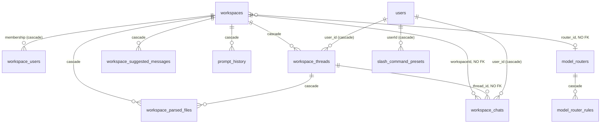

# 02 - Workspaces, threads and the chat pipeline (CHAT)

Covers the workspace and thread lifecycles, workspace-level chat settings (chat mode, provider/model,
model router, system prompt and its history, suggested messages), per-user slash command presets,
system prompt variables, the web UI chat pipeline from `POST /api/workspace/:slug/stream-chat` to the
saved `workspace_chats` row, chat history read/hide/edit/regenerate/feedback/export, message TTS, and
model router CRUD plus its in-memory decision caches. It stops at the agent hand-off (the agent run
itself is the AGENT file), at document upload/embedding/pinning mechanics (DOC), at authentication
middleware internals (AUTH) and at admin user/workspace management screens (ADMIN). The developer API
(`/v1`), OpenAI-compatible and embed chat handlers reuse parts of this pipeline but are not traced here.

**Sources:** `server/endpoints/chat.js`, `server/endpoints/workspaces.js`,
`server/endpoints/workspaceThreads.js`, `server/endpoints/modelRouter.js`, `server/endpoints/system.js`
(chat, preset, variable, export routes), `server/endpoints/utils.js` (`/export-chat`),
`server/endpoints/admin.js:276-293`, `server/utils/chats/{stream,index,agents}.js`,
`server/utils/chats/commands/{reset,img}.js`, `server/utils/helpers/index.js`,
`server/utils/helpers/{reasoningEffort,abortSignals}.js`, `server/utils/helpers/chat/{responses,convertTo}.js`,
`server/utils/helpers/modelPricing/index.js`, `server/utils/router/index.js`,
`server/utils/AiProviders/modelRouter/index.js`, `server/utils/memories/index.js`,
`server/utils/DocumentManager/index.js`, `server/utils/TextToSpeech/messageToSpeech.js`,
`server/utils/middleware/{validWorkspace,workspaceDeletionProtection,chatHistoryViewable,multiUserProtected}.js`,
`server/models/{workspace,workspaceThread,workspaceChats,systemPromptVariables,slashCommandsPresets,workspacesSuggestedMessages,promptHistory,modelRouter,modelRouterRule,workspaceParsedFiles,memory,user}.js`,
`server/prisma/schema.prisma`, and the frontend callers in
`frontend/src/components/WorkspaceChat/ChatContainer/{index.jsx,ChatHistory/index.jsx}`.
All routes below are mounted under `/api` (`server/index.js:98-106`).

---

## 1. Mental model

### Actors

| Actor | How identified | Scope rules |
|---|---|---|
| Single-user owner | No user row. `user` is `null` everywhere | Every role gate passes (`multiUserProtected.js:67-74`). Every `user_id` filter becomes `null` or `undefined` |
| `default` user (multi-user) | Session user | Sees only workspaces with a `workspace_users` row (`workspace.js:294-312`, `415-436`) |
| `manager` / `admin` (multi-user) | Session user | **Bypass workspace membership**: `getWithUser` and `whereWithUser` return any workspace (`workspace.js:295-296`, `421-422`). Admins also bypass the daily chat limit (`user.js:381`) |
| LLM provider / router classifier | Outbound | Gets the assembled prompt; the router classifier also gets the raw prompt (`router/index.js:490`) |

### Resources and ownership



(Relations from `schema.prisma:121-220`, `280-290`, `351-386`, `463-487`.) `workspace_chats` has no FK
to `workspaces` or `workspace_threads` (`schema.prisma:182-195`), so code has to clean those rows up by hand.
`workspaces.router_id` has no FK either (`schema.prisma:142`).

### Invariants the code relies on

1. **A chat row is a (prompt, response) pair.** One `workspace_chats` row holds both the user prompt and
   a JSON `response` (`text`, `sources`, `type`, `attachments`, `metrics`, `outputs`) (`stream.js:358-371`).
2. **`include` is the visibility bit, and rows are not deleted.** Reset, delete, edit-truncate and
   thread delete set `include=false` and keep the row, "so that it still counts towards the user's daily
   message limit" (`workspaces.js:497-504`, `workspaceThread.js:95-103`). Hard deletes happen only on
   workspace delete (`workspaces.js:320`) and admin chat delete (`system.js:1224-1226`).
3. **Conversation key = (workspaceId, user_id, thread_id, api_session_id).** History, counting and
   routing all use this tuple (`chats/index.js:90-101`, `router/index.js:413-418`). `thread_id=null` is the
   workspace's "default thread".
4. **A thread belongs to exactly one workspace and one user (or null in single-user mode).** Every
   thread lookup in the UI channel filters on `user_id` *as well as* workspace (`validWorkspace.js:35-39`).
   This holds **even for admins**: an admin cannot open another user's thread through chat endpoints.
5. **Slugs are globally unique.** Both `workspaces.slug` and `workspace_threads.slug` are `@unique`
   (`schema.prisma:124`, `157`). Thread slugs are UUIDs unless one is supplied (`workspaceThread.js:40-42`).
6. **`chatProvider === "anythingllm-router"` means `router_id` is in effect; any other provider clears
   `router_id`** (`workspace.js:262-268`).

### Patterns

- **Chat request = staged pipeline with early exits** (section 1.1). Each stage can end the request by
  writing a terminal SSE chunk (`close: true`).
- **Model router = rules engine + two cache-aside layers** (router config cache, then per-conversation
  sticky route and LLM-classification caches), invalidated by key on admin edits (section 5.4).
- **Slash commands = small registry** (`VALID_COMMANDS`, `chats/index.js:9-12`) plus per-user textual
  macro expansion (presets).

### 1.1 The chat pipeline (web UI)

```mermaid
flowchart TD
  A[S0 Admission<br/>chat.js] -->|empty msg| X0[400 abort]
  A -->|quota hit| X1[SSE abort]
  A --> B[S1 Command intercept<br/>grepCommand]
  B -->|/reset, /img| X2[command handler, SSE, return]
  B --> C[S2 Agent hand-off<br/>grepAgents]
  C -->|@agent or automatic+native tools| X3[agentInitWebsocketConnection, return]
  C --> D[S3 Connector resolution<br/>resolveProviderConnector / router]
  D -->|router error| X4[SSE abort]
  D --> E[S4 Abort wiring + route notice]
  E --> F[S5 Empty-workspace query gate]
  F -->|query mode, 0 vectors| X5[refusal saved include=false]
  F --> G[S6 Context assembly<br/>history, pinned, parsed files, vector search, backfill]
  G -->|search error| X6[SSE abort]
  G --> H[S7 No-context query gate]
  H -->|query mode, no context| X7[refusal saved include=false]
  H --> I[S8 Pre-save prompt row]
  I --> J[S9 Prompt build<br/>system prompt vars + memories, compressMessages]
  J --> K[S10 Inference + cost metrics]
  K --> L[S11 Finalize row + finalizeResponseStream]
  L --> M[S12 Post: thread auto-rename, telemetry, event log, end]
```

| Stage | Code | Inputs | Outputs | Side effects |
|---|---|---|---|---|
| S0 Admission | `chat.js:23-64` / `110-156` | body `message`, `attachments`, `reasoningEffort`; `response.locals.workspace` (+`thread`) | SSE headers flushed (`chat.js:48-52`) | DB read (24h count, `user.js:385-390`); `WS` abort chunk on quota |
| S1 Command intercept | `stream.js:38-52`, `chats/index.js:25-56` | raw message, user | built-in command name **or** message with the user's presets expanded | `/reset`: DB + CACHE; `/img`: NET + FS + DB (P-CHAT-12/13) |
| S2 Agent hand-off | `stream.js:55-65`, `agents.js:56-130` | expanded message, `workspace.chatMode` | `true` (stop) or falsy | DB `workspace_agent_invocations` row; CACHE attachments/effort maps; `WS` chunks |
| S3 Connector resolution | `stream.js:67-89`, `398-422`, `helpers/index.js:726-796` | workspace, message, user, thread, attachments | `connector`, `routingMetadata`, `prefetchedContext` | Router path only: CACHE, DB reads, possible `NET:llm-provider` classification call |
| S4 Abort wiring | `stream.js:93-101` | response, connector | provider aborted when client closes | `WS` `modelRouteNotification` chunk when route changed |
| S5 Empty-workspace gate | `stream.js:103-138` | VectorDb namespace existence and count | refusal text | `VEC` read; DB `workspace_chats` row `include=false` |
| S6 Context assembly | `stream.js:150-240` | history (limit `openAiHistory`, default 20), pinned docs, parsed files, similarity search (`topN`, `similarityThreshold`, `vectorSearchMode`) | `contextTexts[]`, `sources[]`, `rawHistory`, `chatHistory` | FS reads; `VEC` read; `NET:embedder` for query embedding (unverified: depends on embedder) |
| S7 No-context gate | `stream.js:244-271` | `chatMode`, `contextTexts` | refusal | DB row `include=false` |
| S8 Pre-save | `stream.js:275-287` | prompt, thread, user | `chat.id` | DB `workspace_chats` row created (`include=true`, `text:""`); `WS` `promptChatId` |
| S9 Prompt build | `stream.js:292-312`, `chats/index.js:122-144` | `openAiPrompt` (or default), variables, memories, context, history, attachments | provider-formatted `messages`, `reasoningEffort` | DB `memories.lastUsedAt` (`memories/index.js:51`, not awaited) |
| S10 Inference | `stream.js:316-355` | messages | `completeText`, `metrics` (with cost) | `NET:llm-provider`; `WS` chunks |
| S11 Finalize | `stream.js:357-395` | completeText, sources, metrics | final chunk with `chatId` | DB upsert of the S8 row (`workspaceChats.js:350-388`) |
| S12 Post | `chat.js:76-94`, `170-205` | thread, prompt | thread rename `action` chunk | DB `workspace_threads.name`; `TEL`; `LOG` `event_logs` `sent_chat` |

**Chat modes.** `Workspace.VALID_CHAT_MODES = ["chat","query","automatic"]` (`workspace.js:36`). The DB
column defaults to `"chat"` (`schema.prisma:135`), but `Workspace.new` forces `"automatic"`
(`workspace.js:224`) and an invalid value on update also becomes `"automatic"` (`workspace.js:96-100`).
- `query`: S5 and S7 refuse instead of answering when there is no context (`stream.js:111`, `244`).
- `automatic`: S2 sends **every message** to the agent flow when the workspace's agent provider/model
  (fallback: chat provider/model, then the system default) supports native tool calling
  (`agents.js:70-71`, `workspace.js:666-708`). For a routed workspace, the router's *fallback* model is
  the proxy (`workspace.js:678-696`). Otherwise `automatic` behaves exactly like `chat` in stream.js,
  which only tests for `"query"`.
- `chat`: answers with or without context.

---

## 2. Entry points

| ID | Channel | Method + path | Middleware chain | Handler (path:line) | Who can call |
|---|---|---|---|---|---|
| E-CHAT-01 | ui | POST `/workspace/new` | validatedRequest, flexUserRoleValid([admin, manager]) | `server/endpoints/workspaces.js:54` | SU: any; MU: admin, manager |
| E-CHAT-02 | ui | POST `/workspace/:slug/update` | validatedRequest, flexUserRoleValid([admin, manager]) | `workspaces.js:90` | SU any; MU admin, manager |
| E-CHAT-03 | ui | DELETE `/workspace/:slug` | validatedRequest, flexUserRoleValid([admin, manager]), workspaceDeletionProtection | `workspaces.js:299` | SU any; MU admin, manager; blocked if `WORKSPACE_DELETION_PROTECTION` set |
| E-CHAT-04 | ui | GET `/workspaces` | validatedRequest, flexUserRoleValid([all]) | `workspaces.js:387` | all (membership-filtered for default) |
| E-CHAT-05 | ui | GET `/workspace/:slug` | validatedRequest, flexUserRoleValid([all]) | `workspaces.js:405` | all (membership-filtered) |
| E-CHAT-06 | ui | GET `/workspace/:slug/llm-capabilities` | validatedRequest, all, validWorkspaceSlug | `workspaces.js:424` | all members |
| E-CHAT-07 | ui | GET `/workspace/:slug/chats` | validatedRequest, all | `workspaces.js:450` | all members |
| E-CHAT-08 | ui | DELETE `/workspace/:slug/delete-chats` | validatedRequest, all, validWorkspaceSlug | `workspaces.js:477` | all members |
| E-CHAT-09 | ui | DELETE `/workspace/:slug/delete-edited-chats` | validatedRequest, all, validWorkspaceSlug | `workspaces.js:514` | all members |
| E-CHAT-10 | ui | POST `/workspace/:slug/update-chat` | validatedRequest, all, validWorkspaceSlug | `workspaces.js:544` | all members |
| E-CHAT-11 | ui | POST `/workspace/:slug/chat-feedback/:chatId` | validatedRequest, all, validWorkspaceSlug | `workspaces.js:586` | all members |
| E-CHAT-12 | ui | GET `/workspace/:slug/suggested-messages` | validatedRequest, all, validWorkspaceSlug | `workspaces.js:610` | all members |
| E-CHAT-13 | ui | POST `/workspace/:slug/suggested-messages` | validatedRequest, flexUserRoleValid([admin, manager]) | `workspaces.js:628` | SU any; MU admin, manager (no slug middleware) |
| E-CHAT-14 | ui | GET `/workspace/:slug/tts/:chatId` | validatedRequest, all, validWorkspaceSlug | `workspaces.js:684` | all members (own chats) |
| E-CHAT-15 | ui | POST `/workspace/:slug/thread/fork` | validatedRequest, all, validWorkspaceSlug | `workspaces.js:732` | all members |
| E-CHAT-16 | ui | PUT `/workspace/workspace-chats/:id` | validatedRequest, all | `workspaces.js:808` | all (own chats) |
| E-CHAT-17 | ui | GET/DELETE `/workspace/:slug/prompt-history`, DELETE `/workspace/:slug/prompt-history/:id` | validatedRequest, flexUserRoleValid([admin, manager]), validWorkspaceSlug | `workspaces.js:944`, `965`, `986` | SU any; MU admin, manager |
| E-CHAT-18 | ui | POST `/workspace/search` | validatedRequest, all | `workspaces.js:1013` | all |
| E-CHAT-19 | ui | GET `/workspace/:slug/is-agent-command-available` | validatedRequest, all, validWorkspaceSlug | `workspaces.js:1091` | all members |
| E-CHAT-20 | ui | POST `/workspace/:slug/stream-chat` (SSE) | validatedRequest, all, validWorkspaceSlug | `server/endpoints/chat.js:23` | all members |
| E-CHAT-21 | ui | POST `/workspace/:slug/thread/:threadSlug/stream-chat` (SSE) | validatedRequest, all, validWorkspaceAndThreadSlug | `chat.js:110` | thread owner |
| E-CHAT-22 | ui | POST `/workspace/:slug/thread/new` | validatedRequest, all, validWorkspaceSlug | `server/endpoints/workspaceThreads.js:27` | all members |
| E-CHAT-23 | ui | GET `/workspace/:slug/threads` | validatedRequest, all, validWorkspaceSlug | `workspaceThreads.js:66` | all members (own threads) |
| E-CHAT-24 | ui | DELETE `/workspace/:slug/thread/:threadSlug` | validatedRequest, all, validWorkspaceAndThreadSlug | `workspaceThreads.js:94` | thread owner |
| E-CHAT-25 | ui | DELETE `/workspace/:slug/thread-bulk-delete` | validatedRequest, all, validWorkspaceSlug | `workspaceThreads.js:113` | own threads |
| E-CHAT-26 | ui | GET `/workspace/:slug/thread/:threadSlug/chats` | validatedRequest, all, validWorkspaceAndThreadSlug | `workspaceThreads.js:136` | thread owner |
| E-CHAT-27 | ui | POST `/workspace/:slug/thread/:threadSlug/update` | validatedRequest, all, validWorkspaceAndThreadSlug | `workspaceThreads.js:168` | thread owner |
| E-CHAT-28 | ui | DELETE `/workspace/:slug/thread/:threadSlug/delete-edited-chats` | validatedRequest, all, validWorkspaceAndThreadSlug | `workspaceThreads.js:191` | thread owner |
| E-CHAT-29 | ui | POST `/workspace/:slug/thread/:threadSlug/update-chat` | validatedRequest, all, validWorkspaceAndThreadSlug | `workspaceThreads.js:226` | thread owner |
| E-CHAT-30 | ui | GET/POST `/system/slash-command-presets`, POST/DELETE `/system/slash-command-presets/:slashCommandId` | validatedRequest, all | `server/endpoints/system.js:1301`, `1316`, `1354`, `1400` | all (own presets) |
| E-CHAT-31 | ui | GET `/system/prompt-variables` | validatedRequest, all | `system.js:1427` | all |
| E-CHAT-32 | ui | POST/PUT/DELETE `/system/prompt-variables[/:id]` | validatedRequest, flexUserRoleValid([admin]) | `system.js:1445`, `1481`, `1523` | SU any; MU admin |
| E-CHAT-33 | ui | POST `/export-chat/:type` | validatedRequest, all | `server/endpoints/utils.js:38` | all (own chats) |
| E-CHAT-34 | ui | GET `/system/export-chats` | chatHistoryViewable, validatedRequest, flexUserRoleValid([manager, admin]) | `system.js:1235` | SU any; MU admin, manager |
| E-CHAT-35 | ui | POST `/system/workspace-chats`; DELETE `/system/workspace-chats/:id` | list: chatHistoryViewable, validatedRequest, [admin, manager]; delete: validatedRequest, [admin, manager] | `system.js:1189`, `1218` | SU any; MU admin, manager |
| E-CHAT-36 | ui | GET `/model-routers`, GET `/model-routers/:id`, POST `/model-routers/new`, PUT/DELETE `/model-routers/:id` | validatedRequest, flexUserRoleValid([admin]) | `server/endpoints/modelRouter.js:15`, `29`, `52`, `74`, `92` | SU any; MU admin |
| E-CHAT-37 | ui | POST `/model-routers/:id/rules/new`, PUT `/model-routers/:id/rules/reorder`, PUT/DELETE `/model-routers/:id/rules/:ruleId` | validatedRequest, flexUserRoleValid([admin]) | `modelRouter.js:112`, `138`, `162`, `183` | SU any; MU admin |
| E-CHAT-38 | ui | POST `/admin/workspaces/:workspaceId/update-users` | validatedRequest, strictMultiUserRoleValid([admin, manager]) | `server/endpoints/admin.js:276` | MU admin, manager only |

SU = single-user mode, MU = multi-user mode. "all members" means `ROLES.all` plus a `validWorkspaceSlug`
membership check (`validWorkspace.js:6-20`). Admins and managers count as members of every workspace.

---

## 3. User paths

### P-CHAT-01 List and open workspaces
- **Actor and preconditions:** any authenticated caller.
- **Steps:** UI `/workspace/:slug` (`frontend/src/main.jsx:48`) → GET `/workspaces` (`workspaces.js:387`) →
  `Workspace.whereWithUser(user)` in MU (`workspace.js:415-442`) or `Workspace.where()` in SU
  (`workspace.js:401`). GET `/workspace/:slug` (`workspaces.js:405`) → `getWithUser` / `get`
  (`workspace.js:294`, `366`), which add `contextWindow` and `currentContextTokenCount` (`workspace.js:376-382`).
- **Reads:** `workspaces`, `workspace_users`, `workspace_documents`, `workspace_parsed_files`.
- **State changes:** none.
- **Side effects:** none.
- **Failure and edge paths:** GET `/workspace/:slug` with no access returns **200 with `workspace: null`**,
  not 404 (`workspaces.js:412-416`).
- **Notes:** admin/manager bypass membership (`workspace.js:295`, `421`).

### P-CHAT-02 Create workspace
- **Actor and preconditions:** SU any; MU admin or manager.
- **Steps:** POST `/workspace/new` (`workspaces.js:54`) → `Workspace.new(name, user?.id)`
  (`workspace.js:199-239`): slugify; on collision, retry once with a random 8-digit suffix (`workspace.js:204-208`);
  system prompt = `default_system_prompt` system setting, or else the built-in default (`workspace.js:211-218`);
  `chatMode: "automatic"` (`workspace.js:224`); if there is a creator, add a `workspace_users` row (`workspace.js:233`).
- **Reads:** `workspaces` (slug), `system_settings`.
- **State changes:** `workspaces` row created; `workspace_users` row created when there is a creator.
- **Side effects:** SE-CHAT-01, SE-CHAT-02, SE-CHAT-03.
- **Failure and edge paths:** a missing `name` gives `{workspace:null, message:"name cannot be null"}` with
  HTTP 200 (`workspace.js:200`, `workspaces.js:82`). Telemetry and the event log run even when creation
  failed (`workspaces.js:62-81`).
- **Notes:** the second slug attempt is not re-checked for collisions. A unique-constraint failure then
  returns the error message (`workspace.js:235-237`).

### P-CHAT-03 Update workspace settings (chat mode, provider/model, router, system prompt, retrieval knobs)
- **Actor and preconditions:** SU any; MU admin or manager.
- **Steps:** UI `/workspace/:slug/settings/:tab` (`main.jsx:39`) → POST `/workspace/:slug/update`
  (`workspaces.js:90`) → `Workspace.trackChange` (`workspace.js:509-558`) → `Workspace.update`
  (`workspace.js:247-271`) → `validateFields` against `writable` (`workspace.js:41-59`, `178-190`).
- **Reads:** `workspaces`.
- **State changes:** any of `name, openAiTemp, openAiHistory, lastUpdatedAt, openAiPrompt,
  similarityThreshold, chatProvider, chatModel, topN, chatMode, agentProvider, agentModel,
  queryRefusalResponse, vectorSearchMode, router_id`. Coupling rules: `chatProvider:"default"` →
  `chatProvider=null, chatModel=null` (`workspace.js:257-260`); `chatProvider:"anythingllm-router"` →
  `chatModel=null` (`workspace.js:264-265`); any other `chatProvider` in the body → `router_id=null`
  (`workspace.js:266-267`). A prompt change from one non-default prompt to a different one creates a
  `prompt_history` row holding the **previous** prompt (`workspace.js:530-536`, `promptHistory.js:113-123`).
- **Side effects:** SE-CHAT-04, SE-CHAT-05, SE-CHAT-06.
- **Failure and edge paths:** an unknown slug or no access gives a bare 400 (`workspaces.js:102-105`). Prisma
  errors return `{workspace:null, message}` with HTTP 200 (`workspace.js:288-291`).
- **Notes:** `router_id` is not checked for existence (`workspace.js:134-139`). A dangling id makes every
  later chat fail at S3 (P-CHAT-15). `event_logs` stores the full previous and new system prompt text
  (`workspace.js:548-555`). The model router's `workspace:*` caches are not invalidated by a workspace
  edit; they are keyed by router id (section 5.4).

### P-CHAT-04 Delete workspace
- **Actor and preconditions:** SU any; MU admin or manager; `WORKSPACE_DELETION_PROTECTION` not present
  in env (`workspaceDeletionProtection.js:8-14`).
- **Steps:** DELETE `/workspace/:slug` (`workspaces.js:299`) → `WorkspaceChats.delete({workspaceId})`
  (`workspaces.js:320`) → `DocumentVectors.deleteForWorkspace` (`:321`) → `Document.delete` (`:322`) →
  `Workspace.delete` (`:323`) → event log (`:325-331`) → `VectorDb["delete-namespace"]` (`:333-337`).
- **Reads:** `workspaces`.
- **State changes:** `workspace_chats` rows **hard deleted**; `document_vectors`, `workspace_documents` and
  `workspaces` rows deleted; cascades remove `workspace_threads`, `workspace_users`,
  `workspace_suggested_messages`, `workspace_agent_invocations`, `embed_configs`, `prompt_history`,
  `workspace_parsed_files`, `memories` (`schema.prisma:162`, `177`, `209`, `220`, `251`, `353`, `386`, `442`).
- **Side effects:** SE-CHAT-07, SE-CHAT-08, SE-CHAT-09, SE-CHAT-10.
- **Failure and edge paths:** the steps run one after another with no transaction. A failure midway leaves
  partial state; each model swallows its own error (for example `workspace.js:389-399`). A vector
  namespace delete error is only logged (`workspaces.js:335-337`).
- **Notes:** the hard delete of chats removes them from the 24h quota count (`user.js:385-390`), which
  contradicts the "hide, don't delete" design in invariant 2. Parsed-file JSON on disk under the direct
  uploads folder is not removed here (unverified; DOC owns that path). The in-memory TTS cache entries
  for the slug are not evicted (`workspaces.js:52`).

### P-CHAT-05 Workspace membership (admin)
- **Actor and preconditions:** MU admin or manager (`strictMultiUserRoleValid`).
- **Steps:** POST `/admin/workspaces/:workspaceId/update-users` (`admin.js:276-293`) →
  `Workspace.updateUsers` (`workspace.js:498-507`): delete all `workspace_users` rows for the workspace,
  then `createManyUsers`.
- **State changes:** `workspace_users`: all rows deleted → new set created.
- **Side effects:** SE-CHAT-11.
- **Failure and edge paths:** delete and create are not in a transaction. A failed create leaves the
  workspace with **no members** (`workspace.js:500-501`).
- **Notes:** removing a member does not hide or delete their threads or chats. If they are re-added,
  everything reappears. Details are in the ADMIN file.

### P-CHAT-06 Suggested messages
- **Actor and preconditions:** read: any member; write: SU any / MU admin or manager.
- **Steps:** GET `/workspace/:slug/suggested-messages` (`workspaces.js:610`) →
  `WorkspaceSuggestedMessages.getMessages(slug)` (`workspacesSuggestedMessages.js:59`). POST
  (`workspaces.js:628`) → `saveAll(messages, slug)`: `deleteMany`, then a `create` per message
  (`workspacesSuggestedMessages.js:29-56`).
- **State changes:** `workspace_suggested_messages` replaced wholesale.
- **Side effects:** SE-CHAT-12.
- **Failure and edge paths:** `saveAll` swallows errors (`workspacesSuggestedMessages.js:54-56`), so the
  endpoint returns 200 "saved successfully" even for an unknown slug or a failed insert
  (`workspaces.js:642-646`). A failure midway leaves a partial list (no transaction).
- **Notes:** `heading` and `message` are not validated.

### P-CHAT-07 Prompt history
- **Actor and preconditions:** SU any; MU admin or manager.
- **Steps:** GET/DELETE `/workspace/:slug/prompt-history` (`workspaces.js:944`, `965`) and DELETE `/:id`
  (`:986`) → `Workspace.promptHistory` / `deleteAllPromptHistory` / `deletePromptHistory`
  (`workspace.js:620-659`). The single delete is scoped to `{id, workspaceId}` (`promptHistory.js:95-98`).
- **State changes:** `prompt_history` rows deleted.
- **Side effects:** SE-CHAT-13.
- **Notes:** rows are written only by P-CHAT-03.

### P-CHAT-08 System prompt variables (CRUD and expansion)
- **Actor and preconditions:** list: all; write: SU any / MU admin.
- **Steps:** `system.js:1427-1545` → `SystemPromptVariables.getAll/create/update/delete`. Expansion happens
  in S9 through `chatPrompt` → `expandSystemPromptVariables(basePrompt, user?.id, workspace?.id)`
  (`chats/index.js:127-131`, `systemPromptVariables.js:240-351`). `{key}` tokens are replaced. Built-ins:
  `time`, `time_24`, `date`, `datetime`, `datetime_24`, `user.id`, `user.name`, `user.bio`,
  `workspace.id`, `workspace.name` (`systemPromptVariables.js:19-122`). `user.*` variables are dropped
  when there is no `userId` (`systemPromptVariables.js:161-163`), which leaves placeholders such as `[User name]`.
- **Reads:** `system_prompt_variables`, `users` (name, bio), `workspaces`.
- **State changes:** `system_prompt_variables` row created, updated or deleted.
- **Side effects:** SE-CHAT-14.
- **Failure and edge paths:** an expansion error returns the unexpanded prompt (`systemPromptVariables.js:347-350`).
  An unknown `{token}` is left as is (`:320`).
- **Notes:** **not per-user.** All DB variables apply to everyone. `userId` is stored but ignored on read
  (`systemPromptVariables.js:147-149`). Keys starting with `user.` are rejected (`:367-368`). The
  `user.bio` value goes straight into the system prompt.

### P-CHAT-09 Slash command presets (CRUD and expansion)
- **Actor and preconditions:** any authenticated caller; each preset belongs to its user (`userId`, or
  `uid=0` in SU, `schema.prisma:280-290`).
- **Steps:** `system.js:1301-1425`. `formatCommand` lowercases the command and replaces anything outside
  `[a-zA-Z0-9_-]` with `-` (`slashCommandsPresets.js:3-12`). A command equal to `/reset` or `/img` is
  rejected (`chats/index.js:21-23`, `system.js:1327-1332`). Update and delete check ownership with
  `{userId, id}` (`system.js:1374-1379`, `1409-1416`). Expansion happens in S1: each of the user's presets,
  where it appears at the start of the message or after a space and is not a prefix of a longer word, is
  replaced by its prompt (`chats/index.js:43-53`).
- **State changes:** `slash_command_presets` row created, updated or deleted.
- **Side effects:** SE-CHAT-15.
- **Failure and edge paths:** a duplicate `(userId, command)` on create **returns the existing preset**
  as if it had been created (201) (`slashCommandsPresets.js:42-52`).
- **Notes:** the regex is built from `preset.command` without escaping. That is safe only because
  `formatCommand` limits the character set. The API channel's `grepAllSlashCommands` expands **every
  user's** presets (`chats/index.js:63-81`); its own docstring says it is not user-scoped. The saved
  `prompt` is the original message, not the expanded one (`stream.js:126`, `276`); the expanded text is
  only sent to the LLM.

### P-CHAT-10 Send a chat in the default thread (full pipeline)
- **Actor and preconditions:** a workspace member. MU: the 24h quota is not exhausted.
- **Steps:** UI ChatContainer → POST `/workspace/:slug/stream-chat` (`chat.js:23`) → validatedRequest →
  flexUserRoleValid([all]) → validWorkspaceSlug (`validWorkspace.js:6-20`) → S0..S12 as in section 1.1
  (`stream.js:24-396`).
- **Reads:** `users` (quota count), `slash_command_presets`, `workspace_chats` (history),
  `workspace_documents` + document JSON files (pinned), `workspace_parsed_files` + JSON files,
  vector namespace, `system_prompt_variables`, `users`, `memories`, `system_settings`.
- **State changes:** S8 `workspace_chats` row created `{prompt, response:{text:"", ...}, include:true}` →
  S11 the same row gets `response.text = completeText`, `sources`, `metrics`. Query refusals instead create
  one row with `include:false` (`stream.js:124-136`, `257-269`).
- **Side effects:** SE-CHAT-16..SE-CHAT-24.
- **Failure and edge paths:**
  - Empty or non-string message: HTTP 400 JSON, no SSE (`chat.js:36-46`).
  - Quota: SSE `abort` (`chat.js:54-64`). Nothing is saved.
  - Router error: SSE `abort` "Model router error: ..." (`stream.js:80-89`). Nothing is saved.
  - Similarity search error: SSE `abort` (`stream.js:212-222`). Nothing is saved.
  - Provider throws during inference: caught at `chat.js:95-105` and sent as SSE `abort`. The S8 row
    **remains** with `include:true, text:""`. It stays visible in the thread but is skipped when the next
    prompt history is built (`responses.js:304-308`). It still counts toward the quota.
  - Empty completion: the row is not updated, and `finalizeResponseStream` has no `chatId` (`stream.js:388-394`).
  - Client disconnect: the provider request is aborted (`abortSignals.js:154-161`). Whether partial text
    is saved depends on each provider's `handleStream` (unverified).
  - If the S8 save failed, S11 falls back to `WorkspaceChats.new` (`stream.js:373-375`).
- **Notes:**
  - `contextTexts` gets pinned docs + parsed files + search results + **backfill from earlier citations**
    (`fillSourceWindow`), but `sources` (citations shown) only gets pinned + parsed + current search
    (`stream.js:224-240`).
  - Pinned docs are capped at `promptWindowLimit()` tokens on this path (`stream.js:159-164`), but not on
    the router path (P-CHAT-15).
  - Telemetry and the event log fire only when the pipeline returns normally, including for refusals,
    `/reset` and agent hand-off (`chat.js:66-94`).
  - Reasoning effort: the session value passes through `resolveReasoningEffort` (`stream.js:309-312`) and
    is set to null for routed workspaces (`stream.js:37`).
  - Cost: `addChatCostToMetrics` prices with the routed provider/model if there is one, else the
    workspace/system provider and the connector's model (`modelPricing/index.js:442-453`).

### P-CHAT-11 Send a chat in a thread (+ auto-rename)
- **Actor and preconditions:** the thread's owner (`validWorkspace.js:35-43`).
- **Steps:** POST `/workspace/:slug/thread/:threadSlug/stream-chat` (`chat.js:110`) → same pipeline with
  `thread` → `WorkspaceThread.autoRenameThread` (`chat.js:170-184`, `workspaceThread.js:149-172`):
  if `thread.name === "Thread"` and this user has exactly one chat row in the thread, rename it to the
  prompt cut to 22 characters and emit `{action:"rename_thread"}`.
- **State changes:** as P-CHAT-10 with `thread_id` set; `workspace_threads.name: "Thread" → truncate(prompt,22)`.
- **Side effects:** as P-CHAT-10 plus SE-CHAT-25.
- **Failure and edge paths:** a thread that is not the caller's gives 404 "Workspace thread does not exist."
  (plain text, before SSE).
- **Notes:** the rename uses the **raw** prompt, so a `/img ...` message or an `@agent` message names the
  thread. A refusal row (`include:false`) still counts toward the "exactly one" check because the count
  has no `include` filter (`workspaceThread.js:160-164`).

### P-CHAT-12 `/reset` command
- **Actor and preconditions:** any chatting user. The message must start with `/reset`, not followed by
  `[a-z0-9_-]` (`chats/index.js:33-39`).
- **Steps:** S1 → `resetMemory` (`commands/reset.js:3-33`) → `markThreadHistoryInvalid(workspaceId, user,
  threadId)` or `markHistoryInvalid(workspaceId, user)` (`workspaceChats.js:112-156`) →
  `ModelRouterService.resetForWorkspace` (`router/index.js:191-207`).
- **State changes:** `workspace_chats.include: true → false` for this user's default thread (excluding
  API-session rows) or for this thread. Router sticky, LLM-cache and last-notified entries for this
  conversation key are deleted.
- **Side effects:** SE-CHAT-26, SE-CHAT-27.
- **Notes:** the `/reset` itself is not saved. In SU, `user?.id` is `undefined` and Prisma ignores it, so
  every default-thread row in the workspace is hidden (fine, since there is only one user). The router
  reset runs only when `workspace.router_id` is set (`router/index.js:192`), so a workspace routed through
  the system-wide `MODEL_ROUTER_ID` (`helpers/index.js:757-764`) keeps its sticky route after `/reset`.

### P-CHAT-13 `/img` command
- **Actor and preconditions:** an image generator provider is configured (`commands/img.js:51-66`).
- **Steps:** S1 → `generateImage` (`commands/img.js:25-155`): SSE `imageGenerationPending` → edit
  (if any image attachments) or generate → `WorkspaceChats.new({..., include:true, outputs})`
  (`img.js:108-121`).
- **State changes:** `workspace_chats` row created; an image file is written under `generatedImagesPath`
  (by `ImageGenerators`, unverified).
- **Side effects:** SE-CHAT-28.
- **Failure and edge paths:** no prompt → help text (`img.js:39-48`); provider not configured → error that
  mentions admin settings (`img.js:55-65`); client abort → empty response (`img.js:135-144`). Nothing is
  saved on failure.
- **Notes:** a `storageFilename` attachment reads **any** file in the shared generated-images folder that
  matches the name pattern (`img.js:175-181`). There is no ownership check, so a user who knows another
  user's image filename can use it as an edit input (guessability unverified).

### P-CHAT-14 Agent hand-off
- **Actor and preconditions:** the message contains an agent handle such as `@agent`
  (`WorkspaceAgentInvocation.parseAgents`), **or** `chatMode === "automatic"` and the provider supports
  native tool calling (`agents.js:70-74`).
- **Steps:** S2 → `WorkspaceAgentInvocation.new` (`agents.js:75-80`) → attachments and reasoning effort
  are cached in process maps under the invocation UUID (`agents.js:14-54`, `101-103`) → SSE
  `agentInitWebsocketConnection{websocketUUID}` and a closing `statusResponse` (`agents.js:105-125`). The
  client then opens the agent websocket (AGENT file).
- **State changes:** `workspace_agent_invocations` row created.
- **Side effects:** SE-CHAT-29.
- **Failure and edge paths:** if the invocation cannot be created, a `statusResponse` with `close:true`
  says the chat "will be handled as default chat", `grepAgents` returns `undefined`, and **stream.js goes
  on with the normal pipeline** on the same response (`agents.js:82-97`, `stream.js:65`).
- **Notes:** the cached attachment and effort maps are cleared only when the websocket picks them up
  (`agents.js:32-36`, `50-54`). An abandoned invocation leaks its entries (unverified: no sweeper seen).
  The 24h quota is checked once at S0. Later agent turns over the websocket are an AGENT concern.

### P-CHAT-15 Model-routed chat
- **Actor and preconditions:** `workspace.chatProvider` (or `LLM_PROVIDER`) is `"anythingllm-router"`,
  and `workspace.router_id` (or `MODEL_ROUTER_ID`) points at an existing router.
- **Steps:** S3 `resolveProviderConnector` (`helpers/index.js:737-796`) → `ModelRouterService.gatherRoutingContext`
  (`router/index.js:347-434`) prefetches history, system prompt, pinned docs, parsed files, token count and
  the true message count → `AnythingLLMModelRouter.resolve` (`AiProviders/modelRouter/index.js:39-120`):
  (1) calculated rules, (2) LLM rules (classification result cached), (3) sticky route, (4) fallback →
  `#finalize` instantiates the delegate provider and wraps `getChatCompletion` / `handleStream` so the
  sticky timestamp is refreshed when inference ends (`index.js:122-172`). stream.js then reuses
  `prefetchedContext` (`stream.js:150-156`, `292-297`).
- **Reads:** `model_routers`, `model_router_rules` (via the cache), plus the P-CHAT-10 reads.
- **State changes:** none in the DB. In-process caches change (section 5.4).
- **Side effects:** SE-CHAT-30, SE-CHAT-31, SE-CHAT-32.
- **Failure and edge paths:** missing router → "No model router found for this workspace." → S3 abort
  (`index.js:43`, `stream.js:80-89`). DB error loading the router → the cache entry is dropped so the next
  request retries (`router/index.js:86-90`). An invalid user regex in a rule evaluates as no match
  (`router/index.js:639-643`); rule input is capped at 10,000 characters (`:29`, `:641`).
- **Notes:**
  - Routing runs **before** the query-mode gates, so an empty query-mode workspace can still trigger an
    LLM classification call (`stream.js:72` vs `:111`).
  - Prefetched pinned docs have **no token cap**: `new DocumentManager({workspace})` with no `maxTokens`
    becomes `Infinity` (`router/index.js:380`, `DocumentManager/index.js:13`). The non-router path caps
    them (`stream.js:161-164`).
  - The conversation key is `${userId||0}:${workspaceSlug}:${threadSlug||"default"}`
    (`router/index.js:134-136`). All SU traffic shares user `0`.
  - `modelRouteNotification` is sent when the routed model changes (`router/index.js:275-312`,
    `stream.js:95-101`).

### P-CHAT-16 Read chat history
- **Actor and preconditions:** a member (default thread) or the thread owner.
- **Steps:** default: GET `/workspace/:slug/chats` (`workspaces.js:450`) → `forWorkspaceByUser`
  (MU, `workspaceChats.js:33-57`) or `forWorkspace` (SU, `:85-107`) → `convertToChatHistory`. Thread:
  GET `/workspace/:slug/thread/:threadSlug/chats` (`workspaceThreads.js:136-166`).
- **Reads:** `workspace_chats` where `thread_id` matches (null for the default thread),
  `api_session_id=null`, `include=true`.
- **State changes / side effects:** none.
- **Notes:** a MU caller with no user id gets `[]` (`workspaceChats.js:39`). Admins see only **their own**
  chats here. The cross-user view is P-CHAT-26.

### P-CHAT-17 Delete messages / regenerate
- **Actor and preconditions:** the chat's owner. MU: quota not exhausted (`workspaces.js:487-488`).
- **Steps:** regenerate in the UI (`ChatContainer/index.jsx:260-281`) → DELETE `/workspace/:slug/delete-chats`
  `{chatIds}` (`workspaces.js:477-512`) → `markThreadHistoryInvalidV2({id in chatIds, user_id, workspaceId})`
  → the UI then resends the last user prompt through stream-chat (P-CHAT-10/11).
- **State changes:** `workspace_chats.include: true → false` for the listed ids the user owns.
- **Side effects:** SE-CHAT-33.
- **Failure and edge paths:** 429 when over quota, so the UI does not hide a reply it cannot regenerate.
- **Notes:** one route serves both the default thread and threads (no thread filter, `workspaces.js:495-497`).
  Regenerate creates a new row; the old row stays hidden and keeps counting toward the quota.

### P-CHAT-18 Edit a message (user or assistant)
- **Actor and preconditions:** the chat's owner.
- **Steps (UI, `ChatHistory/index.jsx:55-110`):**
  - Assistant edit, or user "save only": POST `update-chat` (default `workspaces.js:544-584`; thread
    `workspaceThreads.js:226-271`) → `_update` of `response.text` or `prompt`.
  - User edit + resend: DELETE `delete-edited-chats {startingId}` (default `workspaces.js:514-542`; thread
    `workspaceThreads.js:191-224`) hides every row with `id >= startingId` → UI resends the edited text.
- **State changes:** `workspace_chats.prompt` or `.response.text` replaced, `lastUpdatedAt` bumped
  (`workspaceChats.js:289-305`); or `include: true → false` for the truncated tail.
- **Side effects:** SE-CHAT-34.
- **Failure and edge paths:** an empty edit or an unknown chat throws, which gives a bare 500
  (`workspaces.js:550-561`, `579-581`). `delete-edited-chats` returns 429 when over quota.
- **Notes:** the default-thread `update-chat` pins `thread_id: null`, so thread chats must use the thread
  route (`workspaces.js:555-560`). No edit history is kept. The TTS cache is keyed by chat id and is
  **not** invalidated, so audio for an edited assistant message is stale until the process restarts
  (`workspaces.js:692-707`).

### P-CHAT-19 Feedback (thumbs)
- **Steps:** POST `/workspace/:slug/chat-feedback/:chatId {feedback}` (`workspaces.js:586-608`) → ownership
  check `{id, workspaceId, user_id}` → `updateFeedbackScore` (`workspaceChats.js:268-284`).
- **State changes:** `workspace_chats.feedbackScore: any → (null | feedback==1)`.
- **Side effects:** SE-CHAT-35.

### P-CHAT-20 Hide a single chat by id
- **Steps:** PUT `/workspace/workspace-chats/:id` (`workspaces.js:808-831`) → ownership by
  `{id, user_id: user?.id ?? null}` → `_update({include:false})`.
- **State changes:** `workspace_chats.include: true → false`.
- **Side effects:** SE-CHAT-36.
- **Notes:** there is no workspace scope, only user scope. That is enough for ownership.

### P-CHAT-21 Create and list threads
- **Steps:** POST `/workspace/:slug/thread/new` (`workspaceThreads.js:27-64`) → `WorkspaceThread.new(workspace,
  user?.id)` (`workspaceThread.js:35-53`), name "Thread", UUID slug. GET `/workspace/:slug/threads`
  (`workspaceThreads.js:66-92`) lists the user's threads plus a visible default-thread chat count.
- **State changes:** `workspace_threads` row created.
- **Side effects:** SE-CHAT-37.

### P-CHAT-22 Rename a thread
- **Steps:** POST `/workspace/:slug/thread/:threadSlug/update` (`workspaceThreads.js:168-189`) →
  `WorkspaceThread.update` (`workspaceThread.js:55-77`). Only `name` is writable.
- **State changes:** `workspace_threads.name` changes.
- **Side effects:** SE-CHAT-38.
- **Notes:** the name has no type or length validation.

### P-CHAT-23 Delete a thread / bulk delete
- **Steps:** DELETE `/workspace/:slug/thread/:threadSlug` (`workspaceThreads.js:94-111`) or
  `/thread-bulk-delete {slugs}` (`:113-134`, scoped by `user_id` and `workspace_id`) →
  `WorkspaceThread.delete` (`workspaceThread.js:92-113`): first hide all chats of the matched threads, then
  `deleteMany` the threads.
- **State changes:** `workspace_chats.include → false` for those `thread_id`s; `workspace_threads` rows
  deleted; `workspace_parsed_files` rows cascade (`schema.prisma:388`).
- **Side effects:** SE-CHAT-39.
- **Notes:** the hidden chat rows keep a dangling `thread_id` forever (no FK). Router sticky entries for the
  thread are not cleared.

### P-CHAT-24 Fork a thread from a message
- **Steps:** UI fork → POST `/workspace/:slug/thread/fork {chatId, threadSlug}` (`workspaces.js:732-806`):
  resolve the source thread by slug + workspace (**not** by user, `:745-752`) → select the caller's
  visible, non-API chats with `id <= chatId` (`:753-764`) → `WorkspaceThread.new` → `bulkCreate` the
  copies (`workspaceChats.js:333-349`) → rename the thread to the last response cut to 22 characters,
  thinking stripped (`:771-790`) → event log.
- **State changes:** `workspace_threads` row created; N `workspace_chats` rows created; thread name set.
- **Side effects:** SE-CHAT-40.
- **Failure and edge paths:** `bulkCreate` errors are swallowed (`workspaceChats.js:345-348`), so the
  fork can succeed with a partly copied history.
- **Notes:** the copies get a fresh `createdAt`, so **forking a long thread uses up the user's 24h quota**
  (`user.js:385-390` counts by `createdAt`) without any `canSendChat` check. Feedback scores are not
  copied. Because the source thread lookup ignores the owner but the chat query filters by `user_id`, a
  foreign `threadSlug` only gives an empty fork; no data leaks.

### P-CHAT-25 Export your own chat
- **Steps:** POST `/export-chat/:type {workspaceSlug, threadSlug}` (`utils.js:38-87`) → membership check →
  thread lookup by slug + user (no workspace filter) → visible, non-API chats for the user, workspace and
  thread → `sendChatHistoryFile` (`exportChatToFile.js:301`).
- **State changes:** none (the file streams to the client).
- **Notes:** returns 400 when there are no chats (`utils.js:74`).

### P-CHAT-26 Admin view, delete and export of all chats
- **Actor and preconditions:** SU any; MU admin or manager. View and export are blocked by
  `DISABLE_VIEW_CHAT_HISTORY` (`chatHistoryViewable.js:8-14`).
- **Steps:** POST `/system/workspace-chats` pages through `whereWithData({})` (`system.js:1189-1216`;
  N+1 workspace and user lookups at `workspaceChats.js:250-260`). DELETE `/system/workspace-chats/:id`, with
  `-1` meaning **all** rows (`system.js:1218-1233`). GET `/system/export-chats?type&chatType`
  (`system.js:1235-1261`) → `exportChatsAsType` (`convertTo.js:237-246`) → `prepareChatsForExport` with
  `whereWithData({})` (`convertTo.js:47-56`), or embed chats.
- **State changes:** delete: `workspace_chats` rows hard deleted.
- **Side effects:** SE-CHAT-41, SE-CHAT-42.
- **Notes:** the export and the list include **hidden (`include:false`) and thread chats of all users**.
  "Deleted" UI messages are still exported. The DELETE route lacks `chatHistoryViewable`, so it works even
  when viewing is disabled. CSV export guards against formula injection (`convertTo.js:230-235`).

### P-CHAT-27 Text-to-speech of a message
- **Steps:** UI → GET `/workspace/:slug/tts/:chatId` (`workspaces.js:684-730`) → ownership
  `{id, workspaceId, user_id}` → per-process `responseCache` hit (`:700-707`) → or
  `messageToSpeech(response.text)` (strips thinking, code, markdown, emoji, `messageToSpeech.js:10-61`) →
  `getTTSProvider().ttsBuffer` → cache → audio response.
- **State changes:** none in the DB.
- **Side effects:** SE-CHAT-43, SE-CHAT-44.
- **Failure and edge paths:** no text or a null buffer gives 204. A provider error gives 500 JSON.
- **Notes:** `responseCache` is an unbounded `Map` that lives as long as the process (`workspaces.js:52`).
  It is never evicted, and it is not invalidated on edit (P-CHAT-18) or delete.

### P-CHAT-28 Model router CRUD and cache invalidation
- **Actor and preconditions:** SU any; MU admin.
- **Steps:** `modelRouter.js:15-201` → `ModelRouter.{getAllWithCounts,getWithRulesAndCount,create,update,delete}`
  and `ModelRouterRule.{create,update,delete,reorderRules}`. Every mutation except router create calls
  `ModelRouterService.invalidateRouter(Number(:id))` (`modelRouter.js:83`, `103`, `129`, `153`, `174`, `194`;
  `router/index.js:112-121`), which deletes the `router:<id>` entry and clears its sticky and LLM maps.
- **State changes:** `model_routers` and `model_router_rules` rows created, updated or deleted (rules cascade
  on router delete, `schema.prisma:483`).
- **Side effects:** SE-CHAT-45, SE-CHAT-46, SE-CHAT-47.
- **Failure and edge paths:** validation errors return 400 (`modelRouter.js:64`, `82`, `126`, `173`).
- **Notes:**
  - **Rule routes do not check that `:ruleId` belongs to router `:id`.** Update and delete use only the rule
    id (`modelRouterRule.js:194-197`, `213-215`) and reorder uses only the ids in the body
    (`modelRouterRule.js:229-236`). Then `:id`'s cache is invalidated instead of the rule's real router, so
    a mismatched `:id` leaves the real router's cached rules **stale until something else invalidates them**
    (router config entries have no TTL, `router/index.js:67-106`).
  - **Router delete does not clear `workspaces.router_id`** (no FK, no cleanup: `modelRouter.js:232-243`).
    Workspaces still pointing at it fail every chat with "No model router found" (P-CHAT-15).
  - `lastNotifiedRoute` is not cleared on invalidation (`router/index.js:112-121`).

### P-CHAT-29 Search workspaces and threads
- **Steps:** POST `/workspace/search` (`workspaces.js:1013-1029`) → `searchWorkspaceAndThreads(term, user)`
  (`helpers/search.js:18-60`): workspaces through `whereWithUser`, threads filtered by `user_id`.
- **State changes / side effects:** none.

### P-CHAT-30 Capability probes
- **Steps:** GET `/workspace/:slug/llm-capabilities` (`workspaces.js:424-448`) returns reasoning options
  (always none for routed workspaces). GET `/workspace/:slug/is-agent-command-available`
  (`workspaces.js:1091-1106`) → `isAgentCommandAvailable` (`workspace.js:719-723`), which is false only in
  `automatic` mode when native tool calling is supported.
- **Side effects:** may instantiate provider classes. A network probe for tool support is possible but
  unverified (AGENT file).

### Workspace profile picture
No workspace pfp endpoint exists at this commit. `workspaces.pfpFilename` exists in the schema
(`schema.prisma:136`), but no server code reads or writes it. The only pfp routes are the user ones
(`system.js:815`, `844`, `935`), covered in AUTH/ADMIN.

---

## 4. Per-user scoping: where it holds and where it breaks

| Surface | Scope | Holds? | Evidence |
|---|---|---|---|
| Workspace visibility | membership for `default`; **all** for admin/manager | holds by design; admin/manager bypass | `workspace.js:294-296`, `421-422` |
| Thread access (chat, read, rename, delete, edit) | `user_id` + workspace | holds, **even for admins** | `validWorkspace.js:35-39` |
| Default-thread history | `user_id` (MU) | holds | `workspaceChats.js:33-57` |
| Delete/edit/feedback/TTS/hide on chat ids | `user_id` (+ workspace) | holds | `workspaces.js:500-504`, `555-560`, `594-598`, `693-697`, `815-818` |
| Fork source thread lookup | workspace only | lookup does not check owner; chat copy does, so no leak | `workspaces.js:747-750`, `756` |
| Own export thread lookup | user only | no workspace filter on the thread; chat query filters workspace | `utils.js:60-73` |
| System prompt variables | global | **not per-user** | `systemPromptVariables.js:147-149` |
| Slash presets (UI) | per user | holds | `chats/index.js:26` |
| Slash presets (API channel helper) | all users' presets | **breaks** (documented) | `chats/index.js:58-81` |
| `/img` edit by `storageFilename` | none | **breaks** (shared folder) | `commands/img.js:175-181` |
| Memories injected into the prompt | `userId` + workspace (null user in SU) | holds | `memories/index.js:31-34`; skipped when `skipMemories` (`chats/index.js:135`) |
| Admin chat list/export | everything, including hidden | by design (admin/manager) | `system.js:1189-1261`, `convertTo.js:53` |
| Router sticky/LLM cache | `${userId||0}:${ws}:${thread}` | holds per conversation; all SU traffic under `0` | `router/index.js:134-136` |
| Daily limit | `user_id`, last 24h, all rows | admins exempt; fork and workspace delete distort it | `user.js:379-393` |

In SU mode several handlers use `user?.id` (giving `undefined`, which Prisma ignores) and others use
`user?.id || null` (which filters on `IS NULL`). The results are the same today because SU rows have a
null `user_id`. After a MU→SU switch the behavior is unverified.

---

## 5. State machines

### 5.1 Workspace
| State | Transition → | Trigger | Code |
|---|---|---|---|
| (none) | created (`chatMode=automatic`, creator added as member) | E-CHAT-01 | `workspace.js:199-239` |
| created | settings updated (provider ⇄ router coupling) | E-CHAT-02 | `workspace.js:247-271` |
| any | membership replaced | E-CHAT-38 | `workspace.js:498-507` |
| any | deleted (chats hard-deleted, cascades, namespace dropped) | E-CHAT-03 | `workspaces.js:320-337` |

### 5.2 Thread
| State | → | Trigger | Code |
|---|---|---|---|
| (none) | `Thread` (default name) | E-CHAT-22, or fork E-CHAT-15 | `workspaceThread.js:35-53` |
| `Thread` | auto-named (first chat row) | E-CHAT-21 | `workspaceThread.js:149-172` |
| any | renamed | E-CHAT-27 | `workspaceThread.js:55-77` |
| any | deleted (chats hidden) | E-CHAT-24/25 | `workspaceThread.js:92-113` |

### 5.3 `workspace_chats` row
| State | → | Trigger | Code |
|---|---|---|---|
| (none) | pending: `include=true`, `text=""` | S8 | `stream.js:275-281` |
| pending | complete: `text`, `sources`, `metrics` | S11 | `stream.js:357-386` |
| pending | orphaned pending (stays visible, skipped in prompt history) | provider error or empty completion | `chat.js:95-105`, `responses.js:304-308` |
| (none) | refusal (`include=false`) | S5/S7 | `stream.js:124-136`, `257-269` |
| (none) | complete (`/img`, fork copies) | P-CHAT-13/24 | `img.js:108-121`, `workspaces.js:785` |
| visible | hidden (`include=false`) | reset, delete, edit-truncate, hide, thread delete | `workspaceChats.js:112-178`, `workspaceThread.js:101` |
| visible | edited (`prompt` or `response.text`) | E-CHAT-10/29 | `workspaces.js:563-576` |
| any | feedback set or cleared | E-CHAT-11 | `workspaceChats.js:268-284` |
| any | hard-deleted | workspace delete, admin delete | `workspaces.js:320`, `system.js:1224-1226` |

Hidden rows never become visible again through any CHAT endpoint.

### 5.4 Model router caches (`ModelRouterService` singleton, `router/index.js:25-41`)
| Cache | Key | Fill | TTL / eviction | Invalidation |
|---|---|---|---|---|
| `routerCache` (config promise + child maps) | `router:<id>` | first resolve (`:67-81`) | none (lives until invalidated); dropped on load error or not-found (`:86-96`) | `invalidateRouter(id)` on every router/rule edit (`:112-121`). An in-flight load superseded by an edit is detected and retried (`:92-93`) |
| `stickyRoutes` (per config) | conversation key | rule match (`index.js:64`, `84`), re-stamped at inference end (`index.js:164-172`) | `cooldown_seconds` (default 300s), refreshed on each hit (`router/index.js:145-167`) | `/reset` (`:191-207`), router invalidation |
| `llmCache` (per config) | conversation key | after `classifyWithLLM` (`:490-491`) | sticky window for a match; 30s for no match (`:220-243`) | same as sticky |
| `lastNotifiedRoute` (global) | conversation key | `shouldNotify` (`:275-312`) | none | `/reset` only |

---

## 6. Side-effect ledger

| ID | Trigger | Class | Target | Where (path:line) | Reversible? | Notes |
|---|---|---|---|---|---|---|
| SE-CHAT-01 | P-CHAT-02 | DB | `workspaces`, `workspace_users` | `workspace.js:221-233` | yes (delete) | |
| SE-CHAT-02 | P-CHAT-02 | TEL | `workspace_created` | `workspaces.js:62` | no | fires even on failure |
| SE-CHAT-03 | P-CHAT-02 | LOG | `event_logs` `workspace_created` | `workspaces.js:75` | no | |
| SE-CHAT-04 | P-CHAT-03 | DB | `workspaces` | `workspace.js:283` | manually | |
| SE-CHAT-05 | P-CHAT-03 | DB | `prompt_history` | `promptHistory.js:115` | yes (P-CHAT-07) | stores previous prompt |
| SE-CHAT-06 | P-CHAT-03 | TEL + LOG | `workspace_prompt_changed` (log includes full prompts) | `workspace.js:547-555` | no | |
| SE-CHAT-07 | P-CHAT-04 | DB | `workspace_chats` hard delete | `workspaces.js:320` | no | lowers quota counts |
| SE-CHAT-08 | P-CHAT-04 | DB | `document_vectors`, `workspace_documents`, `workspaces` + cascades | `workspaces.js:321-323` | no | no transaction |
| SE-CHAT-09 | P-CHAT-04 | VEC | namespace `slug` dropped | `workspaces.js:334` | no | errors swallowed |
| SE-CHAT-10 | P-CHAT-04 | LOG | `workspace_deleted` | `workspaces.js:325` | no | |
| SE-CHAT-11 | P-CHAT-05 | DB | `workspace_users` delete + create | `workspace.js:500-501` | manually | no transaction |
| SE-CHAT-12 | P-CHAT-06 | DB | `workspace_suggested_messages` replace | `workspacesSuggestedMessages.js:38-53` | no | errors swallowed |
| SE-CHAT-13 | P-CHAT-07 | DB | `prompt_history` delete | `workspace.js:636-659` | no | |
| SE-CHAT-14 | P-CHAT-08 | DB | `system_prompt_variables` | `system.js:1460`, `1496`, `1529` | yes | global effect on every prompt |
| SE-CHAT-15 | P-CHAT-09 | DB | `slash_command_presets` | `system.js:1340`, `1387`, `1418` | yes | |
| SE-CHAT-16 | P-CHAT-10 S0..S11 | WS | SSE chunks to client | `responses.js:354-361` | n/a | dropped after client close |
| SE-CHAT-17 | P-CHAT-10 S5/S7 | DB | `workspace_chats` refusal row `include=false` | `stream.js:124`, `257` | no | counts toward quota |
| SE-CHAT-18 | P-CHAT-10 S8 | DB | `workspace_chats` pending row | `stream.js:275` | hide only | survives failures |
| SE-CHAT-19 | P-CHAT-10 S6 | NET:embedder | query embedding for similarity search | `stream.js:196-204` | n/a | (unverified: embedder-dependent) |
| SE-CHAT-20 | P-CHAT-10 S9 | DB | `memories.lastUsedAt` | `memories/index.js:51`, `memory.js:257-267` | no | not awaited |
| SE-CHAT-21 | P-CHAT-10 S9 | NET:local | native reranker for memories when over the limit | `memories/index.js:68-95` | n/a | local model (unverified whether it downloads) |
| SE-CHAT-22 | P-CHAT-10 S10 | NET:llm-provider | chat completion / stream | `stream.js:321`, `342` | no | aborted on client close |
| SE-CHAT-23 | P-CHAT-10 S11 | DB | `workspace_chats` upsert | `stream.js:373-375` | hide only | |
| SE-CHAT-24 | P-CHAT-10 S12 | TEL + LOG | `sent_chat` | `chat.js:76-93`, `186-204` | no | log includes workspace and thread names |
| SE-CHAT-25 | P-CHAT-11 | DB + WS | `workspace_threads.name`, `rename_thread` chunk | `workspaceThread.js:166-170`, `chat.js:175-183` | yes | |
| SE-CHAT-26 | P-CHAT-12 | DB | `workspace_chats.include=false` | `commands/reset.js:11-17` | no | |
| SE-CHAT-27 | P-CHAT-12 | CACHE | router sticky / LLM / notify entries | `router/index.js:191-207` | n/a | skipped for env-only router |
| SE-CHAT-28 | P-CHAT-13 | NET:image-provider + FS + DB | image generation; file in generated-images folder; chat row | `commands/img.js:89-121` | no | FS write inside `ImageGenerators` (unverified) |
| SE-CHAT-29 | P-CHAT-14 | DB + CACHE + WS | `workspace_agent_invocations`; attachment/effort maps; init chunk | `agents.js:75-125` | n/a | map entries can leak |
| SE-CHAT-30 | P-CHAT-15 | CACHE | `routerCache`, sticky, llmCache, lastNotified | `router/index.js:67-312` | n/a | no TTL on config |
| SE-CHAT-31 | P-CHAT-15 | NET:llm-provider | LLM rule classification using the router fallback model | `router/index.js:490`; `router-classifier.js:88-89` | n/a | sends the raw prompt |
| SE-CHAT-32 | P-CHAT-15 | WS | `modelRouteNotification` | `stream.js:95-101` | n/a | |
| SE-CHAT-33 | P-CHAT-17 | DB | `workspace_chats.include=false` | `workspaces.js:500` | no | |
| SE-CHAT-34 | P-CHAT-18 | DB | `workspace_chats.prompt/response`, or `include=false` tail | `workspaces.js:529-576`, `workspaceThreads.js:211-262` | no | no edit history |
| SE-CHAT-35 | P-CHAT-19 | DB | `workspace_chats.feedbackScore` | `workspaceChats.js:271` | yes | |
| SE-CHAT-36 | P-CHAT-20 | DB | `workspace_chats.include=false` | `workspaces.js:824` | no | |
| SE-CHAT-37 | P-CHAT-21 | DB + TEL + LOG | `workspace_threads`; `workspace_thread_created` | `workspaceThreads.js:34-57` | yes | |
| SE-CHAT-38 | P-CHAT-22 | DB | `workspace_threads.name` | `workspaceThread.js:68` | yes | |
| SE-CHAT-39 | P-CHAT-23 | DB | chats hidden; threads + parsed-file rows deleted | `workspaceThread.js:101-107` | no | parsed-file files on disk untouched (unverified) |
| SE-CHAT-40 | P-CHAT-24 | DB + LOG | thread + copied chats; `thread_forked` | `workspaces.js:766-799` | partly | uses up quota |
| SE-CHAT-41 | P-CHAT-26 | DB | `workspace_chats` hard delete (one or all) | `system.js:1224-1226` | no | not gated by `chatHistoryViewable` |
| SE-CHAT-42 | P-CHAT-26 | LOG | `exported_chats` | `system.js:1246` | no | |
| SE-CHAT-43 | P-CHAT-27 | NET:tts-provider | `ttsBuffer` | `workspaces.js:714-715` | n/a | |
| SE-CHAT-44 | P-CHAT-27 | CACHE | TTS `responseCache` | `workspaces.js:719` | n/a | unbounded, never invalidated |
| SE-CHAT-45 | P-CHAT-28 | DB | `model_routers`, `model_router_rules` | `modelRouter.js:51`, `212`, `236`; `modelRouterRule.js:77`, `194`, `213`, `229` | yes | |
| SE-CHAT-46 | P-CHAT-28 | CACHE | `invalidateRouter(:id)` | `router/index.js:112-121` | n/a | wrong router if `:ruleId` is not under `:id` |
| SE-CHAT-47 | P-CHAT-28 | TEL | `model_router_created`, `model_router_rule_created` | `modelRouter.js:65`, `128` | no | |

---

## 7. Cross-domain links

| To | Hand-off point | Notes |
|---|---|---|
| AUTH (`validatedRequest`, roles, `userFromSession`) | every entry point | role semantics in `multiUserProtected.js:58-83` |
| AGENT | `grepAgents` → `agentInitWebsocketConnection` (`agents.js:105-113`); `getAndClearInvocationAttachments` / `getAndClearInvocationReasoningEffort` read by AgentHandler; `model-router-cooldown` plugin calls `onInferenceComplete` (`AiProviders/modelRouter/index.js:160-163`); `supportsNativeToolCalling` (`workspace.js:666`) | agent runs, websocket, agent chat persistence |
| DOC | pinned docs (`DocumentManager.pinnedDocs`), parsed files (`WorkspaceParsedFiles.getContextFiles`), similarity search, `update-pin`, uploads, `update-embeddings`, `reset-vector-db` (`workspaces.js:120-297`, `346-385`, `657-682`, `834-943`, `1032-1089`) | |
| ADMIN | `/admin/workspaces/*` (`admin.js:257-300+`), `update-users`, user `dailyMessageLimit`, chat history viewer, system `default_system_prompt`, `MODEL_ROUTER_ID` env (`updateENV.js:15`), memories toggle | |
| STATE / memories | `promptWithMemories` read (`memories/index.js:121-137`); `memoryProcessed` column written by the memory extractor (`workspaceChats.js:306-318`) | |
| EXT (api / openai / embed / telegram / mobile) | `apiChatHandler.js`, `openaiCompatible.js`, `embed.js` reuse `recentChatHistory`, `chatPrompt`, `resolveProviderConnector`, `grepAllSlashCommands` | not traced here |
| UI | `frontend/src/components/WorkspaceChat/ChatContainer/*`, `frontend/src/models/workspace.js`, `workspaceThread.js` | regenerate and edit flows are composed client-side |

---

## 8. Open questions and unverified points

1. Whether each provider's `handleStream` returns partial text after a client abort, which decides
   whether a partial reply is saved at S11. Not read.
2. Whether the similarity search makes an outbound embedder call (depends on the configured embedder),
   and whether the native reranker used for memories downloads a model on first use.
3. Where `/img` writes the generated file and how guessable `storageFilename` is (`ImageGenerators` and
   `GENERATED_IMAGE_FILENAME_PATTERN` not read).
4. Whether abandoned agent invocations leak `invocationAttachmentsCache` / `invocationReasoningEffortCache`
   entries. No sweeper was found in `agents.js`, but the AgentHandler side was not read.
5. Whether later agent turns over the websocket are checked against the daily quota (AGENT file).
6. Whether parsed-file JSON files under the direct-uploads path are removed when a thread or workspace is
   deleted (only DB cascades were confirmed).
7. Whether the frontend stops reading after `statusResponse{close:true}` when the agent invocation fails
   and the server then streams a normal chat on the same response (`agents.js:82-97`).
8. Behavior of `user?.id` (undefined) versus `user?.id || null` filters after a multi-user → single-user
   switch, if that switch is possible.
9. Whether `ModelRouter.getAllWithCounts` or the UI warns before deleting a router that workspaces still
   use. The server does not guard (`modelRouter.js:232-243`); the UI was not read.
10. Whether `prisma.workspace_chats.upsert` with the non-unique `user_id` in `where`
    (`workspaceChats.js:372-376`) relies on Prisma extended-where-unique support in the installed version.
