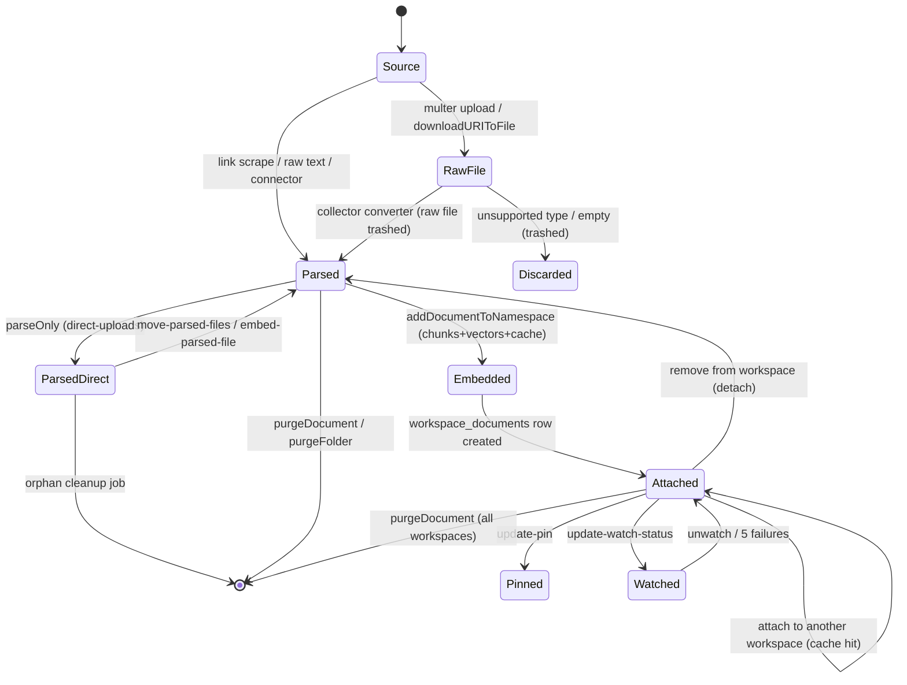
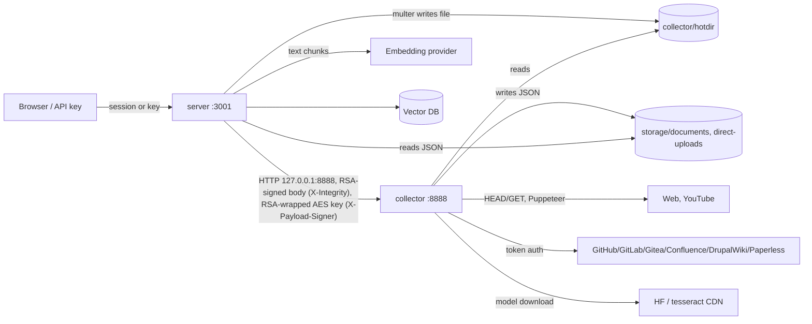

# 03 — Documents and ingestion (DOC)

**Scope.** How content gets into AnythingLLM, where it is stored, how it is chunked and embedded
into a workspace's vector namespace, and every way it is detached or deleted. Covers the
collector service and its signed server↔collector protocol, file / link / raw-text upload, every
data connector, the `storage/` layout, the embedding pipeline (in-process and the native-embedder
worker), the vector cache, pinning, watched documents (live sync), chat-attached parsed files,
and the orphan cleanup job. It stops at the chat boundary: how pinned docs, parsed files and
vector search results enter a prompt is shown only up to the hand-off (see `CHAT`). Agent tools
that call the collector (`web-scraping`, filesystem, Gmail/Outlook) are listed as entry points
only (see `AGENT`). Verified against commit `e82a80da`.

**Sources.** `collector/index.js`, `collector/middleware/*`, `collector/processSingleFile/**`,
`collector/processLink/**`, `collector/processRawText/index.js`, `collector/extensions/**`,
`collector/utils/{url,files,comKey,EncryptionWorker,runtimeSettings,http,constants,downloadURIToFile,OCRLoader,WhisperProviders}/*`,
`collector/utils/extensions/*` (all eight connectors), `server/utils/collectorApi/index.js`,
`server/utils/comKey/index.js`, `server/utils/EncryptionManager/index.js`,
`server/endpoints/{document,workspaces,workspacesParsedFiles,system,browserExtension}.js`,
`server/endpoints/extensions/index.js`, `server/endpoints/experimental/liveSync.js`,
`server/endpoints/api/{document,workspace,system}/index.js` (document routes only),
`server/utils/files/{index,multer,purgeDocument}.js`, `server/utils/EmbeddingWorkerManager.js`,
`server/jobs/{embedding-worker,sync-watched-documents,cleanup-orphan-documents}.js`,
`server/jobs/helpers/index.js`, `server/utils/BackgroundWorkers/index.js`,
`server/utils/TextSplitter/index.js`, `server/utils/vectorDbProviders/{base.js,lance/index.js}`,
`server/utils/vectorStore/resetAllVectorStores.js`, `server/utils/helpers/updateENV.js`
(vector reset hooks), `server/models/{documents,vectors,documentSyncQueue,documentSyncRun,workspaceParsedFiles,systemSettings}.js`,
`server/utils/DocumentManager/index.js`, `server/utils/chats/stream.js` (boundary only),
`server/prisma/schema.prisma`.

---

## 1. Mental model

### Actors and processes

| Actor | Process | Trust |
|---|---|---|
| Browser user (admin / manager / default) | `frontend` → `server` (port 3001) | Authenticated by `validatedRequest`; role checked by `flexUserRoleValid` (`server/utils/middleware/multiUserProtected.js:58-84`), which **passes everyone in single-user mode** (`:67-74`). |
| Developer API key holder | `server` `/v1/*` | `validApiKey`; no role, no workspace scoping. |
| Browser-extension key holder | `server` `/browser-extension/*` | `validBrowserExtensionApiKey`. |
| Server | Node process | Holds `ipc-priv.pem`, `SIG_KEY`/`SIG_SALT`, DB, vector DB. |
| Collector | Separate Express process (default port 8888) | Trusts any request whose body is RSA-signed by the server key. Has filesystem write access to the server's `storage/documents` and `storage/direct-uploads`. |
| Bree child processes | `embedding-worker.js`, `sync-watched-documents.js`, `cleanup-orphan-documents.js` | Same code and env as the server; talk to parent over IPC. |
| External sources | Web pages, YouTube, GitHub/GitLab/Gitea, Confluence, DrupalWiki, Paperless-ngx, embedding providers, OCR/Whisper model CDNs | Untrusted content; some need credentials the user supplies. |

### Resources

- **Hotdir** — `collector/hotdir/` (`collector/utils/constants.js:1`). Multer writes uploads here
  from the server side (`server/utils/files/multer.js:11-25`, prod path
  `STORAGE_DIR/../../collector/hotdir`). Transient: the converter deletes the file after
  parsing, and the collector wipes the directory on boot (`collector/utils/files/index.js:157-193`).
- **Document JSON** — `storage/documents/<folder>/<slug>-<uuid>.json`, written only by the
  collector (`collector/utils/files/index.js:120-152`). One JSON per document: `{id, url, title,
  docAuthor, description, docSource, chunkSource, published, wordCount, pageContent,
  token_count_estimate}`. `docpath` = `"<folder>/<file>.json"` (`:149`). This is the **document
  pool**: global, not owned by any workspace.
- **Direct uploads** — `storage/direct-uploads/<file>.json`, written when `parseOnly` is set
  (`collector/utils/files/index.js:130`). Used for chat-attached files and for transient link
  fetches.
- **Vector cache** — `storage/vector-cache/<uuidv5(docpath)>.json`
  (`server/utils/files/index.js:271-301`): an array of 500-vector chunks with `values` and
  `metadata` (all document fields except `pageContent`, plus the chunk `text`). Keyed by
  **docpath only**, not by embedder or workspace.
- **Vector namespace** — one per workspace slug. Default LanceDB at `storage/lancedb`
  (`server/utils/vectorDbProviders/lance/index.js:25-29`); each row is
  `{id, vector, ...metadata, text}` (`:388-400`).
- **Tables** (`server/prisma/schema.prisma`):
  `workspace_documents` (`:27-40`, one row per (document, workspace) attachment, `docId` unique
  per attachment, `metadata` = document JSON minus `pageContent`, `pinned`, `watched`);
  `document_vectors` (`:113-119`, `docId → vectorId`, no FK); `document_sync_queues`
  (`:294-304`, one per watched attachment, cascades on `workspace_documents` delete);
  `document_sync_executions` (`:305-312`); `workspace_parsed_files` (`:377-393`, cascades on
  workspace, user or thread delete).

### Lifecycle (state machine)

### Copies of the content at each state

| State | Copies of the text that exist | Removed by |
|---|---|---|
| Raw file | `collector/hotdir/<8hex>-<name>` | Converter `trashFile` (every converter, e.g. `asTxt.js:54`); unsupported type `processSingleFile/index.js:74`; collector boot wipe. **Not** removed if the collector is never called (see P-DOC-24 notes) or `absolutePath` is used. |
| Parsed | `storage/documents/<folder>/<file>.json` (full `pageContent`). xlsx also writes one JSON per sheet in its own folder. | `purgeSourceDocument` (`server/utils/files/index.js:304-318`) via `purgeDocument`; `purgeFolder` (`purgeDocument.js:81`). |
| Parsed (direct) | `storage/direct-uploads/<file>.json` | `moveToDocuments` (moves it), orphan job (`cleanup-orphan-documents.js:47-90`). Row delete alone does **not** remove the file. |
| Chunked + embedded | (a) `storage/vector-cache/<uuid>.json` (every chunk's text + metadata + vector); (b) vector rows in namespace `<slug>` (chunk text in `text`); (c) `document_vectors` mapping rows | (a) `purgeVectorCache` via `purgeDocument`/`purgeFolder`, `purgeEntireVectorCache` (chunk-size/overlap change, embedder/vector DB change). (b) `deleteDocumentFromNamespace` per detach, `delete-namespace` on reset/delete workspace. (c) `removeDocuments`, `deleteForWorkspace`, `resetAllVectorStores`. |
| Attached | `workspace_documents.metadata` (all fields except `pageContent`, including `chunkSource`, `url`, `description`) | Row delete on detach, reset, workspace delete, global reset. |
| Used in chat | Sources stored with chats (first 1,000 chars of pinned / parsed docs, chunk text from search) — `server/utils/chats/stream.js:165-191` | Not touched by any DOC deletion path (see CHAT). **(unverified: persistence format)** |

**Key consequence.** "Remove from workspace" (detach) leaves the document JSON **and** the
vector cache on disk; only a system-wide purge (`purgeDocument`/`purgeFolder`) removes all three
disk copies. No DOC path removes text already copied into chat history or event logs.

### Invariants the code relies on

- Folders are one level deep: `docpath` is always `folder/file.json` (`collector/utils/files/index.js:146-149`; enforced on move by `isFolderFilePath`, `server/endpoints/document.js:64`).
- The collector never writes the database; the server never writes document JSON except on live
  sync refresh (`server/jobs/helpers/index.js:44-57`).
- A document attached to N workspaces has N `workspace_documents` rows with N distinct `docId`s
  but one JSON file and one vector-cache file.
- An embedded document cannot be moved (`server/endpoints/document.js:73-79`), because
  `docpath` is the cache key and the attachment key.
- Admins and managers see every workspace in multi-user mode (`server/models/workspace.js:294-296`),
  so workspace-scoped DOC routes are effectively instance-wide for them.

### Trust boundaries

What crosses server → collector per call (`server/utils/collectorApi/index.js:65-84`): the
filename or link or text, metadata, and `options` containing `whisperProvider`,
`WhisperModelPref`, **`openAiKey`**, `WhisperGenericOpenAi{BaseUrl,ApiKey,Model}`, OCR language,
and `runtimeSettings {allowAnyIp, browserLaunchArgs}`. The body is signed, not encrypted: these
keys travel in plaintext over loopback HTTP. The `X-Payload-Signer` header carries the
EncryptionManager AES key (`server/utils/EncryptionManager/index.js:21`) wrapped with
`privateEncrypt` (`server/utils/comKey/index.js:79-83`). Anyone holding the public key
(`storage/comkey/ipc-pub.pem`) can unwrap it, so it is protected from network observers only by
loopback and file permissions. What crosses back is the document JSON (including full
`pageContent`), so text crosses the boundary twice (on disk and in the HTTP response).

---

## 2. Entry points

| ID | Channel | Method + path / event / job | Middleware chain | Handler (path:line) | Who can call |
|---|---|---|---|---|---|
| E-DOC-01 | ui | POST `/workspace/:slug/upload` | validatedRequest, flexUserRoleValid[admin,manager], handleFileUpload | `server/endpoints/workspaces.js:120` | admin, manager; anyone in single-user |
| E-DOC-02 | ui | POST `/workspace/:slug/upload-link` | validatedRequest, flexUserRoleValid[admin,manager] | `server/endpoints/workspaces.js:190` | admin, manager |
| E-DOC-03 | ui | POST `/workspace/:slug/update-embeddings` | validatedRequest, flexUserRoleValid[admin,manager] | `server/endpoints/workspaces.js:233` | admin, manager |
| E-DOC-04 | ui | DELETE `/workspace/:slug/reset-vector-db` | validatedRequest, flexUserRoleValid[admin,manager] | `server/endpoints/workspaces.js:346` | admin, manager |
| E-DOC-05 | ui | DELETE `/workspace/:slug` (doc effects only) | validatedRequest, flexUserRoleValid[admin,manager], workspaceDeletionProtection | `server/endpoints/workspaces.js:299` | admin, manager |
| E-DOC-06 | ui | POST `/workspace/:slug/update-pin` | validatedRequest, flexUserRoleValid[admin,manager], validWorkspaceSlug | `server/endpoints/workspaces.js:657` | admin, manager |
| E-DOC-07 | ui | POST `/workspace/:slug/upload-and-embed` | validatedRequest, flexUserRoleValid[admin,manager], handleFileUpload | `server/endpoints/workspaces.js:834` | admin, manager |
| E-DOC-08 | ui | DELETE `/workspace/:slug/remove-and-unembed` | validatedRequest, flexUserRoleValid[admin,manager], handleFileUpload | `server/endpoints/workspaces.js:915` | admin, manager |
| E-DOC-09 | ui (SSE) | GET `/workspace/:slug/embed-progress` | validatedRequest, flexUserRoleValid[admin,manager], validWorkspaceSlug | `server/endpoints/workspaces.js:1032` | admin, manager |
| E-DOC-10 | ui | DELETE `/workspace/:slug/embed-queue` | same as E-DOC-09 | `server/endpoints/workspaces.js:1063` | admin, manager |
| E-DOC-11 | ui | POST `/document/create-folder` | validatedRequest, flexUserRoleValid[admin,manager] | `server/endpoints/document.js:20` | admin, manager |
| E-DOC-12 | ui | POST `/document/move-files` | validatedRequest, flexUserRoleValid[admin,manager] | `server/endpoints/document.js:58` | admin, manager |
| E-DOC-13 | ui | DELETE `/system/remove-document`, `/system/remove-documents` | validatedRequest, flexUserRoleValid[admin,manager] | `server/endpoints/system.js:470`, `:485` | admin, manager |
| E-DOC-14 | ui | DELETE `/system/remove-folder` | validatedRequest, flexUserRoleValid[admin,manager] | `server/endpoints/system.js:500` | admin, manager |
| E-DOC-15 | ui | GET `/system/local-files`, `/local-files/search`, `/local-files/by-docpaths` | validatedRequest, flexUserRoleValid[admin,manager] | `server/endpoints/system.js:516`, `:538`, `:553` | admin, manager |
| E-DOC-16 | ui | GET `/system/document-processing-status`, `/system/accepted-document-types` | validatedRequest | `server/endpoints/system.js:568`, `:582` | any authenticated user |
| E-DOC-17 | ui | POST `/ext/:repo_platform/branches`, `/ext/:repo_platform/repo` | validatedRequest, flexUserRoleValid[admin,manager], isSupportedRepoProvider | `server/endpoints/extensions/index.js:15`, `:39` | admin, manager |
| E-DOC-18 | ui | POST `/ext/youtube/transcript`, `/ext/confluence`, `/ext/website-depth`, `/ext/drupalwiki`, `/ext/obsidian/vault`, `/ext/paperless-ngx` | validatedRequest, flexUserRoleValid[admin,manager] | `server/endpoints/extensions/index.js:66`, `:88`, `:109`, `:130`, `:152`, `:174` | admin, manager |
| E-DOC-19 | ui | POST `/experimental/toggle-live-sync` | validatedRequest, flexUserRoleValid[admin] | `server/endpoints/experimental/liveSync.js:20` | admin |
| E-DOC-20 | ui | GET `/experimental/live-sync/queues` | validatedRequest, flexUserRoleValid[admin], featureFlagEnabled | `server/endpoints/experimental/liveSync.js:60` | admin |
| E-DOC-21 | ui | POST `/workspace/:slug/update-watch-status` | validatedRequest, flexUserRoleValid[admin,manager], validWorkspaceSlug, featureFlagEnabled | `server/endpoints/experimental/liveSync.js:85` | admin, manager |
| E-DOC-22 | ui | POST `/workspace/:slug/parse` | validatedRequest, flexUserRoleValid[all], handleFileUpload, validWorkspaceSlug | `server/endpoints/workspacesParsedFiles.js:151` | any role with workspace access |
| E-DOC-23 | ui | GET `/workspace/:slug/parsed-files` | validatedRequest, flexUserRoleValid[all], validWorkspaceSlug | `server/endpoints/workspacesParsedFiles.js:18` | any role |
| E-DOC-24 | ui | DELETE `/workspace/:slug/delete-parsed-files` | validatedRequest, flexUserRoleValid[all], validWorkspaceSlug | `server/endpoints/workspacesParsedFiles.js:46` | any role (own files in multi-user) |
| E-DOC-25 | ui | POST `/workspace/:slug/embed-parsed-file/:fileId`, `/workspace/:slug/move-parsed-files` | validatedRequest, flexUserRoleValid[admin,manager], validWorkspaceSlug | `server/endpoints/workspacesParsedFiles.js:70`, `:121` | admin, manager |
| E-DOC-26 | api | POST `/v1/document/upload`, `/v1/document/upload/:folderName` | validApiKey, handleAPIFileUpload, validateWorkspaceSlugQuery | `server/endpoints/api/document/index.js:52`, `:183` | API key |
| E-DOC-27 | api | POST `/v1/document/upload-link` | validApiKey, validateWorkspaceSlugQuery | `server/endpoints/api/document/index.js:338` | API key |
| E-DOC-28 | api | POST `/v1/document/raw-text` | validApiKey, validateWorkspaceSlugQuery | `server/endpoints/api/document/index.js:520` | API key |
| E-DOC-29 | api | GET `/v1/documents`, `/v1/documents/folder/:folderName`, `/v1/document/:docName`, `/v1/document/accepted-file-types`, `/v1/document/metadata-schema` | validApiKey | `server/endpoints/api/document/index.js:669`, `:725`, `:919`, `:810`, `:867` | API key |
| E-DOC-30 | api | POST `/v1/document/create-folder`, DELETE `/v1/document/remove-folder`, POST `/v1/document/move-files` | validApiKey | `server/endpoints/api/document/index.js:974`, `:1048`, `:1107` | API key |
| E-DOC-31 | api | POST `/v1/workspace/:slug/update-embeddings`, `/v1/workspace/:slug/update-pin` | validApiKey | `server/endpoints/api/workspace/index.js:457`, `:535` | API key |
| E-DOC-32 | api | DELETE `/v1/system/remove-documents` | validApiKey | `server/endpoints/api/system/index.js:219` | API key |
| E-DOC-33 | extension | POST `/browser-extension/embed-content`, `/browser-extension/upload-content` | validBrowserExtensionApiKey | `server/endpoints/browserExtension.js:81`, `:128` | extension key |
| E-DOC-34 | job | `cleanup-orphan-documents` every 12 h | Bree | `server/jobs/cleanup-orphan-documents.js:47`; registered `server/utils/BackgroundWorkers/index.js:30-34` | system |
| E-DOC-35 | job | `sync-watched-documents` every 1 h (only if live sync enabled) | Bree | `server/jobs/sync-watched-documents.js:263`; registered `server/utils/BackgroundWorkers/index.js:55-61`, `:169` | system |
| E-DOC-36 | job | `embedding-worker-<ts>` on demand | `BackgroundService.spawnWorker` | `server/jobs/embedding-worker.js:163`; spawned `server/utils/EmbeddingWorkerManager.js:106-110` | system |
| E-DOC-37 | boot | Server boot: rolls RSA comkey, ensures SIG_KEY | — | `server/utils/boot/index.js:38-39`, `:72-73` | system |
| E-DOC-38 | boot | Collector boot: wipes hotdir and `collector/storage/tmp` | — | `collector/index.js:225-229` | system |
| E-DOC-39 | collector | POST `/process`, `/parse`, `/process-link`, `/util/get-link`, `/util/convert-audio-to-wav`, `/process-raw-text` | verifyPayloadIntegrity | `collector/index.js:45`, `:75`, `:109`, `:139`, `:163`, `:188` | holder of server private key |
| E-DOC-40 | collector | POST `/ext/resync-source-document`, `/ext/:repo_platform-repo`, `/ext/confluence`, `/ext/drupalwiki`, `/ext/obsidian/vault`, `/ext/paperless-ngx` | verifyPayloadIntegrity, setDataSigner | `collector/extensions/index.js:15`, `:36`, `:147`, `:173`, `:201`, `:221` | holder of server private key |
| E-DOC-41 | collector | POST `/ext/:repo_platform-repo/branches`, `/ext/youtube-transcript`, `/ext/website-depth` | verifyPayloadIntegrity | `collector/extensions/index.js:66`, `:96`, `:123` | holder of server private key |
| E-DOC-42 | collector | GET `/accepts`; `ALL *` → 200 | none | `collector/index.js:217`, `:221` | anyone who can reach the port |
| E-DOC-43 | (AGENT/CHAT) | `CollectorApi.parseDocument` / `getLinkContent` / `convertAudioToWav` from agents, Telegram, API chat, STT | — | `server/utils/agents/aibitat/plugins/filesystem/lib.js:288`, `server/utils/agents/aibitat/plugins/web-scraping.js:102`, `server/utils/chats/apiChatHandler.js:91`, `server/utils/telegramBot/utils/media.js:60`, `server/utils/SpeechToText/helpers.js:24` | see AGENT / CHAT |

---

## 3. User paths

### P-DOC-01 Upload a file to the document pool (UI)

- **Actor and preconditions.** Admin or manager (any user in single-user). Collector online.
- **Steps.**
  1. `frontend/src/models/workspace.js:296` → POST `/workspace/:slug/upload` (multipart; `folderName` and `metadata` fields must precede the file part, `server/endpoints/workspaces.js:132-135`).
  2. `handleFileUpload` (`server/utils/files/multer.js:92-107`) writes `collector/hotdir/<8hex>-<sanitized name>` (`:19-24`).
  3. `CollectorApi.online()` (`server/utils/collectorApi/index.js:86-90`), then `processDocument(hotdirFilename, metadata, {originalFilename})` (`:114-147`, 600 s header timeout `:136`).
  4. Collector `/process` → `verifyPayloadIntegrity` (`collector/middleware/verifyIntegrity.js:5-28`) → strip leading `../` (`collector/index.js:51-53`) → `processSingleFile` (`collector/processSingleFile/index.js:25-96`): within-hotdir check `:32-40`, reserved name `:42`, existence `:49`, extension → converter map (`collector/utils/constants.js:46-88`), unknown-but-text → `.txt` (`:66-71`), else trash and fail (`:72-80`).
  5. Converter writes JSON to `storage/documents/custom-documents/` and trashes the raw file (see table below).
  6. Back on server: if `folderName`, `moveProcessedDocsToFolder` (`server/utils/files/index.js:754-802`) renames the JSONs into that folder and removes now-empty source folders other than `custom-documents` (`:793-799`).
  7. Telemetry `document_uploaded` and event log `document_uploaded` (`server/endpoints/workspaces.js:173-180`).
- **Converters.**

  | Ext | Converter | Library / external | Output |
  |---|---|---|---|
  | txt md org adoc rst csv json html | `asTxt.js:11-57` | UTF-16/UTF-8/Win-1252 decode `:66-76` | 1 JSON |
  | pdf | `asPDF/index.js:12-85` | PDFLoader; OCR fallback when no text (`:25-34`) via tesseract (model cache `storage/models/tesseract`, `collector/utils/OCRLoader/index.js:25-33`) | 1 JSON |
  | docx | `asDocx.js:11-61` | langchain DocxLoader | 1 JSON |
  | pptx odt odp | `asOfficeMime.js:11-57` | officeparser | 1 JSON |
  | xlsx | `asXlsx.js:35-180` | node-xlsx; one JSON **per sheet** in new folder `documents/<slug>-<4hex>/` (`:114-155`); `parseOnly` combines sheets (`:59-112`) | N JSON |
  | mbox | `asMbox.js:13-82` | mbox-parser, html-to-text; one JSON per message (`:69-71`) | N JSON |
  | epub | `asEPub.js:11-59` | langchain EPubLoader | 1 JSON |
  | mp3 wav mp4 mpeg mov ogg oga opus m4a webm | `asAudio.js:21-81` | Whisper provider from `options.whisperProvider` (`:27-34`): local (HF download into `storage/models`, `collector/utils/WhisperProviders/localWhisper.js:14-23`, `:131-155`), OpenAI, generic OpenAI-compatible | 1 JSON |
  | png jpg jpeg webp | `asImage.js:11-54` | OCRLoader | 1 JSON |

- **Reads.** Hotdir file; env for options.
- **State changes.** File written: hotdir raw → file deleted; file written: `storage/documents/custom-documents/<slug>-<uuid>.json` (or per-sheet folder); optional rename into `<folderName>/`. `event_logs` row created.
- **Side effects.** SE-DOC-01 (FS hotdir), SE-DOC-02 (NET:collector), SE-DOC-03 (FS documents), SE-DOC-04 (NET:whisper/ocr model CDN, first use), SE-DOC-05 (NET:openai whisper when configured), SE-DOC-06 (TEL), SE-DOC-07 (LOG).
- **Failure and edge paths.** Collector offline → 500, raw file **stays in hotdir** until collector reboot (`server/endpoints/workspaces.js:144-153`). Collector error → collector returns 200 `{success:false}` (`collector/index.js:62-69`); server returns 500. Converter failures trash the raw file (e.g. `asTxt.js:26`). `moveProcessedDocsToFolder` throws on bad folder → caught as 500, but the JSON is already written in `custom-documents` (half-done).
- **Notes.** The `:slug` in the URL is not validated or used; uploads are pool-wide. No upload size limit in multer (`multer.js:93`) and a 3 GB body limit in the collector (`collector/index.js:21`). Every document JSON stores `url: "file://<absolute hotdir path>"` (e.g. `asTxt.js:37`), leaking the server's filesystem layout into the document and into vector metadata.

### P-DOC-02 Upload a link (UI)

- **Actor.** Admin or manager. Collector online.
- **Steps.** `frontend/src/models/workspace.js:328` → POST `/workspace/:slug/upload-link` (`server/endpoints/workspaces.js:190-231`) → `CollectorApi.processLink(link)` (`server/utils/collectorApi/index.js:157-187`) → collector `/process-link` (`collector/index.js:109-137`) → `processLink` (`collector/processLink/index.js:14-31`): `validateURL` (adds `https://`, strips trailing `/`, `collector/utils/url/index.js:81-96`) and `validURL` (`:64-72`) → `scrapeGenericUrl` (`collector/processLink/convert/generic.js:29-110`):
  1. `determineContentType`: YouTube regex → transcript; else HEAD request with 5 s timeout (`collector/processLink/helpers/index.js:24-68`, `:100-126`).
  2. If the MIME is a non-HTML accepted type → `processAsFile` → `downloadURIToFile` (GET, 10 s timeout, written to hotdir as `<host>-<slugged path>[.ext]`, `collector/utils/downloadURIToFile/index.js:30-80`) → `processSingleFile` (P-DOC-01 converters).
  3. Else Puppeteer (`generic.js:168-185`; `ignoreHTTPSErrors: true` `:171`; launch args from runtime settings `:172`; custom headers `:177`) → HTML → Markdown; on failure plain `fetch` (`:197-206`).
  4. Writes `documents/custom-documents/url-<host_path>-<uuid>.json` with `chunkSource: link://<url>` (`:87-107`).
- **State changes.** File written in `custom-documents`; hotdir file written then deleted for file-type links. `event_logs` `link_uploaded` (`server/endpoints/workspaces.js:219-224`).
- **Side effects.** SE-DOC-02, SE-DOC-03, SE-DOC-08 (NET:web), SE-DOC-09 (PROC chromium), SE-DOC-06, SE-DOC-07.
- **Failure and edge paths.** Invalid URL → `{success:false, reason:"Not a valid URL."}`. Empty content → failure, nothing written (`generic.js:66-75`). Collector offline → 500.
- **Notes (SSRF guard).** `isInvalidIp` (`collector/utils/url/index.js:27-54`) is explicitly documented as not a security control (`:2-13`). It only inspects **literal IPv4 hostnames**, by first octet (`INVALID_OCTETS = [192,172,10,127,169]`, `:16`), and explicitly allows `127.0.0.1` and `0.0.0.0` (`:51`). Hostnames (`localhost`, internal DNS), IPv6 literals, and redirects are not checked; no DNS resolution happens. It blocks all of `172.*` and `192.*`, not only RFC 1918 ranges. `COLLECTOR_ALLOW_ANY_IP` disables it entirely (`:28-36`), passed per request as `runtimeSettings.allowAnyIp` (`server/utils/collectorApi/index.js:80`). The Puppeteer page runs the remote site's JavaScript with no request interception (no `setRequestInterception` in `collector/utils/puppeteer/index.js`), so page scripts can reach internal hosts regardless of the guard.

### P-DOC-03 Raw text ingestion (API and browser extension)

- **Actor.** API key holder (`/v1/document/raw-text`, `server/endpoints/api/document/index.js:520-667`) or browser extension (`server/endpoints/browserExtension.js:128-152`).
- **Steps.** `CollectorApi.processRawText` (`server/utils/collectorApi/index.js:196-222`) → collector `/process-raw-text` (`collector/index.js:188-213`) → `processRawText` (`collector/processRawText/index.js:72-114`): requires string `textContent` and non-empty string `metadata.title` (`:74-90`); derives `url` (`web://<url>.website` for an http(s) `metadata.url`, else `file://<slug>.txt`), `chunkSource`, `published` (`:13-70`); writes `custom-documents/raw-<slug>-<uuid>.json` (`:106-109`). API path then optionally `Document.api.uploadToWorkspace` (P-DOC-05).
- **State changes.** File written. Optional attachments (P-DOC-09).
- **Side effects.** SE-DOC-02, SE-DOC-03, SE-DOC-06.
- **Failure and edge paths.** Missing title → `{success:false}`; server returns 500.
- **Notes.** A caller-supplied `metadata.chunkSource` is stored as-is (`:37-41`); a value like `link://http://10.0.0.1/` would make the document watchable (`DocumentSyncQueue.canWatch`, `server/models/documentSyncQueue.js:72-84`, requires the title to end in `.html` for `link://`) and later re-fetched by the sync job **(unverified end-to-end)**.

### P-DOC-04 Developer API upload with optional embed

- **Actor.** API key holder. No role or workspace scoping.
- **Steps.** `/v1/document/upload` (`server/endpoints/api/document/index.js:52-181`) or `/upload/:folderName` (`:183-336`, moves via `moveProcessedDocsToFolder` `:308`) → `processDocument` (`:144-148`) → telemetry `document_uploaded`, event `api_document_uploaded` (`:160-163`) → if `addToWorkspaces` → `Document.api.uploadToWorkspace` (`server/models/documents.js:372-427`) → sequential `Document.addDocuments` per (doc, workspace) (`:406-418`). `/v1/document/upload-link` (`:338-518`) accepts a string or an array and runs every link through `processLink` **in parallel** (`Promise.all`, `:451-455`) with caller `scraperHeaders`.
- **State changes.** As P-DOC-01 plus P-DOC-09 for each workspace.
- **Side effects.** SE-DOC-01..03, SE-DOC-06, SE-DOC-07, plus P-DOC-09 effects.
- **Failure and edge paths.** On the first failing workspace for a document the inner loop `break`s (`:413`), so later workspaces for that document are skipped; other documents continue. `partial` flag returned (`:422-426`).
- **Notes.** The API embed path always uses the in-process `Document.addDocuments`, never the native-embedder worker, so a large native embed runs inside the server process. Unbounded parallel Puppeteer launches for an array of links.

### P-DOC-05 Repository import (GitHub / GitLab / Gitea)

- **Actor.** Admin or manager.
- **Steps.** `frontend/src/models/dataConnector.js:8-114` → server `/ext/:repo_platform/branches|repo` (`server/endpoints/extensions/index.js:15-64`; `isSupportedRepoProvider` allows github, gitlab, gitea) → `forwardExtensionRequest` with the **raw request body** (`server/utils/collectorApi/index.js:265-290`, 15 min timeout `:25-30`) → collector `/ext/<platform>-repo` (`collector/extensions/index.js:36-63`, `setDataSigner` attaches `EncryptionWorker`, `collector/middleware/setDataSigner.js:28-40`) → `resolveRepoLoaderFunction` (`collector/utils/extensions/RepoLoader/index.js:30-45`, unknown platform falls back to GitHub) → e.g. `loadGithubRepo` (`collector/utils/extensions/RepoLoader/GithubRepo/index.js:15`): new folder `documents/<author>-<project>-<branch>-<4hex>` (`:37-50`), one JSON per file (`:74-78`), `chunkSource = github://<repo>?payload=<AES(owner,project,branch,path,pat,scheme)>` (`:146-158`).
- **State changes.** Folder and N files written. Telemetry `extension_invoked`.
- **Side effects.** SE-DOC-10 (NET:github/gitlab/gitea), SE-DOC-03, SE-DOC-11 (credential persisted encrypted), SE-DOC-06.
- **Failure and edge paths.** Collector errors return 200 `{success:false}` (`collector/extensions/index.js:53-60`). Branch listing returns 400.
- **Notes.** The access token is persisted inside every document JSON, every `workspace_documents.metadata`, every vector row and every vector-cache file for that repo, AES-256-CBC encrypted with the `SIG_KEY`-derived key. `Document._stripSource` hides the payload only for `confluence` and `github` (`server/models/documents.js:349-357`), not gitlab, gitea, drupalwiki or paperless-ngx.

### P-DOC-06 Website crawl (depth scrape)

- **Actor.** Admin or manager.
- **Steps.** `/ext/website-depth` (`server/endpoints/extensions/index.js:109-129`) → collector `/ext/website-depth` (`collector/extensions/index.js:123-145`): `validateURL` + `validURL` on the start URL only (`:130-131`) → `websiteScraper` (`collector/utils/extensions/WebsiteDepth/index.js:225-243`): BFS `discoverLinks` (`:14-50`) restricted to the start origin and path (`:124`), `bulkScrapePages` with Puppeteer (`:137-220`), writes to `documents/<host>-<4hex>/` (`:209`).
- **State changes.** Folder and up to `maxLinks` files written.
- **Side effects.** SE-DOC-08, SE-DOC-09, SE-DOC-03, SE-DOC-06.
- **Failure and edge paths.** No pages → `{success:false}`.
- **Notes.** `depth` and `maxLinks` come from the client body and are not capped on the server or collector.

### P-DOC-07 Credentialed connectors (Confluence, DrupalWiki, Paperless-ngx)

- **Actor.** Admin or manager.
- **Steps.** Server forward (`server/endpoints/extensions/index.js:88`, `:130`, `:174`) → collector `/ext/confluence|drupalwiki|paperless-ngx` with `setDataSigner` (`collector/extensions/index.js:147-241`) → loader validates the base URL syntactically only (`validBaseUrl`, `collector/utils/http/index.js:23-30`; Confluence `collector/utils/extensions/Confluence/index.js:35`, `:247`; DrupalWiki `collector/utils/extensions/DrupalWiki/index.js:21`; Paperless `collector/utils/extensions/PaperlessNgx/index.js:21`) → fetch pages/documents → folder under `documents/` → `chunkSource` with encrypted credential payload (Confluence `:303`, DrupalWiki `DrupalWiki/DrupalWiki/index.js:225-235`, Paperless `PaperlessNgx/index.js:114-121`).
- **Side effects.** SE-DOC-10, SE-DOC-03, SE-DOC-11, SE-DOC-06.
- **Notes.** None of these go through `validURL`, so an admin-supplied base URL may be any internal host. Paperless-ngx documents carry a resync payload and the collector has a `paperless-ngx` resync method (`collector/extensions/resync/index.js:276-307`), but the server cannot watch them: `paperless-ngx` is not in `validFileTypes` or `canWatch` (`server/models/documentSyncQueue.js:13-21`, `:72-84`).

### P-DOC-08 YouTube transcript and Obsidian vault

- **Steps.** YouTube: `/ext/youtube/transcript` → collector `/ext/youtube-transcript` (`collector/extensions/index.js:96-121`) → `loadYouTubeTranscript` (`chunkSource: youtube://<url>`, `collector/utils/extensions/YoutubeTranscript/index.js:163`). Obsidian: the browser reads the vault and sends `{files}` → `/ext/obsidian/vault` → `loadObsidianVault` (`collector/utils/extensions/ObsidianVault/index.js:33-88`) writes `documents/<vault>/…` with `chunkSource: obsidian://<path>`.
- **Side effects.** SE-DOC-12 (NET:youtube), SE-DOC-03, SE-DOC-06.
- **Notes.** Obsidian content is entirely client-supplied; nothing is fetched.

### P-DOC-09 Embed documents into a workspace (attach)

- **Actor.** Admin or manager (UI), API key (`/v1/workspace/:slug/update-embeddings`, `server/endpoints/api/workspace/index.js:521-522`), browser extension, parsed-file embed, upload-and-embed.
- **Steps (UI).**
  1. `frontend/src/models/workspace.js:44` → POST `/workspace/:slug/update-embeddings {adds, deletes}` (`server/endpoints/workspaces.js:233-297`).
  2. `deletes` are processed first (P-DOC-10).
  3. **Native embedder** (`EMBEDDING_ENGINE` unset or `native`, `server/utils/EmbeddingWorkerManager.js:190-193`): `embedFiles` (`:91-156`) appends to a running worker for the slug or spawns `embedding-worker.js` via Bree (`server/utils/BackgroundWorkers/index.js:219-238`) and returns immediately. The worker (`server/jobs/embedding-worker.js:44-161`) loops: `fileData` (`:78`), new `docId` (`:89`), `addDocumentToNamespace` (`:108-112`), `workspace_documents.create` (`:126`), IPC progress events → parent `emitProgress` → SSE (P-DOC-21).
  4. **Other embedders**: in-process `Document.addDocuments` (`server/models/documents.js:85-249`), same steps plus rollback of vectors if the row insert fails (`:184-215`).
  5. `addDocumentToNamespace` (LanceDB, `server/utils/vectorDbProviders/lance/index.js:323-425`): if `storage/vector-cache/<uuidv5(docpath)>.json` exists, reinsert cached vectors with fresh ids (`:335-354`). Otherwise `TextSplitter` (chunk size = min(setting, embedder max), overlap setting, header meta `sourceDocument`/`published`, embedder prefix; `:363-379`; `server/utils/TextSplitter/index.js:47-80`) → `EmbedderEngine.embedChunks` (`:383`; engine from `server/utils/helpers/index.js:313-363`) → `updateOrCreateCollection` (rejects empty vectors, `:255-270`) → `storeVectorResult` (`:417`) → `DocumentVectors.bulkInsert` (`:420`; `server/models/vectors.js:5`).
  6. Telemetry `documents_embedded_in_workspace`, event `workspace_documents_added` (`server/models/documents.js:233-247`; worker path logs via `EmbeddingWorkerManager.js:38-50`).
- **Reads.** Document JSON, vector cache, `system_settings` (chunk size/overlap), env.
- **State changes.** Vector rows added in namespace `<slug>`; file written `vector-cache/<uuid>.json` (cache miss only); `document_vectors` rows created; `workspace_documents` row created (`docId`, `filename`, `docpath`, `workspaceId`, `metadata`).
- **Side effects.** SE-DOC-13 (NET:embedding provider, or PROC native model + HF download), SE-DOC-14 (VEC), SE-DOC-15 (FS vector-cache), SE-DOC-16 (DB document_vectors, workspace_documents), SE-DOC-17 (PROC worker), SE-DOC-18 (WS SSE), SE-DOC-06, SE-DOC-07.
- **Failure and edge paths.** Missing file / path outside `documents` → `fileData` returns null (`server/utils/files/index.js:30-42`) → `doc_failed`. Embedding error → no rows. Worker path: if the row insert fails after vectors are written, **no rollback** (`server/jobs/embedding-worker.js:132-139`), leaving vectors and `document_vectors` rows with no attachment. In both paths, if `bulkInsert` fails after the vector insert, vectors exist with no mapping and cannot be deleted by `docId` (`lance/index.js:415-420`). Worker crash → synthetic `all_complete` with error (`EmbeddingWorkerManager.js:122-137`).
- **Notes.** There is no unique constraint on `(workspaceId, docpath)` (`schema.prisma:27-40`), so the same document can be attached twice to one workspace by an API caller **(unverified whether the UI prevents it)**. The vector cache is not keyed by embedder; it is only cleared by the global reset hooks (P-DOC-15). The UI response for the native path is returned before embedding finishes.

### P-DOC-10 Remove a document from a workspace (detach)

- **Steps.** `update-embeddings {deletes}` (`server/endpoints/workspaces.js:250-254`) → `Document.removeDocuments` (`server/models/documents.js:251-287`): for each docpath find the attachment, `VectorDb.deleteDocumentFromNamespace(slug, docId)` (Lance: look up `document_vectors`, `table.delete("id IN (…)")`, `lance/index.js:302-321`), delete the `workspace_documents` row and its `document_vectors` rows (`:266-275`), event `workspace_documents_removed` (`:277-284`).
- **State changes.** Vector rows deleted; `workspace_documents` row deleted (cascades `document_sync_queues`, `schema.prisma:301`); `document_vectors` rows deleted. Document JSON and vector cache **kept**.
- **Side effects.** SE-DOC-14, SE-DOC-16, SE-DOC-07.
- **Failure and edge paths.** `deleteDocumentFromNamespace` is outside the try block (`:261-264`); a vector DB error aborts the rest of the batch with rows intact. If the namespace is missing it returns early and the rows are still deleted.
- **Notes.** If the detached row owned the sync queue, the cascade drops the queue for every workspace, but other workspaces' rows keep `watched = true` (`DocumentSyncQueue.watch` sets the flag on every row with that filename, `server/models/documentSyncQueue.js:115-118`) **(inferred)**.

### P-DOC-11 Upload and embed in one step (UI)

- **Steps.** `/workspace/:slug/upload-and-embed` (`server/endpoints/workspaces.js:834-913`): workspace lookup → `processDocument` (`:869-873`) → `Document.addDocuments(currWorkspace, [documents[0].location])` (`:891-896`).
- **Notes.** Only the **first** document is embedded: for xlsx (one per sheet) or mbox (one per message) the rest stay unattached in the pool. Always in-process, never the worker.

### P-DOC-12 Purge documents system-wide

- **Actor.** Admin or manager (`/system/remove-document(s)`, `server/endpoints/system.js:470-496`; `/workspace/:slug/remove-and-unembed`, `server/endpoints/workspaces.js:915-942`), API key (`/v1/system/remove-documents`, `server/endpoints/api/system/index.js:274`).
- **Steps.** `purgeDocument(docpath)` (`server/utils/files/purgeDocument.js:13-23`): `purgeVectorCache` (`server/utils/files/index.js:321-331`) → `purgeSourceDocument` (`:304-318`, path must be inside `documents` and a regular file) → for **every workspace** `Document.removeDocuments(workspace, [docpath])` (P-DOC-10).
- **State changes.** Files deleted (vector cache, JSON). All attachments, vectors, `document_vectors` and sync queues for that docpath deleted.
- **Side effects.** SE-DOC-19 (FS delete), SE-DOC-14, SE-DOC-16, SE-DOC-07.
- **Failure and edge paths.** The two disk deletes happen before the DB/vector work; a failure later leaves attachments pointing at a missing file (chat pinning then silently skips it, `server/utils/DocumentManager/index.js:46-69`).
- **Notes.** `removeDocuments` logs an event even when the document is not in that workspace (`server/models/documents.js:277-284`), so one purge writes one `workspace_documents_removed` row per workspace. `remove-and-unembed` is workspace-scoped in its URL but deletes the document from **all** workspaces, and runs the multer middleware on a DELETE.

### P-DOC-13 Purge a folder

- **Steps.** `/system/remove-folder` (`server/endpoints/system.js:500-511`) or `/v1/document/remove-folder` (`server/endpoints/api/document/index.js:1093`) → `purgeFolder` (`server/utils/files/purgeDocument.js:33-84`): refuses `custom-documents` and anything not a top-level directory (`:37-54`); removes vector cache for every file; `removeDocuments` for every workspace; `rmSync(folder, {recursive})` (`:81`).
- **Side effects.** SE-DOC-19, SE-DOC-14, SE-DOC-16, SE-DOC-07.
- **Notes.** All cache and DB work runs concurrently via `Promise.all` (`:80`).

### P-DOC-14 Create folder, move files, browse

- **Steps.** `/document/create-folder` (`server/endpoints/document.js:20-56`; `normalizeFolderName`, `isWithin`) → `mkdirSync`. `/document/move-files` (`:58-131`): reject non `folder/file.json` targets (`:64-71`), skip any `from` that is attached to a workspace (`:73-79`), `fs.rename` with both paths inside `documents` (`:81-101`). Browsing: `/system/local-files*` (`server/endpoints/system.js:516-566`), `/v1/document/:docName` (`findDocumentInDocuments`, `server/utils/files/index.js:334-363`, returns metadata without `pageContent`).
- **State changes.** Directory created; file renamed.
- **Side effects.** SE-DOC-20 (FS).
- **Notes.** The API move route mirrors this (`server/endpoints/api/document/index.js:1107-1217`). Moving a previously embedded-then-detached file orphans its vector-cache file under the old path's key.

### P-DOC-15 Reset vectors: one workspace, workspace delete, and global

- **Workspace reset.** `/workspace/:slug/reset-vector-db` (`server/endpoints/workspaces.js:346-385`): `DocumentVectors.deleteForWorkspace` (`server/models/vectors.js:41-54`), `Document.delete({workspaceId})`, event `workspace_vectors_reset`, `VectorDb["delete-namespace"]` (Lance `dropTable`, `lance/index.js:297-300`, `:492-502`). JSON and vector cache kept.
- **Workspace delete (doc effects).** Same plus `WorkspaceChats.delete` and `Workspace.delete` (`server/endpoints/workspaces.js:320-335`); `workspace_parsed_files` rows cascade (`schema.prisma:386-388`), their direct-upload files wait for the orphan job.
- **Global reset.** Changing `VectorDB`, `EmbeddingEngine`, `EmbeddingModelPref` or `AzureOpenAiEmbeddingModelPref` runs `handleVectorStoreReset` (`server/utils/helpers/updateENV.js:1411-1432`) → `resetAllVectorStores` (`server/utils/vectorStore/resetAllVectorStores.js:11-56`): purge whole vector cache, delete **all** `document_vectors` and **all** `workspace_documents`, event log, drop every namespace (or `pgvector.reset()`). Every document is detached from every workspace; JSON files remain. Changing `text_splitter_chunk_size` / `_overlap` purges the vector cache inside the setting's validator (`server/models/systemSettings.js:123-150`).
- **Side effects.** SE-DOC-14, SE-DOC-16, SE-DOC-21 (FS vector-cache wipe), SE-DOC-07.
- **Failure and edge paths.** `delete-namespace` errors are swallowed after DB rows are gone (`server/endpoints/workspaces.js:333-337`, `:374-378`): vectors can survive with no rows.
- **Notes.** The validators purge the cache on any valid write to those settings, even if the value did not change **(inferred from the validator code; caller not traced)**.

### P-DOC-16 Pin / unpin

- **Steps.** `frontend/src/models/workspace.js:374` → `/workspace/:slug/update-pin` (`server/endpoints/workspaces.js:657-682`) → `Document.update(id, {pinned})` (`server/models/documents.js:299-317`). API equivalent `server/endpoints/api/workspace/index.js:535`.
- **State changes.** `workspace_documents.pinned: false → true` (or back).
- **Side effects.** SE-DOC-16.
- **Notes.** Effect at chat time: P-DOC-24.

### P-DOC-17 Toggle live sync (feature flag)

- **Steps.** `/experimental/toggle-live-sync` (`server/endpoints/experimental/liveSync.js:20-58`): validate, compare, `SystemSettings._updateSettings({experimental_live_file_sync})`, then `DocumentSyncQueue.bootWorkers()` (`new BackgroundService().boot()`) or `killWorkers()` (`BackgroundService.stop()`, `server/models/documentSyncQueue.js:42-48`).
- **State changes.** `system_settings.experimental_live_file_sync: disabled ↔ enabled`; Bree restarted or stopped.
- **Side effects.** SE-DOC-22 (DB), SE-DOC-23 (TIME), SE-DOC-06, SE-DOC-07.
- **Notes.** `stop()` (`server/utils/BackgroundWorkers/index.js:156-163`) stops **all** Bree jobs and sets `this.bree = null`, so disabling live sync also stops the orphan cleanup, generated-file cleanups and memory extraction, and makes `spawnWorker` throw (`:220-221`), which breaks native-embedder uploads until the next `boot()` or restart **(inferred from code)**. `boot()` has no guard against an already running Bree (`:106-136`), so enabling may start a second scheduler **(unverified)**.

### P-DOC-18 Watch / unwatch a document

- **Steps.** `frontend/src/models/experimental/liveSync.js:39` → `/workspace/:slug/update-watch-status` (`server/endpoints/experimental/liveSync.js:85-111`) → `DocumentSyncQueue.toggleWatchStatus` (`server/models/documentSyncQueue.js:261-270`) → `watch` (`:90-124`: refuse if any same-filename watched row already has a queue; create `document_sync_queues` with `nextSyncAt = now + staleAfter` (default 7 days, env `DOCUMENT_SYNC_STALE_AFTER_MS`, min 1 h, `:32-38`); set `watched = true` on every row with that filename) or `unwatch` (`:130-150`).
- **State changes.** `document_sync_queues` row created/deleted; `workspace_documents.watched` updated for all rows sharing the filename.
- **Side effects.** SE-DOC-16, SE-DOC-24 (TIME queue entry), SE-DOC-06.
- **Notes.** `watch` does not check `canWatch`; the UI gates it via `fileToPickerData` (`server/utils/files/index.js:828`) **(unverified)**. Errors return null and the endpoint still answers 200.

### P-DOC-19 Sync watched documents (job)

- **Steps.** Hourly Bree job (`server/jobs/sync-watched-documents.js:263-294`): `staleDocumentQueues` (`server/models/documentSyncQueue.js:230-248`) → collector online check → per queue `syncQueue` (`:124-261`):
  1. `parseDocumentTypeAndSource` (`server/models/documents.js:19-32`); invalid or unsupported type → `unwatch` (`:130-137`).
  2. `fetchSourceContent` (`:51-64`): link/youtube send `{link}`; repo/confluence/drupalwiki send the stored encrypted `chunkSource`; `forwardExtensionRequest` → collector `/ext/resync-source-document` (`collector/extensions/index.js:15-34`) → resync method (`collector/extensions/resync/index.js:22-307`, `expandPayload` decrypts credentials, `collector/utils/EncryptionWorker/index.js:23-41`).
  3. Unchanged → push `nextSyncAt`, run `exited` (`:72-86`).
  4. Changed → `reembedDocument` for the queue's workspace with `skipCache = true` (delete vectors, delete `document_vectors`, add; `:97-115`, `:171-177`), then every other workspace row with the same filename using the new cache (`:188-222`).
  5. Overwrite the document JSON (`updateSourceDocument`, `server/jobs/helpers/index.js:44-57`) with new `pageContent`, new `published`, and an added `docId` field.
  6. Update queue times; save run `success` or `failed` (`:234-260`).
- **State changes.** `storage/documents/<docpath>` rewritten; vector cache rewritten; vectors and `document_vectors` replaced in every attached workspace; `document_sync_queues.lastSyncedAt/nextSyncAt` updated; `document_sync_executions` row created.
- **Side effects.** SE-DOC-25 (NET:collector + source), SE-DOC-14, SE-DOC-15, SE-DOC-16, SE-DOC-26 (FS JSON overwrite), SE-DOC-13.
- **Failure and edge paths.** Per-document `recordFailure` (`:18-43`); after 5 consecutive failures → `unwatch`. Embed failures are recorded but the new content is still saved (`:164-165`), so a failed re-embed is never retried.
- **Notes.** `workspace_documents.metadata` is not updated, so its `published` no longer matches the JSON and vector rows. The comment at `:154-156` says the pinned-doc filter depends on title + published matching; the chat path reads `published` from the JSON for pinned docs and from vectors for search, which are both updated, so it holds **(inferred)**. The resync request carries no `options.runtimeSettings`, so the collector reuses whatever `allowAnyIp` the last request set (`collector/utils/runtimeSettings/index.js:58-65`).

### P-DOC-20 Chat-attached files (parse only)

- **Actor.** Any role with access to the workspace (`flexUserRoleValid([ROLES.all])`).
- **Steps.** `frontend/src/models/workspace.js:306` → POST `/workspace/:slug/parse` (`server/endpoints/workspacesParsedFiles.js:151-237`): multer writes to hotdir **before** `validWorkspaceSlug` runs (`:155-157`) → `parseDocument` (`server/utils/collectorApi/index.js:338-370`) → collector `/parse` (`collector/index.js:75-107`) with `parseOnly: true` → converter writes `storage/direct-uploads/<file>.json` → one `workspace_parsed_files` row per returned document (`:196-214`) with `metadata` = doc minus `pageContent`, linked to user and thread → event `document_uploaded_to_chat`.
- **Related.** List (`:18-44`), delete rows (`:46-68`, scoped to `userId` when there is a user), move to documents (`:121-149`, `WorkspaceParsedFiles.moveToDocuments`, `server/models/workspaceParsedFiles.js:110-145`: copy into `custom-documents`, unlink source, delete row in `finally`), embed (`:70-119`, `moveToDocumentsAndEmbed` `:154-175` → P-DOC-09).
- **State changes.** File written in direct-uploads; `workspace_parsed_files` row created; on move: file moved, row deleted.
- **Side effects.** SE-DOC-01, SE-DOC-02, SE-DOC-27 (FS direct-uploads), SE-DOC-28 (DB workspace_parsed_files), SE-DOC-07.
- **Failure and edge paths.** Invalid slug or no access → 404 after the raw file is already in the hotdir, where it stays until the collector restarts. `moveToDocuments` deletes the row even when the move fails (`finally`, `:138-144`), and the direct-upload file then becomes an orphan.
- **Notes.** Deleting a parsed-file row never deletes its JSON (`:83-93`); the orphan job does. The GET looks up `threadSlug` without workspace or user scoping (`server/endpoints/workspacesParsedFiles.js:26-28`) **(scoping enforced later inside `getContextMetadataAndLimits` — unverified)**.

### P-DOC-21 Embedding progress stream and dequeue

- **Steps.** `/workspace/:slug/embed-progress` (`server/endpoints/workspaces.js:1032-1061`) registers an SSE response (`addSSEConnection`, `server/utils/EmbeddingWorkerManager.js:52-72`), replays buffered events only while a worker is running. `/workspace/:slug/embed-queue` → `removeQueuedFile` (`:164-188`) → worker drops or marks cancelled (`server/jobs/embedding-worker.js:189-198`).
- **Side effects.** SE-DOC-18 (WS), SE-DOC-29 (CACHE event history; deleted 10 s after `all_complete`, `:22-23`).
- **Notes.** The SSE response sets `Access-Control-Allow-Origin: *` (`server/endpoints/workspaces.js:1049`). Events carry `userId` and docpaths of the uploader to every admin/manager watching that slug.

### P-DOC-22 Browser extension embed

- **Steps.** `/browser-extension/embed-content` (`server/endpoints/browserExtension.js:81-126`): workspace by numeric id (user-scoped in multi-user) → `processRawText` → `Document.addDocuments(workspace, [documents[0].location])`.
- **Side effects.** SE-DOC-02, SE-DOC-03, P-DOC-09 effects, SE-DOC-06.

### P-DOC-23 Orphan cleanup (job)

- **Steps.** Every 12 h (`server/utils/BackgroundWorkers/index.js:30-34`): build the set of known names from `workspace_parsed_files` (basename of `metadata.location`, else slugified filename, `server/jobs/cleanup-orphan-documents.js:50-67`); delete every other entry of `storage/direct-uploads` in batches of 500 (`:9-45`, `:74-84`).
- **State changes.** Files (and directories) in `direct-uploads` deleted.
- **Side effects.** SE-DOC-30 (FS).
- **Notes.** This is the only orphan job in the domain. It does not look at `storage/documents`, `vector-cache`, the hotdir or vector namespaces, so unattached pool documents, stale cache entries and orphaned vectors are never collected. A direct-upload file written moments before the job runs and before its row is inserted could be deleted (window between `/parse` response and `WorkspaceParsedFiles.create`) **(inferred race)**.

### P-DOC-24 Documents entering chat context (boundary)

- **Steps.** `server/utils/chats/stream.js:158-207`: `DocumentManager.pinnedDocs()` (`server/utils/DocumentManager/index.js:30-76`) reads each pinned docpath's JSON (inside `documents`), adds full `pageContent` until `maxTokens` = the LLM prompt window is reached; `WorkspaceParsedFiles.getContextFiles` (`server/models/workspaceParsedFiles.js:232-268`) reads direct-upload JSONs for the workspace + thread (+ user); vector search excludes chunks whose `title`+`published` match a pinned doc (`sourceIdentifier`, `server/utils/chats/index.js:151-154`; Lance filter `lance/index.js:214`).
- **Notes.** The token check happens before adding a document, so the last pinned document can push the total past `maxTokens` (`DocumentManager/index.js:60-68`). Sources returned to the client include every metadata field (including `url` with the hotdir path and encrypted `chunkSource`) and the first 1,000 characters (`stream.js:165-191`); vector sources come from `curateSources` (`lance/index.js:512-526`), which strips only `vector` and `_distance`. Hand-off to CHAT.

### P-DOC-25 Boot: keys and collector cleanup

- **Steps.** Server listen callback: `new CommunicationKey(true)` generates a fresh RSA-2048 pair into `storage/comkey/ipc-{priv,pub}.pem` (`server/utils/comKey/index.js:40-66`), then `new EncryptionManager()` creates `SIG_KEY`/`SIG_SALT` if missing and rewrites `.env` (`server/utils/EncryptionManager/index.js:38-43`) (`server/utils/boot/index.js:38-39`, `:72-73`). Collector listen callback: `wipeCollectorStorage` (`collector/utils/files/index.js:157-193`).
- **Side effects.** SE-DOC-31 (FS comkey), SE-DOC-32 (ENV), SE-DOC-33 (FS hotdir/tmp wipe).
- **Notes.** Rotating the RSA pair does not affect stored data; rotating or losing `SIG_KEY`/`SIG_SALT` makes every stored resync payload undecryptable (resync then fails and the document is unwatched after 5 tries) **(inferred)**.

### P-DOC-26 Collector request authentication and runtime settings

- **Steps.** Every collector route except `/accepts` and the catch-all runs `verifyPayloadIntegrity` (`collector/middleware/verifyIntegrity.js:5-28`): `X-Integrity` must be an RSA-SHA256 signature of the exact body (`collector/utils/comKey/index.js:30-42`); then `runtimeSettings.parseOptionsFromRequest` stores `allowAnyIp`, `browserLaunchArgs`, `seenAnyIpWarning` from `body.options.runtimeSettings` in a process-wide singleton (`collector/utils/runtimeSettings/index.js:18-65`). `setDataSigner` unwraps the AES key (`collector/middleware/setDataSigner.js:28-40`).
- **Failure and edge paths.** Missing/invalid signature → 400. With `NODE_ENV=development` verification is skipped entirely (`verifyIntegrity.js:7-12`).
- **Notes (security-relevant).**
  - `forwardExtensionRequest` signs and forwards the **browser's request body unchanged** (`server/endpoints/extensions/index.js:26-30` etc.; `server/utils/collectorApi/index.js:265-275`). A caller of any `/ext/*` route can therefore include `options.runtimeSettings`, and the collector will apply it: `allowAnyIp: "true"` disables the IP guard for that request and every later request until a server-built request resets it; `browserLaunchArgs` sets the Chromium command-line flags for subsequent Puppeteer launches (`generic.js:172`). Reachable by admin/manager in multi-user mode and by any user in single-user mode **(exploitability not tested)**.
  - Signatures have no nonce or timestamp; a captured signed request can be replayed until the server restarts and rolls the key.
  - The collector listens on all interfaces (`collector/index.js:225-226`, no host argument); the server always calls `127.0.0.1` (`server/utils/collectorApi/index.js:54`). `cors({origin: true})` is enabled (`collector/index.js:35`).
  - `/parse` honours `options.absolutePath` with no containment check (`collector/processSingleFile/index.js:26-40`), so any signed caller can make the collector read any file it can access; the server uses this for the agent filesystem plugin (`server/utils/agents/aibitat/plugins/filesystem/lib.js:288-290`).

---

## 4. State machines

### Document (pool + attachment)

| From | To | Trigger | Code |
|---|---|---|---|
| — | RawFile | multer upload; link file download | `server/utils/files/multer.js:11-25`; `collector/utils/downloadURIToFile/index.js:75-77` |
| RawFile | Parsed | converter success | `collector/utils/files/index.js:120-152` + `trashFile` |
| RawFile | (deleted) | unsupported/empty/error | `collector/processSingleFile/index.js:72-80`; converters |
| RawFile | (lingers) | collector offline or request rejected before collector call | `server/endpoints/workspaces.js:144-153`; `server/endpoints/workspacesParsedFiles.js:155-157` |
| — | Parsed | link scrape, raw text, connector | `generic.js:104`; `processRawText/index.js:106`; connectors |
| Parsed | ParsedDirect | `parseOnly` | `collector/utils/files/index.js:130` |
| ParsedDirect | Parsed | move/embed parsed file | `server/models/workspaceParsedFiles.js:110-145` |
| ParsedDirect | (deleted) | orphan job | `server/jobs/cleanup-orphan-documents.js:74-84` |
| Parsed | Attached(ws) | embed | `server/models/documents.js:85`; `server/jobs/embedding-worker.js:44` |
| Attached(ws) | Parsed | detach, workspace reset, workspace delete, global reset | `server/models/documents.js:251`; `server/endpoints/workspaces.js:363-364`, `:321-322`; `resetAllVectorStores.js:21-22` |
| Parsed / Attached | (deleted) | purge document / folder | `server/utils/files/purgeDocument.js:13-23`, `:33-84` |
| Attached | Attached (content refreshed) | sync job | `server/jobs/sync-watched-documents.js:124-261` |

### Attachment flags

- `pinned`: `false ↔ true` via `update-pin` only (`server/endpoints/workspaces.js:675`).
- `watched`: `false → true` via `DocumentSyncQueue.watch` on all same-filename rows (`server/models/documentSyncQueue.js:115-118`); `true → false` via `unwatch` (`:141-144`), triggered by the user, by 5 failures (`sync-watched-documents.js:27-33`) or by an invalid type (`:130-137`).

### Document sync queue entry

| State | Meaning | Transition |
|---|---|---|
| Scheduled | `nextSyncAt > now` | created by `watch` (`documentSyncQueue.js:108-114`) |
| Due | `nextSyncAt <= now` | time passes; picked by `staleDocumentQueues` (`:230-248`) |
| Due → Scheduled | after a run | unchanged (`sync-watched-documents.js:72-86`) or refreshed (`:234-237`) |
| Due → Due | failed run, `nextSyncAt` not moved | `recordFailure` (`:18-43`) — retried next hour |
| → Deleted | unwatch, 5 failures, invalid type, attachment row deleted (cascade) | `documentSyncQueue.js:130-150`; `schema.prisma:301` |

Run statuses: `unknown`, `exited`, `failed`, `success` (`server/models/documentSyncRun.js:3-8`).

### Embedding worker (per workspace slug)

`none → running` (`embedFiles` spawn, `EmbeddingWorkerManager.js:106-111`) → accepts `add_files` / `remove_file` → `all_complete` emitted and `process.exit(0)` (`embedding-worker.js:150-160`) → `none` (`exit` handler `EmbeddingWorkerManager.js:122-137`). If `add_files` arrives between `all_complete` and exit, the files are lost **(inferred race)**.

---

## 5. Side-effect ledger

| ID | Trigger | Class | Target | Where (path:line) | Reversible? | Notes |
|---|---|---|---|---|---|---|
| SE-DOC-01 | P-DOC-01, P-DOC-04, P-DOC-11, P-DOC-20 | FS | `collector/hotdir/<8hex>-<name>` | `server/utils/files/multer.js:11-25` | Deleted by converter or collector boot | No size limit |
| SE-DOC-02 | all ingestion paths | NET:collector | `http://127.0.0.1:8888` | `server/utils/collectorApi/index.js:126-147`, `:167`, `:202`, `:267`, `:307`, `:350` | n/a | Signed body carries `openAiKey` and generic Whisper key in plaintext |
| SE-DOC-03 | all ingestion paths | FS | `storage/documents/<folder>/*.json` | `collector/utils/files/index.js:140-142` | Purge | Written by collector process |
| SE-DOC-04 | P-DOC-01 (audio/image/scanned PDF) | NET:huggingface / tesseract CDN | `storage/models/**` | `collector/utils/WhisperProviders/localWhisper.js:131-155`; `collector/utils/OCRLoader/index.js:111-121` | Manual delete | First use only |
| SE-DOC-05 | P-DOC-01 (audio) | NET:openai / generic whisper | provider API | `collector/processSingleFile/convert/asAudio.js:27-35` | No | Audio leaves the host |
| SE-DOC-06 | uploads, links, connectors, embeds, watch | TEL | telemetry | `server/endpoints/workspaces.js:173`, `:219`, `:882`; `server/endpoints/extensions/index.js:55` etc.; `server/models/documents.js:233`; `server/models/documentSyncQueue.js:263`, `:268` | No | |
| SE-DOC-07 | uploads, embeds, removals, resets | LOG | `event_logs` | `server/endpoints/workspaces.js:174-180`, `:220-224`, `:366-372`; `server/models/documents.js:240-247`, `:277-284`; `resetAllVectorStores.js:23-25` | No | Purge logs once per workspace |
| SE-DOC-08 | P-DOC-02, P-DOC-06, P-DOC-19 | NET:web | arbitrary URL | `collector/processLink/helpers/index.js:35-38`; `collector/utils/downloadURIToFile/index.js:44`; `collector/processLink/convert/generic.js:187`, `:198` | No | Weak SSRF guard |
| SE-DOC-09 | P-DOC-02, P-DOC-06 | PROC | headless Chromium | `collector/processLink/convert/generic.js:168-187` | Exits | Args controllable via runtime settings |
| SE-DOC-10 | P-DOC-05, P-DOC-07 | NET:github/gitlab/gitea/confluence/drupalwiki/paperless | user-supplied base URL | `collector/utils/extensions/RepoLoader/GithubRepo/RepoLoader/index.js:135`, `:221`; `collector/utils/extensions/PaperlessNgx/PaperlessNgxLoader/index.js:41`; `collector/utils/extensions/DrupalWiki/DrupalWiki/index.js:239` | No | No IP guard |
| SE-DOC-11 | P-DOC-05, P-DOC-07 | FS | credential persisted (AES) inside `chunkSource` | `GithubRepo/index.js:146-158`; `Confluence/index.js:303`; `PaperlessNgx/index.js:114-121` | Purge doc | Copies in JSON, DB, vectors, cache |
| SE-DOC-12 | P-DOC-08 | NET:youtube | youtube.com | `collector/utils/extensions/YoutubeTranscript/YoutubeLoader/youtube-transcript.js` | No | **(file not read line by line)** |
| SE-DOC-13 | P-DOC-09, P-DOC-19 | NET:embedding-provider / PROC native model | embedder | `server/utils/vectorDbProviders/lance/index.js:383` | No | Chunk text leaves the host for remote embedders |
| SE-DOC-14 | P-DOC-09, -10, -12, -13, -15, -19 | VEC | namespace `<slug>` | `lance/index.js:255-270`, `:319`, `:297-300` | Re-embed | |
| SE-DOC-15 | P-DOC-09, P-DOC-19 | FS | `storage/vector-cache/<uuidv5(docpath)>.json` | `server/utils/files/index.js:290-301` | Purge | Holds full chunk text |
| SE-DOC-16 | P-DOC-09, -10, -12, -16, -18, -19 | DB | `workspace_documents`, `document_vectors`, `document_sync_queues` | `server/models/documents.js:179`, `:266-272`; `server/models/vectors.js:5`; `server/models/documentSyncQueue.js:108-118` | Yes | |
| SE-DOC-17 | P-DOC-09 (native) | PROC | Bree child `embedding-worker-<ts>` | `server/utils/EmbeddingWorkerManager.js:106-110` | Exits | One per slug |
| SE-DOC-18 | P-DOC-09, P-DOC-21 | WS | SSE `/workspace/:slug/embed-progress` | `server/utils/EmbeddingWorkerManager.js:17-36` | n/a | CORS `*` |
| SE-DOC-19 | P-DOC-12, P-DOC-13 | FS | delete JSON, cache, folder | `server/utils/files/index.js:304-331`; `purgeDocument.js:81` | No | |
| SE-DOC-20 | P-DOC-14 | FS | mkdir / rename under `documents` | `server/endpoints/document.js:46`, `:92` | Yes | |
| SE-DOC-21 | P-DOC-15 (global) | FS | wipe `storage/vector-cache` | `server/utils/files/index.js:805-809` | No | Also on chunk-size/overlap writes |
| SE-DOC-22 | P-DOC-17 | DB | `system_settings.experimental_live_file_sync` | `server/endpoints/experimental/liveSync.js:37-39` | Yes | |
| SE-DOC-23 | P-DOC-17 | TIME | Bree boot/stop (all jobs) | `server/models/documentSyncQueue.js:42-48`; `server/utils/BackgroundWorkers/index.js:156-163` | Yes | Stops unrelated jobs |
| SE-DOC-24 | P-DOC-18 | TIME | `document_sync_queues.nextSyncAt` | `server/models/documentSyncQueue.js:108-114` | Yes | |
| SE-DOC-25 | P-DOC-19 | NET:collector + source | `/ext/resync-source-document` | `server/jobs/sync-watched-documents.js:58-62` | No | Decrypts stored credentials |
| SE-DOC-26 | P-DOC-19 | FS | overwrite `storage/documents/<docpath>` | `server/jobs/helpers/index.js:53-55` | No | Adds `docId` field to JSON |
| SE-DOC-27 | P-DOC-20, E-DOC-43 | FS | `storage/direct-uploads/*.json` | `collector/utils/files/index.js:130` | Orphan job | |
| SE-DOC-28 | P-DOC-20 | DB | `workspace_parsed_files` | `server/endpoints/workspacesParsedFiles.js:202-209`; `server/models/workspaceParsedFiles.js:83-93` | Yes | |
| SE-DOC-29 | P-DOC-21 | CACHE | `eventHistory`, `runningWorkers`, `sseConnections` maps | `server/utils/EmbeddingWorkerManager.js:5-11` | Process lifetime | |
| SE-DOC-30 | P-DOC-23 | FS | delete in `storage/direct-uploads` | `server/jobs/cleanup-orphan-documents.js:17-23` | No | |
| SE-DOC-31 | P-DOC-25 | FS | `storage/comkey/ipc-{priv,pub}.pem` | `server/utils/comKey/index.js:53-62` | Rolled each boot | |
| SE-DOC-32 | P-DOC-25 | ENV | `SIG_KEY`, `SIG_SALT` + `.env` rewrite | `server/utils/EncryptionManager/index.js:38-43` | No | Loss breaks resync payloads |
| SE-DOC-33 | P-DOC-25 | FS | wipe `collector/hotdir`, `collector/storage/tmp` | `collector/utils/files/index.js:157-193` | No | |
| SE-DOC-34 | P-DOC-26 | CACHE | collector `RuntimeSettings` singleton | `collector/utils/runtimeSettings/index.js:58-65`, `:90-94` | Overwritten by next request | Settable from client body via `/ext/*` |

---

## 6. Cross-domain links

- **AUTH** — `validatedRequest`, `flexUserRoleValid`, `validApiKey`, `validBrowserExtensionApiKey`, `Workspace.getWithUser` (admin/manager see all) decide every DOC entry point.
- **CHAT** — P-DOC-24: pinned docs, parsed files and vector search feed `server/utils/chats/stream.js`, `openaiCompatible.js`, `apiChatHandler.js` (which also calls `parseDocument`, `apiChatHandler.js:91`). Chat history keeps source excerpts after documents are purged.
- **AGENT** — agent tools call `getLinkContent` (`web-scraping.js:102`, `agentFlows/executors/web-scraping.js:26`) and `parseDocument` with `absolutePath` (filesystem, Gmail, Outlook plugins); these share the collector SSRF guard and runtime settings singleton.
- **ADMIN** — vector DB / embedder / chunking settings trigger P-DOC-15 global reset (`server/utils/helpers/updateENV.js:1411-1432`); live sync toggle (P-DOC-17); event logs.
- **EXT** — browser extension (P-DOC-22), Telegram media (`server/utils/telegramBot/utils/media.js:60`), STT audio conversion (`server/utils/SpeechToText/helpers.js:24`).
- **STATE** — Bree `BackgroundService` lifecycle shared with scheduled jobs and memory extraction (P-DOC-17 stops all of them).

---

## 7. Open questions and unverified points

1. Whether passing `options.runtimeSettings` in an `/ext/*` request body actually reaches `RuntimeSettings` in practice was traced in code only (`server/endpoints/extensions/index.js` → `collectorApi/index.js:265-275` → `verifyIntegrity.js:26`); not exercised. The impact of attacker-chosen Chromium `browserLaunchArgs` was not tested.
2. Whether disabling live sync really leaves native-embedder uploads broken until restart (P-DOC-17) and whether enabling it twice starts two Bree schedulers.
3. Whether the UI prevents attaching the same docpath twice to one workspace; the schema does not.
4. How `fileToPickerData` gates the watch toggle (`canWatch`) for the UI; `DocumentSyncQueue.watch` itself does not check.
5. Persistence format of chat `sources` (pinned/parsed excerpts, vector chunk text, `chunkSource` payloads) in `workspace_chats` — belongs to CHAT.
6. `getContextMetadataAndLimits` thread scoping for GET `/workspace/:slug/parsed-files`.
7. Race windows: orphan job vs. `/parse` row insert; `add_files` vs. worker exit.
8. The inconsistency where other workspaces keep `watched = true` after the owning attachment's queue cascades away (P-DOC-10) is inferred from model code.
9. Vector DB providers other than LanceDB were not read; their `addDocumentToNamespace` / `deleteDocumentFromNamespace` may differ in rollback and cache behaviour.
10. YouTube, GitLab, Gitea, Confluence and DrupalWiki loader internals were read only at their write and `chunkSource` sites, not line by line.
11. Production hotdir path assumes `STORAGE_DIR` is `<app>/server/storage` (`server/utils/files/multer.js:16`, `server/utils/files/index.js:19-22`); a different `STORAGE_DIR` would put server writes and collector reads in different directories — not checked against the Docker image or desktop build.
12. `purgeEntireVectorCache` inside the `text_splitter_*` validators: whether the validator runs on every settings save, including unchanged values, was not traced to its caller.
