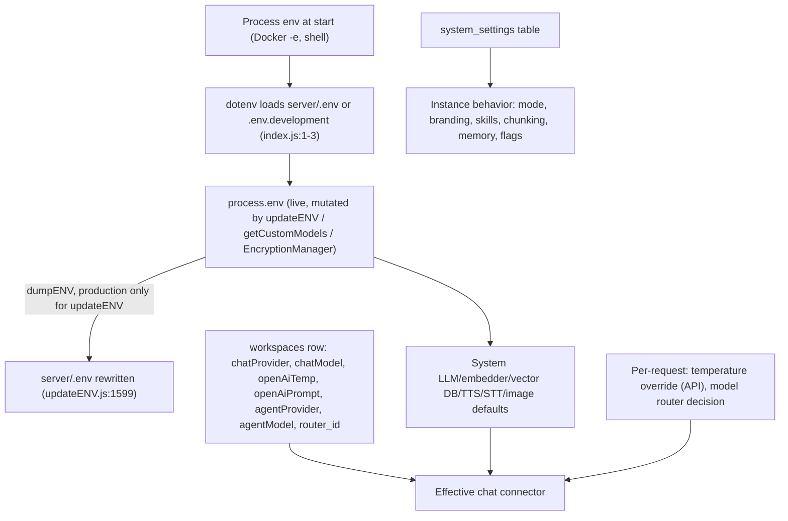

# 06 - ADMIN: system configuration and the runtime

Scope: how the server process boots (middleware, routes, static frontend, boot hooks, background
workers, telemetry, keys), and every path that reads or changes instance-wide configuration:
`.env`-backed provider settings (`POST /system/update-env` → `updateENV`), `system_settings`
labels (`/admin/system-preferences*`), branding, theme palettes, privacy/telemetry, experimental
toggles, agent skill settings, Security (single-user password, enable multi-user), event logs,
the admin workspace-chat viewer, logging, in-memory caches and the background job registry.
Left to other files: login/JWT/SSO/recovery and user/invite/role management (AUTH), chat and
model-router behavior (CHAT), document upload/embedding/live-sync internals (DOC), agent runtime,
MCP, flows and scheduled-job CRUD (AGENT), collector extensions (EXT), frontend pages (UI).

Sources: `server/index.js`, `server/utils/boot/*`, `server/utils/BackgroundWorkers/index.js`,
`server/jobs/*.js`, `server/utils/telemetry/index.js`, `server/models/telemetry.js`,
`server/models/systemSettings.js`, `server/models/eventLogs.js`, `server/utils/helpers/updateENV.js`,
`server/utils/helpers/customModels.js`, `server/endpoints/system.js`, `server/endpoints/admin.js`,
`server/endpoints/themePalettes.js`, `server/endpoints/utils.js`, `server/endpoints/utils/*.js`,
`server/endpoints/experimental/*.js`, `server/utils/AiProviders/embeddedLemonade/{endpoints,config}.js`,
`server/utils/comKey/index.js`, `server/utils/EncryptionManager/index.js`, `server/utils/logger/index.js`,
`server/utils/vectorStore/resetAllVectorStores.js`, `server/utils/helpers/contextWindowCache.js`,
`server/utils/router/index.js`, `server/utils/helpers/modelPricing/index.js`,
`server/utils/AiProviders/modelMap/index.js`, `server/utils/middleware/{multiUserProtected,validatedRequest,chatHistoryViewable}.js`,
`server/utils/helpers/index.js`, `docker/docker-entrypoint.sh`, `package.json`, `collector/index.js`.
Verified against commit `e82a80da`.

## 2. Mental model

**Actors.** The *operator* (sets process env / `.env` / Docker `-e`), the *admin* (UI Settings
pages; in single-user mode anyone who passes `validatedRequest`), the *manager* (multi-user only,
a narrow branding subset), the *runtime* itself (boot hooks, Bree jobs, in-process cron timers).

**Resources.**

| Resource | Store | Written by |
|---|---|---|
| Provider/secret config | `process.env` (live) mirrored to `server/.env` by `dumpENV` | `updateENV` (`server/utils/helpers/updateENV.js:1519`), `EncryptionManager` (`server/utils/EncryptionManager/index.js:38`), `/system/update-password`, `getCustomModels` side writes |
| Instance settings | `system_settings` rows `{label, value}` (string values) | `SystemSettings._updateSettings` (`server/models/systemSettings.js:728`) |
| Audit trail | `audit_events` (new rows) and legacy `event_logs` (read-only history, copied into `audit_events` as `legacy.<event>` by migration `20261111180000_audit_events`); outbox `storage/audit-outbox/<pid>.jsonl` | `audit.record` / `audit.recordOrFail` (`server/utils/audit/index.js`); `EventLogs.logEvent` is a wrapper that maps old event names to catalogue actions (`server/models/eventLogs.js:63`, `server/utils/audit/legacy.js`); see P-ADMIN-35 |
| Telemetry | PostHog (remote) | `Telemetry.sendTelemetry` (`server/models/telemetry.js:89`) |
| Keys | `storage/comkey/ipc-{priv,pub}.pem` (rolled every boot), `SIG_KEY`/`SIG_SALT` env, `storage/.../vapid-keys.json` | boot hooks |
| Branding assets | `storage/assets/*` + `logo_filename` label | `/system/upload-logo` |
| Background work | Bree jobs (child processes), `later` cron timers, `p-queue` | `BackgroundService` (`server/utils/BackgroundWorkers/index.js:12`) |

**Patterns.** Configuration is a *layered key-value store* with two write channels (env via
`KEY_MAPPING` registry, DB via `supportedFields` allowlist + `validations` map). Both channels use a
*validator registry* where validators can also perform side effects (cache purges, vector resets,
job (re)scheduling). The runtime uses *singletons* (`BackgroundService`, `MetaGenerator`,
`ModelRouterService`, `ModelPricing`, `Logger`) and *cache-aside* in-memory maps.

**Invariants the code relies on.**
- `multi_user_mode` row value `"true"` is the single source of truth for mode (`server/models/systemSettings.js:765-773`); `flexUserRoleValid` bypasses all role checks when it is not `"true"` (`server/utils/middleware/multiUserProtected.js:67-74`).
- Single-user mode with no `AUTH_TOKEN` or no `JWT_SECRET` (or `NODE_ENV=development`) means every `validatedRequest` route is open (`server/utils/middleware/validatedRequest.js:14-22`).
- A `system_settings` label exists at most once (`upsert where: { label }`, `server/models/systemSettings.js:744`).
- Values that are all asterisks are masked placeholders and are dropped by `updateENV` (`server/utils/helpers/updateENV.js:1524`).
- Embeddings are only valid for the (embedder, model, vector DB) triple that produced them; changing any of them triggers a full reset (`server/utils/helpers/updateENV.js:1411-1433`).

### Configuration layers and precedence

| Concern | Highest wins (left to right) | Evidence |
|---|---|---|
| Chat LLM provider | workspace `chatProvider` → `process.env.LLM_PROVIDER` → `"openai"` | `server/utils/helpers/index.js:737`, `:173` |
| Chat model | workspace `chatModel` → provider env pref (e.g. `OPEN_MODEL_PREF`) → hard-coded default | `server/utils/helpers/index.js:746`, `server/utils/AiProviders/openAi/index.js:31-32` |
| Temperature | per-request override (if `parseFloat >= 0`) → workspace `openAiTemp` → provider default; dropped if model rejects temperature | `server/utils/helpers/index.js:740-747`, `:138-143` |
| Router | when effective provider is `anythingllm-router`: workspace `router_id` → `MODEL_ROUTER_ID` env | `server/utils/helpers/index.js:742-764` |
| Agent provider/model | workspace `agentProvider` (+ `agentModel` or provider default) → workspace `chatProvider` = router → workspace `chatProvider`+`chatModel` → system `LLM_PROVIDER` + env default model → error | `server/utils/agents/index.js:420-440,476-500` |
| Embedder | `EMBEDDING_ENGINE` env only (no workspace override) | `server/utils/helpers/index.js:313-315` |
| Vector DB | `VECTOR_DB` env → `"lancedb"` (no workspace override) | `server/utils/helpers/index.js:87-88` |
| System prompt | workspace `openAiPrompt` → `saneDefaultSystemPrompt`; `default_system_prompt` label is only *copied* into new workspaces at create time | `server/utils/chats/index.js:126`, `server/models/workspace.js:210-218` |
| Env at boot vs `.env` | dotenv's default does not override variables already set in the process env (library behavior, **unverified** in repo), so Docker `-e` values beat `.env` on every restart even after a UI change was dumped to `.env` | `server/index.js:1-3` |

### In-memory caches and how they are invalidated

| Cache | Where | Keyed by | Invalidated by |
|---|---|---|---|
| Router configs + sticky routes + LLM classification | `ModelRouterService.routerCache` Map, `lastNotifiedRoute` Map (`server/utils/router/index.js:35-36`) | `router:<id>`; per (user, workspace, thread) | `invalidateRouter(id)` on router/rule edits (`server/endpoints/modelRouter.js:83,103,129,153,174,194`), `resetForWorkspace` on `/reset` (`server/utils/chats/commands/reset.js:22`), time windows (`DEFAULT_STICKY_MS` 5 min, `server/utils/router/index.js:27`) |
| Runtime context windows | `ContextWindowCache` per provider class (`server/utils/helpers/contextWindowCache.js:18`) used by lmstudio, llmman, foundry, localai, omlx, cerebras, ollama | `connection()` string (base path/auth) | connection change discards bucket (`:52-63`), TTL 5 min (`:1`); boot pre-warm (`server/utils/boot/eagerLoadContextWindows.js:9`); Foundry model change forces refresh (`updateENV.js:967`) |
| Static model map | `ContextWindowFinder` file cache `storage/models/context-windows/` (`server/utils/AiProviders/modelMap/index.js:32-38`) | provider | 3-day expiry, refetched from GitHub (`:28-30`) |
| Model pricing / reasoning | `ModelPricing` singleton + `storage/models/pricing/*` (`server/utils/helpers/modelPricing/index.js:69-93,172-193`) | - | 3-day expiry, ETag revalidation against `models.dev` |
| Generic OpenAI catalog | `catalogCache` Map (`server/utils/AiProviders/genericOpenAi/modelCatalog.js:32`) | base path + hash(apiKey, headers) | key change; `expiresAt` |
| Reasoning capability | `capabilityCache` Map (`server/utils/helpers/reasoningEffort.js:254`) | connector + model | TTL 5 min (`:252`) |
| Index page meta | `MetaGenerator.#customConfig` (`server/utils/boot/MetaGenerator.js:27`) | - | `clearConfig()` from `meta_page_title`/`meta_page_favicon` validators (`server/models/systemSettings.js:437,448`) |
| Telemetry cooldown | `TelemetryCooldown` Map (`server/models/telemetry.js:7`) | event name | process restart; per-event debounce seconds (`:19-32`) |
| User locale | `UserMetaCache.#cache` (`server/utils/userLocale.js:22`) | user id or `"primary"` | overwritten per request (`server/utils/middleware/validatedRequest.js:20`) |
| Native embedder pipelines | `NativeEmbedder.#pipelines`, `#pipelinePromises` (`server/utils/EmbeddingEngines/native/index.js:13-15`) | model | none found (process lifetime) |
| Foundry loaded models | `FoundryLLM.#loadedModels` Set (`server/utils/AiProviders/foundry/index.js:70`) | model | `unloadModelFromEngine` on model change (`updateENV.js:967`) |
| Embedding workers / SSE | `runningWorkers`, `sseConnections`, `eventHistory` Maps (`server/utils/EmbeddingWorkerManager.js:5-11`) | workspace slug | worker completion; `eventHistory.delete(slug)` on new run (`:104`) |
| Agent invocation extras | `invocationAttachmentsCache`, `invocationReasoningEffortCache` (`server/utils/chats/agents.js:14,43`) | invocation | owned by AGENT domain |
| Mobile pairing | `TemporaryMobileDeviceRequests` Map (`server/models/mobileDevice.js:19`) | request | owned by AUTH/mobile |
| Scheduled job timers | `#scheduledJobTimers`, `#scheduledJobVersions`, `#scheduledJobWorkers` (`server/utils/BackgroundWorkers/index.js:18-27`) | job id | `syncScheduledJob`, `removeScheduledJob`, `stop()` |
| Embedded Lemonade download | module `activeDownload` (`server/utils/AiProviders/embeddedLemonade/endpoints.js:10`) | - | finish/abort |
| Provider integration bridges | Gmail/Calendar/Outlook bridges | - | `.reset()` in their `system_settings` validators (`server/models/systemSettings.js:300,343,396`) |

Nothing invalidates provider caches when `updateENV` changes a key other than the hooks listed in
the KEY_MAPPING table; connectors are constructed per request from `process.env`, so most changes
take effect on the next request without a cache flush.

### Settings with destructive or far-reaching side effects

| Setting (channel) | Effect | Where |
|---|---|---|
| `VectorDB` (env) | Deletes **all** `document_vectors` and `workspace_documents` rows, purges `vector-cache`, deletes every workspace namespace in the *previous* vector DB (pgvector: drops table) | `server/utils/helpers/updateENV.js:1413-1417`, `server/utils/vectorStore/resetAllVectorStores.js:19-49` |
| `EmbeddingEngine`, `EmbeddingModelPref`, `AzureOpenAiEmbeddingModelPref` (env) | Same full reset against the *current* vector DB | `server/utils/helpers/updateENV.js:1420-1431` |
| `EmbeddingModelPref` with native embedder | Starts a model download | `server/utils/helpers/updateENV.js:1440-1449` |
| `text_splitter_chunk_size`, `text_splitter_chunk_overlap` (DB) | Purges the entire `vector-cache` folder on *every* save, even when the value is unchanged | `server/models/systemSettings.js:127-128,142-143`, `server/utils/files/index.js:805-809` |
| `LLMProvider` (env) | Starts or stops the embedded Lemonade engine (child process) | `server/utils/AiProviders/embeddedLemonade/config.js:157-166` |
| `FoundryModelPref` (env) | Unloads previous model from Foundry | `server/utils/helpers/updateENV.js:967-978` |
| `PGVectorConnectionString` (env) | Connects to the database during validation and sets env *before* the main write | `server/utils/helpers/updateENV.js:1471-1487` |
| `AuthToken`/`JWTSecret` (`/system/update-password`) | Rotates `JWT_SECRET`, invalidating every session; disabling sets both to `""` opening all routes | `server/endpoints/system.js:632-654` |
| Enable multi-user (`/system/enable-multi-user`) | One-way mode switch: reassigns chats/threads/memories/devices/keys/presets to the new admin, clears single-user skill whitelist; on exception **deletes all users** | `server/endpoints/system.js:693-718` |
| `experimental_live_file_sync` toggle | `boot()`s or `stop()`s the *whole* `BackgroundService` singleton, not just the sync job | `server/endpoints/experimental/liveSync.js:46-49`, `server/models/documentSyncQueue.js:42-48` |
| `memory_enabled`, `memory_auto_extraction` (DB) | Adds/removes the `extract-memories` Bree job | `server/models/systemSettings.js:198-236`, `server/utils/BackgroundWorkers/index.js:178-197` |
| `DisableTelemetry` (env) | Sends one final `telemetry_disabled` event; takes effect on next `client()` call | `server/utils/helpers/updateENV.js:631-639`, `server/models/telemetry.js:50` |
| `meta_page_title`/`meta_page_favicon` (DB) | Clears index-page meta cache | `server/models/systemSettings.js:430-450` |
| `DELETE /system/event-logs` | Deletes only legacy `event_logs` rows (`EventLogs.delete`, `server/models/eventLogs.js:152`); `audit_events` rows can't be deleted through the app; records `audit.cleared` via legacy `event_logs_cleared` (F-54, route removal planned for PR B) | `server/endpoints/system.js:1351-1358` |
| `DELETE /system/workspace-chats/-1` | Hard-deletes every chat in the instance; records `chat.bulk_deleted` | `server/endpoints/system.js:1425` |
| Any `updateENV` call in production | Rewrites `server/.env` from a fixed key allowlist; keys outside it are dropped from the file, values truncated at the first quote/`#`/whitespace-class char | `server/utils/helpers/updateENV.js:1573,1599-1733` |

## 3. Entry points

| ID | Channel | Method + path / event / job | Middleware chain | Handler (path:line) | Who can call |
|---|---|---|---|---|---|
| E-ADMIN-01 | boot | `node server/index.js` | - | `server/index.js:1-198` | operator |
| E-ADMIN-02 | boot | docker entrypoint | - | `docker/docker-entrypoint.sh:19-29` | container |
| E-ADMIN-03 | collector | `node collector/index.js` | - | `collector/index.js:226-228` | container |
| E-ADMIN-04 | ui | `GET /api/ping`, `GET /api/migrate` | none | `server/endpoints/system.js:85,89` | anyone |
| E-ADMIN-05 | ui | `GET /api/env-dump` | none | `server/endpoints/system.js:95` | anyone (no-op outside production) |
| E-ADMIN-06 | ui | `GET /api/onboarding` / `POST /api/onboarding` | none / `validatedRequest` | `server/endpoints/system.js:102,112` | anyone / authed |
| E-ADMIN-07 | ui | `GET /api/setup-complete` | none | `server/endpoints/system.js:125` | anyone |
| E-ADMIN-08 | ui | `GET /api/system/document-processing-status`, `GET /api/system/accepted-document-types` | `validatedRequest` | `server/endpoints/system.js:567,581` | authed |
| E-ADMIN-09 | ui | `POST /api/system/update-env` | `validatedRequest`, `flexUserRoleValid([admin])` | `server/endpoints/system.js:600` | admin (any authed in single-user) |
| E-ADMIN-10 | ui | `POST /api/system/update-password` | `validatedRequest` | `server/endpoints/system.js:619` | single-user only (401 in multi-user, `:625`) |
| E-ADMIN-11 | ui | `POST /api/system/enable-multi-user` | `validatedRequest` | `server/endpoints/system.js:665` | single-user authed |
| E-ADMIN-12 | ui | `GET /api/system/multi-user-mode` | none | `server/endpoints/system.js:727` | anyone |
| E-ADMIN-13 | ui | `GET /api/system/logo`, `GET /api/system/is-default-logo`, `GET /api/system/custom-app-name` | none | `server/endpoints/system.js:737,1009,799` | anyone |
| E-ADMIN-14 | ui | `GET /api/system/footer-data`, `GET /api/system/support-email` | `validatedRequest` | `server/endpoints/system.js:771,783` | authed |
| E-ADMIN-15 | ui | `POST /api/system/upload-logo` | `validatedRequest`, `flexUserRoleValid([admin, manager])`, `handleAssetUpload` | `server/endpoints/system.js:970` | admin, manager |
| E-ADMIN-16 | ui | `GET /api/system/remove-logo` | `validatedRequest`, `flexUserRoleValid([admin, manager])` | `server/endpoints/system.js:1021` | admin, manager |
| E-ADMIN-17 | ui | `GET`/`POST /api/system/default-system-prompt` | `validatedRequest`, `flexUserRoleValid([all])` / `([admin])` | `server/endpoints/system.js:882,907` | all / admin |
| E-ADMIN-18 | ui | `POST /api/system/custom-models` | `validatedRequest`, `flexUserRoleValid([admin])` | `server/endpoints/system.js:1120` | admin |
| E-ADMIN-19 | ui | `POST /api/system/event-logs`, `DELETE /api/system/event-logs` | `validatedRequest`, `flexUserRoleValid([admin])` | `server/endpoints/system.js:1148,1170` | admin |
| E-ADMIN-20 | ui | `POST /api/system/workspace-chats` | `chatHistoryViewable`, `validatedRequest`, `flexUserRoleValid([admin, manager])` | `server/endpoints/system.js:1189` | admin, manager |
| E-ADMIN-21 | ui | `DELETE /api/system/workspace-chats/:id` | `validatedRequest`, `flexUserRoleValid([admin, manager])` | `server/endpoints/system.js:1218` | admin, manager |
| E-ADMIN-22 | ui | `GET /api/system/export-chats` | `chatHistoryViewable`, `validatedRequest`, `flexUserRoleValid([manager, admin])` | `server/endpoints/system.js:1235` | admin, manager |
| E-ADMIN-23 | ui | `GET/POST /api/system/prompt-variables`, `PUT/DELETE /api/system/prompt-variables/:id` | `validatedRequest`, `flexUserRoleValid([all])` (GET) / `([admin])` | `server/endpoints/system.js:1427,1445,1481,1523` | all / admin |
| E-ADMIN-24 | ui | `POST /api/system/transcribe-audio` | `validatedRequest`, `flexUserRoleValid([all])`, `handleAudioUpload` | `server/endpoints/system.js:1551` | all authed |
| E-ADMIN-25 | ui | `POST /api/system/validate-sql-connection` | `validatedRequest`, `flexUserRoleValid([admin])` | `server/endpoints/system.js:1588` | admin |
| E-ADMIN-26 | ui | `GET /api/admin/system-preferences-for?labels=` | `validatedRequest`, `flexUserRoleValid([admin, manager])` | `server/endpoints/admin.js:331` | admin, manager (subset) |
| E-ADMIN-27 | ui | `POST /api/admin/system-preferences` | `validatedRequest`, `flexUserRoleValid([admin, manager])` | `server/endpoints/admin.js:465` | admin, manager (subset) |
| E-ADMIN-28 | ui | `GET /api/system/theme-palettes` | none | `server/endpoints/themePalettes.js:9` | anyone |
| E-ADMIN-29 | ui | `POST /api/experimental/toggle-live-sync` | `validatedRequest`, `flexUserRoleValid([admin])` | `server/endpoints/experimental/liveSync.js:20` | admin |
| E-ADMIN-30 | ui | `POST /api/utils/lemonade/download-model`, `POST /api/utils/lemonade/delete-model` | `validatedRequest`, `flexUserRoleValid([admin])` | `server/endpoints/utils/lemonadeUtilsEndpoints.js:15,111` | admin |
| E-ADMIN-31 | ui | `POST /api/utils/foundry/capabilities` | `validatedRequest`, `flexUserRoleValid([admin])` | `server/endpoints/utils/foundryUtilsEndpoints.js:12` | admin |
| E-ADMIN-32 | ui | `GET /api/utils/embedded-lemonade/{status,recommendations}`, `POST`/`DELETE .../download-model`, `DELETE .../remove-model` | `validatedRequest`, `flexUserRoleValid([admin, manager])` | `server/utils/AiProviders/embeddedLemonade/endpoints.js:26,35,50,100,110` | admin, manager (only registered when engine enabled, `:21`) |
| E-ADMIN-33 | ui | `GET /api/admin/agent-skills/{gmail,google-calendar,outlook}/status`, `POST .../outlook/{auth-url,revoke}`, `GET /api/agent-skills/outlook/auth-callback` | `validatedRequest`, `isSingleUserMode` | `server/endpoints/utils/googleAgentSkillEndpoints.js:13,41`, `server/endpoints/utils/outlookAgentUtils.js:21,89,134,172` | single-user only |
| E-ADMIN-34 | ui | `GET /api/utils/metrics` | none (404 if `DISABLE_METRICS_ENDPOINT=true`) | `server/endpoints/utils.js:16` | anyone |
| E-ADMIN-35 | ui | `POST /api/v/:command` (development only) | none | `server/index.js:163` | anyone, dev builds |
| E-ADMIN-36 | ui | `GET /manifest.json`, `GET /robots.txt`, static `server/public`, SPA fallback `/` | none | `server/index.js:136,152,141,157` | anyone (production) |
| E-ADMIN-37 | job | `cleanup-orphan-documents` every 12hr | Bree | `server/utils/BackgroundWorkers/index.js:30-34`, `server/jobs/cleanup-orphan-documents.js:47` | runtime |
| E-ADMIN-38 | job | `cleanup-generated-files` every 8hr | Bree | `server/utils/BackgroundWorkers/index.js:35-39`, `server/jobs/cleanup-generated-files.js:11` | runtime |
| E-ADMIN-39 | job | `cleanup-generated-images` every 9hr | Bree | `server/utils/BackgroundWorkers/index.js:40-44`, `server/jobs/cleanup-generated-images.js:16` | runtime |
| E-ADMIN-40 | job | `extract-memories` every `MEMORY_EXTRACTION_INTERVAL` (default 3hr) when auto-memories on | Bree | `server/utils/BackgroundWorkers/index.js:47-52,168` | runtime |
| E-ADMIN-41 | job | `sync-watched-documents` every 1hr when live sync on | Bree | `server/utils/BackgroundWorkers/index.js:54-61,169` | runtime |
| E-ADMIN-42 | job | `run-scheduled-job` per enabled scheduled job cron (single-user only) | `later.setInterval` → p-queue → Bree one-off | `server/utils/BackgroundWorkers/index.js:274-309,394-475` | runtime |
| E-ADMIN-43 | job | `embedding-worker` on demand | `spawnWorker` | `server/utils/EmbeddingWorkerManager.js:106-109` | runtime |
| E-ADMIN-44 | job | `handle-telegram-chat` on demand | `bree.add` + `bree.run` | `server/utils/telegramBot/index.js:492-508` | runtime |

## 4. User paths

### P-ADMIN-01 Server process boot (HTTP or HTTPS)

- **Actor and preconditions:** operator runs `yarn start`/`node index.js`; `ENABLE_HTTPS` selects SSL.
- **Steps (require time, in order):**
  1. dotenv loads `.env.development` in development, else `.env` (`server/index.js:1-3`).
  2. Logger singleton; in production replaces `console.log/error/info` with winston (`server/index.js:5`, `server/utils/logger/index.js:8-54`). Note `console.info` maps to `logger.warn` (`:51-53`).
  3. `patchSdkTimeouts()` sets undici global dispatcher timeouts (default 600 s, `ANYTHINGLLM_FETCH_TIMEOUT`) and monkey-patches OpenAI/Anthropic SDK `buildRequest`/`makeRequest` to inject `timeout` and `maxRetries` (default 0, `ANYTHINGLLM_MAX_RETRIES`) (`server/utils/boot/patchSdkTimeouts.js:16-107`).
  4. `require("./utils/helpers/modelPricing")` constructs `ModelPricing` singleton, refreshing from `https://models.dev/api.json` when the 3-day disk cache is stale (`server/utils/helpers/modelPricing/index.js:69-70,172-193,403`).
  5. Requiring endpoint modules instantiates `EncryptionManager` at module scope in `validatedRequest.js` (`server/utils/middleware/validatedRequest.js:6`): if `SIG_KEY`/`SIG_SALT` are missing it generates them and calls `dumpENV()` regardless of `NODE_ENV` (`server/utils/EncryptionManager/index.js:38-42`).
- **Steps (middleware order):** optional dev `httpLogger` (`server/index.js:57-66`) → `cors({ origin: true })` reflects any origin (`:67`) → `/api/embed` parsers at 1 MB (`:70-74`) → global text/json/urlencoded at 3 GB (`:75-82`) → body-error handler 413/400 (`:83-90`) → websockets via `express-ws` (non-SSL `:95`, SSL `server/utils/boot/index.js:48`) → `app.use("/api", apiRouter)` (`server/index.js:98`) → 28 endpoint registrars in fixed order (`:99-130`; `developerEndpoints` also mounts on `app`, `:115`) → production: `/manifest.json`, static `server/public` with `X-Frame-Options: DENY` (`:141-150`), `/robots.txt` disallow-all (`:152-155`), SPA fallback via `MetaGenerator.generate` (`:157-160`, `server/utils/boot/MetaGenerator.js:321-324`) → development: `/api/v/:command` (`server/index.js:163`) → `app.all("*") 404` (`:192`).
- **Steps (listen callback, both modes, `server/utils/boot/index.js:68-79` and `:34-45`):** `migrateWebBrowsingToDefault` → `markOnboarded` → `setupTelemetry` → `new CommunicationKey(true)` → `new EncryptionManager()` → `new BackgroundService().boot()` (not awaited) → `eagerLoadContextWindows` → `PushNotifications.setupPushNotificationService` → `TelegramBotService.bootIfActive`.
- **Reads:** `system_settings` (`__migration_web_browser_to_default`, `onboarding_complete`, `default_agent_skills`, `disabled_agent_skills`, `multi_user_mode`, `telemetry_id`, `memory_*`, `experimental_live_file_sync`), `scheduled_jobs`, `scheduled_job_runs`, `external_communication_connectors` (telegram), env.
- **State changes:**
  - `system_settings.__migration_web_browser_to_default: null → "true"` once (`server/utils/boot/migrateWebBrowsingToDefault.js:89-91`); existing onboarded instances get `web-browsing` removed from `default_agent_skills` or added to `disabled_agent_skills` (`:49-75`).
  - `system_settings.onboarding_complete → "true"` for legacy instances where `LLM_PROVIDER`, `VECTOR_DB`, `AUTH_TOKEN`/`JWT_SECRET` or multi-user is set (`server/utils/boot/markOnboarded.js:37-50,19`), which also sends `onboarding_complete` telemetry (`server/models/systemSettings.js:816-821`).
  - `system_settings.telemetry_id` created (uuid v4) if missing (`server/models/telemetry.js:133-145`).
  - `storage/comkey/ipc-priv.pem`, `ipc-pub.pem` rewritten every boot (`server/utils/comKey/index.js:40-65`).
  - `scheduled_job_runs.status: queued|running → failed` with error "Server restarted during execution" (`server/models/scheduledJobRun.js:306-321`); `scheduled_jobs.nextRunAt` recomputed (`server/utils/BackgroundWorkers/index.js:284`).
  - `vapid-keys.json` written if missing (`server/utils/PushNotifications/index.js:205-216`).
- **Side effects:** `TEL` `server_boot {commit}` (`server/utils/telemetry/index.js:27`); `NET:posthog`; `NET:models.dev`; `FS`; `PROC` (Bree jobs, embedded Lemonade engine install/spawn when enabled, `server/utils/AiProviders/embeddedLemonade/endpoints.js:24`); `TIME` (Bree intervals, cron timers); `CACHE` (context windows for local providers, `server/utils/boot/eagerLoadContextWindows.js:16-52`); `NET:telegram` if bot active; `ENV` (SIG keys).
- **Failure and edge paths:** SSL key read failure falls back to HTTP (`server/utils/boot/index.js:50-61`). Boot hooks are sequential `await`s with no try/catch around the group: a throw from `setupTelemetry` or `eagerLoadContextWindows` would skip the later hooks (**unverified** whether any of them can throw; `markOnboarded` and the migration catch internally). `BackgroundService().boot()` is not awaited, so its rejection is unhandled.
- **Notes:**
  - `catchSigTerms` (telemetry flush on SIGINT/SIGUSR2) is only attached as the listen `error` handler (`server/utils/boot/index.js:46,80,85-94`), so in a normal run it is never installed.
  - MCP servers are not started at boot; `MCPCompatibilityLayer` is constructed lazily by endpoints (`server/endpoints/mcpServers.js:17`), creating `storage/plugins/anythingllm_mcp_servers.json` on first use (`server/utils/MCP/hypervisor/index.js:75-96`).
  - `server/utils/database/index.js` contains a second `server_boot` sender (`:104`) but no file requires it (grep), so it appears dead.

### P-ADMIN-02 Container start: Prisma migrations and the two processes

- **Actor and preconditions:** Docker image entrypoint; `STORAGE_DIR` should be set (warning only, `docker/docker-entrypoint.sh:4-17`).
- **Steps:** `CHECKPOINT_DISABLE=1` → `npx prisma generate` → `npx prisma migrate deploy` → `node /app/server/index.js` in one background group; `node /app/collector/index.js` in another; `wait -n` exits when either process exits (`docker/docker-entrypoint.sh:19-29`). Local dev uses `yarn prisma:setup` = generate + `migrate dev --name init` + seed (`package.json:30-33`); `prisma:reset` truncates `server/storage/anythingllm.db` (`package.json:34`).
- **Reads/State changes:** SQLite schema migrated (`DB`, all tables). Prisma client logs `error, info, warn` (`server/utils/prisma/index.js:8-11`).
- **Failure and edge paths:** a failed migration short-circuits `&&` so the server never starts but the collector keeps running until `wait -n` sees the server group exit.
- **Notes:** the server itself never runs migrations; `/api/migrate` is a no-op 200 (`server/endpoints/system.js:89-91`).

### P-ADMIN-03 Collector process boot

- **Steps:** dotenv + logger (`collector/index.js:1-5`), `cors({origin:true})` and 3 GB parsers (`:35-43`); routes `/process` (`:46`), `/parse` (`:76`), `/process-link` (`:110`), `/util/get-link` (`:140`), `/util/convert-audio-to-wav` (`:164`), `/process-raw-text` (`:189`), all behind `verifyPayloadIntegrity`; `extensions(app)` (`:215`); `GET /accepts` (`:217`); on listen `wipeCollectorStorage()` (`:226-228`).
- **State changes:** collector hot/temp storage wiped (`FS`, **unverified** exact paths; see EXT/DOC files).
- **Notes:** integrity check relies on the server's per-boot RSA key (`server/utils/comKey/index.js:12-20`). The server checks liveness via `GET /api/system/document-processing-status` → `CollectorApi.online()` (`server/endpoints/system.js:567-579`).

### P-ADMIN-04 Public instance state reads

- **Actor:** anyone, including unauthenticated browsers before login.
- **Steps:** `GET /api/setup-complete` → `SystemSettings.currentSettings()` (`server/endpoints/system.js:125-133`, `server/models/systemSettings.js:462-663`); `GET /api/onboarding` (`server/endpoints/system.js:102`); `GET /api/system/multi-user-mode` (`:727`); `GET /api/ping` (`:85`); `GET /api/utils/metrics` (`server/endpoints/utils.js:16-36`).
- **Reads:** env, `system_settings`, `workspace_documents` count (`hasEmbeddings`, `server/models/systemSettings.js:838-847`), vector-cache folder (`hasVectorCachedFiles`), disk usage.
- **State changes:** none. **Side effects:** none.
- **Notes:** `currentSettings` returns secrets only as booleans but returns raw base paths/URLs, model prefs, `StorageDir`, `ChromaApiHeader`, `PineConeIndex`, compliance flags and SSO redirect (`server/models/systemSettings.js:476-662`); the code comment calls this intentional (`server/endpoints/system.js:122-124`). `/utils/metrics` returns git version, mode, vector DB and disk stats unauthenticated.

### P-ADMIN-05 Complete onboarding

- **Actor:** authed caller (`validatedRequest`; open in single-user without a password).
- **Steps:** UI onboarding → `POST /api/onboarding` → `SystemSettings.markOnboardingComplete()` (`server/endpoints/system.js:112-120`, `server/models/systemSettings.js:816-826`).
- **State changes:** `system_settings.onboarding_complete: null → "true"`.
- **Side effects:** `TEL` `onboarding_complete`.
- **Notes:** `onboarding_complete` is listed in `protectedFields` (`server/models/systemSettings.js:41`) but `protectedFields` is not referenced anywhere else (grep), so the list is inert; protection actually comes from `onboarding_complete` not being in `supportedFields`.

### P-ADMIN-06 Update env-backed settings (`POST /api/system/update-env`)

- **Actor and preconditions:** admin in multi-user; any authed caller in single-user. Used by LLM, Embedder, Vector DB, Transcription, Audio (TTS/STT), Image generation, Privacy and Agent search-provider key forms (`frontend/src/models/system.js:219-220`).
- **Steps:** `server/endpoints/system.js:600-617` → `updateENV(body, false, userId)` (`server/utils/helpers/updateENV.js:1519`):
  1. Keep only body keys present in `KEY_MAPPING` and not all-asterisk (`:1522-1525`).
  2. For each key in body order: run `checks` with `(value, force)` (`:1539`, `:1577-1582`); string results are errors → append and `break` (`:1543-1546`).
  3. Run `preUpdate(key, prev, next)` hooks; error → `break` (`:1550-1560`).
  4. `process.env[envKey] = nextValue` (`:1563`), then `postUpdate` hooks awaited in order (`:1565-1566`).
  5. After loop: `postSettled` hooks (none defined), `logChangesToEventLog` for `LLMProvider`/`EmbeddingEngine`/`VectorDB` (`:1569-1572`, `:1584-1597`), `dumpENV()` only when `NODE_ENV=production` (`:1573`).
- **Reads:** `process.env`.
- **State changes:** `process.env.<ENV>: prev → next` per accepted key; `server/.env` rewritten (production).
- **Side effects:** `ENV`, `FS` (`server/.env`), `LOG` (`update_llm_provider`, `update_embedding_engine`, `update_vector_db`), plus per-key hooks (P-ADMIN-07..09).
- **Failure and edge paths:** **partial apply** - keys before the failing one are already in `process.env`, their `postUpdate` hooks (including vector resets) have run, and `dumpENV` still persists them; the response is 200 with `{newValues, error}` (`server/endpoints/system.js:611`). `requiresForceMode` makes `AuthToken`/`JWTSecret` unsettable through this route (`server/utils/helpers/updateENV.js:1375-1377`). `isInteger` returns a number, never a string, so it never rejects (`:1138-1141`). Keys absent from `KEY_MAPPING` are silently ignored.
- **Notes:** `dumpENV` writes only `KEY_MAPPING` env keys plus a fixed allowlist (`:1604-1708`, e.g. `JWT_EXPIRY`, `STORAGE_DIR`, `SIG_KEY`, password-policy keys, `DISABLE_VIEW_CHAT_HISTORY`, SSO keys, timeouts); any other operator-set variable present in `.env` is dropped from the rewritten file. Values are cut at the first `"`, `'`, backtick, `#` or Unicode whitespace (`:1711-1718`), silently truncating secrets that contain those characters. File path is always `server/.env` (`:1731`), never `.env.development` or `STORAGE_DIR`.

#### KEY_MAPPING registry (every entry)

Validators are defined at `server/utils/helpers/updateENV.js:1119-1409`; hook functions at `:1411-1513`.
Line numbers below are in `server/utils/helpers/updateENV.js`. Two entries come from
`server/utils/AiProviders/embeddedLemonade/config.js:139-148` via spread at `updateENV.js:1065`.

| Line | UI key | ENV | Checks | Hooks |
|---|---|---|---|---|
| 5 | `LLMProvider` | `LLM_PROVIDER` | isNotEmpty, supportedLLM | post: manageEngineOnProviderChange |
| 14 | `ModelRouterId` | `MODEL_ROUTER_ID` | - | |
| 19 | `OpenAiKey` | `OPEN_AI_KEY` | isNotEmpty, validOpenAIKey | |
| 23 | `OpenAiModelPref` | `OPEN_MODEL_PREF` | isNotEmpty | |
| 28 | `AzureOpenAiEndpoint` | `AZURE_OPENAI_ENDPOINT` | isNotEmpty | |
| 32 | `AzureOpenAiTokenLimit` | `AZURE_OPENAI_TOKEN_LIMIT` | validOpenAiTokenLimit | |
| 36 | `AzureOpenAiKey` | `AZURE_OPENAI_KEY` | isNotEmpty | |
| 40 | `AzureOpenAiModelPref` | `AZURE_OPENAI_MODEL_PREF` | isNotEmpty | |
| 44 | `AzureOpenAiEmbeddingModelPref` | `EMBEDDING_MODEL_PREF` | isNotEmpty | post: handleVectorStoreReset |
| 49 | `AzureOpenAiModelType` | `AZURE_OPENAI_MODEL_TYPE` | enum["default", "reasoning"] | |
| 58 | `AzureOpenAiAgentApi` | `AZURE_OPENAI_AGENT_API` | enum["chat", "responses"] | |
| 69 | `AnthropicApiKey` | `ANTHROPIC_API_KEY` | isNotEmpty, validAnthropicApiKey | |
| 73 | `AnthropicModelPref` | `ANTHROPIC_MODEL_PREF` | isNotEmpty | |
| 77 | `AnthropicCacheControl` | `ANTHROPIC_CACHE_CONTROL` | enum["none", "5m", "1h"] | |
| 87 | `GeminiLLMApiKey` | `GEMINI_API_KEY` | isNotEmpty | |
| 91 | `GeminiLLMModelPref` | `GEMINI_LLM_MODEL_PREF` | isNotEmpty | |
| 95 | `GeminiSafetySetting` | `GEMINI_SAFETY_SETTING` | validGeminiSafetySetting | |
| 101 | `LMStudioBasePath` | `LMSTUDIO_BASE_PATH` | isNotEmpty, validLLMExternalBasePath, validDockerizedUrl | |
| 105 | `LMStudioModelPref` | `LMSTUDIO_MODEL_PREF` | - | |
| 109 | `LMStudioTokenLimit` | `LMSTUDIO_MODEL_TOKEN_LIMIT` | - | |
| 113 | `LMStudioAuthToken` | `LMSTUDIO_AUTH_TOKEN` | - | |
| 119 | `LocalAiBasePath` | `LOCAL_AI_BASE_PATH` | isNotEmpty, validLLMExternalBasePath, validDockerizedUrl | |
| 123 | `LocalAiModelPref` | `LOCAL_AI_MODEL_PREF` | - | |
| 127 | `LocalAiTokenLimit` | `LOCAL_AI_MODEL_TOKEN_LIMIT` | - | |
| 131 | `LocalAiApiKey` | `LOCAL_AI_API_KEY` | - | |
| 136 | `OllamaLLMBasePath` | `OLLAMA_BASE_PATH` | isNotEmpty, validOllamaLLMBasePath, validDockerizedUrl | |
| 140 | `OllamaLLMModelPref` | `OLLAMA_MODEL_PREF` | - | |
| 144 | `OllamaLLMTokenLimit` | `OLLAMA_MODEL_TOKEN_LIMIT` | - | |
| 148 | `OllamaLLMKeepAliveSeconds` | `OLLAMA_KEEP_ALIVE_TIMEOUT` | isInteger (never rejects) | |
| 152 | `OllamaLLMAuthToken` | `OLLAMA_AUTH_TOKEN` | - | |
| 158 | `MistralApiKey` | `MISTRAL_API_KEY` | isNotEmpty | |
| 162 | `MistralModelPref` | `MISTRAL_MODEL_PREF` | isNotEmpty | |
| 168 | `KoboldCPPBasePath` | `KOBOLD_CPP_BASE_PATH` | isNotEmpty, isValidURL | |
| 172 | `KoboldCPPModelPref` | `KOBOLD_CPP_MODEL_PREF` | isNotEmpty | |
| 176 | `KoboldCPPTokenLimit` | `KOBOLD_CPP_MODEL_TOKEN_LIMIT` | - | |
| 180 | `KoboldCPPMaxTokens` | `KOBOLD_CPP_MAX_TOKENS` | - | |
| 186 | `TextGenWebUIBasePath` | `TEXT_GEN_WEB_UI_BASE_PATH` | isValidURL | |
| 190 | `TextGenWebUITokenLimit` | `TEXT_GEN_WEB_UI_MODEL_TOKEN_LIMIT` | nonZero | |
| 194 | `TextGenWebUIAPIKey` | `TEXT_GEN_WEB_UI_API_KEY` | - | |
| 200 | `LiteLLMModelPref` | `LITE_LLM_MODEL_PREF` | isNotEmpty | |
| 204 | `LiteLLMTokenLimit` | `LITE_LLM_MODEL_TOKEN_LIMIT` | nonZero | |
| 208 | `LiteLLMBasePath` | `LITE_LLM_BASE_PATH` | isValidURL | |
| 212 | `LiteLLMApiKey` | `LITE_LLM_API_KEY` | - | |
| 218 | `GenericOpenAiBasePath` | `GENERIC_OPEN_AI_BASE_PATH` | isValidURL | |
| 222 | `GenericOpenAiModelPref` | `GENERIC_OPEN_AI_MODEL_PREF` | isNotEmpty | |
| 226 | `GenericOpenAiTokenLimit` | `GENERIC_OPEN_AI_MODEL_TOKEN_LIMIT` | nonZero | |
| 230 | `GenericOpenAiKey` | `GENERIC_OPEN_AI_API_KEY` | - | |
| 234 | `GenericOpenAiMaxTokens` | `GENERIC_OPEN_AI_MAX_TOKENS` | nonNegative | |
| 240 | `AwsBedrockLLMApiKey` | `AWS_BEDROCK_LLM_API_KEY` | isNotEmpty | |
| 244 | `AwsBedrockLLMRegion` | `AWS_BEDROCK_LLM_REGION` | isNotEmpty | |
| 248 | `AwsBedrockLLMModel` | `AWS_BEDROCK_LLM_MODEL_PREFERENCE` | isNotEmpty | |
| 252 | `AwsBedrockLLMTokenLimit` | `AWS_BEDROCK_LLM_MODEL_TOKEN_LIMIT` | nonZero | |
| 256 | `AwsBedrockLLMMaxTokens` | `AWS_BEDROCK_LLM_MAX_TOKENS` | - | |
| 261 | `EmbeddingEngine` | `EMBEDDING_ENGINE` | supportedEmbeddingModel | post: handleVectorStoreReset |
| 266 | `EmbeddingBasePath` | `EMBEDDING_BASE_PATH` | isNotEmpty, validDockerizedUrl | |
| 270 | `EmbeddingModelPref` | `EMBEDDING_MODEL_PREF` | isNotEmpty | post: handleVectorStoreReset, downloadEmbeddingModelIfRequired |
| 275 | `EmbeddingModelMaxChunkLength` | `EMBEDDING_MODEL_MAX_CHUNK_LENGTH` | nonZero | |
| 279 | `EmbeddingOutputDimensions` | `EMBEDDING_OUTPUT_DIMENSIONS` | - | |
| 283 | `OllamaEmbeddingBatchSize` | `OLLAMA_EMBEDDING_BATCH_SIZE` | nonZero | |
| 289 | `GeminiEmbeddingApiKey` | `GEMINI_EMBEDDING_API_KEY` | isNotEmpty | |
| 295 | `GenericOpenAiEmbeddingApiKey` | `GENERIC_OPEN_AI_EMBEDDING_API_KEY` | - | |
| 299 | `GenericOpenAiEmbeddingMaxConcurrentChunks` | `GENERIC_OPEN_AI_EMBEDDING_MAX_CONCURRENT_CHUNKS` | nonZero | |
| 303 | `GenericOpenAiEmbeddingPassagePrefix` | `GENERIC_OPEN_AI_EMBEDDING_PASSAGE_PREFIX` | - | |
| 307 | `GenericOpenAiEmbeddingQueryPrefix` | `GENERIC_OPEN_AI_EMBEDDING_QUERY_PREFIX` | - | |
| 313 | `ImageGenerationProvider` | `IMAGE_GEN_PROVIDER` | isNotEmpty, supportedImageGenerationProvider | |
| 317 | `ImageGenerationModelPref` | `IMAGE_GEN_MODEL_PREF` | - | |
| 321 | `ImageGenerationDimensions` | `IMAGE_GEN_SIZE_PREF` | - | |
| 325 | `ImageGenerationOpenAiKey` | `IMAGE_GEN_OPENAI_KEY` | isNotEmpty, validOpenAIKey | |
| 329 | `ImageGenerationOpenRouterApiKey` | `IMAGE_GEN_OPENROUTER_API_KEY` | isNotEmpty | |
| 333 | `ImageGenerationOllamaBasePath` | `IMAGE_GEN_OLLAMA_BASE_PATH` | isNotEmpty, validOllamaLLMBasePath, validDockerizedUrl | |
| 337 | `ImageGenerationOllamaAuthToken` | `IMAGE_GEN_OLLAMA_AUTH_TOKEN` | - | |
| 341 | `ImageGenerationLemonadeBasePath` | `IMAGE_GEN_LEMONADE_BASE_PATH` | isValidURL | |
| 345 | `ImageGenerationLemonadeApiKey` | `IMAGE_GEN_LEMONADE_API_KEY` | - | |
| 349 | `ImageGenerationLocalAiBasePath` | `IMAGE_GEN_LOCALAI_BASE_PATH` | isNotEmpty, validLLMExternalBasePath, validDockerizedUrl | |
| 353 | `ImageGenerationLocalAiApiKey` | `IMAGE_GEN_LOCALAI_API_KEY` | - | |
| 357 | `ImageGenerationLlmmanBasePath` | `IMAGE_GEN_LLMMAN_BASE_PATH` | isNotEmpty, isValidURL, validDockerizedUrl | |
| 361 | `ImageGenerationLlmmanAuthToken` | `IMAGE_GEN_LLMMAN_AUTH_TOKEN` | - | |
| 365 | `ImageGenerationGeminiApiKey` | `IMAGE_GEN_GEMINI_API_KEY` | isNotEmpty | |
| 371 | `VectorDB` | `VECTOR_DB` | isNotEmpty, supportedVectorDB | post: handleVectorStoreReset |
| 378 | `ChromaEndpoint` | `CHROMA_ENDPOINT` | isValidURL, validChromaURL, validDockerizedUrl | |
| 382 | `ChromaApiHeader` | `CHROMA_API_HEADER` | - | |
| 386 | `ChromaApiKey` | `CHROMA_API_KEY` | - | |
| 392 | `ChromaCloudApiKey` | `CHROMACLOUD_API_KEY` | isNotEmpty | |
| 396 | `ChromaCloudTenant` | `CHROMACLOUD_TENANT` | isNotEmpty | |
| 400 | `ChromaCloudDatabase` | `CHROMACLOUD_DATABASE` | isNotEmpty | |
| 406 | `WeaviateEndpoint` | `WEAVIATE_ENDPOINT` | isValidURL, validDockerizedUrl | |
| 410 | `WeaviateApiKey` | `WEAVIATE_API_KEY` | - | |
| 414 | `WeaviateDeployment` | `WEAVIATE_DEPLOYMENT` | validWeaviateDeployment | |
| 418 | `WeaviateGrpcHost` | `WEAVIATE_GRPC_HOST` | optional(validHostname) | |
| 422 | `WeaviateGrpcPort` | `WEAVIATE_GRPC_PORT` | optional(validPort) | |
| 428 | `QdrantEndpoint` | `QDRANT_ENDPOINT` | isValidURL, validDockerizedUrl | |
| 432 | `QdrantApiKey` | `QDRANT_API_KEY` | - | |
| 436 | `PineConeKey` | `PINECONE_API_KEY` | - | |
| 440 | `PineConeIndex` | `PINECONE_INDEX` | - | |
| 446 | `MilvusAddress` | `MILVUS_ADDRESS` | isValidURL, validDockerizedUrl | |
| 450 | `MilvusUsername` | `MILVUS_USERNAME` | isNotEmpty | |
| 454 | `MilvusPassword` | `MILVUS_PASSWORD` | isNotEmpty | |
| 460 | `ZillizEndpoint` | `ZILLIZ_ENDPOINT` | isValidURL | |
| 464 | `ZillizApiToken` | `ZILLIZ_API_TOKEN` | isNotEmpty | |
| 470 | `AstraDBApplicationToken` | `ASTRA_DB_APPLICATION_TOKEN` | isNotEmpty | |
| 474 | `AstraDBEndpoint` | `ASTRA_DB_ENDPOINT` | isNotEmpty | |
| 485 | `PGVectorConnectionString` | `PGVECTOR_CONNECTION_STRING` | isNotEmpty, looksLikePostgresConnectionString | pre: validatePGVectorConnectionString |
| 490 | `PGVectorTableName` | `PGVECTOR_TABLE_NAME` | isNotEmpty | pre: validatePGVectorTableName |
| 497 | `TogetherAiApiKey` | `TOGETHER_AI_API_KEY` | isNotEmpty | |
| 501 | `TogetherAiModelPref` | `TOGETHER_AI_MODEL_PREF` | isNotEmpty | |
| 505 | `TogetherAiMaxTokens` | `TOGETHER_AI_MAX_TOKENS` | nonNegative | |
| 511 | `FireworksAiLLMApiKey` | `FIREWORKS_AI_LLM_API_KEY` | isNotEmpty | |
| 515 | `FireworksAiLLMModelPref` | `FIREWORKS_AI_LLM_MODEL_PREF` | isNotEmpty | |
| 521 | `PerplexityApiKey` | `PERPLEXITY_API_KEY` | isNotEmpty | |
| 525 | `PerplexityModelPref` | `PERPLEXITY_MODEL_PREF` | isNotEmpty | |
| 531 | `OpenRouterApiKey` | `OPENROUTER_API_KEY` | isNotEmpty | |
| 535 | `OpenRouterModelPref` | `OPENROUTER_MODEL_PREF` | isNotEmpty | |
| 539 | `OpenRouterTimeout` | `OPENROUTER_TIMEOUT_MS` | - | |
| 543 | `OpenRouterServiceTier` | `OPENROUTER_SERVICE_TIER` | OpenRouterLLM service-tier enum | |
| 556 | `NovitaLLMApiKey` | `NOVITA_LLM_API_KEY` | isNotEmpty | |
| 560 | `NovitaLLMModelPref` | `NOVITA_LLM_MODEL_PREF` | isNotEmpty | |
| 564 | `NovitaLLMTimeout` | `NOVITA_LLM_TIMEOUT_MS` | - | |
| 570 | `GroqApiKey` | `GROQ_API_KEY` | isNotEmpty | |
| 574 | `GroqModelPref` | `GROQ_MODEL_PREF` | isNotEmpty | |
| 580 | `CohereApiKey` | `COHERE_API_KEY` | isNotEmpty | |
| 584 | `CohereModelPref` | `COHERE_MODEL_PREF` | isNotEmpty | |
| 590 | `VoyageAiApiKey` | `VOYAGEAI_API_KEY` | isNotEmpty | |
| 596 | `WhisperProvider` | `WHISPER_PROVIDER` | isNotEmpty, supportedTranscriptionProvider | (empty postUpdate) |
| 601 | `WhisperModelPref` | `WHISPER_MODEL_PREF` | validLocalWhisper | (empty postUpdate) |
| 606 | `WhisperGenericOpenAiBaseUrl` | `WHISPER_GENERIC_OPEN_AI_BASE_URL` | isValidURL | (empty postUpdate) |
| 611 | `WhisperGenericOpenAiApiKey` | `WHISPER_GENERIC_OPEN_AI_API_KEY` | - | (empty postUpdate) |
| 616 | `WhisperGenericOpenAiModel` | `WHISPER_GENERIC_OPEN_AI_MODEL` | isNotEmpty | (empty postUpdate) |
| 623 | `AuthToken` | `AUTH_TOKEN` | requiresForceMode, noRestrictedChars | |
| 627 | `JWTSecret` | `JWT_SECRET` | requiresForceMode | |
| 631 | `DisableTelemetry` | `DISABLE_TELEMETRY` | - | pre: send `telemetry_disabled` when `"true"` |
| 642 | `AgentSerpApiKey` | `AGENT_SERPAPI_API_KEY` | - | |
| 646 | `AgentSerpApiEngine` | `AGENT_SERPAPI_ENGINE` | - | |
| 650 | `AgentSearchApiKey` | `AGENT_SEARCHAPI_API_KEY` | - | |
| 654 | `AgentSearchApiEngine` | `AGENT_SEARCHAPI_ENGINE` | - | |
| 658 | `AgentSerperApiKey` | `AGENT_SERPER_DEV_KEY` | - | |
| 662 | `AgentBingSearchApiKey` | `AGENT_BING_SEARCH_API_KEY` | - | |
| 666 | `AgentBaiduSearchApiKey` | `AGENT_BAIDU_SEARCH_API_KEY` | - | |
| 670 | `AgentSerplyApiKey` | `AGENT_SERPLY_API_KEY` | - | |
| 674 | `AgentSearXNGApiUrl` | `AGENT_SEARXNG_API_URL` | - | |
| 678 | `AgentTavilyApiKey` | `AGENT_TAVILY_API_KEY` | - | |
| 682 | `AgentExaApiKey` | `AGENT_EXA_API_KEY` | - | |
| 686 | `AgentPerplexityApiKey` | `AGENT_PERPLEXITY_API_KEY` | - | |
| 690 | `AgentBraveApiKey` | `AGENT_BRAVE_API_KEY` | - | |
| 694 | `AgentCrwApiKey` | `AGENT_CRW_API_KEY` | - | |
| 698 | `AgentCrwApiUrl` | `AGENT_CRW_API_URL` | - | |
| 702 | `AgentYouApiKey` | `AGENT_YOU_API_KEY` | - | |
| 706 | `AgentKeenableApiKey` | `AGENT_KEENABLE_API_KEY` | - | |
| 710 | `AgentKeenableApiUrl` | `AGENT_KEENABLE_API_URL` | - | |
| 714 | `AgentAnySearchApiKey` | `AGENT_ANYSEARCH_API_KEY` | - | |
| 718 | `AgentFirecrawlApiKey` | `AGENT_FIRECRAWL_API_KEY` | - | |
| 722 | `AgentDeepSeekApiKey` | `AGENT_DEEPSEEK_API_KEY` | - | |
| 728 | `TextToSpeechProvider` | `TTS_PROVIDER` | supportedTTSProvider | |
| 734 | `TTSOpenAIKey` | `TTS_OPEN_AI_KEY` | validOpenAIKey | |
| 738 | `TTSOpenAIVoiceModel` | `TTS_OPEN_AI_VOICE_MODEL` | - | |
| 744 | `TTSElevenLabsKey` | `TTS_ELEVEN_LABS_KEY` | isNotEmpty | |
| 748 | `TTSElevenLabsVoiceModel` | `TTS_ELEVEN_LABS_VOICE_MODEL` | - | |
| 754 | `TTSPiperTTSVoiceModel` | `TTS_PIPER_VOICE_MODEL` | - | |
| 760 | `TTSOpenAICompatibleKey` | `TTS_OPEN_AI_COMPATIBLE_KEY` | - | |
| 764 | `TTSOpenAICompatibleModel` | `TTS_OPEN_AI_COMPATIBLE_MODEL` | - | |
| 768 | `TTSOpenAICompatibleVoiceModel` | `TTS_OPEN_AI_COMPATIBLE_VOICE_MODEL` | isNotEmpty | |
| 772 | `TTSOpenAICompatibleEndpoint` | `TTS_OPEN_AI_COMPATIBLE_ENDPOINT` | isValidURL | |
| 778 | `TTSKokoroEndpoint` | `TTS_KOKORO_ENDPOINT` | isValidURL | |
| 782 | `TTSKokoroKey` | `TTS_KOKORO_KEY` | - | |
| 786 | `TTSKokoroVoiceModel` | `TTS_KOKORO_VOICE_MODEL` | isNotEmpty | |
| 792 | `SpeechToTextProvider` | `STT_PROVIDER` | supportedSTTProvider | |
| 798 | `STTOpenAIModel` | `STT_OPEN_AI_MODEL` | - | |
| 804 | `STTLemonadeBasePath` | `STT_LEMONADE_BASE_PATH` | isValidURL | |
| 808 | `STTLemonadeModelPref` | `STT_LEMONADE_MODEL_PREF` | - | |
| 814 | `STTDeepgramApiKey` | `STT_DEEPGRAM_API_KEY` | isNotEmpty | |
| 818 | `STTDeepgramModel` | `STT_DEEPGRAM_MODEL` | isNotEmpty | |
| 824 | `STTOpenAICompatibleKey` | `STT_OPEN_AI_COMPATIBLE_KEY` | - | |
| 828 | `STTOpenAICompatibleModel` | `STT_OPEN_AI_COMPATIBLE_MODEL` | - | |
| 832 | `STTOpenAICompatibleEndpoint` | `STT_OPEN_AI_COMPATIBLE_ENDPOINT` | isValidURL | |
| 838 | `STTGroqApiKey` | `STT_GROQ_API_KEY` | isNotEmpty | |
| 842 | `STTGroqModel` | `STT_GROQ_MODEL` | isNotEmpty | |
| 848 | `DeepSeekApiKey` | `DEEPSEEK_API_KEY` | isNotEmpty | |
| 852 | `DeepSeekModelPref` | `DEEPSEEK_MODEL_PREF` | isNotEmpty | |
| 858 | `MinimaxApiKey` | `MINIMAX_API_KEY` | isNotEmpty | |
| 862 | `MinimaxModelPref` | `MINIMAX_MODEL_PREF` | isNotEmpty | |
| 868 | `CerebrasApiKey` | `CEREBRAS_API_KEY` | isNotEmpty | |
| 872 | `CerebrasModelPref` | `CEREBRAS_MODEL_PREF` | isNotEmpty | |
| 878 | `VertexAiLLMApiKey` | `VERTEX_AI_LLM_API_KEY` | isNotEmpty | |
| 882 | `VertexAiLLMProjectId` | `VERTEX_AI_LLM_PROJECT_ID` | isNotEmpty | |
| 886 | `VertexAiLLMRegion` | `VERTEX_AI_LLM_REGION` | isNotEmpty | |
| 890 | `VertexAiLLMModelPref` | `VERTEX_AI_LLM_MODEL_PREF` | isNotEmpty | |
| 894 | `VertexAiLLMTokenLimit` | `VERTEX_AI_LLM_MODEL_TOKEN_LIMIT` | - | |
| 900 | `ApipieLLMApiKey` | `APIPIE_LLM_API_KEY` | isNotEmpty | |
| 904 | `ApipieLLMModelPref` | `APIPIE_LLM_MODEL_PREF` | isNotEmpty | |
| 910 | `XAIApiKey` | `XAI_LLM_API_KEY` | isNotEmpty | |
| 914 | `XAIModelPref` | `XAI_LLM_MODEL_PREF` | isNotEmpty | |
| 920 | `NvidiaNimLLMBasePath` | `NVIDIA_NIM_LLM_BASE_PATH` | isValidURL | post: rewrite env via `parseNvidiaNimBasePath` |
| 931 | `NvidiaNimLLMModelPref` | `NVIDIA_NIM_LLM_MODEL_PREF` | - | post: `NvidiaNimLLM.setModelTokenLimit` (`NET`, sets `NVIDIA_NIM_LLM_MODEL_TOKEN_LIMIT`, **unverified**) |
| 943 | `PPIOApiKey` | `PPIO_API_KEY` | isNotEmpty | |
| 947 | `PPIOModelPref` | `PPIO_MODEL_PREF` | isNotEmpty | |
| 953 | `MoonshotAiApiKey` | `MOONSHOT_AI_API_KEY` | isNotEmpty | |
| 957 | `MoonshotAiModelPref` | `MOONSHOT_AI_MODEL_PREF` | isNotEmpty | |
| 963 | `FoundryBasePath` | `FOUNDRY_BASE_PATH` | isNotEmpty | |
| 967 | `FoundryModelPref` | `FOUNDRY_MODEL_PREF` | isNotEmpty | post: `FoundryLLM.unloadModelFromEngine(prev)` + `cacheContextWindows(true)` |
| 979 | `FoundryModelTokenLimit` | `FOUNDRY_MODEL_TOKEN_LIMIT` | - | |
| 985 | `CometApiLLMApiKey` | `COMETAPI_LLM_API_KEY` | isNotEmpty | |
| 989 | `CometApiLLMModelPref` | `COMETAPI_LLM_MODEL_PREF` | isNotEmpty | |
| 993 | `CometApiLLMTimeout` | `COMETAPI_LLM_TIMEOUT_MS` | - | |
| 999 | `ZAiApiKey` | `ZAI_API_KEY` | isNotEmpty | |
| 1003 | `ZAiModelPref` | `ZAI_MODEL_PREF` | isNotEmpty | |
| 1009 | `GiteeAIApiKey` | `GITEE_AI_API_KEY` | isNotEmpty | |
| 1013 | `GiteeAIModelPref` | `GITEE_AI_MODEL_PREF` | isNotEmpty | |
| 1017 | `GiteeAITokenLimit` | `GITEE_AI_MODEL_TOKEN_LIMIT` | nonZero | |
| 1023 | `LlmmanBasePath` | `LLMMAN_BASE_PATH` | isNotEmpty, isValidURL, validDockerizedUrl | |
| 1027 | `LlmmanModelPref` | `LLMMAN_MODEL_PREF` | - | |
| 1031 | `LlmmanTokenLimit` | `LLMMAN_MODEL_TOKEN_LIMIT` | - | |
| 1035 | `LlmmanKeepAliveSeconds` | `LLMMAN_KEEP_ALIVE_TIMEOUT` | isInteger (never rejects) | |
| 1039 | `LlmmanAuthToken` | `LLMMAN_AUTH_TOKEN` | - | |
| 1045 | `PrivateModeBasePath` | `PRIVATEMODE_LLM_BASE_PATH` | isValidURL | |
| 1049 | `PrivateModeModelPref` | `PRIVATEMODE_LLM_MODEL_PREF` | isNotEmpty | |
| 1055 | `SambaNovaLLMApiKey` | `SAMBANOVA_LLM_API_KEY` | isNotEmpty | |
| 1059 | `SambaNovaLLMModelPref` | `SAMBANOVA_LLM_MODEL_PREF` | isNotEmpty | |
| 1065 (config.js:140) | `EmbeddedLemonadeModelPref` | `EMBEDDED_LEMONADE_MODEL_PREF` | modelSelected | |
| 1065 (config.js:144) | `EmbeddedLemonadeTokenLimit` | `EMBEDDED_LEMONADE_MODEL_TOKEN_LIMIT` | validTokenLimit | |
| 1068 | `LemonadeLLMBasePath` | `LEMONADE_LLM_BASE_PATH` | isValidURL | |
| 1072 | `LemonadeLLMApiKey` | `LEMONADE_LLM_API_KEY` | - | |
| 1076 | `LemonadeLLMModelPref` | `LEMONADE_LLM_MODEL_PREF` | isNotEmpty | |
| 1080 | `LemonadeLLMModelTokenLimit` | `LEMONADE_LLM_MODEL_TOKEN_LIMIT` | nonZero | |
| 1086 | `OMLXLLMBasePath` | `OMLX_LLM_BASE_PATH` | isValidURL | |
| 1090 | `OMLXLLMApiKey` | `OMLX_LLM_API_KEY` | - | |
| 1094 | `OMLXLLMModelPref` | `OMLX_LLM_MODEL_PREF` | isNotEmpty | |
| 1098 | `OMLXLLMTokenLimit` | `OMLX_LLM_TOKEN_LIMIT` | - | |
| 1104 | `AgentSkillMaxToolCalls` | `AGENT_MAX_TOOL_CALLS` | nonZero | |
| 1108 | `AgentSkillRerankerEnabled` | `AGENT_SKILL_RERANKER_ENABLED` | - | |
| 1112 | `AgentSkillRerankerTopN` | `AGENT_SKILL_RERANKER_TOP_N` | nonZero | |

229 entries (227 inline + 2 spread). `AzureOpenAiEmbeddingModelPref` and `EmbeddingModelPref`
share `EMBEDDING_MODEL_PREF`. `validDockerizedUrl` probes a loopback port only when
`ANYTHING_LLM_RUNTIME=docker` (`server/utils/helpers/updateENV.js:1379-1402`).

### P-ADMIN-07 Change the system LLM provider or model

- **Actor:** as P-ADMIN-06. UI `/settings/llm-preference` (`frontend/src/utils/paths.js:119-120`).
- **Steps:** P-ADMIN-06 with `LLMProvider` + provider keys. Hooks: `manageEngineOnProviderChange` starts embedded Lemonade (`prepareInBackground`) when moving onto it, or stops it without awaiting when moving off (`server/utils/AiProviders/embeddedLemonade/config.js:157-166`); Nvidia NIM path rewrite and token-limit lookup (`updateENV.js:920-941`); Foundry unload + context window refresh (`:967-978`).
- **State changes:** `process.env.LLM_PROVIDER` etc.; `audit_events` rows `settings.changed` (key, masked from/to) and `vendor.changed` (`server/utils/helpers/updateENV.js:1628-1654`).
- **Side effects:** `ENV`, `FS` (`.env`), `LOG`, `PROC` (embedded Lemonade), `NET:llm-provider` (NIM, Foundry), `CACHE` (Foundry context windows).
- **Failure and edge paths:** an invalid later key leaves the provider switched but unconfigured (partial apply, P-ADMIN-06).
- **Notes:** workspaces with their own `chatProvider` are unaffected (precedence table). No router cache invalidation runs on `LLMProvider`/`ModelRouterId` changes; router state is keyed by router id (`server/utils/router/index.js:70`), so switching `MODEL_ROUTER_ID` naturally selects a different cache entry.

### P-ADMIN-08 Change the embedder (destructive)

- **Actor:** as P-ADMIN-06. UI `/settings/embedding-preference` (`frontend/src/utils/paths.js:132-136`).
- **Steps:** P-ADMIN-06 → `handleVectorStoreReset` for `EmbeddingEngine`/`EmbeddingModelPref`/`AzureOpenAiEmbeddingModelPref` when `prev !== next` (`server/utils/helpers/updateENV.js:1411-1431`) → `resetAllVectorStores({ vectorDbKey: process.env.VECTOR_DB })` (`server/utils/vectorStore/resetAllVectorStores.js:11`); `downloadEmbeddingModelIfRequired` instantiates the native embedder client for a supported model (`updateENV.js:1440-1449`).
- **Reads:** `workspaces`.
- **State changes:** `storage/vector-cache/*` deleted (`resetAllVectorStores.js:20`); `document_vectors` all rows deleted (`:21`); `workspace_documents` all rows deleted (`:22`); vector DB namespace per workspace slug deleted, or pgvector `reset()` drops the table (`:33-49`).
- **Side effects:** `FS`, `DB` (`document_vectors`, `workspace_documents`), `VEC`, `LOG` `workspace_vectors_reset` (`:23-25`) + `update_embedding_engine`, `NET` (model download for native).
- **Failure and edge paths:** per-namespace delete errors are logged and skipped (`:43-47`); any other error returns `false` but `updateENV` ignores the hook result, so env is already switched while data may be half-reset. The frontend shows `HasExistingEmbeddings`/`HasCachedEmbeddings` from `currentSettings` as the only warning (`server/models/systemSettings.js:489-490`).
- **Notes:** source files in `storage/documents` are not touched by the reset (not in `resetAllVectorStores`), so documents can be re-embedded.

### P-ADMIN-09 Change the vector database (destructive)

- **Steps:** P-ADMIN-06 with `VectorDB` → `handleVectorStoreReset` resets namespaces in the **previous** DB (`server/utils/helpers/updateENV.js:1413-1418`). PGVector keys first run `preUpdate` connectivity/table validation that opens a Postgres connection and sets `PGVECTOR_CONNECTION_STRING` early (`:1471-1513`).
- **State changes / side effects:** as P-ADMIN-08 against `vectorDbKey = prev`; `LOG` `update_vector_db`; `NET:vector-db` (pgvector validation).
- **Failure and edge paths:** if the previous DB is unreachable, namespace deletes fail individually and orphaned vectors remain there; local DB rows are still deleted.

### P-ADMIN-10 TTS, STT, transcription and image generation preferences

- **Steps:** P-ADMIN-06 with keys from the `TTS*`, `STT*`, `Whisper*`, `ImageGeneration*` rows. No hooks (Whisper entries have empty `postUpdate` arrays, `server/utils/helpers/updateENV.js:596-620`). Server-side STT is used by `POST /api/system/transcribe-audio`, which refuses when `STT_PROVIDER` is `native` and otherwise calls `getSTTProvider().transcribe(buffer, name)` (`server/endpoints/system.js:1562-1577`).
- **Side effects:** `ENV`, `FS`; transcription: `NET:stt-provider`.
- **Notes:** `TTSOpenAIKey` requires the `sk-` prefix (`updateENV.js:734`, `:1169-1171`).

### P-ADMIN-11 List provider models (`POST /api/system/custom-models`)

- **Actor:** admin (any authed in single-user). Called by every provider form to populate model dropdowns.
- **Steps:** `server/endpoints/system.js:1120-1146` → `getCustomModels(provider, apiKey, basePath, options)` (`server/utils/helpers/customModels.js:82-210`), provider must be in `SUPPORT_CUSTOM_MODELS` (`:17-80`).
- **Reads:** env defaults for keys/base paths (e.g. `_apiKey === true` → env, `server/utils/helpers/customModels.js:404-407`).
- **State changes:** on a successful listing, many helpers write the *submitted* key into `process.env` before the user saves anything, e.g. `OPEN_AI_KEY` (`:304-305`), `ANTHROPIC_API_KEY` (`:379`), `LOCAL_AI_API_KEY` (`:398`), `GROQ_API_KEY` (`:425`), `LITE_LLM_API_KEY` (`:470`), `OLLAMA_AUTH_TOKEN` (`:558`), `TOGETHER_AI_API_KEY` (`:571`), `MISTRAL_API_KEY` (`:702`), `TTS_ELEVEN_LABS_KEY` (`:728`), `MINIMAX_API_KEY` (`:794`), `DEEPSEEK_API_KEY` (`:830`), `XAI_LLM_API_KEY` (`:874`), `GEMINI_API_KEY` (`:916`), `MOONSHOT_AI_API_KEY` (`:958`), `ZAI_API_KEY` (`:1038`), `LLMMAN_AUTH_TOKEN` (`:1087`), `STT_DEEPGRAM_API_KEY` (`:1181`), `GENERIC_OPEN_AI_API_KEY` (`:1333`), `AWS_BEDROCK_LLM_API_KEY` (`:1497`).
- **Side effects:** `NET:llm-provider` (arbitrary admin-supplied `basePath` for local providers), `ENV` (in-memory; persisted to `.env` by the next `dumpENV`), `CACHE` (Generic OpenAI catalog).
- **Failure and edge paths:** provider errors are swallowed per helper and return `models: []`.
- **Notes:** `groq-stt` writes `GROQ_STT_API_KEY` (`:451`) while everything else reads `STT_GROQ_API_KEY` (`:431-434`, `updateENV.js:838`); `GROQ_STT_API_KEY` has no reader and is not in the `dumpENV` allowlist. Image-model helpers use `unmaskedSecret` to ignore masked values (`:1544-1547`).

### P-ADMIN-12 Provider utility endpoints

- **Lemonade (external server):** `POST /api/utils/lemonade/download-model` proxies `POST <basePath>/api/v1/pull` as SSE (`server/endpoints/utils/lemonadeUtilsEndpoints.js:15-108`); `POST /api/utils/lemonade/delete-model` proxies `api/v1/delete` (`:111-140`). Both attach `Authorization: Bearer $LEMONADE_LLM_API_KEY` to whatever `basePath` the caller sends (`:37-39`, `:135-137`). Because `basePath` defaults to `""` and is combined with `??`, the env base path is never used as a fallback (`:20-23`, `:116-127`) (**unverified** what `parseLemonadeServerEndpoint("")` returns).
- **Foundry:** `POST /api/utils/foundry/capabilities` → `FoundryModels.resolveSource(basePath || FOUNDRY_BASE_PATH)`; any error returns 200 `{source:"openai", canManage:false}` (`server/endpoints/utils/foundryUtilsEndpoints.js:12-28`).
- **Embedded Lemonade (bundled engine):** registered only if `isEnabled()` (Docker runtime from `/proc/self/environ` + `ENABLE_BUILT_IN_LLM`, `server/utils/AiProviders/embeddedLemonade/config.js:71-81`); registration itself calls `prepareInBackground()` (install, write config, spawn `lemond`, `server/utils/AiProviders/embeddedLemonade/engine.js:132-151`). `status`, `recommendations`, single-flight `download-model` SSE with 409 on concurrency, cancel, `remove-model` (`server/utils/AiProviders/embeddedLemonade/endpoints.js:26-123`).
- **Side effects:** `NET:lemonade`, `NET:foundry`, `PROC` (`lemond`), `FS` (model files, **unverified** location), `WS` (SSE).
- **Notes:** managers may download/remove embedded models (`flexUserRoleValid([admin, manager])`) while the external Lemonade equivalents are admin-only.

### P-ADMIN-13 Read system preferences (`GET /api/admin/system-preferences-for`)

- **Actor:** admin; manager limited to `custom_app_name`, `footer_data`, `support_email`, `meta_page_title`, `meta_page_favicon` (`server/endpoints/admin.js:354-371`). Single-user: everyone.
- **Steps:** labels from query → skip unless in `publicFields` (`server/endpoints/admin.js:364`, `server/models/systemSettings.js:42-69`) → per-label switch (`server/endpoints/admin.js:382-454`).
- **Reads:** `system_settings`; embedder max chunk length; imported plugins on disk (`ImportedPlugin.listImportedPlugins`, `:429`).
- **Notes:** `agent_sql_connections` returns parsed `username`, `password`, `host`, `port`, `database` for each connection (`server/models/systemSettings.js:1103-1128`), i.e. database passwords in clear to any admin (and to any caller in an unprotected single-user instance). `gmail_agent_config`, `google_calendar_agent_config`, `outlook_agent_config`, `agent_clarifying_questions_*` are in `publicFields` but have no switch case, so nothing is returned for them.

### P-ADMIN-14 Update system preferences (`POST /api/admin/system-preferences`)

- **Actor:** admin (all `supportedFields`); manager filtered to branding + `theme_palettes` (`server/endpoints/admin.js:476-492`).
- **Steps:** `SystemSettings.updateSettings(updates)` drops keys not in `supportedFields` (`server/models/systemSettings.js:700-711`, list `:70-109`) → `_updateSettings` runs `validations[key]` (sync or async), skips `undefined`, upserts all in parallel (`:728-763`).
- **Label → validator → effect:**

| Label | Validator (systemSettings.js) | Stored value / side effect |
|---|---|---|
| `logo_filename` | none | raw (normally set by logo routes) |
| `telemetry_id` | none | raw; writable by admin, changes PostHog distinct id |
| `footer_data` | `:112-122` | JSON array filtered by `isValidUrl`, max 3; parse error → `[]` |
| `support_email` | none | raw |
| `text_splitter_chunk_size` | `:123-137` | number > 0 else 1000; **purges vector-cache** |
| `text_splitter_chunk_overlap` | `:138-152` | number ≥ 0 else 20; **purges vector-cache** |
| `agent_search_provider` | `:153-188` | one of 19 SERP ids, `"none"` → null, invalid → null |
| `default_agent_skills`, `disabled_agent_skills`, `disabled_filesystem_skills`, `disabled_create_files_skills`, `disabled_gmail_skills`, `disabled_google_calendar_skills`, `disabled_outlook_skills` | `:189-197`, `:237-272`, `:303-311`, `:346-354` | comma list → JSON array |
| `gmail_agent_config`, `google_calendar_agent_config` | `:273-302`, `:312-345` | merge `deploymentId`, `apiKey` (masked values ignored); bridge `.reset()` |
| `outlook_agent_config` | `:355-398` | merge `clientId`, `tenantId`, `clientSecret`, `authType`, tokens; `OutlookBridge.reset()` |
| `agent_sql_connections` | `:399-414`, `mergeConnections :1185-1265` | add/update/remove by slugified `database_id`; invalid action throws → keeps existing |
| `agent_clarifying_questions_enabled` | `:415-418` | `"true"`/`"false"` |
| `agent_clarifying_questions_max_per_turn` | `:419-423` | integer 1-10, default 3 |
| `custom_app_name` | none | raw |
| `default_system_prompt` | `:455-460` | trimmed string or null |
| `meta_page_title`, `meta_page_favicon` | `:430-450` | string / valid URL or null; **clears MetaGenerator cache** |
| `theme_palettes` | `:111` | `sanitizeThemePalettes` (max 20 palettes, 40-char names, hex colors, `server/utils/themePalettes/index.js:8-9,26-33`) |
| `experimental_live_file_sync` | `:424-429` | `"enabled"`/`"disabled"` (no worker boot when set via this route) |
| `hub_api_key` | `:451-454` | string or null (also in inert `protectedFields`) |
| `memory_enabled` | `:198-218` | `"true"`/`"false"`; **adds/removes `extract-memories` job** |
| `memory_auto_extraction` | `:219-236` | same, combined with `memory_enabled` |

- **State changes:** `system_settings.<label>` upserted.
- **Side effects:** `DB` (`system_settings`), `FS` (vector-cache purge), `CACHE` (MetaGenerator, bridges), `TIME`/`PROC` (memory job).
- **Failure and edge paths:** the handler ignores `updateSettings`' `{success,error}` and always returns `{success:true}` (`server/endpoints/admin.js:494-495`); validators run before the parallel upserts, so a later upsert failure leaves side effects (cache purge, job sync) applied with the value unsaved.
- **Notes:** there is no event log for any `system_settings` change. Setting `experimental_live_file_sync` here bypasses the worker boot/stop done by P-ADMIN-20.

### P-ADMIN-15 Default system prompt

- **Steps:** `GET /api/system/default-system-prompt` returns stored value or `saneDefaultSystemPrompt` (`server/endpoints/system.js:882-905`); `POST` (admin) → `SystemSettings.updateSettings({ default_system_prompt })` (`:907-932`).
- **State changes:** `system_settings.default_system_prompt`.
- **Notes:** affects only workspaces created later (`server/models/workspace.js:210-218`).

### P-ADMIN-16 Branding: logo, app name, footer, support email, page meta

- **Actor:** admin or manager (multi-user); anyone in single-user without a password. UI `/settings/branding` (`frontend/src/utils/paths.js:150-151`).
- **Steps:**
  - Upload: multer writes `storage/assets/<sanitized original name>` (`server/utils/files/multer.js:48-63`) → `validFilename` (`server/endpoints/system.js:982`) → `renameLogoFile` (`server/utils/files/logo.js:73-91`) → `removeCustomLogo(existing)` (`server/utils/files/logo.js:95-104`) → `logo_filename` label (`server/endpoints/system.js:989-995`).
  - Remove: `GET /api/system/remove-logo` deletes the custom file and sets `logo_filename = "anything-llm.png"` (`server/endpoints/system.js:1021-1042`).
  - Read: `GET /api/system/logo?theme=` streams file with `X-Is-Custom-Logo` (`:737-769`); `GET /api/system/is-default-logo` (`:1009-1019`).
  - App name / footer / support email / meta: written through P-ADMIN-14; read via `/system/custom-app-name` (public, `:799-812`), `/system/footer-data` and `/system/support-email` (authed, `:771-796`); meta tags rendered server-side by `MetaGenerator` (`server/utils/boot/MetaGenerator.js:216-224,321-324,346`).
- **State changes:** `system_settings.logo_filename`; `storage/assets/*` file created/renamed/deleted.
- **Side effects:** `FS`, `DB`, `CACHE` (meta).
- **Failure and edge paths:** a write that fails after `removeCustomLogo` leaves no logo file but the old label (**inferred** from ordering at `:989-995`).
- **Notes:** a state-changing operation (`remove-logo`) uses `GET`.

### P-ADMIN-17 Theme palettes

- **Steps:** write via P-ADMIN-14 label `theme_palettes` (admin or manager); read via public `GET /api/system/theme-palettes`, sanitized again on read (`server/endpoints/themePalettes.js:9-19`).
- **Notes:** managers can write `theme_palettes` (`server/endpoints/admin.js:483`) but it is not in the manager read list (`:354-360`); reading uses the public route instead.

### P-ADMIN-18 Privacy and data (telemetry opt-out)

- **Steps:** UI `/settings/privacy` (`frontend/src/utils/paths.js:172-173`) shows `currentSettings` (`DisableTelemetry`, providers) → `POST /api/system/update-env { DisableTelemetry: "true" }` → preUpdate sends `telemetry_disabled` (not awaited) (`server/utils/helpers/updateENV.js:631-639`) → `process.env.DISABLE_TELEMETRY = "true"` → `Telemetry.client()` returns null from then on (`server/models/telemetry.js:49-50`).
- **Side effects:** `TEL` (final event), `ENV`, `FS`.
- **Notes:** at boot `DISABLE_TELEMETRY === "true"` skips `server_boot` (`server/utils/telemetry/index.js:9-14`); development stubs all events (`server/models/telemetry.js:45-47`).

### P-ADMIN-19 Experimental: live file sync toggle

- **Actor:** admin. UI `/settings/beta-features` (`frontend/src/utils/paths.js:184-185`).
- **Steps:** `POST /api/experimental/toggle-live-sync { updatedStatus }` → normalize via the label validator → no-op if unchanged → `_updateSettings({experimental_live_file_sync})` → enabled: telemetry + event log + `DocumentSyncQueue.bootWorkers()`; disabled: `DocumentSyncQueue.killWorkers()` (`server/endpoints/experimental/liveSync.js:20-58`).
- **State changes:** `system_settings.experimental_live_file_sync: disabled ↔ enabled`.
- **Side effects:** `DB`, `TEL` `experimental_feature_enabled {feature:"live_file_sync"}`, `LOG` `experimental_feature_enabled`, `PROC`/`TIME`.
- **Failure and edge paths / Notes (high impact):**
  - `bootWorkers` calls `new BackgroundService().boot()` on the existing singleton (`server/models/documentSyncQueue.js:42-44`): it builds a **second** Bree instance without stopping the first (`server/utils/BackgroundWorkers/index.js:125-136`), so the cleanup jobs run twice per interval (**inferred**), and `ScheduledJobRun.failOrphanedRuns()` marks every currently queued/running scheduled job run as failed (`:115`, `server/models/scheduledJobRun.js:306-315`).
  - `killWorkers` calls `stop()` (`server/models/documentSyncQueue.js:46-48`), which clears all scheduled-job cron timers and the p-queue, stops Bree and sets `this.bree = null` (`server/utils/BackgroundWorkers/index.js:148-163`). Until restart: no cleanup jobs, no memory extraction, no scheduled jobs, and `spawnWorker` throws "BackgroundService has not been booted yet" (`:219-221`), which breaks document embedding (`server/utils/EmbeddingWorkerManager.js:106-109`) and Telegram chat jobs (`server/utils/telegramBot/index.js:500`, `bgService.bree` is null).

### P-ADMIN-20 Agent skill settings

- **Actor:** admin. UI `/settings/agents` (`frontend/src/utils/paths.js:153-154`).
- **Steps:** skills on/off and search provider → P-ADMIN-14 labels (`default_agent_skills`, `disabled_*_skills`, `agent_search_provider`, clarifying questions); search provider API keys and `AgentSkillMaxToolCalls`/reranker → P-ADMIN-06 env keys (`updateENV.js:642-722`, `:1104-1115`); SQL connections → label `agent_sql_connections` with actions `add|update|remove` (`server/models/systemSettings.js:1185-1265`); connection test → `POST /api/system/validate-sql-connection` → `validateConnection(engine, {connectionString})` (`server/endpoints/system.js:1588-1622`).
- **Side effects:** `DB`, `ENV`, `NET:sql-db` (validation opens a real connection).
- **Notes:** the `web-browsing` default changed via the boot migration (P-ADMIN-01). Imported (community) plugin toggles live in `server/endpoints/experimental/imported-agent-plugins.js:12,30,49` (AGENT file).

### P-ADMIN-21 Agent integrations (Gmail, Google Calendar, Outlook)

- **Actor:** single-user only (`isSingleUserMode`).
- **Steps:** status routes mask secrets (`server/endpoints/utils/googleAgentSkillEndpoints.js:13-39`); Outlook `auth-url` merges client config and returns Microsoft auth URL (`server/endpoints/utils/outlookAgentUtils.js:21-87`); callback exchanges code for tokens and redirects (`:89-132`); `revoke` deletes the `outlook_agent_config` row (`:172-187`).
- **Side effects:** `DB` (`system_settings`), `NET:microsoft`.
- **Notes:** the same config labels are writable in multi-user mode via P-ADMIN-14 even though these routes refuse multi-user.

### P-ADMIN-22 Memory feature toggles

- **Steps:** P-ADMIN-14 with `memory_enabled` / `memory_auto_extraction` → `bgService.syncMemoryJob(enabled && autoOn)` adds+starts or stops+removes `extract-memories` (`server/models/systemSettings.js:198-236`, `server/utils/BackgroundWorkers/index.js:178-197`).
- **Failure and edge paths:** `syncMemoryJob` is a no-op when Bree is not running (`:179`); the value is still saved, so the job state diverges until restart.

### P-ADMIN-23 Security: single-user password

- **Actor:** single-user instance (401 in multi-user, `server/endpoints/system.js:625-628`). UI `/settings/security`.
- **Steps:** disable → `AUTH_TOKEN=""`, `JWT_SECRET=""`, `dumpENV()` in production (`:632-636`); enable → reject all-asterisk password (`:641-647`) → `updateENV({AuthToken, JWTSecret: v4()}, force=true)` (`:648-654`) → `noRestrictedChars` allows `[a-zA-Z0-9_-!@$%^&*();]` only (`server/utils/helpers/updateENV.js:1404-1409`).
- **State changes:** `process.env.AUTH_TOKEN`, `JWT_SECRET`; `.env`.
- **Side effects:** `ENV`, `FS`. Every existing JWT becomes invalid.
- **Notes:** the plain password is stored in `AUTH_TOKEN` in `.env` (**inferred**: the value written is the submitted `newPassword`). Password policy envs (`PASSWORDMINCHAR` etc.) are preserved by `dumpENV` but apply to multi-user accounts (AUTH file).

### P-ADMIN-24 Security: enable multi-user mode

- **Actor:** single-user caller passing `validatedRequest`.
- **Steps:** `POST /api/system/enable-multi-user {username,password}` → `User.create({role: admin})` → `multi_user_mode = true` → reassign ownership: browser-extension keys, memories, workspace chats, threads, parsed files, mobile devices, slash presets → `AgentSkillWhitelist.clearSingleUserWhitelist()` → `updateENV({JWTSecret: existing || v4()}, true)` (`server/endpoints/system.js:665-714`).
- **State changes:** `users` row created; `system_settings.multi_user_mode: null → "true"`; `user_id` set on rows in the listed tables; whitelist rows deleted.
- **Side effects:** `DB`, `ENV`, `FS`, `TEL` `enabled_multi_user_mode {multiUserMode:true}`, `LOG` `multi_user_mode_enabled`.
- **Failure and edge paths:** on any exception after user creation the catch runs `User.delete({})` (deletes **every** user) and resets `multi_user_mode=false` (`:715-719`), but already-migrated ownership rows are not reverted. There is no route to turn multi-user mode off. In-process scheduled job timers stop on their next fire (`server/utils/BackgroundWorkers/index.js:401-405`).

### P-ADMIN-25 Event logs: read and clear

- **Actor:** admin. UI `/settings/event-logs`.
- **Steps:** `POST /api/system/event-logs {offset, limit}` → `EventLogs.whereWithData({}, limit, offset*limit, {id:"desc"})` + `count()`, which now read `audit_events` and reshape each row to the old `{event, metadata, userId, occurredAt}` form (`server/endpoints/system.js:1320-1345`, `server/models/eventLogs.js:5-37,95-146`); the read records `audit.viewed`. `DELETE /api/system/event-logs` → `EventLogs.delete()` deletes legacy `event_logs` rows only, then records `audit.cleared` through legacy `event_logs_cleared` (`server/endpoints/system.js:1349-1363`, `server/models/eventLogs.js:152-163`).
- **State changes:** `event_logs` all rows deleted (the copies in `audit_events` stay); one new `audit_events` row.
- **Side effects:** `DB`, `LOG`.
- **Notes:** `whereWithData` issues one `User.get` per log row (N+1, `server/models/eventLogs.js:90-93`). `limit` has only a lower bound (`server/endpoints/system.js:1155`).

### P-ADMIN-26 Workspace chats admin viewer

- **Actor:** admin or manager; refused with 422 if `DISABLE_VIEW_CHAT_HISTORY` is set at all (`server/utils/middleware/chatHistoryViewable.js:8-14`). UI `/settings/workspace-chats`.
- **Steps:** list `POST /api/system/workspace-chats` → `WorkspaceChats.whereWithData` across **all** workspaces, decorating workspace and user names (`server/endpoints/system.js:1189-1216`, `server/models/workspaceChats.js:238-267`); delete one or all (`id = -1`) via `deleteMany` (`server/endpoints/system.js:1218-1233`, `server/models/workspaceChats.js:194-204`); export all as jsonl/csv/json/etc. with an `exported_chats` event (`server/endpoints/system.js:1235-1261`, `server/utils/helpers/chat/convertTo.js:237-246`).
- **State changes:** `workspace_chats` rows hard-deleted.
- **Side effects:** `DB`, `LOG` (export only).
- **Notes:** managers see and can delete chats from workspaces they are not members of. `DELETE` is not behind `chatHistoryViewable`, so deletion still works when viewing is disabled. Deletions are not event-logged. `chatHistoryViewable` runs before auth, so the 422 is visible unauthenticated.

### P-ADMIN-27 System prompt variables

- **Steps:** `GET` (all roles) → `SystemPromptVariables.getAll(user?.id)`; `POST` create, `PUT /:id` update, `DELETE /:id` (admin) (`server/endpoints/system.js:1427-1549`).
- **State changes:** `system_prompt_variables` rows (`server/models/systemPromptVariables.js:134-223`).
- **Side effects:** `DB`.

### P-ADMIN-28 Flush config to `.env` (`GET /api/env-dump`)

- **Actor:** anyone; only acts in production (`server/endpoints/system.js:95-100`).
- **State changes:** `server/.env` rewritten from current `process.env` allowlist.
- **Notes:** unauthenticated by design per the comment (`:93-94`); it cannot inject values but it can drop non-allowlisted keys from `.env` (see P-ADMIN-06 notes).

### P-ADMIN-29 Always-on cleanup jobs

- **Scheduling:** registered in `#alwaysRunJobs` and started with Bree `runJobsAs: "process"` in UTC (`server/utils/BackgroundWorkers/index.js:10,29-45,125-136`).
- **cleanup-orphan-documents (12hr, 1 m timeout):** deletes files in `directUploadsPath` not referenced by any `workspace_parsed_files` row (by metadata location basename or slugified filename) in batches of 500 (`server/jobs/cleanup-orphan-documents.js:9-90`).
- **cleanup-generated-files (8hr, 5 m):** deletes files in the create-files output dir older than 1 h that are unnamed-pattern or not referenced by any `include: true` chat output or scheduled job run (`server/jobs/cleanup-generated-files.js:9-65,74-81`).
- **cleanup-generated-images (9hr, 6 m):** deletes `generatedImagesPath` files older than 1 h not referenced by an active chat or completed run (`server/jobs/cleanup-generated-images.js:14-52,59-80`).
- **Side effects:** `FS`, `PROC`, `LOG` (worker messages to logger via `onWorkerMessageHandler`, `server/utils/BackgroundWorkers/index.js:206-212`).
- **Notes:** chats hidden by `/reset` (`include:false`) stop protecting their generated files.

### P-ADMIN-30 Conditional jobs

- **extract-memories:** in the job list only when `autoMemoriesEnabled()` at boot (`server/utils/BackgroundWorkers/index.js:112,168`) or added later by P-ADMIN-22; interval `MEMORY_EXTRACTION_INTERVAL` (default `3hr`, `:50`); exits early if disabled (`server/jobs/extract-memories.js:24-27`); idle threshold `MEMORY_IDLE_THRESHOLD_MS` (`:17-19`). Details in AGENT/CHAT files.
- **sync-watched-documents:** in the list only when live sync is enabled at boot (`server/utils/BackgroundWorkers/index.js:111,169`), every `1hr` (`:58-59`); unwatches after repeated failures (`server/jobs/sync-watched-documents.js:17-30`). Details in DOC file.

### P-ADMIN-31 On-demand and cron workers

- **run-scheduled-job:** single-user only. Boot registers a `later.setInterval` per enabled job (`server/utils/BackgroundWorkers/index.js:274-309`); a fire calls `enqueueScheduledJob` → `ScheduledJobRun.start` (DB dedup) → p-queue (concurrency `SCHEDULED_JOB_MAX_CONCURRENT`, default 1, `:20-22`) → `spawnWorker(run-scheduled-job.js)` → IPC `{jobId, runId}` (`:394-475`); worker timeout `SCHEDULED_JOB_TIMEOUT_MS` default 5 min (`server/jobs/helpers/scheduled-job-helper.js:8-9`); SIGTERM marks the run killed (`server/jobs/run-scheduled-job.js:14-19`).
- **embedding-worker:** spawned per workspace by `EmbeddingWorkerManager` (`server/utils/EmbeddingWorkerManager.js:106-109`), IPC protocol in `server/jobs/embedding-worker.js:1-21`.
- **handle-telegram-chat:** spawned per Telegram message with the decrypted bot token in the IPC payload (`server/utils/telegramBot/index.js:496-518`).
- **Side effects:** `PROC`, `TIME`, `DB` (`scheduled_job_runs`), plus domain effects (AGENT/DOC/EXT files).

### P-ADMIN-32 Telemetry emission pipeline and catalogue

- **Steps:** `sendTelemetry(event, props, subUserId, silent)` → `connect()` creates a new PostHog client per call and reads/creates `telemetry_id` (`server/models/telemetry.js:39-53,89-98`) → skip if debounced and on cooldown (`:102`) → log unless `silent` → `client.capture({event, distinctId: systemId[::userId], properties: {...props, runtime}})` (`:114-118`) → mark cooldown (`:123`).
- **Side effects:** `TEL`, `NET:posthog`, `DB` (`telemetry_id` on first call), `CACHE` (cooldown map).
- **Notes:** `runtime` is `docker`, `production` or `other` (`:55-59`). `flush()` builds a fresh client and shuts it down, so it cannot flush events buffered in earlier per-call clients (`:127-131`) (**unverified**: depends on posthog-node buffering per instance). Debounced events: `sent_chat`, `agent_chat_sent`, `agent_chat_started`, `agent_tool_call` (1800 s); document events and `agent_generated_file_downloaded` (30 s) (`:19-32`).

| Event | Properties | Call sites |
|---|---|---|
| `server_boot` | `commit` | `server/utils/telemetry/index.js:27`; dead copy `server/utils/database/index.js:104` |
| `onboarding_complete` | - | `server/models/systemSettings.js:820` |
| `telemetry_disabled` | - | `server/utils/helpers/updateENV.js:636` |
| `enabled_multi_user_mode` | `multiUserMode` | `server/endpoints/system.js:710` |
| `login_event` | `multiUserMode` (+ user id) | `server/endpoints/system.js:280,340,380` |
| `experimental_feature_enabled` | `feature` | `server/endpoints/experimental/liveSync.js:41` |
| `workspace_created` | `multiUserMode`, `LLMSelection`, `Embedder`, `VectorDbSelection`, `TTSSelection`, `LLMModel` (+ user id) | `server/endpoints/workspaces.js:62`, `server/endpoints/api/workspace/index.js:91` |
| `workspace_thread_created` | `multiUserMode`, `LLMSelection`, `Embedder`, `VectorDbSelection`, `TTSSelection`, `LLMModel` (+ user id) | `server/endpoints/workspaceThreads.js:38`, `server/endpoints/api/workspaceThread/index.js:93` |
| `workspace_prompt_changed` | - | `server/models/workspace.js:547` |
| `sent_chat` | `multiUserMode`, `LLMSelection`, `Embedder`, `VectorDbSelection`, `multiModal`, `TTSSelection`, `LLMModel` (UI); API variants omit `multiUserMode`/`multiModal`, some use `workspace.chatProvider` | `server/endpoints/chat.js:76,186`, `server/endpoints/api/workspace/index.js:711,872`, `server/endpoints/api/openai/index.js:147,176`, `server/endpoints/api/workspaceThread/index.js:464,668` |
| `embed_sent_chat` | `multiUserMode`, `LLMSelection`, `Embedder`, `VectorDbSelection` | `server/endpoints/embed/index.js:48` |
| `document_uploaded` | - | `server/endpoints/workspaces.js:173,882`, `server/endpoints/api/document/index.js:160,314` |
| `link_uploaded` | - | `server/endpoints/workspaces.js:219`, `server/endpoints/api/document/index.js:474` |
| `raw_document_uploaded` | - | `server/endpoints/api/document/index.js:648` |
| `document_embedded` | - | `server/endpoints/workspacesParsedFiles.js:99` |
| `documents_embedded_in_workspace` | `LLMSelection`, `Embedder`, `VectorDbSelection`, `TTSSelection`, `LLMModel` / none in worker | `server/models/documents.js:233`, `server/jobs/embedding-worker.js:60` |
| `document_watched`, `document_unwatched` | - | `server/models/documentSyncQueue.js:269,263` |
| `extension_invoked` | `type` (`<platform>_repo`, `youtube_transcript`, `confluence`, `website_depth`, `drupalwiki`, `obsidian_vault`, `paperless_ngx`) | `server/endpoints/extensions/index.js:55,77,99,120,141,163,185` |
| `browser_extension_embed_content`, `browser_extension_upload_content` | - | `server/endpoints/browserExtension.js:119,145` |
| `agent_chat_started` | - | `server/endpoints/agentWebsocket.js:65`, `server/utils/chats/apiChatHandler.js:197,576` |
| `agent_chat_sent` | - | `server/utils/agents/aibitat/plugins/websocket.js:487`, `server/utils/agents/aibitat/plugins/http-socket.js:236` |
| `agent_tool_call` | `tool` (silent) | `server/utils/agents/aibitat/index.js:1100,1268` |
| `agent_generated_file_downloaded` | `type` (mime) | `server/endpoints/agentFileServer.js:79`, `server/endpoints/api/document/index.js:1300,1328` |
| `agent_flow_created` | `blockCount` | `server/endpoints/agentFlows.js:34` |
| `agent_flow_executed` | `{}` (properties commented out) | `server/endpoints/agentFlows.js:115` |
| `agent_flow_execution_started` | - | `server/utils/agentFlows/executor.js:263` |
| `image_generated` | `withReferences?`, `provider`, `model` | `server/utils/ImageGenerators/base.js:48,109,122` |
| `community_hub_import` | `itemType`, `visibility` | `server/endpoints/communityHub.js:104,146` |
| `model_router_created`, `model_router_rule_created` | - | `server/endpoints/modelRouter.js:65,128` |
| `scheduled_job_created` | - | `server/endpoints/scheduledJobs.js:188` |
| `telegram_bot_connected` | - | `server/endpoints/telegram.js:149` |

No `sendTelemetry` call exists in `collector/` (grep).

### P-ADMIN-33 Logging

- **Steps:** `setLogger()` returns the singleton; production uses a winston Console transport formatted `[service][origin] level: message` and overrides `console.log`→info, `console.error`→error, `console.info`→warn (`server/utils/logger/index.js:3-66`); development uses plain `console`. `BackgroundService` wraps the logger to drop `{silent:true}` IPC messages (`server/utils/BackgroundWorkers/index.js:92-104`). Dev-only HTTP logging via `ENABLE_HTTP_LOGGER` (`server/index.js:57-66`). Prisma logs `error, info, warn` (`server/utils/prisma/index.js:8`).
- **Side effects:** stdout only; no file transport.
- **Notes:** `sendTelemetry` logs full event properties and distinct id to stdout unless `silent` (`server/models/telemetry.js:106-112`); `resetAllVectorStores` and `handleVectorStoreReset` log provider names (`server/utils/helpers/updateENV.js:1414-1429`).

### P-ADMIN-34 Development vector DB debug route

- **Actor:** anyone, only when `NODE_ENV=development` (`server/index.js:161-190`).
- **Steps:** `POST /api/v/:command` invokes any own property of the vector DB class with the request body (`:163-178`).
- **Side effects:** `VEC` (arbitrary, including `delete-namespace`), no auth.

### P-ADMIN-35 Audit trail writer (added with the audit-logging PR A)

- **Actor:** every route, job and boot hook; no user action starts it.
- **Steps:**
  1. `app.use(audit.middleware)` runs before every route: gives the request an id (sent back as `X-Request-Id`), the channel (from the path), IP and user agent, held in `response.locals.audit` and an AsyncLocalStorage store; the actor is read at record time (`server/index.js:68`, `server/utils/audit/context.js:80-81`).
  2. A handler calls `audit.record(event, {response})` or `audit.recordOrFail` for `must_record` actions. The action must be in the catalogue (`server/utils/audit/catalogue.js`); unknown actions throw; metadata keys not allowed for the action are dropped (`sanitize.js`) (`server/utils/audit/index.js`).
  3. The row is inserted into `audit_events`; on failure it is appended and fsynced to `storage/audit-outbox/<pid>.jsonl` and flushed 30 s later or at the next boot; if both fail a `must_record` action throws `AuditError` (`recordOrFail` answers 500) (`server/utils/audit/index.js:155-165,218-242`, `outbox.js`).
  4. Prisma middleware (`$use`) notes writes to sensitive tables; when the request or job ends, a table written with no covering catalogue action gets one `db.write` row (table, operation, count). Writes outside a request or job are pooled and flushed each minute (`server/utils/audit/backstop.js`, installed at `server/utils/prisma/index.js:14`).
  5. Boot: `auditBoot` flushes the outbox, instruments vendor provider classes, records `system.boot` (version, multi-user flag, `NODE_ENV`) and registers SIGTERM/SIGINT handlers that flush vendor counts and record `system.shutdown` (`server/utils/audit/boot.js`, called from `server/utils/boot/index.js:36,71`).
  6. Vendor inventory: the provider folders (LLM, embedder, vector DB, TTS, STT, image and others) are wrapped once at boot; each call is counted by vendor, channel and hour, and one `vendor.data_sent` row per group is written on flush (`server/utils/audit/vendors.js`).
  7. Settings: `updateENV` records `settings.changed` per changed key (secrets masked) and `vendor.changed` for vendor settings, plus a failed `settings.changed` for the key that stopped the batch (`server/utils/helpers/updateENV.js:1628-1654`); `SystemSettings._updateSettings` records `settings.changed` (`server/models/systemSettings.js:794`).
  8. Logs: console output goes through `scrubSecrets` and carries `[req:<id>]` (`server/utils/logger/index.js:3,28-38`).
- **Reads:** request context, `audit_events` (only by the Event Logs page and `EventLogs.where`).
- **State changes:** `audit_events` rows created; `storage/audit-outbox/<pid>.jsonl` written and removed after a flush.
- **Side effects:** `DB`, `FS`, `LOG`, `TIME` (30 s outbox flush, 1 min backstop flush, hourly vendor flush; all `unref`'d timers).
- **Failure and edge paths:** an outbox flush that crashes after the insert and before deleting the file inserts the rows again on the next flush (at-least-once, `outbox.js` header). Denials are rate-limited to 20 rows per actor, action and reason per minute (`server/utils/audit/index.js:41-53`).
- **Notes:** the route declarations in `server/utils/audit/routes/*.js` list, per route, which actions it records; `held.js` lists routes in files other branches still edit (`legacy` entries use `EventLogs.logEvent`, `pending` entries have no row yet). A route-coverage test fails when a state-changing route is undeclared.

## 5. State machines

**Instance mode** (`system_settings.multi_user_mode`): `unset/false` → `true` via P-ADMIN-24 (`server/endpoints/system.js:693-695`); `true` → `false` only in that route's catch (`:717-719`). No other transition.

**Onboarding** (`system_settings.onboarding_complete`): `unset` → `true` via `POST /onboarding` or the legacy boot patch (`server/utils/boot/markOnboarded.js:19`). Never reset.

**Boot migration marker** (`__migration_web_browser_to_default`): `unset` → `true` on first boot, fresh or migrated (`server/utils/boot/migrateWebBrowsingToDefault.js:36-39,77`).

**Live sync flag** (`experimental_live_file_sync`): `disabled` ↔ `enabled` via P-ADMIN-19 (with worker boot/stop) or P-ADMIN-14 (flag only).

**BackgroundService lifecycle** (`server/utils/BackgroundWorkers/index.js`):

| State | Enter | Exit |
|---|---|---|
| constructed (`bree` undefined) | first `new BackgroundService()` (`:63-71`) | `boot()` |
| running (`bree` set) | `boot()` (`:106-143`); re-entered on each `bootWorkers()` creating another Bree | `stop()` |
| stopped (`bree = null`) | `stop()` (`:156-163`) | `boot()` (only via live-sync enable) |

**Scheduled job run** (`scheduled_job_runs.status`): `queued` (`ScheduledJobRun.start`, `:408`) → `running` (worker) → `success|failed|timed_out|killed`; any non-terminal → `failed` on `boot()` (`server/models/scheduledJobRun.js:306-315`); stale-version runs → killed (`server/utils/BackgroundWorkers/index.js:412-420`). Owned by AGENT file for details.

**`updateENV` key processing:** `filtered` → `checked` (error: stop loop) → `preUpdate` (error: stop loop) → `applied` (`process.env` set) → `postUpdate` → after loop: event log → `.env` dump. Earlier keys stay applied when a later key fails.

## 6. Side-effect ledger

| ID | Trigger | Class | Target | Where (path:line) | Reversible? | Notes |
|---|---|---|---|---|---|---|
| SE-ADMIN-01 | P-ADMIN-01 | FS | `storage/comkey/ipc-{priv,pub}.pem` | `server/utils/comKey/index.js:53-62` | n/a (rolled each boot) | collector trusts new key |
| SE-ADMIN-02 | P-ADMIN-01 | ENV, FS | `SIG_KEY`, `SIG_SALT`, `server/.env` | `server/utils/EncryptionManager/index.js:38-42` | no (losing them breaks decryption of stored secrets) | runs at require time and in any `NODE_ENV` |
| SE-ADMIN-03 | P-ADMIN-01 | DB | `system_settings.__migration_web_browser_to_default`, `default_agent_skills`, `disabled_agent_skills` | `server/utils/boot/migrateWebBrowsingToDefault.js:50-90` | manual | one-time |
| SE-ADMIN-04 | P-ADMIN-01 | DB, TEL | `system_settings.onboarding_complete` | `server/utils/boot/markOnboarded.js:19` | no | |
| SE-ADMIN-05 | P-ADMIN-01, P-ADMIN-32 | DB | `system_settings.telemetry_id` | `server/models/telemetry.js:133-145` | yes (admin can overwrite) | |
| SE-ADMIN-06 | P-ADMIN-01 | TEL | `server_boot` | `server/utils/telemetry/index.js:27` | no | skipped if disabled/dev |
| SE-ADMIN-07 | P-ADMIN-01 | NET:models.dev, FS | `storage/models/pricing/*` | `server/utils/helpers/modelPricing/index.js:180-193,237` | yes | 3-day cache |
| SE-ADMIN-08 | P-ADMIN-01 | DB | `scheduled_job_runs` non-terminal → failed | `server/utils/BackgroundWorkers/index.js:115` | no | also on every `bootWorkers()` |
| SE-ADMIN-09 | P-ADMIN-01 | PROC, TIME | Bree cleanup/memory/sync jobs; cron timers | `server/utils/BackgroundWorkers/index.js:125-142,301-309` | yes | |
| SE-ADMIN-10 | P-ADMIN-01 | CACHE, NET:llm-provider | local provider context windows | `server/utils/boot/eagerLoadContextWindows.js:16-52` | yes | |
| SE-ADMIN-11 | P-ADMIN-01 | FS | `vapid-keys.json` | `server/utils/PushNotifications/index.js:205-216` | no (rotating breaks subscriptions) | |
| SE-ADMIN-12 | P-ADMIN-01 | NET:telegram, PROC | Telegram bot polling | `server/utils/telegramBot/index.js:813-832` | yes | single-user only |
| SE-ADMIN-13 | P-ADMIN-01, P-ADMIN-07, P-ADMIN-12 | PROC, NET:cdn | embedded Lemonade install/spawn | `server/utils/AiProviders/embeddedLemonade/endpoints.js:24`, `engine.js:132-151,194` | yes | Docker + flag only |
| SE-ADMIN-14 | P-ADMIN-02 | DB | Prisma `migrate deploy` | `docker/docker-entrypoint.sh:24` | no | |
| SE-ADMIN-15 | P-ADMIN-03 | FS | collector storage wipe | `collector/index.js:227` | no | |
| SE-ADMIN-16 | P-ADMIN-06 | ENV | `process.env.<key>` | `server/utils/helpers/updateENV.js:1563` | yes (re-save) | partial apply on error |
| SE-ADMIN-17 | P-ADMIN-06, P-ADMIN-23, P-ADMIN-28 | FS, ENV | `server/.env` rewrite | `server/utils/helpers/updateENV.js:1599-1733` | no | drops non-allowlisted keys, truncates values |
| SE-ADMIN-18 | P-ADMIN-06 | LOG | `audit_events: settings.changed` per key (secrets masked) and `vendor.changed` for vendor settings; the old `update_*` events are gone | `server/utils/helpers/updateENV.js:1628,1641,1654` | n/a | a failed key records `settings.changed` with outcome `failed` |
| SE-ADMIN-19 | P-ADMIN-07 | PROC | embedded Lemonade stop/start | `server/utils/AiProviders/embeddedLemonade/config.js:157-166` | yes | stop not awaited |
| SE-ADMIN-20 | P-ADMIN-07 | NET:foundry, CACHE | unload previous model, refresh windows | `server/utils/helpers/updateENV.js:967-978` | yes | |
| SE-ADMIN-21 | P-ADMIN-07 | NET:nvidia-nim, ENV | base path rewrite, token limit | `server/utils/helpers/updateENV.js:920-941` | yes | |
| SE-ADMIN-22 | P-ADMIN-08, P-ADMIN-09 | FS | `storage/vector-cache` purge | `server/utils/vectorStore/resetAllVectorStores.js:20` | no | |
| SE-ADMIN-23 | P-ADMIN-08, P-ADMIN-09 | DB | `document_vectors`, `workspace_documents` all rows | `server/utils/vectorStore/resetAllVectorStores.js:21-22` | no | re-embed required |
| SE-ADMIN-24 | P-ADMIN-08, P-ADMIN-09 | VEC | every workspace namespace / pgvector table | `server/utils/vectorStore/resetAllVectorStores.js:33-49` | no | previous DB for VectorDB change |
| SE-ADMIN-25 | P-ADMIN-08, P-ADMIN-09 | LOG | `audit_events: workspace.vectors_reset` | `server/utils/vectorStore/resetAllVectorStores.js:24` | n/a | |
| SE-ADMIN-26 | P-ADMIN-08 | NET:huggingface (**unverified** host), FS | native embedder model download | `server/utils/helpers/updateENV.js:1440-1449` | yes | |
| SE-ADMIN-27 | P-ADMIN-09 | NET:postgres, ENV | PGVector validation, early env set | `server/utils/helpers/updateENV.js:1471-1513` | yes | |
| SE-ADMIN-28 | P-ADMIN-11 | ENV | provider key env vars set from unsaved form input | `server/utils/helpers/customModels.js:305,379,425,...,1497` | yes | persisted by next dumpENV |
| SE-ADMIN-29 | P-ADMIN-11, P-ADMIN-12 | NET:llm-provider | model listing / pull / delete at admin-supplied base path, with stored bearer key | `server/utils/helpers/customModels.js:82-210`, `server/endpoints/utils/lemonadeUtilsEndpoints.js:34-46,132-140` | n/a | |
| SE-ADMIN-30 | P-ADMIN-12 | WS | SSE download progress | `server/endpoints/utils/lemonadeUtilsEndpoints.js:28-32`, `server/utils/AiProviders/embeddedLemonade/endpoints.js:61-65` | n/a | |
| SE-ADMIN-31 | P-ADMIN-14 | DB | `system_settings.<label>` upsert | `server/models/systemSettings.js:743-757` | yes | `audit_events: settings.changed` per changed label (`server/models/systemSettings.js:794`); free text is named, not stored |
| SE-ADMIN-32 | P-ADMIN-14 | FS | `vector-cache` purge on chunk size/overlap save | `server/models/systemSettings.js:127-128,142-143` | no | runs even if unchanged |
| SE-ADMIN-33 | P-ADMIN-14, P-ADMIN-16 | CACHE | `MetaGenerator.clearConfig()` | `server/models/systemSettings.js:437,448` | yes | |
| SE-ADMIN-34 | P-ADMIN-14, P-ADMIN-21 | CACHE | Gmail/Calendar/Outlook bridge `.reset()` | `server/models/systemSettings.js:300,343,396`, `server/endpoints/utils/outlookAgentUtils.js:180` | yes | |
| SE-ADMIN-35 | P-ADMIN-14, P-ADMIN-22 | TIME, PROC | add/remove `extract-memories` | `server/utils/BackgroundWorkers/index.js:178-197` | yes | no-op if Bree stopped |
| SE-ADMIN-36 | P-ADMIN-16 | FS, DB | `storage/assets/*`, `logo_filename` | `server/endpoints/system.js:989-995,1026-1030` | yes (re-upload) | |
| SE-ADMIN-37 | P-ADMIN-18 | TEL | `telemetry_disabled` | `server/utils/helpers/updateENV.js:636` | no | last event before opt-out |
| SE-ADMIN-38 | P-ADMIN-19 | DB, TEL, LOG | `experimental_live_file_sync`, `experimental_feature_enabled`; `audit_events: feature.toggled` | `server/endpoints/experimental/liveSync.js:36-45`, audit at `:52` | yes | |
| SE-ADMIN-39 | P-ADMIN-19 | PROC, TIME | whole BackgroundService boot (second Bree) or stop (all jobs, timers, `bree=null`) | `server/models/documentSyncQueue.js:42-48`, `server/utils/BackgroundWorkers/index.js:106-163` | until restart | breaks embedding/telegram/scheduled jobs when disabled |
| SE-ADMIN-40 | P-ADMIN-20 | NET:sql-db | test connection | `server/endpoints/system.js:1604` | n/a | |
| SE-ADMIN-41 | P-ADMIN-21 | DB, NET:microsoft | `outlook_agent_config` create/delete | `server/endpoints/utils/outlookAgentUtils.js:21-187` | yes | single-user only |
| SE-ADMIN-42 | P-ADMIN-23 | ENV, FS | `AUTH_TOKEN`, `JWT_SECRET` | `server/endpoints/system.js:634-654` | yes | invalidates sessions |
| SE-ADMIN-43 | P-ADMIN-24 | DB | `users`, `system_settings.multi_user_mode`, ownership columns in 7 tables, whitelist delete | `server/endpoints/system.js:679-703` | no | catch deletes all users |
| SE-ADMIN-44 | P-ADMIN-24 | ENV, FS | `JWT_SECRET` ensured | `server/endpoints/system.js:704-709` | n/a | |
| SE-ADMIN-45 | P-ADMIN-24 | TEL, LOG | `enabled_multi_user_mode`; `audit_events: multi_user.enabled` (legacy `multi_user_mode_enabled`) | `server/endpoints/system.js:850-854` | n/a | |
| SE-ADMIN-46 | P-ADMIN-25 | DB, LOG | legacy `event_logs` deleteMany + `audit_events: audit.cleared` (legacy `event_logs_cleared`) | `server/endpoints/system.js:1351-1358`; `server/models/eventLogs.js:152-163` | no | `audit_events` rows survive; route removal planned for PR B (F-54) |
| SE-ADMIN-47 | P-ADMIN-26 | DB, LOG | `workspace_chats` deleteMany (one or all); `audit_events: chat.deleted` / `chat.bulk_deleted` | `server/endpoints/system.js:1425,1431` | no | |
| SE-ADMIN-48 | P-ADMIN-26 | LOG | `audit_events: chat.exported` | `server/endpoints/system.js:1465` | n/a | |
| SE-ADMIN-49 | P-ADMIN-27 | DB | system prompt variables | `server/endpoints/system.js:1460,1496,1529` | yes | |
| SE-ADMIN-50 | P-ADMIN-29 | FS | direct uploads, generated files, generated images deleted | `server/jobs/cleanup-orphan-documents.js:82`, `server/jobs/cleanup-generated-files.js:45-54`, `server/jobs/cleanup-generated-images.js:37-44` | no | |
| SE-ADMIN-51 | P-ADMIN-31 | PROC, DB | scheduled job / embedding / telegram workers | `server/utils/BackgroundWorkers/index.js:219-236,439-475` | n/a | |
| SE-ADMIN-52 | P-ADMIN-32 | TEL, NET:posthog | all catalogue events | `server/models/telemetry.js:114-118` | no | |
| SE-ADMIN-53 | P-ADMIN-34 | VEC | arbitrary vector DB command | `server/index.js:163-178` | no | development only |
| SE-ADMIN-54 | P-ADMIN-01 | FS | `storage/plugins/anythingllm_mcp_servers.json` created on first MCP use | `server/utils/MCP/hypervisor/index.js:87-95` | yes | lazy, not at boot |
| SE-ADMIN-55 | P-ADMIN-35 | DB, LOG | `audit_events` row per `audit.record` | `server/utils/audit/index.js` | no (no delete path in the app) | |
| SE-ADMIN-56 | P-ADMIN-35 | FS | `storage/audit-outbox/<pid>.jsonl` append + fsync on a failed insert; flushed after 30 s and at boot | `server/utils/audit/outbox.js`; `server/utils/audit/index.js:155-165` | yes | at-least-once |
| SE-ADMIN-57 | P-ADMIN-35 | DB, LOG | `audit_events: db.write` backstop row for a sensitive-table write with no covering action | `server/utils/audit/backstop.js`; `server/utils/prisma/index.js:14` | no | a row here means a missing catalogue event |
| SE-ADMIN-58 | P-ADMIN-35, P-ADMIN-01 | LOG | `audit_events: system.boot`; `system.shutdown` on SIGTERM/SIGINT | `server/utils/audit/boot.js`; `server/utils/boot/index.js:36,71` | no | |
| SE-ADMIN-59 | P-ADMIN-35 | LOG, TIME | `audit_events: vendor.data_sent` hourly counts per vendor, channel and hour (no content); timer flush | `server/utils/audit/vendors.js` | no | provider classes wrapped at boot |
| SE-ADMIN-60 | P-ADMIN-35 | LOG | `audit_events: audit.viewed` when the Event Logs page is read | `server/endpoints/system.js:1336` | no | |

## 7. Cross-domain links

- **AUTH:** `validatedRequest`, `flexUserRoleValid`/`strictMultiUserRoleValid` semantics; `/request-token`, SSO, recovery, user/invite/API-key routes in `server/endpoints/system.js:135-450,1044-1118,1265-1300` and `server/endpoints/admin.js:38-330,503-570`; password policy envs; multi-user ownership migration consumers.
- **CHAT:** `resolveProviderConnector` and the model router (`server/utils/helpers/index.js:726`, `server/utils/router/index.js`); `/reset` clearing router state; `sent_chat` telemetry; export of a single thread (`server/endpoints/utils.js:38`).
- **DOC:** `resetAllVectorStores` consumers, vector cache semantics, live sync queues (`server/endpoints/experimental/liveSync.js:60-85`), `sync-watched-documents`, `embedding-worker`, `cleanup-orphan-documents` inputs; `/system/local-files*`, `/system/remove-*` (`server/endpoints/system.js:452-565`).
- **AGENT:** agent skill labels and SQL connections consumers, imported plugins, MCP hypervisor, scheduled jobs CRUD and `run-scheduled-job`, `extract-memories`, agent flows, Gmail/Calendar/Outlook plugins.
- **EXT:** collector routes and extensions; `extension_invoked` telemetry; Telegram worker (`handle-telegram-chat`); browser extension and mobile ownership migration.
- **UI:** settings pages under `/settings/*` (`frontend/src/utils/paths.js:105-232`) and `frontend/src/models/{system,admin}.js`.
- **STATE:** the precedence and cache tables in section 2 describe server-side state the frontend mirrors.

## 8. Open questions and unverified points

1. dotenv's non-override default (process env beats `.env`) is library behavior, not read in repo.
2. Whether any listen-time boot hook can throw and skip later hooks (`server/utils/boot/index.js:69-77`).
3. The second Bree instance created by `bootWorkers()` while the first keeps running: inferred to double-run cleanup jobs; not traced into Bree internals.
4. `Telemetry.flush()` effectiveness depends on posthog-node per-instance buffering.
5. `parseLemonadeServerEndpoint("")` result when the Lemonade utility routes are called without `basePath`.
6. `NvidiaNimLLM.setModelTokenLimit` network target and the env it writes.
7. Native embedder download host (assumed Hugging Face).
8. Exact collector storage paths wiped at collector boot, and embedded Lemonade model storage location.
9. `providerDefault()` resolution for agents (`server/utils/agents/index.js:487`) not read.
10. `server/utils/database/index.js` appears unused (no `require` found); dynamic loading not ruled out.
11. `protectedFields` (`server/models/systemSettings.js:41`) has no reader; confirm it is dead rather than used by a non-JS consumer.
12. Logo upload failure ordering (old logo deleted before label update) is inferred from line order, not exercised.
