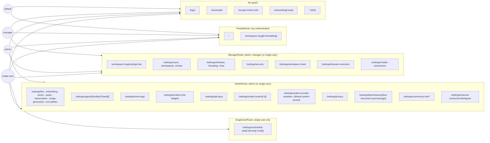

# 07 - Frontend routes and flows (UI)

Covers the React single-page app in `frontend/src`: every client route, the guard on it, the
actions each page and major modal exposes, the model function each action calls and the server
endpoint plus middleware that handles it, client-side state (contexts, browser storage, SSE and
websocket clients, service worker, i18n) and client-side side effects. Server handler internals
(what the handler writes) are left to the server-domain files; this file stops at the endpoint,
its middleware chain and the handler line. Verified against commit `e82a80da` (branch
`claude/rbac-account-access-expansion-5787c7`, no frontend changes on top).

Sources: `frontend/src/main.jsx`, `frontend/src/App.jsx`, `frontend/src/AuthContext.jsx`,
`frontend/src/components/PrivateRoute/index.jsx`, `frontend/src/utils/{request,session,constants,paths,keyboardShortcuts}.js`,
`frontend/src/models/**/*.js`, `frontend/src/pages/**`, `frontend/src/components/{Modals,Sidebar,SettingsSidebar,UserMenu,WorkspaceChat,CanViewChatHistory}/**`,
`frontend/src/hooks/{useWebPushNotifications,useLoginMode,useOnboardingComplete,usePromptInputStorage,useLanguageOptions}.js`,
`frontend/src/{EmbeddingProgressContext,PWAContext,i18n}.js(x)`, `frontend/public/service-workers/push-notifications.js`,
server side for comparison: `server/utils/middleware/{validatedRequest,multiUserProtected}.js`, `server/endpoints/*.js`,
`server/endpoints/agentWebsocket.js`, `server/utils/AiProviders/embeddedLemonade/endpoints.js`.

Method: the model-to-endpoint map and the endpoint-to-middleware map were extracted with two
read-only scripts over the source (regex over `fetch(\`${API_BASE}...\`)` in `frontend/src/models`
and over `app.<verb>("<path>", [middleware], ...)` in `server/endpoints`), then spot-checked by
reading the files. Line numbers for server routes are the line of the `app.<verb>(` call.

---

## 2. Mental model

**Actors.** Three kinds of browser user, decided by two server settings read before login from
the public `GET /api/setup-complete` (`frontend/src/models/system.js:61`,
`server/endpoints/system.js:125`):

| Mode | `MultiUserMode` | `RequiresAuth` | Who is "the user" | Role in UI |
|---|---|---|---|---|
| Single-user, open | false | false | anyone who can reach the host | no `user` object; guards treat as all-powerful |
| Single-user, password | false | true | holder of the instance password | no `user` object; same as above once a token is held |
| Multi-user | true | (n/a) | a `users` row | `admin`, `manager` or `default` from `localStorage.anythingllm_user` |

**Resources the UI acts on.** Workspaces, threads, chats, documents (custom-documents folder and
workspace embeddings), parsed files (chat attachments), memories, users, invites, API keys,
browser-extension keys, mobile devices, embed widgets, agent flows, MCP servers, model routers,
scheduled jobs, system settings (`system_settings` rows and `.env`).

**Pattern.** A thin client: every page is a React component that calls a model object
(`frontend/src/models/*.js`) whose methods are one `fetch` each, with headers from
`baseHeaders()` (`frontend/src/utils/request.js:11`): `Authorization: Bearer <localStorage.anythingllm_authToken>`,
`X-Timezone`, `X-Language`. There is no client router loader or global store; each page fetches on
mount. Route guards are a client-side gate only (see invariant 2).

**Invariants the code relies on.**

1. Identity on the client is whatever is in `localStorage`: token in `anythingllm_authToken`,
   user JSON (including `role`) in `anythingllm_user` (`frontend/src/utils/constants.js:4-5`).
   Guards read the role with `userFromStorage()` (`frontend/src/utils/request.js:5`), a plain
   `JSON.parse` of that key.
2. Route guards are therefore advisory. A user who edits `anythingllm_user.role` to `admin` passes
   `AdminRoute` (`frontend/src/components/PrivateRoute/index.jsx:89-90`); security depends on the
   server middleware on each endpoint. `AuthContext` rewrites the stored user from
   `GET /system/refresh-user` on mount (`frontend/src/AuthContext.jsx:50-72`), but the guard reads
   storage independently and can run first (unverified ordering; both run on mount).
3. In single-user mode every guard admits everyone who passes the auth check (`!multiUserMode`
   short-circuits the role test: `PrivateRoute/index.jsx:90,123`), and on the server
   `flexUserRoleValid` skips the role test (`server/utils/middleware/multiUserProtected.js:71-74`)
   while `strictMultiUserRoleValid` refuses (`:40`) and `isSingleUserMode` admits (`:16-20`).
4. "Role" visibility in the UI uses three idioms: `user?.role !== "default"` (manager or admin, or
   single-user), `!user || user.role === "admin"` (admin or single-user), and the settings sidebar's
   `roles` + `flex` props (`frontend/src/components/SettingsSidebar/MenuOption/index.jsx:50-59`).

**Server middleware recap (used in every table below).**

| Name | Where | Single-user | Multi-user |
|---|---|---|---|
| `validatedRequest` | `server/utils/middleware/validatedRequest.js:8` | passes if `NODE_ENV=development` or no `AUTH_TOKEN`/`JWT_SECRET` (`:15-22`); else checks JWT `p` against `AUTH_TOKEN` | JWT `id` must be a non-suspended user (`:74-110`) |
| `flexUserRoleValid([...])` | `multiUserProtected.js:58` | always passes | role must be in list; `ROLES.all` always passes (`:62`) |
| `strictMultiUserRoleValid([...])` | `multiUserProtected.js:29` | **401** | role must be in list |
| `isSingleUserMode` | `multiUserProtected.js:16` | passes | **401** |
| `isMultiUserSetup` | `multiUserProtected.js:88` | **403** | passes |
| `validWorkspaceSlug` / `validWorkspaceAndThreadSlug` | `server/utils/middleware/validWorkspace.js:9,26` | `Workspace.get` | `Workspace.getWithUser(user, …)` (membership) |
| `chatHistoryViewable` | `server/utils/middleware/chatHistoryViewable.js` | env `DISABLE_VIEW_CHAT_HISTORY` gate (unverified detail) | same |

### Navigation graph (role → reachable areas)

Mode notes on the graph: in multi-user mode admins reach the Telegram page but every Telegram
endpoint is `isSingleUserMode` (401), and the Users/Workspaces/Invites pages are reachable in
single-user mode but their endpoints are `strictMultiUserRoleValid` (401). See section 4.1.

---

## 3. Entry points

Every client route in `frontend/src/main.jsx`. Channel is `ui` for all. "Middleware chain" is the
client guard; server middleware is per action in section 4.

| ID | Channel | Path | Middleware chain (client guard) | Handler (page component, path:line) | Who can call |
|---|---|---|---|---|---|
| E-UI-01 | ui | `/` | `PrivateRoute` + `usePasswordModal` | `pages/Main/index.jsx:8` (`main.jsx:24-28`) | any authenticated; shows login modal otherwise |
| E-UI-02 | ui | `/login` | none | `pages/Login/index.jsx:17` (`main.jsx:31`) | anyone |
| E-UI-03 | ui | `/sso/simple` | none | `pages/Login/SSO/simple.jsx:8` (`main.jsx:35`) | anyone with `?token=` |
| E-UI-04 | ui | `/workspace/:slug/settings/:tab` | `ManagerRoute` | `pages/WorkspaceSettings/index.jsx` (`main.jsx:39-45`) | admin, manager, single-user |
| E-UI-05 | ui | `/workspace/:slug` and child `t/:threadSlug` | `PrivateRoute` + `usePasswordModal` | `pages/WorkspaceChat/index.jsx:12` (`main.jsx:48-60`) | any authenticated |
| E-UI-06 | ui | `/accept-invite/:code` | none | `pages/Invite/index.jsx` (`main.jsx:62-66`) | anyone with a code |
| E-UI-07 | ui | `/settings/llm-preference` | `AdminRoute` | `pages/GeneralSettings/LLMPreference` (`main.jsx:70`) | admin, single-user |
| E-UI-08 | ui | `/settings/transcription-preference` | `AdminRoute` | `pages/GeneralSettings/TranscriptionPreference` (`main.jsx:79`) | admin, single-user |
| E-UI-09 | ui | `/settings/audio-preference` | `AdminRoute` | `pages/GeneralSettings/AudioPreference` (`main.jsx:90`) | admin, single-user |
| E-UI-10 | ui | `/settings/embedding-preference` | `AdminRoute` | `pages/GeneralSettings/EmbeddingPreference` (`main.jsx:101`) | admin, single-user |
| E-UI-11 | ui | `/settings/image-generation-preference` | `AdminRoute` | `pages/GeneralSettings/ImageGenerationPreference` (`main.jsx:112`) | admin, single-user |
| E-UI-12 | ui | `/settings/text-splitter-preference` | `AdminRoute` | `pages/GeneralSettings/EmbeddingTextSplitterPreference` (`main.jsx:123`) | admin, single-user |
| E-UI-13 | ui | `/settings/vector-database` | `AdminRoute` | `pages/GeneralSettings/VectorDatabase` (`main.jsx:134`) | admin, single-user |
| E-UI-14 | ui | `/settings/agents` | `AdminRoute` | `pages/Admin/Agents` (`main.jsx:145`) | admin, single-user |
| E-UI-15 | ui | `/settings/agents/builder`, `/settings/agents/builder/:flowId` | `AdminRoute hideUserMenu` | `pages/Admin/AgentBuilder` (`main.jsx:152,165`) | admin, single-user |
| E-UI-16 | ui | `/settings/event-logs` | `AdminRoute` | `pages/Admin/Logging` (`main.jsx:178`) | admin, single-user |
| E-UI-17 | ui | `/settings/embed-chat-widgets` | `AdminRoute` | `pages/GeneralSettings/ChatEmbedWidgets` (`main.jsx:185`) | admin, single-user |
| E-UI-18 | ui | `/settings/security` | `ManagerRoute` | `pages/GeneralSettings/Security` (`main.jsx:195`) | admin, manager, single-user |
| E-UI-19 | ui | `/settings/privacy` | `AdminRoute` | `pages/GeneralSettings/PrivacyAndData` (`main.jsx:204`) | admin, single-user |
| E-UI-20 | ui | `/settings/interface` | `ManagerRoute` | `pages/GeneralSettings/Settings/Interface` (`main.jsx:213`) | admin, manager, single-user |
| E-UI-21 | ui | `/settings/branding` | `ManagerRoute` | `pages/GeneralSettings/Settings/Branding` (`main.jsx:222`) | admin, manager, single-user |
| E-UI-22 | ui | `/settings/default-system-prompt` | `AdminRoute` | `pages/Admin/DefaultSystemPrompt` (`main.jsx:231`) | admin, single-user |
| E-UI-23 | ui | `/settings/chat` | `ManagerRoute` | `pages/GeneralSettings/Settings/Chat` (`main.jsx:240`) | admin, manager, single-user |
| E-UI-24 | ui | `/settings/beta-features` | `AdminRoute` | `pages/Admin/ExperimentalFeatures` (`main.jsx:249`) | admin, single-user |
| E-UI-25 | ui | `/settings/api-keys` | `AdminRoute` | `pages/GeneralSettings/ApiKeys` (`main.jsx:258`) | admin, single-user |
| E-UI-26 | ui | `/settings/model-routers` | `AdminRoute` | `pages/GeneralSettings/ModelRouters` (`main.jsx:267`) | admin, single-user |
| E-UI-27 | ui | `/settings/model-routers/:id` | `AdminRoute` | `pages/GeneralSettings/ModelRouters/RouterRulesPage` (`main.jsx:276`) | admin, single-user |
| E-UI-28 | ui | `/settings/system-prompt-variables` | `AdminRoute` | `pages/Admin/SystemPromptVariables` (`main.jsx:285`) | admin, single-user |
| E-UI-29 | ui | `/settings/browser-extension` | `ManagerRoute` | `pages/GeneralSettings/BrowserExtensionApiKey` (`main.jsx:296`) | admin, manager, single-user |
| E-UI-30 | ui | `/settings/workspace-chats` | `ManagerRoute` | `pages/GeneralSettings/Chats` (`main.jsx:307`) | admin, manager, single-user |
| E-UI-31 | ui | `/settings/invites` | `ManagerRoute` | `pages/Admin/Invitations` (`main.jsx:316`) | admin, manager (single-user reaches page, API 401) |
| E-UI-32 | ui | `/settings/users` | `ManagerRoute` | `pages/Admin/Users` (`main.jsx:325`) | admin, manager (single-user reaches page, API 401) |
| E-UI-33 | ui | `/settings/workspaces` | `ManagerRoute` | `pages/Admin/Workspaces` (`main.jsx:332`) | admin, manager (single-user reaches page, API 401) |
| E-UI-34 | ui | `/onboarding`, `/onboarding/:step` | none (self-redirects home when complete) | `pages/OnboardingFlow/index.jsx:5` (`main.jsx:342-348`) | anyone |
| E-UI-35 | ui | `/settings/beta-features/live-document-sync/manage` | `AdminRoute` | `pages/Admin/ExperimentalFeatures/Features/LiveSync/manage` (`main.jsx:351`) | admin, single-user |
| E-UI-36 | ui | `/settings/community-hub/trending` | `AdminRoute` | `pages/GeneralSettings/CommunityHub/Trending` (`main.jsx:362`) | admin, single-user |
| E-UI-37 | ui | `/settings/community-hub/authentication` | `AdminRoute` | `pages/GeneralSettings/CommunityHub/Authentication` (`main.jsx:371`) | admin, single-user |
| E-UI-38 | ui | `/settings/community-hub/import-item` | `AdminRoute` | `pages/GeneralSettings/CommunityHub/ImportItem` (`main.jsx:382`) | admin, single-user |
| E-UI-39 | ui | `/settings/mobile-connections` | `ManagerRoute` | `pages/GeneralSettings/MobileConnections` (`main.jsx:393`) | admin, manager, single-user (manager: API 401) |
| E-UI-40 | ui | `/settings/external-connections/telegram` | `AdminRoute` | `pages/GeneralSettings/Connections/TelegramBot` (`main.jsx:402`) | single-user (admin in multi-user: API 401) |
| E-UI-41 | ui | `/settings/scheduled-jobs` | `SingleUserRoute` | `pages/GeneralSettings/ScheduledJobs` (`main.jsx:411`) | single-user only |
| E-UI-42 | ui | `/settings/scheduled-jobs/:id/runs` | `SingleUserRoute` | `pages/GeneralSettings/ScheduledJobs/RunHistoryPage.jsx` (`main.jsx:420`) | single-user only |
| E-UI-43 | ui | `/settings/scheduled-jobs/:id/runs/:runId` | `SingleUserRoute` | `pages/GeneralSettings/ScheduledJobs/RunDetailPage.jsx` (`main.jsx:429`) | single-user only |
| E-UI-44 | ui | `*` | none | `pages/404.jsx` (`main.jsx:440`) | anyone |
| E-UI-45 | ws | `ws(s)://<host>/api/agent-invocation/:uuid` | none on client or server | client `components/WorkspaceChat/ChatContainer/index.jsx:384`; server `server/endpoints/agentWebsocket.js:29` | anyone holding the invocation uuid |
| E-UI-46 | ui (SSE) | `POST /api/workspace/:slug[/thread/:threadSlug]/stream-chat` | chat client | `frontend/src/models/workspace.js:184`, `models/workspaceThread.js:111` | see P-UI-11 |
| E-UI-47 | ui (SSE) | `GET /api/workspace/:slug/embed-progress` | embed progress client | `frontend/src/EmbeddingProgressContext.jsx:184` | see P-UI-16 |
| E-UI-48 | ui (SW) | service worker `/service-workers/push-notifications.js` | registered by `hooks/useWebPushNotifications.js:56` | `frontend/public/service-workers/push-notifications.js:10,21` | browser, after permission |

### Guard semantics (`frontend/src/components/PrivateRoute/index.jsx`)

`useIsAuthenticated()` (`:15-76`) on every mount of a guarded route:

1. `GET /onboarding` (`:23`); if `onboardingComplete === false`, every guard redirects to
   `/onboarding` (`:28-31`, `:85-87`, `:118-120`, `:142-144`, `:162-164`).
2. `GET /setup-complete` (`:24`).
3. Single-user open: authenticated (`:35-38`).
4. Single-user password: needs `anythingllm_authToken`; validates with `GET /system/check-token`
   (`frontend/src/utils/session.js:5-15`) (`:41-51`).
5. Multi-user: needs both `anythingllm_user` and token, validates token; on failure removes
   `anythingllm_user`, `anythingllm_authToken`, `anythingllm_authTimestamp` (`:54-70`).

Then: `AdminRoute` admits `user.role === "admin" || !multiUserMode` (`:90`); `ManagerRoute`
admits `user.role !== "default" || !multiUserMode` (`:123`), so a stored user with no `role` or any
unknown role passes; `SingleUserRoute` admits `!multiUserMode` (`:146`); `PrivateRoute` admits any
authenticated (`:166`). Failures redirect to `/` (Admin/Manager/SingleUser) or `/login?nt=1`
(Private) (`:107,132,153,175`). Guarded pages are wrapped in `UserMenu` (except `SingleUserRoute`
and `hideUserMenu`) and `KeyboardShortcutWrapper`.

---

## 4. User paths

Endpoint column format: `METHOD /api<path>` → server middleware → handler line. `vR` =
`validatedRequest`, `flex[...]` = `flexUserRoleValid`, `strict[...]` = `strictMultiUserRoleValid`,
`single` = `isSingleUserMode`, `vWS` = `validWorkspaceSlug`, `vWT` = `validWorkspaceAndThreadSlug`.

### 4.1 Findings: UI gate vs server enforcement

Compared each route guard (and in-page role checks) with the middleware on every endpoint the page
calls. "UI stricter" means the server would accept a call the UI hides (a hidden capability that a
direct API call can use). "Server stricter" means the UI shows something that fails.

| # | Where | UI gate | Server | Kind | Effect |
|---|---|---|---|---|---|
| F-1 | All guards | role from `localStorage.anythingllm_user` (`request.js:5`, `PrivateRoute/index.jsx:89,122`) | per-endpoint | UI advisory | Editing storage reaches any page; server must enforce every call. Guards are UX only. |
| F-2 | Embedded Lemonade model download/remove (`components/LLMSelection/EmbeddedLemonadeOptions/utils.js:13-109`), shown only on admin LLM page | `AdminRoute` (`main.jsx:75`) | `flex[admin, manager]` on all five routes (`server/utils/AiProviders/embeddedLemonade/endpoints.js:26,35,50,100,110`) | **UI stricter** | A manager can start/cancel model downloads and delete models (disk + network) by calling the API directly. |
| F-3 | `/settings/mobile-connections` | `ManagerRoute` (`main.jsx:398`); sidebar shows admin only (`SettingsSidebar/index.jsx:436-438`) | `flex[admin]` (`server/endpoints/mobile/index.js:19,40,65,84`) | server stricter | Manager who types the URL sees an empty page; all calls 401. |
| F-4 | `/settings/external-connections/telegram` | `AdminRoute` (`main.jsx:407`); sidebar hides when a user object exists (`SettingsSidebar/index.jsx:386-388`) | `single` (`server/endpoints/telegram.js:17-293`) | server stricter | Multi-user admin by URL gets 401s; page calls `System.isMultiUserMode` to explain (`pages/GeneralSettings/Connections/TelegramBot/index.jsx:21`) (unverified rendering). |
| F-5 | `/settings/users`, `/settings/workspaces`, `/settings/invites` | `ManagerRoute` admits single-user (`PrivateRoute/index.jsx:123`); sidebar hides in single-user (`SettingsSidebar/index.jsx:281-299`, no `flex`) | `strict[admin, manager]` (`server/endpoints/admin.js:38-295`) → 401 in single-user | server stricter | Single-user URL access shows empty lists. |
| F-6 | Workspace settings (manager) Chat tab model picker | `ManagerRoute`; tab visible to all who pass (`pages/WorkspaceSettings/index.jsx:99-117`) | `POST /system/custom-models` is `flex[admin]` (`server/endpoints/system.js:1120`); `GET /model-routers` is `flex[admin]` (`server/endpoints/modelRouter.js:15`); provider credential save `POST /system/update-env` is `flex[admin]` (`server/endpoints/system.js:600`) | server stricter | For managers the model list and router list come back 401, credential save fails (`pages/WorkspaceSettings/ChatSettings/WorkspaceLLMSelection/WorkspaceLLMItem/index.jsx:127`). |
| F-7 | Workspace settings Agent tab save | admin-only section rendered at `pages/WorkspaceSettings/AgentConfig/index.jsx:73`, but save always calls `Admin.updateSystemPreferences` and `System.updateSystem` (`:56-57`) | `POST /admin/system-preferences` filters manager writes to six branding labels (`server/endpoints/admin.js:465-489`); `update-env` 401 for manager | server stricter, silent | Manager save silently drops system-level fields; responses are not checked (`:56-57`). |
| F-8 | Chat drag-and-drop embed | `DnDWrapper` has no role check (`components/WorkspaceChat/ChatContainer/DnDWrapper/index.jsx`, no `role` reference) | `POST /workspace/:slug/update-embeddings` `flex[admin, manager]` (`server/endpoints/workspaces.js:233`); `DELETE …/remove-and-unembed` `flex[admin, manager]` (`:915`); `GET …/embed-progress` `flex[admin, manager]` (`:1032`) | server stricter | Default user who chooses "embed" for an oversized attachment (`DnDWrapper/index.jsx:419-420`) or removes an embedded attachment (`:134`) gets 401s; the warning modal's embed option may be hidden for default users elsewhere (unverified). `ParsedFilesMenu` does gate (`PromptInput/AttachItem/ParsedFilesMenu/index.jsx:23`). |
| F-9 | `/settings/interface`, `/settings/chat` | `ManagerRoute` | mostly no server call: settings are `localStorage` only (`models/appearance.js:28-66`) | UI stricter (UX) | Default users cannot reach per-browser chat preferences (auto-submit, render HTML, spell check) that are not server-protected at all; only language/theme are in the account modal (`components/UserMenu/AccountModal/index.jsx:192-204`). |
| F-10 | Agent websocket | no token sent (`ChatContainer/index.jsx:384-386`) | no middleware; only checks an open invocation for the uuid (`server/endpoints/agentWebsocket.js:29-37`) | neither | The uuid is the only credential (bearer capability). Not a UI/server mismatch, but no session binding on either side. |
| F-11 | Security page in single-user, open mode | `ManagerRoute` admits all (single-user) | `POST /system/enable-multi-user` and `/system/update-password` are `vR` only (`server/endpoints/system.js:619,665`), and `vR` passes everyone when no `AUTH_TOKEN` (`validatedRequest.js:15-22`) | consistent but notable | Anyone who can reach an open single-user instance can create the first admin or set the password. Same exposure at `/onboarding` (P-UI-02). |
| F-12 | `/settings/api-keys` | `AdminRoute`; model picked by presence of stored user (`pages/GeneralSettings/ApiKeys/index.jsx:25-26`) | single-user `GET /system/api-keys` etc. are `vR` + in-handler `multiUserMode → 401` (`server/endpoints/system.js:1044-1103`); multi-user `/admin/api-keys` `strict[admin]` (`server/endpoints/admin.js:503-547`) | consistent | If `anythingllm_user` is missing in multi-user (cleared), page calls the single-user routes and gets 401. |

No case was found where the UI hides an admin-only write that the server leaves open to
`default` users: every `flex[ROLES.all]` endpoint the UI calls is scoped by workspace membership
(`vWS`/`vWT`) or by `user_id` in the handler (for example `PUT /workspace/workspace-chats/:id`
filters by `user_id`, `server/endpoints/workspaces.js:814-818`; `POST /export-chat/:type` uses
`getWithUser` and `user_id`, `server/endpoints/utils.js:38-70`). Managers versus admins is where
the gaps are (F-2, and the `flex[admin, manager]` set in P-UI-16 which managers legitimately use).

---

### P-UI-01 App boot and mode detection

- **Actor and preconditions**: any browser; any mode.
- **Steps**:
  1. `main.jsx:18-449` builds a browser router; root element `App` (`App.jsx:19-47`) wraps
     `ErrorBoundary` → `ThemeProvider` → `PWAModeProvider` → `AuthProvider` → `LogoProvider` →
     `PfpProvider` → `I18nextProvider` → `Outlet` + `ToastContainer` + `KeyboardShortcutsHelp` +
     `ImageLightbox`.
  2. `AuthProvider` reads `anythingllm_user` / `anythingllm_authToken` (`AuthContext.jsx:14-19`);
     if a token exists, `GET /system/refresh-user` (`models/system.js:155`) → `vR`
     (`server/endpoints/system.js:165`).
  3. `LogoProvider` fetches `GET /system/logo?theme=` (public, `models/system.js:463-486`,
     `server/endpoints/system.js:737`) and turns the blob into an object URL.
  4. `PfpProvider` fetches `GET /system/pfp/:id` for the stored user (`PfpContext.jsx:12-22`,
     `models/system.js:488`) → `vR, flex[all]` (`server/endpoints/system.js:814`).
  5. Theme palettes: `GET /system/theme-palettes` (public, `palettes/index.js:176`,
     `server/endpoints/themePalettes.js:9`), cached in `localStorage.theme_palettes`.
  6. The matched route's guard runs (section 3, guard semantics).
- **Reads**: `localStorage` (auth, theme, palette), public settings.
- **State changes**: `localStorage.anythingllm_user` rewritten with server copy (`AuthContext.jsx:65`).
- **Side effects**: SE-UI-01, SE-UI-02.
- **Failure and edge paths**: refresh-user failure (suspended user, bad token) clears auth keys and
  `navigate("/login")` (`AuthContext.jsx:55-62`). In single-user mode the server returns
  `success:true, user:null` and nothing changes (`:53`).
- **Notes**: `AuthContext.actions.updateUser/unsetUser` are dead code per its own comment
  (`AuthContext.jsx:23-28`); login code writes storage directly instead.

### P-UI-02 First-run onboarding

- **Actor and preconditions**: anyone; `onboardingComplete === false`. Guards force this route
  (`PrivateRoute/index.jsx:28-31`). The route itself has no guard (`main.jsx:342-348`).
- **Steps**:
  1. `/onboarding` → `Steps/Home` → "Get started" → `/onboarding/llm-preference`
     (`pages/OnboardingFlow/Steps/Home/index.jsx:57`). `useRedirectToHomeOnOnboardingComplete`
     (`hooks/useOnboardingComplete.js:6-15`) navigates home if `GET /onboarding` says complete
     (`Steps/Home/index.jsx:11`, `Steps/index.jsx:22`).
  2. LLM preference: `GET /setup-complete` (`Steps/LLMPreference/index.jsx:387`); forward →
     `POST /onboarding` (`:399`; `models/system.js:53`) → `vR` (`server/endpoints/system.js:112`),
     then form submit `POST /system/update-env` with `LLMProvider`, `EmbeddingEngine=native`,
     `VectorDB=lancedb` + provider fields (`:415-430`) → `vR, flex[admin]`
     (`server/endpoints/system.js:600`); navigate `/onboarding/user-setup`.
  3. User setup (`Steps/UserSetup/index.jsx`): "just me" with password → `POST /system/update-password`
     (`:136`) → `vR` (`server/endpoints/system.js:619`), then `POST /request-token` (`:148`;
     public, `server/endpoints/system.js:205`) and store token (`:151-153`). "My team" →
     `POST /system/enable-multi-user` (`:260`) → `vR` (`server/endpoints/system.js:665`), then
     `POST /request-token` and store user + token (`:269-272`). Next `/onboarding/data-handling`.
  4. Data handling: display only, forward to survey (`Steps/DataHandling/index.jsx:20-21`).
  5. Survey: on mount, if `GET /workspaces` is empty, `POST /workspace/new` with
     `onboardingComplete:true` (`Steps/Survey/index.jsx:96-104`) → `vR, flex[admin, manager]`
     (`server/endpoints/workspaces.js:54`). Submit sends email/use-case/comment by
     `navigator.sendBeacon` (or `fetch`) to `https://onboarding.anythingllm.com`
     (`Steps/Survey/index.jsx:12-43`, `utils/constants.js:2`); skip goes home (`:81-83`).
- **Reads**: `system_settings`, `.env` booleans via `/setup-complete`.
- **State changes**: onboarding flag set (server, see admin domain); `.env` LLM/embedder/vector
  values; optional `AUTH_TOKEN`/`JWT_SECRET`; optional first admin user and `multi_user_mode=true`;
  a default workspace row; `localStorage.anythingllm_completed_questionnaire = true`.
- **Side effects**: SE-UI-03 (survey), SE-UI-04 (token storage).
- **Failure and edge paths**: `markOnboardingComplete` runs before the LLM form is saved and before
  any password is set (`LLMPreference/index.jsx:397-407`), so a user who abandons after step 2
  leaves an onboarded, unauthenticated instance; subsequent visits no longer redirect to onboarding.
  An update-env error shows a toast and stays on the page (`:425-429`) but onboarding is already
  marked complete.
- **Notes**: onboarding is reachable by URL after completion; protection relies on the redirect
  hook (client) and on `vR`/`flex[admin]` (server). On an open single-user instance those pass for
  anyone (F-11). The survey posts the entered email to an external host (`TEL`/`NET`).

### P-UI-03 Single-user password login

- **Actor and preconditions**: single-user, `RequiresAuth=true`, no valid token.
- **Steps**: `/` or `/workspace/:slug` → `usePasswordModal` (`components/Modals/Password/index.jsx:27-127`):
  skips the check if `anythingllm_authTimestamp` is under 5 minutes old (`:40-46`,
  `models/system.js:120-125`), else `GET /setup-complete` then `GET /system/check-token`
  (`models/system.js:127-135`; sets `anythingllm_authTimestamp`) → `vR`
  (`server/endpoints/system.js:135`). Form → `POST /request-token` (`SingleUserAuth.jsx:34`) →
  public (`server/endpoints/system.js:205`); on success store token and `window.location = "/"`
  (`SingleUserAuth.jsx:41-42`). If the server returns `recoveryCodes`, the recovery modal is shown
  first and the token stored after download (`:36-40, :55-59`).
- **Reads**: `localStorage` auth keys.
- **State changes**: `localStorage.anythingllm_authToken` set; `anythingllm_authTimestamp` set.
- **Side effects**: SE-UI-04, SE-UI-05 (full reload).
- **Failure and edge paths**: invalid token clears token/user/timestamp (`Password/index.jsx:99-104`).
  Network error on check-token counts as invalid (`models/system.js:131-132`).
- **Notes**: `usePasswordModal(notry=false)` returns `mode:"multi"` whenever the 5-minute cache is
  fresh (`Password/index.jsx:41-45`), even in single-user mode; harmless because it only governs
  which login form would render.

### P-UI-04 Multi-user login and first-login recovery codes

- **Actor and preconditions**: multi-user, no valid token.
- **Steps**: `/login` (`pages/Login/index.jsx:17-36`): if Simple SSO is on with `noLogin`, redirect
  to `SimpleSSONoLoginRedirect` via `window.location.replace` or to `/sso/simple` (`:25-31`);
  if no auth needed, `Navigate "/"` (`:33`). Form → `POST /request-token`
  (`components/Modals/Password/MultiUserAuth.jsx:200`); on success with recovery codes, open
  `DisplayRecoveryCodeModal` (download `recovery_codes.txt` via `saveAs`,
  `components/Modals/DisplayRecoveryCodeModal/index.jsx:21`, or copy, `:33`) and store user+token
  after download (`MultiUserAuth.jsx:258-264`); otherwise store and `window.location = "/"`
  (`:209-211`).
- **Reads**: `/setup-complete` (`useSimpleSSO`, `hooks/useSimpleSSO.js:22-23`), custom app name
  `GET /system/custom-app-name` (public, `MultiUserAuth.jsx:269`, `server/endpoints/system.js:799`).
- **State changes**: `localStorage.anythingllm_user`, `anythingllm_authToken`.
- **Side effects**: SE-UI-04, SE-UI-05, SE-UI-06 (file download), SE-UI-07 (clipboard).
- **Failure and edge paths**: error message shown in form; `?nt=1` (`paths.login(true)`,
  `utils/paths.js:26-28`) skips the token re-check.

### P-UI-05 Account recovery and password reset

- **Actor and preconditions**: multi-user; user has recovery codes.
- **Steps**: login form "forgot" → `POST /system/recover-account` (`MultiUserAuth.jsx:223`;
  `models/system.js:167`) → `isMultiUserSetup` (`server/endpoints/system.js:403`); store returned
  `resetToken` in `localStorage.resetToken` (`MultiUserAuth.jsx:229`); reset form →
  `POST /system/reset-password` (`:241`) → `isMultiUserSetup` (`server/endpoints/system.js:428`);
  on success remove `resetToken` (`:248`).
- **State changes**: `localStorage.resetToken` set then removed.
- **Side effects**: SE-UI-08.
- **Failure and edge paths**: on reset failure the `resetToken` stays in `localStorage`
  indefinitely (`MultiUserAuth.jsx:252-254`); logout does not remove it (P-UI-08).

### P-UI-06 Simple SSO passthrough

- **Actor and preconditions**: Simple SSO enabled; a temporary token issued elsewhere.
- **Steps**: `/sso/simple?token=…&redirectTo=…` (`pages/Login/SSO/simple.jsx:8-53`): clear auth keys
  (`:19-21`), `GET /request-token/sso/simple?token=` (`:23`; `models/system.js:811-812`) →
  `simpleSSOEnabled` (`server/endpoints/system.js:360`); store user, token and timestamp
  (`:27-29`); `window.location.replace(redirectTo || "/")` (`:10, :49`).
- **State changes**: auth keys replaced.
- **Side effects**: SE-UI-04, SE-UI-09 (redirect to a query-string URL).
- **Failure and edge paths**: missing/invalid token shows an error page (`:40-48`).
- **Notes**: `redirectTo` is not validated on the client; an absolute URL would be followed after a
  successful login (open-redirect shape). Whether the server constrains it was not checked
  (unverified).

### P-UI-07 Accept invite

- **Actor and preconditions**: multi-user; invite code from an admin/manager (P-UI-25).
- **Steps**: `/accept-invite/:code` → `GET /invite/:code` (`pages/Invite/index.jsx:24`; public,
  `server/endpoints/invite.js:12`) → form → `POST /invite/:code` (`pages/Invite/NewUserModal/index.jsx:32`)
  → `simpleSSOLoginDisabledMiddleware` (`server/endpoints/invite.js:50`) → `POST /request-token`
  (`:34`) → store user+token, `window.location = "/"` (`:36-38`).
- **State changes**: user row created (server), invite claimed (server); auth keys stored.
- **Side effects**: SE-UI-04, SE-UI-05.

### P-UI-08 Logout

- **Actor and preconditions**: any authenticated user with a `UserMenu` (all guards except
  `SingleUserRoute` / `hideUserMenu`).
- **Steps**: user menu "Sign out" (`components/UserMenu/UserButton/index.jsx:95-103`) removes
  `anythingllm_user`, `anythingllm_authToken`, `anythingllm_authTimestamp`,
  `anythingllm_last_visited_workspace`, `anythingllm_user_prompt_input_map`, then
  `window.location.replace("/")`.
- **State changes**: those five `localStorage` keys removed.
- **Side effects**: SE-UI-10.
- **Failure and edge paths**: no server call; the JWT stays valid until it expires (no server-side
  revocation from the UI).
- **Notes**: left behind after logout: `anythingllm_session_reasoning_effort_map`,
  `anythingllm_can_view_chat_history`, `resetToken`, appearance settings, sidebar state,
  `sessionStorage.anythingllm_pending_home_message`, and the push subscription. On a shared
  browser the next user inherits these.

### P-UI-09 Session refresh, suspension and role sync

- **Actor and preconditions**: multi-user, token present.
- **Steps**: P-UI-01 step 2. Admin editing their own user rewrites stored role/username/bio from
  the form values (`pages/Admin/Users/UserRow/EditUserModal/index.jsx:48-56`) before reload.
  Account modal rewrites stored username/bio after `POST /system/user`
  (`components/UserMenu/AccountModal/index.jsx:72-78`) → `vR` (`server/endpoints/system.js:1265`;
  handler accepts only `username`, `password`, `bio` for the session user, `:1268-1282`).
- **State changes**: `localStorage.anythingllm_user`.
- **Failure and edge paths**: suspended user → refresh fails → logout + `/login` (`AuthContext.jsx:55-62`).

### P-UI-10 Home quick-send

- **Actor and preconditions**: any authenticated; at least one workspace or permission to create.
- **Steps**: `pages/Main/Home/index.jsx`: target workspace = last visited (`localStorage.anythingllm_last_visited_workspace`)
  via `GET /workspace/:slug` (`:43-48`) else first of `GET /workspaces` (`:51`); if none, create
  `POST /workspace/new` (`:55-58`) → `flex[admin, manager]` (`server/endpoints/workspaces.js:54`);
  default users with no workspace see a notice instead (`:173`). Suggested messages
  `GET /workspace/:slug/suggested-messages` (`:99`), agent availability
  `GET /workspace/:slug/is-agent-command-available` (`:100`). Submit: create thread
  `POST /workspace/:slug/thread/new` (`:84`), copy reasoning effort, write
  `sessionStorage.anythingllm_pending_home_message = {message, attachments}` (`:268-271`), clear the
  draft, navigate to the thread (`:278-282`). The chat container replays and removes it
  (`components/WorkspaceChat/ChatContainer/index.jsx:287-290`).
- **State changes**: thread row; `sessionStorage` pending message (removed on replay).
- **Side effects**: SE-UI-11.

### P-UI-11 Workspace chat streaming (SSE)

- **Actor and preconditions**: any authenticated; member of the workspace in multi-user.
- **Steps**:
  1. `pages/WorkspaceChat/index.jsx`: `usePasswordModal` (`:12`), `GET /workspace/:slug` (`:38`),
     suggested messages and agent availability (`:46-47`), write last-visited workspace (`:55-56`).
  2. History: `GET /workspace/:slug/chats` or `GET /workspace/:slug/thread/:threadSlug/chats`
     (`components/WorkspaceChat/index.jsx:74-75`) → `vR, flex[all]` (+`vWT` for threads)
     (`server/endpoints/workspaces.js:450`, `server/endpoints/workspaceThreads.js:136`).
  3. Send: `Workspace.multiplexStream` (`ChatContainer/index.jsx:346`; `models/workspace.js:140-162`)
     → `fetchEventSource POST /workspace/:slug/stream-chat` body `{message, attachments, reasoningEffort}`
     (`models/workspace.js:184-238`) or thread variant (`models/workspaceThread.js:111`) →
     `vR, flex[all], vWS` / `vWT` (`server/endpoints/chat.js:23,110`).
  4. Client handling: `onopen` 4xx (except 429) → synthetic `abort` event and abort
     (`models/workspace.js:191-205`); other non-OK → abort "Unknown Error" (`:206-217`);
     `onmessage` parses JSON and passes to `handleChat` (`:220-223`); `onerror` → abort and throw so
     `fetchEventSource` does not retry (`:224-234`). Stop button dispatches `ABORT_STREAM_EVENT`,
     which aborts the controller and emits `stopGeneration` (`:172-178`).
  5. `handleChat` (`frontend/src/utils/chat/index.js`) dispatches on `type`:
     `modelRouteNotification` (`:30`), `imageGenerationPending` (`:41`), `abort`/`statusResponse`
     (`:58`), `textResponse` (`:100`), `textResponseChunk`/`finalizeResponseStream` (`:133-143`),
     `agentInitWebsocketConnection` → stores `websocketUUID` to open P-UI-12 (`:186-187`),
     `promptChatId` (`:188`), `stopGeneration` (`:192`).
- **Reads**: chats, workspace, `localStorage.anythingllm_session_reasoning_effort_map`
  (`utils/chat/reasoningEffort.js:24`), prompt draft `anythingllm_user_prompt_input_map`
  (`hooks/usePromptInputStorage.js:15,22`, keyed by thread or workspace slug, `:93-94`).
- **State changes**: chat rows (server); drafts in `localStorage` (debounced writes).
- **Side effects**: SE-UI-12 (SSE), SE-UI-13 (draft persistence).
- **Failure and edge paths**: suspended or non-member user → 401/404 at `onopen` → abort message
  shown in chat. Server per-user chat quota (`User.canSendChat`, `server/endpoints/chat.js:54`
  region) surfaces the same way (unverified exact line).
- **Notes**: unsent prompt text (possibly sensitive) is persisted in `localStorage` per slug and
  cleared on logout only for that one key (P-UI-08).

### P-UI-12 Agent session over websocket

- **Actor and preconditions**: P-UI-11 returned `agentInitWebsocketConnection`.
- **Steps**: `ChatContainer/index.jsx:372-460`: `new WebSocket(\`${websocketURI()}/api/agent-invocation/${socketId}\`)`
  (`:384-386`); `websocketURI()` uses `wss:` on https and the page host or `VITE_API_BASE` host
  (`utils/chat/agent.js:103-107`). Messages parsed and fed to `handleSocketResponse`
  (`utils/chat/agent.js:109+`) which handles `rename_thread` and the event list at `:95-101`
  (`agentSessionExited`, `rechartVisualize`, `toolApprovalRequest`, `clarificationRequest`,
  `reportStreamEvent`, …). Stop → close socket (`:388-394`). Close → reset state and
  dispatch `AGENT_SESSION_END` (`:414-426`). Tool approval UI can call
  `POST /agent-skills/whitelist/add` (`components/WorkspaceChat/ChatContainer/ChatHistory/ToolApprovalRequest/index.jsx:43`)
  → `vR, flex[all]` (`server/endpoints/agentSkillWhitelist.js:65`).
- **Server**: `server/endpoints/agentWebsocket.js:29-70`: loads the invocation by uuid; no auth
  middleware; closes if none (`:34-37`).
- **State changes**: agent whitelist row (server) when "always allow" is chosen.
- **Side effects**: SE-UI-14 (WS).
- **Notes**: F-10. No token is sent; any party who learns the uuid while the invocation is open can
  attach (unverified whether the invocation is single-use beyond `WorkspaceAgentInvocation.close`
  on socket close, `agentWebsocket.js:45`).

### P-UI-13 Chat message actions

All from `components/WorkspaceChat/ChatContainer/ChatHistory/**`, all endpoints `vR, flex[all]` plus
`vWS`/`vWT` unless noted.

| Action | Call site | Endpoint | Server |
|---|---|---|---|
| Edit prompt/response | `ChatHistory/index.jsx:67` | `POST /workspace/:slug/update-chat` or thread variant | `workspaces.js:544`, `workspaceThreads.js:226` |
| Regenerate (delete edited tail) | `ChatHistory/index.jsx:83` | `DELETE /workspace/:slug/delete-edited-chats` or thread variant | `workspaces.js:514`, `workspaceThreads.js:191` |
| Fork to thread | `ChatHistory/index.jsx:115` | `POST /workspace/:slug/thread/fork` | `workspaces.js:732` |
| Delete message | `HistoricalMessage/Actions/DeleteMessage/index.jsx:19` | `PUT /workspace/workspace-chats/:id` (no `vWS`; handler filters `user_id`) | `workspaces.js:808` |
| Feedback thumbs | `HistoricalMessage/Actions/index.jsx:27` | `POST /workspace/:slug/chat-feedback/:chatId` | `workspaces.js:586` |
| Read aloud (server TTS) | `Actions/TTSButton/asyncTts.jsx:23` | `GET /workspace/:slug/tts/:chatId` → blob → object URL (`models/workspace.js:392-402`) | `workspaces.js:684` |
| Copy | `components/WorkspaceChat/index.jsx:192`, `utils/clipboard.js:21` | none | - |
| Download generated file | `ChatHistory/FileDownloadCard/index.jsx:21-23` | `GET /agent-skills/generated-files/:filename` → `saveAs` | `agentFileServer.js:29` |
| Generated image view/download/copy | `ChatHistory/ImageGenerationCard/index.jsx:36-72` | `GET /image-generation/generated-images/:filename` | `agentFileServer.js:95` |
| Download chart as JPEG | `ChatHistory/Chartable/index.jsx:55` | none | - |
| Clear chat (`/reset`) | `ChatContainer/index.jsx:269` | `DELETE /workspace/:slug/delete-chats` | `workspaces.js:477` |
| Export chat | `ChatSettingsMenu/Export/index.jsx:30-37` | `POST /export-chat/:type` → `saveAs` | `utils.js:38` (scoped to user) |
| Copy link to chat | `ChatSettingsMenu/CopyLinkToChat/index.jsx:22-28` | none; sets `anythingllm_seen_copy_link_chat_alert` | - |

- **Side effects**: SE-UI-06, SE-UI-07, SE-UI-15 (object URLs).

### P-UI-14 Threads and sidebar

- **Actor**: any authenticated.
- **Steps**: `components/Sidebar/ActiveWorkspaces/ThreadContainer/index.jsx`: list `GET /workspace/:slug/threads`
  (`:64`), new `POST …/thread/new` (`:196`), bulk delete `DELETE …/thread-bulk-delete` (`:85`);
  `ThreadItem/index.jsx`: rename `POST …/thread/:t/update` (`:218`), delete
  `DELETE …/thread/:t` (`:242`). Server `vR, flex[all], vWS|vWT` (`server/endpoints/workspaceThreads.js:27-168`).
  Workspace list `GET /workspaces` (`ActiveWorkspaces/index.jsx:33`); drag reorder stored in
  `localStorage.anythingllm-workspace-order` (`:71`, `models/workspace.js:548-571`). Search
  `POST /workspace/search` (`components/Sidebar/SearchBox/index.jsx:34`) → `flex[all]`
  (`server/endpoints/workspaces.js:1013`). New workspace button hidden for `default`
  (`components/Sidebar/index.jsx:160`); modal `POST /workspace/new`
  (`components/Modals/NewWorkspace.jsx:27`) → `flex[admin, manager]`. Upload/settings icons hidden
  for `default` (`ActiveWorkspaces/index.jsx:167`).
- **Side effects**: SE-UI-16 (sidebar/order storage).

### P-UI-15 Chat attachments (parsed files)

- **Actor**: any authenticated.
- **Steps**: `ChatContainer/DnDWrapper/index.jsx`: processor check `GET /system/document-processing-status`
  (`:84`; `vR`, `server/endpoints/system.js:567`), parse `POST /workspace/:slug/parse` (`:269`) →
  `vR, flex[all], handleFileUpload, vWS` (`server/endpoints/workspacesParsedFiles.js:151`); list
  `GET /workspace/:slug/parsed-files` (`:251`; `:18`); delete `DELETE …/delete-parsed-files`
  (`:345`; `:46`); move to workspace `POST …/move-parsed-files` (`:393`; `flex[admin, manager]`,
  `:121`); embed overflow `POST …/update-embeddings` (`:419`) + SSE `embed-progress`
  (`:420` via `startEmbedding`). Attach menu embed `POST …/embed-parsed-file/:id`
  (`PromptInput/AttachItem/ParsedFilesMenu/index.jsx:76`; gated `canEmbed = !user || role !== "default"`, `:23`).
  Voice input `POST /system/transcribe-audio` (`models/system.js:930`; `flex[all]`,
  `server/endpoints/system.js:1551`).
- **Notes**: F-8.

### P-UI-16 Manage workspace documents modal

- **Actor and preconditions**: admin, manager or single-user. `showModal()` refuses `default`
  (`components/Modals/ManageWorkspace/index.jsx:139-143`); data-connector tab hidden for `default`
  (`:83`).
- **Steps** (all `vR, flex[admin, manager]` on the server unless noted):

| Action | Call site | Endpoint | Server |
|---|---|---|---|
| Browse/search/fetch documents | `Documents/hooks/useDocumentPicker.js:479,747,861` | `GET /system/local-files`, `GET /system/local-files/search`, `POST /system/local-files/by-docpaths` | `system.js:515,537,552` |
| Upload file | `Documents/UploadFile/FileUploadProgress/index.jsx:56` | `POST /workspace/:slug/upload` | `workspaces.js:120` |
| Upload link | `Documents/UploadFile/index.jsx:58` | `POST /workspace/:slug/upload-link` | `workspaces.js:190` |
| Embed / unembed | `Documents/index.jsx:70`, `WorkspaceDirectory/index.jsx:132`, `WorkspaceFileRow/index.jsx:32` | `POST /workspace/:slug/update-embeddings` | `workspaces.js:233` |
| Embed progress stream | `EmbeddingProgressContext.jsx:184-196` | `GET /workspace/:slug/embed-progress` (SSE) | `workspaces.js:1032` |
| Cancel queued embed | `EmbeddingProgressContext.jsx` (`Workspace.removeQueuedEmbedding`) | `DELETE /workspace/:slug/embed-queue` | `workspaces.js:1063` |
| Pin document | `WorkspaceFileRow/index.jsx:133` | `POST /workspace/:slug/update-pin` (+`vWS`) | `workspaces.js:657` |
| Watch document (live sync) | `WorkspaceFileRow/index.jsx:198` | `POST /workspace/:slug/update-watch-status` (+`vWS`, feature flag) | `experimental/liveSync.js:85` |
| New folder / move files | `Directory/NewFolderModal/index.jsx:25`, `Directory/index.jsx:291` | `POST /document/create-folder`, `POST /document/move-files` | `document.js:20,58` |
| Delete documents/folder | `Directory/index.jsx:268,270` | `DELETE /system/remove-documents`, `DELETE /system/remove-folder` | `system.js:485,500` |
| Data connectors (GitHub, GitLab, Gitea, YouTube, website, Confluence, DrupalWiki, Obsidian, Paperless-ngx) | `DataConnectors/Connectors/*/index.jsx` (e.g. `Github/index.jsx:34,186`) | `POST /ext/<platform>/{branches,repo}`, `/ext/youtube/transcript`, `/ext/website-depth`, `/ext/confluence`, `/ext/drupalwiki`, `/ext/obsidian/vault`, `/ext/paperless-ngx` (`models/dataConnector.js:8-254`) | `extensions/index.js:15-174` |

- **State changes**: one-time-alert flags `anythingllm_pinned_document_alert`,
  `anythingllm_watched_document_alert` (`WorkspaceDirectory/index.jsx:356,414`).
- **Failure and edge paths**: SSE errors delete the controller and throw so no retry
  (`EmbeddingProgressContext.jsx:190-194`).

### P-UI-17 Workspace settings

- **Actor and preconditions**: `ManagerRoute`. Tabs from `pages/WorkspaceSettings/index.jsx:28-31,99-117`;
  Members tab visible only to admin/manager role (`:113`), so single-user does not see it.

| Tab / action | Call site | Endpoint | Server |
|---|---|---|---|
| Load | `WorkspaceSettings/index.jsx:58-65` | `GET /workspace/:slug`, `/setup-complete`, suggested messages | `workspaces.js:405,610` |
| General: rename, image, etc. | `GeneralAppearance/index.jsx:27` | `POST /workspace/:slug/update` | `workspaces.js:90` (`flex[admin, manager]`) |
| General: suggested messages | `GeneralAppearance/SuggestedChatMessages/index.jsx:29` | `POST /workspace/:slug/suggested-messages` | `workspaces.js:628` (`flex[admin, manager]`) |
| General: delete workspace | `GeneralAppearance/DeleteWorkspace/index.jsx:24-33` | `DELETE /workspace/:slug` → reload or `/` | `workspaces.js:299` (`flex[admin, manager], workspaceDeletionProtection`) |
| Chat: settings | `ChatSettings/index.jsx:29` | `POST /workspace/:slug/update` | as above |
| Chat: prompt history list/clear/delete | `ChatPromptSettings/ChatPromptHistory/index.jsx:20,35`, `PromptHistoryItem/index.jsx:28` | `GET/DELETE /workspace/:slug/prompt-history[/:id]` | `workspaces.js:944,965,986` |
| Chat: default system prompt | `ChatPromptSettings/index.jsx:71` | `GET /system/default-system-prompt` | `system.js:882` (`flex[all]`) |
| Chat: LLM/model picker | `WorkspaceLLMSelection/**` | `POST /system/custom-models`, `GET /model-routers`, `POST /system/update-env` | admin-only (F-6) |
| Vector: count / reset | `VectorDatabase/VectorCount/index.jsx:12`, `ResetDatabase/index.jsx:13` | `GET /system/system-vectors?slug=`, `DELETE /workspace/:slug/reset-vector-db` | `system.js:452`, `workspaces.js:346` |
| Members | `Members/index.jsx:19-21`, `AddMemberModal/index.jsx:18` | `GET /admin/users`, `/admin/workspaces/:id/users`, `/admin/workspaces`, `POST /admin/workspaces/:id/update-users` | `admin.js:38,242,228,276` (`strict[admin, manager]`) |
| Agent | `AgentConfig/index.jsx:52-57` | `POST /workspace/:slug/update`, `POST /admin/system-preferences`, `POST /system/update-env` | F-7 |

### P-UI-18 Memories sidebar

- **Actor**: any authenticated; toggling personalization is admin/single-user only
  (`MemoriesSidebar/MemoriesContext.jsx:25`, `ChatSettingsMenu/Memories/index.jsx:14`).
- **Steps**: `MemoriesContext.jsx:46-79` → `GET/POST /workspaces/:slug/memories`,
  `PUT/DELETE /memories/:id`, `POST /memories/:id/promote`, `POST /memories/:id/demote/:slug`
  (`models/memory.js:23-99`) → `vR, flex[all], memoryFeatureEnabled, [validateMemoryOwner], vWS`
  (`server/endpoints/memory.js:44-167`). Toggle `POST /admin/system-preferences`
  (`PersonalizationToggle/index.jsx:19,28`).

### P-UI-19 Prompt input tools menu (slash commands, agent skills)

- **Actor**: slash commands any user; agent-skills tab admin/single-user only
  (`PromptInput/ToolsMenu/index.jsx:25-34`).
- **Steps**: slash presets `GET/POST /system/slash-command-presets`, `POST/DELETE …/:id`
  (`ToolsMenu/Tabs/SlashCommands/index.jsx:48-156`) → `flex[all]` (`server/endpoints/system.js:1301-1400`).
  Agent skills (`Tabs/AgentSkills/useAgentSkillsState.js:49-171`, `useSubSkillPreferences.js:66`):
  `GET /admin/system-preferences-for`, `GET /agent-flows/list`, `GET /mcp-servers/list`,
  availability checks, `POST /admin/system-preferences`, `POST /experimental/agent-plugins/:id/toggle`,
  `POST /agent-flows/:uuid/toggle`, `POST /mcp-servers/toggle-tool` → `flex[admin]` except the
  preference routes (`flex[admin, manager]`, manager writes filtered, `server/endpoints/admin.js:476-489`).
  Reasoning-effort button `GET /workspace/:slug/llm-capabilities` (`PromptInput/ReasoningEffortButton/index.jsx:42`).

### P-UI-20 In-chat LLM selector

- **Actor**: admin or single-user (`PromptInput/LLMSelector/action.jsx:92`).
- **Steps**: save `POST /workspace/:slug/update` with `chatProvider`/`chatModel` or `router_id`
  (`PromptInput/LLMSelector/index.jsx:90-110`); provider setup `POST /system/update-env`
  (`LLMSelector/SetupProvider/index.jsx:28`); router list `GET /model-routers`
  (`LLMSelector/RouterPickerSelection/index.jsx:16`).

### P-UI-21 Account modal

- **Actor**: multi-user users (opened from `UserMenu`).
- **Steps**: `components/UserMenu/AccountModal/index.jsx`: upload pfp `POST /system/upload-pfp`
  (`:41`; `flex[all]`, `server/endpoints/system.js:843`), fetch `GET /system/pfp/:id` (`:47`), remove
  `DELETE /system/remove-pfp` (`:53`; `:934`), save profile `POST /system/user` (`:72`; `vR`,
  `:1265`). Language select → `i18n.changeLanguage` (`:192-204`, `hooks/useLanguageOptions.js:9-11`).
  Theme → `localStorage.theme` (`hooks/useTheme.js:40,74`).
- **Notes**: `GET /system/pfp/:id` takes any id under `flex[all]`, so any user can fetch another
  user's avatar (low sensitivity; handler not read).

### P-UI-22 AI provider and system configuration pages (admin)

Pages E-UI-07..E-UI-13 and E-UI-19 load `GET /setup-complete` and save `POST /system/update-env`
(`vR, flex[admin]`, `server/endpoints/system.js:600`): LLM (`pages/GeneralSettings/LLMPreference/index.jsx:463,482`),
embedder (`EmbeddingPreference/index.jsx:199,218`), vector DB (`VectorDatabase/index.jsx:141,160`),
audio STT/TTS (`AudioPreference/stt.jsx:81`, `tts.jsx:82`), transcription
(`TranscriptionPreference/index.jsx:58,77`), image generation (`ImageGenerationPreference/index.jsx:98,116`),
privacy/telemetry (`PrivacyAndData/index.jsx:18,67`). Text splitter uses
`GET /admin/system-preferences-for` + `POST /admin/system-preferences`
(`EmbeddingTextSplitterPreference/index.jsx:51,76`). Provider option components fetch model lists
with `POST /system/custom-models` (`flex[admin]`, `:1120`), Lemonade utils
(`/utils/lemonade/*`, `flex[admin]`, `server/endpoints/utils/lemonadeUtilsEndpoints.js:15,111`),
Foundry (`flex[admin]`, `foundryUtilsEndpoints.js:12`), Embedded Lemonade (F-2).

- **Side effects**: `.env` writes (ENV, server); cross-domain.

### P-UI-23 Model routers (admin)

`pages/GeneralSettings/ModelRouters/index.jsx:36,189`, `NewRouterModal/index.jsx:30,61-62`,
`RouterRulesPage/index.jsx:20`, `LLMProviderModelPicker/index.jsx:51-106` →
`/model-routers[...]` (`models/modelRouter.js:6-113`) → `vR, flex[admin]`
(`server/endpoints/modelRouter.js:15-183`).

### P-UI-24 User management (admin, manager)

- **Steps**: `pages/Admin/Users/index.jsx:66` `GET /admin/users`; create
  `NewUserModal/index.jsx:39` `POST /admin/users/new`; edit/suspend `UserRow/index.jsx:29`,
  `EditUserModal/index.jsx:46` `POST /admin/user/:id`; delete `UserRow/index.jsx:49`
  `DELETE /admin/user/:id` → `vR, strict[admin, manager]` (`server/endpoints/admin.js:38-129`).
- **Role rules**: UI lets managers offer only `default`/`manager` (`NewUserModal/index.jsx:89-92`,
  `EditUserModal/index.jsx:105-108`) and modify only those (`UserRow/index.jsx:11-18`); server
  re-checks with `validRoleSelection` / `validCanModify` (`server/endpoints/admin.js:59-64,98-108`).
  Consistent.
- **Side effects**: SE-UI-05 (reload after create/edit, `NewUserModal/index.jsx:40`, `EditUserModal/index.jsx:56`).

### P-UI-25 Invitations (admin, manager)

`pages/Admin/Invitations/index.jsx:20` `GET /admin/invites`; `NewInviteModal/index.jsx:27`
`POST /admin/invite/new` (workspace list `:70`), copy link to clipboard (`:40`); `InviteRow/index.jsx:22`
`DELETE /admin/invite/:id`, copy (`:26`) → `strict[admin, manager]` (`server/endpoints/admin.js:162-208`).

### P-UI-26 Workspaces admin (admin, manager)

`pages/Admin/Workspaces/index.jsx:66-68`; create `NewWorkspaceModal/index.jsx:20` `POST /admin/workspaces/new`
(then reload, `:21`); delete `WorkspaceRow/index.jsx:21` `DELETE /admin/workspaces/:id` →
`strict[admin, manager]` (+`workspaceDeletionProtection` on delete) (`server/endpoints/admin.js:228-295`).

### P-UI-27 Workspace chats log and export (admin, manager)

`pages/GeneralSettings/Chats/index.jsx:111` `POST /system/workspace-chats`; delete
`ChatRow/index.jsx:31` / bulk `:82` `DELETE /system/workspace-chats/:id`; export `:63-68`
`GET /system/export-chats?type=&chatType=` → `saveAs` → `chatHistoryViewable, vR, flex[admin, manager]`
(`server/endpoints/system.js:1189,1218,1235`). Sidebar hides the item when
`canViewChatHistory` is false (`SettingsSidebar/index.jsx:290`); `CanViewChatHistory` redirects home
(`components/CanViewChatHistory/index.jsx:11-17`) using a value cached a day in
`localStorage.anythingllm_can_view_chat_history` (`models/system.js:782-805`). Server enforces with
`chatHistoryViewable`, so the stale cache is only cosmetic.

### P-UI-28 Embed widgets (admin)

`pages/GeneralSettings/ChatEmbedWidgets/**`: list `EmbedConfigs/index.jsx:21` `GET /embeds`;
create `NewEmbedModal/index.jsx:44` `POST /embeds/new` (reload `:45`); edit `EditEmbedModal/index.jsx:29`
`POST /embed/update/:id` (reload `:33`); delete `EmbedRow/index.jsx:56` `DELETE /embed/:id`;
snippet copy (`CodeSnippetModal/index.jsx:60`); embed chats `EmbedChats/index.jsx:96`
`POST /embed/chats` (`chatHistoryViewable`), delete `ChatRow/index.jsx:34`, export `:60-65` →
`flex[admin]` (`server/endpoints/embedManagement.js:18-117`).

### P-UI-29 Event logs (admin)

`pages/Admin/Logging/index.jsx:23` `POST /system/event-logs`; clear `:38` `DELETE /system/event-logs`
→ `flex[admin]` (`server/endpoints/system.js:1148,1170`).

### P-UI-30 Developer API keys (admin)

`pages/GeneralSettings/ApiKeys/index.jsx:25-27`: multi-user `Admin.*` → `/admin/api-keys`,
`/admin/generate-api-key`, `/admin/delete-api-key/:id` (`strict[admin]`, `server/endpoints/admin.js:503-547`);
single-user `System.*` → `/system/api-keys`, `/system/generate-api-key`, `/system/api-key/:id`
(`vR` + in-handler multi-user 401, `server/endpoints/system.js:1044-1103`). Copy secret
(`NewApiKeyModal/index.jsx:42`, `ApiKeyRow/index.jsx:23`). F-12.

### P-UI-31 Browser extension keys (admin, manager)

`pages/GeneralSettings/BrowserExtensionApiKey/index.jsx:28`, `NewBrowserExtensionApiKeyModal/index.jsx:26,42`,
`BrowserExtensionApiKeyRow/index.jsx:25,39` → `/browser-extension/api-keys[/new|/:id]`
(`flex[admin, manager]`, `server/endpoints/browserExtension.js:155-195`). The connection string is
copied to the clipboard; the extension then calls `validBrowserExtensionApiKey` routes
(`browserExtension.js:19-128`, extension domain).

### P-UI-32 Mobile connections

`pages/GeneralSettings/MobileConnections/index.jsx:19`, `ConnectionModal/index.jsx:120`,
`DeviceRow/index.jsx:13,19` → `/mobile/devices`, `/mobile/connect-info`, `/mobile/update/:id`,
`DELETE /mobile/:id` (`flex[admin]`, `server/endpoints/mobile/index.js:19-84`). F-3.

### P-UI-33 Telegram bot (single-user)

`pages/GeneralSettings/Connections/TelegramBot/**` (`index.jsx:21-22`, `SetupView/index.jsx:24,32`,
`ConnectedView/index.jsx:20-21`, `UsersSection/index.jsx:14-38`, `DisconnectedView/index.jsx:27-127`,
`DetailsSection/index.jsx:60`) → `/telegram/*` (`models/telegram.js:10-163`) → `vR, single`
(`server/endpoints/telegram.js:17-293`). F-4.

### P-UI-34 Scheduled jobs and web push (single-user)

- **Steps**: list/toggle/trigger/delete `pages/GeneralSettings/ScheduledJobs/index.jsx:26-52`;
  create/edit `JobFormModal/index.jsx:41,86-87`; runs `RunHistoryPage.jsx:26-41`; run detail,
  mark read, continue in thread, kill `RunDetailPage.jsx:46-77`, `components/RunRow.jsx:44`; download
  generated file `components/GeneratedFileCard.jsx:88-91` → `/scheduled-jobs/*`
  (`models/scheduledJobs.js:6-118`) → `vR, single` (`server/endpoints/scheduledJobs.js:18-358`;
  `runs/:runId/:action` covers read/continue/kill, `:63`).
- **Push**: page mount calls `useWebPushNotifications(false)` (`index.jsx:19`) which, only if
  permission is already granted, fetches `GET /web-push/pubkey`, registers
  `/service-workers/push-notifications.js?v=1.0.0`, subscribes and `POST /web-push/subscribe`
  (`hooks/useWebPushNotifications.js:24-112`) → `vR` (`server/endpoints/webPush.js:8,21`). An
  "enable" button calls `subscribeToPushNotifications()` which prompts for permission
  (`index.jsx:205-218`). The service worker shows notifications from the push payload and opens
  `data.onClickUrl` on click (`public/service-workers/push-notifications.js:10-26`). On SW update it
  `confirm()`s and reloads (`useWebPushNotifications.js:61-79`).
- **Side effects**: SE-UI-17, SE-UI-18.
- **Notes**: only place the UI subscribes to push. `onClickUrl` is opened as given by the server
  (no client allow-list).

### P-UI-35 Agent skills admin page

`pages/Admin/Agents/index.jsx:122-131,212-213,296`: load settings/preferences/flows/availability, save
`POST /admin/system-preferences` + `POST /system/update-env`; skills filtered by mode
(`:82-90`). Sub-panels: MCP servers (`MCPServers/index.jsx:20,35`, `ServerPanel.jsx:23,42`;
`flex[admin]`, `server/endpoints/mcpServers.js:12-99`); flows (`AgentFlows/FlowPanel.jsx:22,80`;
`flex[admin]`, `agentFlows.js:138,167`); Outlook OAuth (`OutlookSkillPanel/index.jsx:55-176`; auth URL
opened with `window.open(url, "_blank")` `:162`; `single`, `server/endpoints/utils/outlookAgentUtils.js:21-172`);
Gmail/Calendar status (`single`, `googleAgentSkillEndpoints.js:13,41`; panel disabled in multi-user
`GMailSkillPanel/index.jsx:116-125`); SQL connection test `POST /system/validate-sql-connection`
(`flex[admin]`, `system.js:1588`); imported plugin config (`Imported/ImportedSkillConfig/index.jsx:51,89`;
`flex[admin]`, `experimental/imported-agent-plugins.js:30`).

### P-UI-36 Agent flow builder

`pages/Admin/AgentBuilder/index.jsx:77,88,216` → `GET /agent-flows/list`, `GET /agent-flows/:uuid`,
`POST /agent-flows/save` (`flex[admin]`, `server/endpoints/agentFlows.js:13-75`). Rendered without
`UserMenu` (`main.jsx:159,172`).

### P-UI-37 Community hub (admin)

Trending `CommunityHub/Trending/HubItems/index.jsx:22` `GET /community-hub/explore`; auth
`Authentication/index.jsx:33,73` `GET/POST /community-hub/settings`, `useUserItems.js:25`
`GET /community-hub/items`; import `ImportItem/Steps/PullAndReview/index.jsx:17` `POST /community-hub/item`,
apply/import `HubItem/*.jsx` (`POST /community-hub/apply`, `/import`, `/agent-flows/save`); publish
`components/CommunityHub/PublishEntityModal/**` `POST /community-hub/:type/create` → `flex[admin]`
(+`communityHubItem`, `communityHubDownloadsEnabled` on import) (`server/endpoints/communityHub.js:19-185`).

### P-UI-38 Experimental features and live sync (admin)

`pages/Admin/ExperimentalFeatures/index.jsx:27` reads `feature_flags`; ToS acceptance stored in
`localStorage.anythingllm_tos_experimental_feature_set` (`:186-200`) then reload; feature link
navigates with `window.location = feature.href` (`:143`). Live sync toggle
`Features/LiveSync/toggle.jsx:14` `POST /experimental/toggle-live-sync`, queues
`manage/index.jsx:45` `GET /experimental/live-sync/queues`, unwatch `DocumentSyncQueueRow/index.jsx:11`
→ `flex[admin]` (+feature flag) (`server/endpoints/experimental/liveSync.js:20-85`). Holding
Ctrl/Meta 3 s on the settings sidebar unlocks hidden previews and stores
`anythingllm_experimental_feature_preview_unlocked` (`components/SettingsSidebar/index.jsx:465-485`).

### P-UI-39 Security page (multi-user enable, instance password)

- **Actor and preconditions**: `ManagerRoute`; meaningful only in single-user mode.
- **Steps**: `pages/GeneralSettings/Security/index.jsx`: enable multi-user `POST /system/enable-multi-user`
  (`:59`) then after 2 s clear auth keys and `window.location = "/settings/users"` (`:62-68`);
  password toggle `POST /system/update-password` (`:232`) then after 3 s clear keys and reload
  (`:234-241`) → both `vR` only (`server/endpoints/system.js:619,665`); the password route refuses
  in multi-user in-handler (`:625-628`), enable-multi-user refuses if already on (`:670-676`).
- **Side effects**: SE-UI-10, SE-UI-05.
- **Notes**: F-11.

### P-UI-40 Customization pages

Interface (`pages/GeneralSettings/Settings/Interface`): language (`components/LanguagePreference/index.jsx:26`),
theme. Branding: custom logo `CustomLogo/index.jsx:18-51` (`POST /system/upload-logo`,
`GET /system/remove-logo` — a GET that deletes; `flex[admin, manager]`, `server/endpoints/system.js:970,1021`);
app name, support email, footer, site title/favicon via `POST /admin/system-preferences`
(`CustomAppName/index.jsx:39`, `SupportEmail/index.jsx:34`, `FooterCustomization/index.jsx:35`,
`CustomSiteSettings/index.jsx:28`), each clearing its `localStorage` cache
(`anythingllm_custom_app_name`, `anythingllm_support_email`, `anythingllm_footer_links`,
`CustomAppName/index.jsx:47`, `SupportEmail/index.jsx:43`, `FooterCustomization/index.jsx:46`).
Chat (`Settings/Chat`): auto-submit, auto-speak, spell check, scrollbar, auto-scroll, render HTML,
all `localStorage.anythingllm_appearance_settings` only (`models/appearance.js:28-66`). F-9.

### P-UI-41 Default system prompt and system prompt variables (admin)

`pages/Admin/DefaultSystemPrompt/index.jsx:39,76` → `GET` (`flex[all]`) / `POST`
(`flex[admin]`) `/system/default-system-prompt` (`server/endpoints/system.js:882,907`). Variables
`pages/Admin/SystemPromptVariables/**` → `/system/prompt-variables` GET `flex[all]`, POST/PUT/DELETE
`flex[admin]` (`server/endpoints/system.js:1427-1523`).

### P-UI-42 Keyboard shortcuts

`utils/keyboardShortcuts.js:18-45` maps keys to navigation (interface, home, workspaces, api keys,
LLM preference, chat settings); enabled only for admin or single-user (`:124-131`). Destination
guards still apply.

### P-UI-43 404

`pages/404.jsx` for unmatched paths (`main.jsx:440-446`). No server call (unverified: component not read).

---

## 5. State machines

### 5.1 Client auth state (per browser)

| State | Storage | Enters by | Leaves by |
|---|---|---|---|
| Anonymous | no token | first visit, logout (P-UI-08), invalid token (`PrivateRoute/index.jsx:62-67`, `Password/index.jsx:59-62,101-104`), refresh-user failure (`AuthContext.jsx:55-62`), SSO start (`simple.jsx:19-21`), mode change (`Security/index.jsx:64-66,237-239`) | login (P-UI-03/04), invite (P-UI-07), SSO (P-UI-06), onboarding user setup (`UserSetup/index.jsx:151-153,270-272`) |
| Authenticated, check cached | token + `anythingllm_authTimestamp` < 5 min | `checkAuth` (`models/system.js:134`) or SSO (`simple.jsx:29`) | 5 minutes elapse (`models/system.js:120-125`) |
| Authenticated, needs check | token, stale or no timestamp | after login (login paths remove/skip timestamp) | `GET /system/check-token` |
| Recovering | `localStorage.resetToken` | `recover-account` success (`MultiUserAuth.jsx:229`) | reset success (`:248`); never on failure |

`useLoginMode` derives `multi` (user+token) / `single` (token only) / `null` from storage
(`hooks/useLoginMode.js:4-17`).

### 5.2 Onboarding (instance)

`not complete` → (`POST /onboarding` at LLM step, `Steps/LLMPreference/index.jsx:399`) → `complete`.
No client transition back. All guards redirect to `/onboarding` while `not complete`.

### 5.3 Chat stream (per message)

`idle` → send (`ChatContainer/index.jsx:346`) → `streaming` (SSE chunks) → `finalizeResponseStream`
→ `idle`; or → `abort` (4xx/network, `models/workspace.js:191-234`) → `idle`; or → stop
(`ABORT_STREAM_EVENT`, `:172-178`) → `stopGeneration` → `idle`; or →
`agentInitWebsocketConnection` (`utils/chat/index.js:186`) → `agent session` (WS open,
`ChatContainer/index.jsx:384-412`) → WS close (`:414-426`) → `idle`.

### 5.4 Embed progress (per workspace slug)

`none` → `startEmbedding` sets each file `pending` and opens SSE (`EmbeddingProgressContext.jsx:199-215,177-196`)
→ per-file status updates from events → job finished → cleanup timeout clears the map
(`cleanupTimeoutsRef`, same file) (unverified detail of terminal event names).

---

## 6. Side-effect ledger

| ID | Trigger | Class | Target | Where (path:line) | Reversible? | Notes |
|---|---|---|---|---|---|---|
| SE-UI-01 | P-UI-01 | CACHE | `localStorage.anythingllm_user` overwritten from server | `frontend/src/AuthContext.jsx:65` | yes | role sync |
| SE-UI-02 | P-UI-01 | CACHE | `localStorage` caches: `anythingllm_footer_links` (1 h), `anythingllm_support_email`, `anythingllm_custom_app_name`, `anythingllm_can_view_chat_history` (24 h), `anythingllm_deployment_version`, `theme_palettes` | `models/system.js:334-424,783-805,834-852`; `palettes/index.js:93-108` | yes | stale for up to TTL |
| SE-UI-03 | P-UI-02 survey | NET:onboarding.anythingllm.com, TEL | email, use case, comment | `pages/OnboardingFlow/Steps/Survey/index.jsx:12-43` | no | skipped in dev (`:13-16`); sets `anythingllm_completed_questionnaire` |
| SE-UI-04 | P-UI-02/03/04/06/07 | CACHE | auth token (and user) written to `localStorage` | `SingleUserAuth.jsx:41,57`; `MultiUserAuth.jsx:209-210,261-262`; `Login/SSO/simple.jsx:27-29`; `Invite/NewUserModal/index.jsx:36-37`; `OnboardingFlow/Steps/UserSetup/index.jsx:153,270-271` | yes (logout) | token readable by any script on the origin |
| SE-UI-05 | many | (navigation) | full page reload / `window.location` | `SingleUserAuth.jsx:42`; `MultiUserAuth.jsx:211,263`; `Admin/Users/NewUserModal/index.jsx:40`; `EditUserModal/index.jsx:56`; `Admin/Workspaces/NewWorkspaceModal/index.jsx:21`; `ChatEmbedWidgets/.../NewEmbedModal/index.jsx:45`; `EditEmbedModal/index.jsx:33`; `WorkspaceSettings/Members/AddMemberModal/index.jsx:25`; `DeleteWorkspace/index.jsx:32-33`; `Security/index.jsx:67,240`; `ExperimentalFeatures/index.jsx:143,200` | n/a | |
| SE-UI-06 | P-UI-04, P-UI-13, P-UI-27, P-UI-28, P-UI-34 | FS (client download) | `saveAs`: `recovery_codes.txt`, chat export, chart JPEG, generated files/images, chat log export, embed chat export | `DisplayRecoveryCodeModal/index.jsx:21`; `ChatSettingsMenu/Export/index.jsx:37`; `Chartable/index.jsx:55`; `FileDownloadCard/index.jsx:23`; `ImageGenerationCard/index.jsx:65`; `GeneralSettings/Chats/index.jsx:68`; `EmbedChats/index.jsx:65`; `ScheduledJobs/components/GeneratedFileCard.jsx:91` | no | |
| SE-UI-07 | many | (clipboard) | `navigator.clipboard` write | `utils/clipboard.js:21`; `DisplayRecoveryCodeModal/index.jsx:33`; `ErrorBoundaryFallback/index.jsx:33`; `WorkspaceChat/index.jsx:192`; `CopyLinkToChat/index.jsx:22`; `ImageGenerationCard/index.jsx:72`; `ApiKeys/NewApiKeyModal/index.jsx:42`; `ApiKeyRow/index.jsx:23`; `BrowserExtensionApiKeyRow/index.jsx:39`; `NewBrowserExtensionApiKeyModal/index.jsx:42`; `CodeSnippetModal/index.jsx:60`; `Invitations/InviteRow/index.jsx:26`; `NewInviteModal/index.jsx:40` | no | secrets (API keys, recovery codes) put on the clipboard |
| SE-UI-08 | P-UI-05 | CACHE | `localStorage.resetToken` | `MultiUserAuth.jsx:229,248` | partly | left on failure and on logout |
| SE-UI-09 | P-UI-04, P-UI-06 | (redirect) | `window.location.replace(redirectTo / SimpleSSONoLoginRedirect)` | `Login/SSO/simple.jsx:49`; `Login/index.jsx:28` | n/a | `redirectTo` unvalidated client-side |
| SE-UI-10 | P-UI-08, P-UI-39 | CACHE | remove auth keys (+ last workspace, prompt map on logout) | `UserMenu/UserButton/index.jsx:97-102`; `Security/index.jsx:64-66,237-239` | n/a | no server revocation |
| SE-UI-11 | P-UI-10 | CACHE | `sessionStorage.anythingllm_pending_home_message` | `pages/Main/Home/index.jsx:268`; `ChatContainer/index.jsx:115,202,287-290` | yes | holds the first message text and attachments |
| SE-UI-12 | P-UI-11 | NET:anythingllm-server (SSE) | stream-chat | `models/workspace.js:184`; `models/workspaceThread.js:111` | no | `openWhenHidden: true` |
| SE-UI-13 | P-UI-11 | CACHE | `localStorage.anythingllm_user_prompt_input_map` (drafts), `anythingllm_session_reasoning_effort_map` | `hooks/usePromptInputStorage.js:15,22`; `utils/chat/reasoningEffort.js:24,54` | yes | drafts may contain sensitive text |
| SE-UI-14 | P-UI-12 | WS | `/api/agent-invocation/:uuid` | `ChatContainer/index.jsx:384` | n/a | no token |
| SE-UI-15 | P-UI-01, P-UI-13 | CACHE | blob object URLs (logo, pfp, TTS audio, images, Piper TTS) | `models/system.js:478,498`; `models/workspace.js:402`; `ImageGenerationCard/index.jsx:38`; `utils/piperTTS/index.js:138,191`; `CustomLogo/index.jsx:28` | yes | |
| SE-UI-16 | P-UI-14 etc. | CACHE | UI prefs: `anythingllm-workspace-order`, `anythingllm_sidebar_toggle`, settings-menu expand keys, `anythingllm_text_size`, `theme`, `palette`, `anythingllm_appearance_settings`, one-time alert keys | `models/workspace.js:9,550`; `Sidebar/SidebarToggle/index.jsx:5,47,62`; `SettingsSidebar/MenuOption/index.jsx:67,159`; `TextSizeMenu/index.jsx:44`; `hooks/useTheme.js:74`; `palettes/index.js:106`; `models/appearance.js:65` | yes | |
| SE-UI-17 | P-UI-34 | PUSH, NET:push-service | service worker registration + `pushManager.subscribe` + `POST /web-push/subscribe` | `hooks/useWebPushNotifications.js:33,56,100-108` | partly (no unsubscribe path in UI found) | permission prompt only on explicit button |
| SE-UI-18 | P-UI-34 | PUSH | `showNotification`, `clients.openWindow(onClickUrl)` | `public/service-workers/push-notifications.js:15,25` | no | URL from server payload |
| SE-UI-19 | P-UI-35 | (external link) | `window.open(outlookAuthUrl, "_blank")` | `pages/Admin/Agents/OutlookSkillPanel/index.jsx:162` | n/a | |
| SE-UI-20 | P-UI-21, P-UI-40 | CACHE | i18n language via `i18next-browser-languagedetector` | `frontend/src/i18n.js:3,9`; `hooks/useLanguageOptions.js:9-11` | yes | detector's default cache is `localStorage.i18nextLng` (library default, unverified here) |
| SE-UI-21 | P-UI-38 | CACHE | `anythingllm_tos_experimental_feature_set`, `anythingllm_experimental_feature_preview_unlocked` | `ExperimentalFeatures/index.jsx:186-191`; `SettingsSidebar/index.jsx:481` | yes | |
| SE-UI-22 | P-UI-01 | NET:anythingllm-server | `GET /utils/metrics` app version, cached | `models/system.js:833-852`; `server/endpoints/utils.js:16` | n/a | public |
| SE-UI-23 | every request | (header) | `X-Timezone`, `X-Language` sent to server | `utils/request.js:15-16` | n/a | server stores per-user locale (`UserMetaCache`, `validatedRequest.js:21,108`) |

### Complete browser-storage key list

`localStorage`: `anythingllm_user`, `anythingllm_authToken`, `anythingllm_authTimestamp`,
`anythingllm_completed_questionnaire`, `anythingllm_pinned_document_alert`,
`anythingllm_watched_document_alert`, `anythingllm_last_visited_workspace`,
`anythingllm_user_prompt_input_map`, `anythingllm_session_reasoning_effort_map`,
`anythingllm_appearance_settings` (`utils/constants.js:4-16`); `anythingllm_footer_links`,
`anythingllm_support_email`, `anythingllm_custom_app_name`, `anythingllm_can_view_chat_history`,
`anythingllm_deployment_version` (`models/system.js:9-15`); `anythingllm-workspace-order`
(`models/workspace.js:9`); `anythingllm_sidebar_toggle` (`Sidebar/SidebarToggle/index.jsx:5`);
settings-menu keys from `generateStorageKey({key: btnText})` (`SettingsSidebar/MenuOption/index.jsx:19`);
`anythingllm_experimental_feature_preview_unlocked` (`SettingsSidebar/index.jsx:469`);
`anythingllm_tos_experimental_feature_set` (`ExperimentalFeatures/index.jsx:186`);
`anythingllm_seen_copy_link_chat_alert` (`CopyLinkToChat/index.jsx:6`); `anythingllm_text_size`
(`hooks/useTextSize.js:19`); `theme` (`hooks/useTheme.js:40`); `palette`, `theme_palettes`
(`palettes/index.js:46-47`); `resetToken` (`MultiUserAuth.jsx:229`); i18n detector key (SE-UI-20).
`sessionStorage`: `anythingllm_pending_home_message` (`utils/constants.js:12`).

### Contexts and providers

`ThemeProvider` (`ThemeContext.jsx`), `PWAModeProvider` (standalone detection via
`display-mode: standalone`, iOS `navigator.standalone`, Android referrer; `PWAContext.jsx:13-60`),
`AuthProvider` (`AuthContext.jsx:13`), `LogoProvider` (`LogoContext.jsx:20-45`, refetch on
`refetch-logo` event), `PfpProvider` (`PfpContext.jsx:12-22`), `I18nextProvider` (`App.jsx:33`),
`MultiUserModeContext` (set by every guard, `PrivateRoute/index.jsx:92,124,147,167`),
`EmbeddingProgressProvider` (ManageWorkspace and DnDWrapper only, `ManageWorkspace/index.jsx:91`),
`TTSProvider` (`components/contexts/TTSProvider.jsx:12`), `MemoriesContext`
(`ChatContainer/MemoriesSidebar/MemoriesContext.jsx`). No service worker is registered for PWA
caching; the only SW is the push worker (`public/service-workers/` contains one file).

---

## 7. Cross-domain links

- Login, tokens, `validatedRequest`, suspension, Simple SSO, invites, recovery: AUTH domain file
  (P-AUTH-*), from P-UI-03..07, P-UI-09.
- Chat pipeline behind `stream-chat`, thread fork, edit/regenerate, export: CHAT domain (P-CHAT-*),
  from P-UI-11, P-UI-13.
- Agent websocket session, tool approval whitelist, generated files, scheduled jobs runner: AGENT
  domain (P-AGENT-*), from P-UI-12, P-UI-34, P-UI-35, P-UI-36.
- Upload, parse, embed queue, embed-progress, data connectors, live sync: DOC domain (P-DOC-*),
  from P-UI-15, P-UI-16, P-UI-38.
- `update-env`, `system-preferences`, users, workspaces, invites, API keys, event logs: ADMIN domain
  (P-ADMIN-*), from P-UI-17, P-UI-22..30, P-UI-39..41.
- Browser extension, mobile, Telegram, embed widget runtime: EXT domain (P-EXT-*), from P-UI-28,
  P-UI-31..33.
- Browser storage and contexts here are the client half of STATE (P-STATE-*).

---

## 8. Open questions and unverified points

1. Ordering between `AuthProvider`'s refresh-user rewrite and a guard's `userFromStorage()` read on
   first mount was not traced; a stale stored role could decide one render (invariant 2).
2. `pages/404.jsx`, `ThemeContext.jsx` and the onboarding `Home`/`DataHandling` bodies were only
   skimmed through grep; no server calls were found in them.
3. Whether `DnDWrapper`'s oversized-attachment warning hides the "embed" choice for `default` users
   (F-8) was not confirmed.
4. Whether the server constrains SSO `redirectTo` (P-UI-06) was not checked; the client does not.
5. Agent invocation uuid lifetime and reuse (F-10) are server/agent-domain questions; only
   `agentWebsocket.js:29-70` was read.
6. `chatHistoryViewable` internals and the exact env flag were not read.
7. The i18n detector's storage key is the library default (`i18nextLng`), not set in this repo's
   config (`i18n.js:6-19`); not confirmed against the installed version.
8. `GET /system/pfp/:id` handler was not read; cross-user readability is inferred from `flex[all]`
   and the `:id` parameter.
9. Whether `OnboardingLayout` remounts between steps (which would re-run the "already complete"
   redirect after `markOnboardingComplete` at the LLM step) was not verified; the observed flow
   continues to user setup, which suggests it does not.
10. The Telegram page's multi-user rendering (F-4) was inferred from `System.isMultiUserMode` being
    called, not from reading the JSX branch.
11. Server-side per-user chat quota line in `chat.js` was seen in a grep window only.
