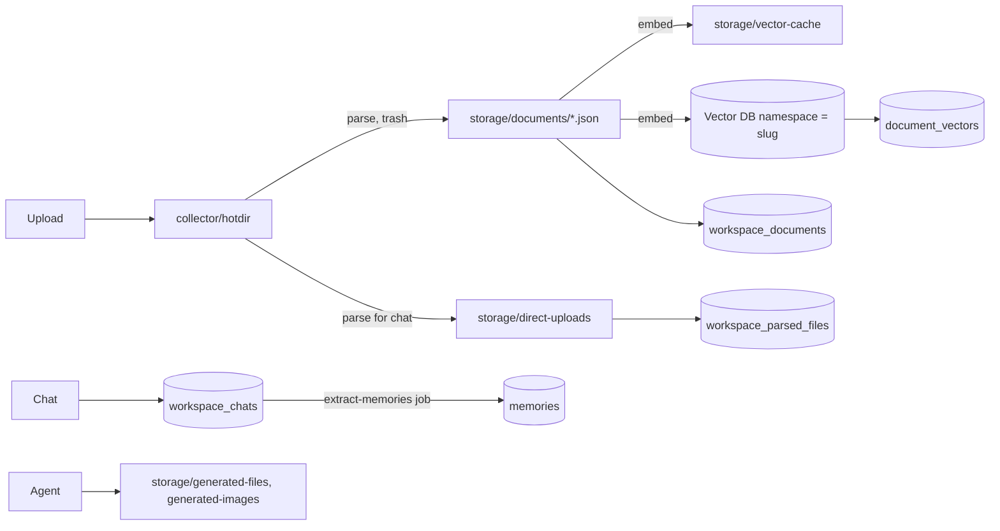

# 08 - State stores (STATE)

## 1. Title and scope

This file catalogues every place AnythingLLM keeps state: the Prisma/SQLite database, the
`storage/` filesystem tree (server and collector), `process.env` and the `.env` file that
`dumpENV` rewrites, the `system_settings` key/value table, in-process memory (maps, caches,
singletons, queues), state held in external systems (vector databases, MCP servers, OAuth
and push handles), and browser `localStorage`. It finishes with a data lifecycle matrix
that shows where each kind of user data lands and what deletes it. The file does not
describe request flows in detail; those belong to the AUTH, CHAT, DOC, AGENT, EXT, ADMIN
and UI files (see section 9). It is a catalogue, so the "Entry points", "User paths",
"State machines" and "Side-effect ledger" sections of CONVENTIONS.md are replaced by
catalogue sections 3 to 9.

Verified against commit `e82a80da` (branch `claude/rbac-account-access-expansion-5787c7`).

**Sources:** `server/prisma/schema.prisma`, `server/prisma/migrations/**/migration.sql`,
`server/prisma/seed.js`, `server/models/*.js`, `server/utils/files/*.js`,
`server/utils/helpers/updateENV.js`, `server/utils/EncryptionManager/index.js`,
`server/utils/BackgroundWorkers/index.js`, `server/jobs/*.js`,
`server/utils/vectorStore/resetAllVectorStores.js`, `server/utils/vectorDbProviders/*`,
`server/utils/MCP/**`, `server/utils/PushNotifications/index.js`,
`server/utils/agents/aibitat/plugins/{gmail,google-calendar,outlook,create-files,filesystem}/lib.js`,
`server/endpoints/{workspaces,workspaceThreads,workspacesParsedFiles,system,admin}.js`,
`collector/utils/files/index.js`, `collector/utils/constants.js`, `server/.gitignore`,
`frontend/src/**` (localStorage only). Counting was done with `grep` over `server/` and
`collector/` excluding `node_modules` and `__tests__`.

## 2. Mental model

- **One relational store, one vector store, one file tree.** Durable state lives in three
  places on the AnythingLLM host: the SQLite file `server/storage/anythingllm.db`
  (`server/prisma/schema.prisma:13-16`), the vector database selected by `VECTOR_DB`
  (LanceDB is the only one that lives under `storage/`), and the `server/storage/` tree.
  The collector process has no database: it reads its upload inbox `collector/hotdir`
  and writes parsed JSON into `server/storage/documents` or `server/storage/direct-uploads`
  (`collector/utils/files/index.js:9-22`).
- **Configuration is split three ways.** Provider choice, credentials and deployment
  switches live in `process.env`, loaded from `server/.env` at boot and rewritten in full by
  `dumpENV` (`server/utils/helpers/updateENV.js:1599-1733`). Admin-editable product settings
  live as label/value rows in `system_settings`. A few secrets (Outlook tokens, SQL
  connection strings, Gmail/Calendar bridge keys, Community Hub key) live in
  `system_settings` as JSON strings, not in `.env`.
- **Documents have four copies.** An uploaded file passes through `collector/hotdir`
  (deleted after parse), becomes a JSON document under `storage/documents/<folder>/`, is
  chunked and embedded into the vector DB (namespace = workspace slug) with a per-file
  cache in `storage/vector-cache/<uuidv5(filename)>.json`, and is linked to a workspace
  by a `workspace_documents` row plus one `document_vectors` row per chunk.
- **"Delete" usually means "hide" for chats.** Chat deletion from the UI, thread
  deletion and user deletion set `workspace_chats.include = false` (and, for users,
  `user_id = null`) instead of deleting rows, so daily message usage still counts
  (`server/models/workspaceThread.js:92-110`, `server/models/user.js:311-325`). Only
  admin chat deletion and workspace deletion remove `workspace_chats` rows.
- **Invariants the code relies on**
  - A `workspace_documents` row cannot outlive its workspace: the FK is `ON DELETE
    RESTRICT` (migration SQL), so every workspace-delete path deletes documents first
    (`server/endpoints/workspaces.js:320-323`).
  - `workspace_chats.workspaceId` and `thread_id` have no FK ("No relation to prevent
    whole table migration", `server/prisma/schema.prisma:189`), so chats are only removed
    when code removes them explicitly.
  - Vector-cache files are keyed by `uuidv5(filename)` (`server/utils/files/index.js:274-276`);
    changing chunk size or overlap purges the entire cache
    (`server/models/systemSettings.js:123-152`).
  - Everything held in process memory is rebuilt from the DB, the filesystem or the
    provider on restart; nothing in memory is the only copy of user data except in-flight
    agent attachments, pending Telegram pairings and pending mobile-device tokens (section 7).
- **Patterns:** repository objects over Prisma (one `server/models/*.js` per table),
  cache-aside for provider metadata (`ContextWindowCache`, model-map JSON caches), process
  singletons (`MCPHypervisor`, `BackgroundService`, `TelegramBotService`,
  `PushNotifications`, `ModelRouterService`), and periodic garbage collection jobs for
  orphaned files (`server/utils/BackgroundWorkers/index.js:29-60`).

## 3. Database catalogue

### 3.1 Engine, client, migrations

| Item | Detail |
|---|---|
| Engine | SQLite, file `../storage/anythingllm.db` relative to `server/prisma/` (`server/prisma/schema.prisma:13-16`). A commented PostgreSQL datasource block is offered (`schema.prisma:5-12`). |
| Client | Single shared `PrismaClient` with log levels `error, info, warn` (`server/utils/prisma/index.js:1-13`); Prisma 5.3.1 (`server/package.json:38,90`). |
| Migrations | `server/prisma/migrations/`: 40 migration folders from `20230921191814_init` to `20260520160208_init`, plus `migration_lock.toml`. Every folder is named `*_init`. |
| Seed | `server/prisma/seed.js:5-8` creates `multi_user_mode=false` and `logo_filename=anything-llm.png` in `system_settings` if missing. |
| SQLite limits visible in schema | `workspaces.router_id` and `workspace_chats.thread_id` / `workspace_agent_invocations.thread_id` are plain ints with no relation, explicitly to avoid whole-table migrations (`schema.prisma:142,189,204`). |
| Legacy column check | `server/utils/database/index.js:4-23` (`checkColumnTemplate`, `checkForMigrations`) **(unverified: not read in depth)**. |

Foreign-key actions below come from the migration SQL (`grep FOREIGN KEY`), not only the
schema. Relations without an explicit `onDelete` in the schema got Prisma's defaults:
optional relations are `ON DELETE SET NULL`, the one required relation without an action
(`workspace_documents.workspaceId`) is `ON DELETE RESTRICT`.

### 3.2 Tables (33 models in 32 rows)

Paths abbreviated: `e/` = `server/endpoints/`, `u/` = `server/utils/`, `j/` = `server/jobs/`,
`m/` = `server/models/`. "Callers" lists files outside `server/models/` that call the
wrapping model (reads and writes); the main writers are named in "Writes".

| # | Table (`schema.prisma` line) | Purpose | Key columns | Relations and onDelete | Model file | Writes (model line) and main writer callers | Other readers | How rows are removed |
|---|---|---|---|---|---|---|---|---|
| 1 | `api_keys` (18) | Developer API keys | `secret` unique, `createdBy` (no FK) | none | `m/apiKeys.js` (`ApiKey`) | create `:16`, deleteMany `:53`; `e/system.js`, `e/admin.js` | `u/middleware/validApiKey.js`, `u/database/index.js` | Explicit: `ApiKey.delete` at `e/system.js:1106`, `e/admin.js:554`. Not removed when the creator is deleted. |
| 2 | `workspace_documents` (27) | A document file linked into a workspace | `docId` unique, `docpath`, `workspaceId`, `pinned`, `watched`, `metadata` JSON | `workspaceId -> workspaces` **RESTRICT**; 1:1 child `document_sync_queues` | `m/documents.js` (`Document`) | create `:179`, delete `:267`, deleteMany `:43`, update `:311`, updateMany `:323`; `Document.addDocuments` `:85`; also `j/embedding-worker.js` writes directly | `e/workspaces.js`, `e/document.js`, `e/api/*`, `u/DocumentManager`, `u/files/index.js`, `u/agents/aibitat/plugins/summarize.js`, `j/sync-watched-documents.js` | `Document.removeDocuments` (`m/documents.js:251-287`, also deletes vectors and `document_vectors`); `Document.delete` on workspace delete (`e/workspaces.js:322`, `e/admin.js:314`, `e/api/workspace/index.js:260`); all rows on vector reset (`u/vectorStore/resetAllVectorStores.js:22`); purge of source file (`u/files/purgeDocument.js:20,75`). |
| 3 | `invites` (42) | Multi-user invite codes | `code` unique, `status` (`pending`/claimed/disabled), `claimedBy`, `workspaceIds` CSV, `createdBy` | none | `m/invite.js` | create `:12`, update `:33,46` (deactivate, markClaimed), deleteMany `:99` | `e/invite.js`, `e/admin.js`, `e/api/admin/index.js` | `Invite.delete` exists but has no caller outside the model; invites are deactivated, not deleted. Effectively **never**. |
| 4 | `system_settings` (53) | Label/value product settings (section 6) | `label` unique, `value` string | none | `m/systemSettings.js`; also `m/agentSkillWhitelist.js` | upsert `:744`, deleteMany `:717`; `m/agentSkillWhitelist.js:56,86`; seed `prisma/seed.js` | about 45 files (middleware, agents, vector providers, boot) | `SystemSettings.delete` only at `e/utils/outlookAgentUtils.js:179` (Outlook revoke); `AgentSkillWhitelist.clearSingleUserWhitelist` (`e/system.js:703`). Otherwise never. |
| 5 | `users` (61) | Accounts | `username` unique, `password` (bcrypt hash **(unverified)**), `role`, `suspended`, `dailyMessageLimit`, `pfpFilename`, `bio`, `web_push_subscription_config` JSON | parent of 17 relations | `m/user.js` | create `:126`, update `:201,236`, delete `:311-325` (transaction) | `u/middleware/validatedRequest.js`, `u/PasswordRecovery`, `u/PushNotifications`, `u/MCP/identity.js`, many endpoints | `User.delete` at `e/admin.js:145`, `e/api/admin/index.js:258`, `e/system.js:716` (rollback when enabling multi-user fails: deletes **all** users). Before deleting it sets `workspace_chats.user_id=null, include=false` for that user (`m/user.js:313-317`). |
| 6 | `recovery_codes` (92) | Hashed single-user/multi-user recovery codes | `user_id`, `code_hash` | `users` CASCADE | `m/passwordRecovery.js` (`RecoveryCode`) | create `:11,24`, deleteMany `:57` | `u/PasswordRecovery/index.js` | Cascade on user delete; `RecoveryCode.deleteMany` after reset (`u/PasswordRecovery/index.js:99`). |
| 7 | `password_reset_tokens` (102) | Reset tokens from recovery codes | `token` unique, `expiresAt` | `users` CASCADE | `m/passwordRecovery.js` (`PasswordResetToken`) | create `:81`, deleteMany `:103` | `u/PasswordRecovery/index.js` | `deleteMany` after use (`u/PasswordRecovery/index.js:98`); cascade on user delete. Expired tokens are not swept **(unverified)**. |
| 8 | `document_vectors` (113) | Map docId -> vector IDs in the vector DB | `docId`, `vectorId` (no FK) | none | `m/vectors.js` (`DocumentVectors`); also `m/documents.js:270` | create `:12` (`bulkInsert` from every vector provider), deleteMany `:46,58,70` | vector providers under `u/vectorDbProviders/*`, `j/sync-watched-documents.js` | `deleteForWorkspace` on workspace delete/reset (`e/workspaces.js:321,363`); `deleteIds` in providers' `deleteDocumentFromNamespace` (e.g. `u/vectorDbProviders/qdrant/index.js:347`); `removeDocuments` (`m/documents.js:270`); `DocumentVectors.delete()` all rows on vector reset (`u/vectorStore/resetAllVectorStores.js:21`); re-sync (`j/sync-watched-documents.js:108`). **LanceDB and PGVector do not call `deleteIds`** (grep shows no call) **(unverified whether rows leak there)**. |
| 9 | `workspaces` (121) | Workspace config | `slug` unique, `name`, LLM/agent provider+model overrides, `openAiPrompt` (system prompt), `similarityThreshold`, `topN`, `chatMode`, `vectorSearchMode`, `router_id` (no FK), `pfpFilename` | parent of 9 relations | `m/workspace.js` | create `:221`, update `:283`, delete `:391`, upsert `:602` | `u/middleware/validWorkspace.js`, Telegram handlers, `u/agents/*`, `j/extract-memories.js`, endpoints | `Workspace.delete` at `e/workspaces.js:323`, `e/admin.js:315`, `e/api/workspace/index.js:261`, each preceded by explicit chat, vector and document deletes. |
| 10 | `workspace_threads` (154) | Chat threads | `slug` unique, `workspace_id`, `user_id` | `workspaces` CASCADE, `users` CASCADE | `m/workspaceThread.js` | create `:37`, update `:68`, deleteMany `:105`, updateMany `:137` | `e/workspaceThreads.js`, `e/chat.js`, `e/api/workspaceThread`, Telegram, `u/helpers/search.js` | `WorkspaceThread.delete` (`e/workspaceThreads.js:104,123`, `e/api/workspaceThread/index.js:233`) first hides the thread's chats (`m/workspaceThread.js:96-103`); cascade on workspace or user delete (chats are **not** hidden on cascade). |
| 11 | `workspace_suggested_messages` (170) | Starter prompts per workspace | `workspaceId`, `heading`, `message` | `workspaces` CASCADE | `m/workspacesSuggestedMessages.js` | deleteMany `:38` + create `:46` (`saveAll` replaces set) | `e/workspaces.js` | Replaced on save; cascade on workspace delete. |
| 12 | `workspace_chats` (182) | Every prompt/response pair (UI, API, Telegram, agents) | `workspaceId` (no FK), `user_id`, `thread_id` (no FK), `api_session_id`, `include`, `feedbackScore`, `memory_processed`, `response` JSON (sources, attachments, outputs) | `users` CASCADE (but see row 5) | `m/workspaceChats.js` | create `:15,339`, upsert `:372`, update `:271,293`, updateMany `:115,142,168,311,322`, deleteMany `:196`; writers `u/chats/stream.js`, `u/chats/apiChatHandler.js`, `u/chats/openaiCompatible.js`, `u/agents/*`, `u/telegramBot/chat/*`, `e/mobile/utils/index.js` (direct prisma) | `j/extract-memories.js`, `j/cleanup-generated-*.js`, `u/helpers/chat/convertTo.js` (export), `u/router/index.js` | Hidden (`include=false`): `/workspace/:slug/delete-chats` and `delete-edited-chats` (`e/workspaces.js:500,529`), thread `delete-edited-chats` (`e/workspaceThreads.js:211`), thread delete, user delete, `/reset` command **(unverified: `u/chats/commands/reset.js` not read)**. Rows deleted: `/system/workspace-chats/:id` (admin/manager; `id=-1` deletes all, `e/system.js:1218-1227`) and workspace delete (`e/workspaces.js:320`, `e/admin.js:312`, `e/api/workspace/index.js:258`). |
| 13 | `workspace_agent_invocations` (198) | One row per `@agent` session | `uuid` unique, `prompt`, `closed`, `user_id`, `thread_id` (no FK), `workspace_id` | `users` CASCADE, `workspaces` CASCADE | `m/workspaceAgentInvocation.js` | create `:24`, update `:15` (close), delete `:72` | `e/agentWebsocket.js`, `u/agents/index.js`, `u/agents/ephemeral.js`, `u/chats/agents.js`, `u/telegramBot/index.js` | Closed, not deleted; `WorkspaceAgentInvocation.delete` has no outside caller. Removed only by cascade. |
| 14 | `workspace_users` (214) | Membership of users in workspaces | `user_id`, `workspace_id` | both CASCADE | `m/workspaceUsers.js` (`WorkspaceUser`) | create `:9,31,47`, deleteMany `:95` | `e/api/admin/index.js`, `u/database/index.js`, `m/workspace.js:498-505` (`updateUsers`) | Replaced by `Workspace.updateUsers` (`m/workspace.js:500`); cascade. |
| 15 | `cache_data` (224) | Generic named cache with `expiresAt` | `name`, `data`, `belongsTo`, `byId`, `expiresAt` | none | `m/cacheData.js` | create `:6`, deleteMany `:32` | **No caller outside the model** | Effectively unused. |
| 16 | `embed_configs` (235) | Public chat-widget configs | `uuid` unique, `enabled`, `chat_mode`, `allowlist_domains`, override flags, rate limits, `workspace_id`, `createdBy`, `usersId` | `workspaces` CASCADE, `users` SET NULL | `m/embedConfig.js` | create `:28`, update `:101`, delete `:143` | `u/middleware/embedMiddleware.js`, `e/embedManagement.js`, `e/api/embed/index.js` | `EmbedConfig.delete` (`e/embedManagement.js:79`, `e/api/embed/index.js:397`); cascade on workspace delete. |
| 17 | `embed_chats` (256) | Widget chat history | `session_id`, `prompt`, `response`, `include`, `connection_information` JSON (host, IP, user agent **(unverified fields)**), `embed_id`, `usersId` | `embed_configs` CASCADE, `users` SET NULL | `m/embedChats.js` | create `:24`, updateMany `:94` (`markHistoryInvalid`), deleteMany `:125` | `u/chats/embed.js`, `e/embed/index.js`, `e/embedManagement.js`, `u/helpers/chat/convertTo.js` | Visitor reset hides (`e/embed/index.js:93` **(unverified that it calls markHistoryInvalid)**); admin `EmbedChats.delete` (`e/embedManagement.js:123`); cascade on embed config, so also on workspace delete. |
| 18 | `event_logs` (270) | Audit log | `event`, `metadata` JSON, `userId` (no FK), `occurredAt` | none | `m/eventLogs.js` | create `:6` (`logEvent`, about 20 caller files), deleteMany `:116` | `e/system.js` (list) | Only full clear by admin: `DELETE /system/event-logs` (`e/system.js:1170-1176`), which immediately logs `event_logs_cleared`. Survives user deletion. |
| 19 | `slash_command_presets` (280) | User `/command` presets | `command`, `prompt`, `uid` (0 = no user), `userId`; unique `(uid, command)` | `users` CASCADE | `m/slashCommandsPresets.js` | create `:54`, update `:93`, delete `:106`, updateMany `:124` (migrate to multi-user) | `e/system.js`, `u/chats/index.js` | `SlashCommandPresets.delete` (`e/system.js:1418`); cascade. |
| 20 | `document_sync_queues` (294) | Watched-document sync schedule | `workspaceDocId` unique, `staleAfterMs` (default 7 days), `nextSyncAt`, `lastSyncedAt` | `workspace_documents` CASCADE | `m/documentSyncQueue.js` | create `:108` (`watch`), update `:156`, deleteMany `:214` (`unwatch`/`delete`) | `e/experimental/liveSync.js`, `u/files/index.js`, `u/BackgroundWorkers`, `j/sync-watched-documents.js` | `unwatch` (`m/documentSyncQueue.js:130`); cascade when the workspace document is removed. |
| 21 | `document_sync_executions` (305) | Sync run results | `queueId`, `status`, `result` | `document_sync_queues` CASCADE | `m/documentSyncRun.js` | create `:17`, deleteMany `:79` | `j/sync-watched-documents.js` | Cascade only; `DocumentSyncRun.delete` has no outside caller. |
| 22 | `browser_extension_api_keys` (314) | Browser extension keys | `key` unique, `user_id` | `users` CASCADE | `m/browserExtensionApiKey.js` | create `:22`, delete `:79`, deleteMany `:98`, updateMany `:175` | `e/browserExtension.js`, `u/middleware/validBrowserExtensionApiKey.js`, `e/admin.js` | `delete` (`e/browserExtension.js:51,213`); `deleteAllForUser` before user delete (`e/admin.js:144`); cascade. |
| 23 | `temporary_auth_tokens` (325) | Single-use login tokens (10 min): `allm-tat-` from Simple SSO, `allm-oidc-` from the Google sign-in callback | `token` unique, `userId`, `expiresAt` | `users` CASCADE | `m/temporaryAuthToken.js` | `issue`: deleteMany + create in one `$transaction` (since `169b68a0`), delete (consume on validate) | `e/system.js`, `e/api/userManagement/index.js`, `e/auth/oidc.js` | Consumed on use; prior tokens for the user replaced on issue; cascade. Expired, unused tokens stay until the next `issue` for that user. |
| 23a | `user_identities` (97) | External sign-in identity linked to a user (Google OIDC) | `(provider, subject)` unique, `user_id` indexed, `email`, `lastLoginAt` | `users` CASCADE | `m/userIdentity.js` | create in `u/auth/oidc.js` (with the user or invite claim, same transaction), `recordLogin` update | `e/auth/oidc.js`, `e/admin.js` (`/admin/users` adds `identities`) | Lives as long as the user. Migration `20261111121000_user_identities`. |
| 24 | `system_prompt_variables` (337) | `{variable}` expansion for system prompts | `key` unique, `value`, `type` (system/user/dynamic), `userId` | `users` CASCADE | `m/systemPromptVariables.js` | create `:181`, update `:206`, delete `:223` | `e/system.js`, `u/chats/index.js`, `u/agents/aibitat/providers/ai-provider.js` | `SystemPromptVariables.delete` (`e/system.js:1529`); cascade. |
| 25 | `prompt_history` (351) | History of workspace system prompt edits | `workspaceId`, `prompt`, `modifiedBy`, `modifiedAt` | `workspaces` CASCADE, `users` SET NULL | `m/promptHistory.js` | create `:6` (`handlePromptChange` from `m/workspace.js:529`), deleteMany `:80,97` | `m/workspace.js:620-660` | `Workspace.deleteAllPromptHistory` / `deletePromptHistory` (`e/workspaces.js:975,997`); cascade on workspace. |
| 26 | `desktop_mobile_devices` (364) | Paired mobile app devices | `token` unique, `deviceOs`, `deviceName`, `approved`, `userId` | `users` CASCADE | `m/mobileDevice.js` | create `:125`, update `:160`, delete `:192`, updateMany `:237` | `e/mobile/index.js`, `e/mobile/middleware/index.js`, `e/mobile/utils/index.js`, `e/system.js` | `MobileDevice.delete` (`e/mobile/index.js:75`, `e/mobile/utils/index.js:213`); cascade. |
| 27 | `workspace_parsed_files` (377) | Files attached to a chat ("parse, don't embed") | `filename` unique, `workspaceId`, `userId`, `threadId`, `metadata` JSON (`location` in `direct-uploads`), `tokenCountEstimate` | `workspaces`, `users`, `workspace_threads` all CASCADE | `m/workspaceParsedFiles.js` | create `:19`, deleteMany `:85`, updateMany `:179` | `e/workspacesParsedFiles.js`, `u/chats/stream.js`, `u/agents/*`, `u/router/index.js`, `j/cleanup-orphan-documents.js` | `WorkspaceParsedFiles.delete` (`e/workspacesParsedFiles.js:55`, row only); `moveToDocuments` deletes the row after moving the file (`m/workspaceParsedFiles.js:136-143`); cascade on workspace, user or thread. The file in `direct-uploads` is removed later by `cleanup-orphan-documents` (every 12 h). |
| 28 | `external_communication_connectors` (394) | Telegram (and future) connector config | `type` unique, `config` JSON (bot token, approved users **(unverified fields)**), `active` | none | `m/externalCommunicationConnector.js` | upsert `:59`, delete `:99` | `e/telegram.js`, `u/telegramBot/index.js`, `u/telegramBot/utils/verification.js` | `delete` at `e/telegram.js:168`, `u/telegramBot/index.js:222,427`. |
| 29 | `scheduled_jobs` (403) | Agent prompts run on cron | `name`, `prompt`, `tools` JSON, `schedule` cron, `enabled`, `lastRunAt`, `nextRunAt` | parent of runs | `m/scheduledJob.js` | create `:92`, update `:128,241,260`, delete `:173` | `e/scheduledJobs.js`, `u/agents/aibitat/plugins/create-scheduled-job/*`, `u/BackgroundWorkers`, `j/run-scheduled-job.js` | `ScheduledJob.delete` (`e/scheduledJobs.js:283`). |
| 30 | `scheduled_job_runs` (417) | Run records | `jobId`, `status` (queued/running/completed/failed/timed_out), `result` JSON trace, `error`, `readAt` | `scheduled_jobs` CASCADE | `m/scheduledJobRun.js` | updateMany `:69-230` (state transitions), update `:281`, deleteMany `:294`, `start` `:32` | `e/scheduledJobs.js`, `e/agentFileServer.js`, `j/cleanup-generated-*.js` | Cascade on job delete only; `ScheduledJobRun.delete` has no outside caller. **Never pruned** otherwise. |
| 31 | `memories` (431) | Long-term user/workspace memories | `userId`, `workspaceId`, `scope` (workspace/global), `content`, `lastUsedAt` | `users` CASCADE, `workspaces` CASCADE | `m/memory.js` | create `:116`, update `:139,196,237`, updateMany `:260,449`, delete `:160` | `e/memory.js`, `e/system.js`, `u/memories/index.js`, `j/extract-memories.js` | `Memory.delete` (`e/memory.js:136`); replaced by extraction (`applyExtractedMemories` `m/memory.js:345`, `replaceWorkspaceMemories` `:300`); cascade. |
| 32 | `model_routers` (448) / `model_router_rules` (461) | Model router definitions and rules | router `name` unique, fallback provider/model, `cooldown_seconds`; rule `priority`, `type`, `conditions` JSON, route provider/model | rules -> routers CASCADE; `workspaces.router_id` has no FK | `m/modelRouter.js`, `m/modelRouterRule.js` | router create `:51`, update `:212`, delete `:236`; rule create `:77`, update `:194,231`, delete `:213` | `e/modelRouter.js`, `u/router/index.js` | `ModelRouter.delete` (`e/modelRouter.js:98`), `ModelRouterRule.delete` (`e/modelRouter.js:189`). |

Count: 33 Prisma models (the last row covers two). `grep -c '^model ' schema.prisma` = 33.

### 3.3 Cascade fan-out

| Parent deleted | Rows removed by FK cascade | Rows set to NULL | Rows left behind |
|---|---|---|---|
| `users` row | `recovery_codes`, `password_reset_tokens`, `workspace_threads`, `workspace_users`, `workspace_agent_invocations`, `slash_command_presets`, `browser_extension_api_keys`, `temporary_auth_tokens`, `system_prompt_variables`, `desktop_mobile_devices`, `workspace_parsed_files`, `memories`; `workspace_chats` would cascade but `User.delete` detaches them first | `embed_configs.usersId`, `embed_chats.usersId`, `prompt_history.modifiedBy`; `workspace_chats.user_id` (by code) | `workspace_chats` (hidden, anonymised by `user_id=null` only; prompt/response text kept), `event_logs.userId`, `api_keys.createdBy`, `invites.createdBy/claimedBy`, `model_routers.created_by`, pfp file in `storage/assets/pfp`, `user_<id>_whitelisted_agent_skills` row in `system_settings` |
| `workspaces` row | `workspace_threads` (and their `workspace_parsed_files`), `workspace_suggested_messages`, `workspace_agent_invocations`, `workspace_users`, `embed_configs` -> `embed_chats`, `prompt_history`, `workspace_parsed_files`, `memories` | none | Blocked by `workspace_documents` (RESTRICT) unless code deletes them first; `workspace_chats` unless code deletes them (all three delete paths do); vector namespace unless `delete-namespace` succeeds (`e/workspaces.js:333-337`, errors swallowed) |
| `workspace_documents` row | `document_sync_queues` -> `document_sync_executions` | none | `document_vectors` unless deleted by `removeDocuments`; source JSON in `storage/documents`; vector-cache file |
| `workspace_threads` row | `workspace_parsed_files` with that `threadId` | none | `workspace_chats` with that `thread_id` (hidden only when deleted via `WorkspaceThread.delete`) |
| `scheduled_jobs` row | `scheduled_job_runs` | none | Generated files referenced by the runs until the cleanup jobs run |

## 4. Filesystem catalogue

### 4.1 Path constants

`server/storage` is resolved as `__dirname/../../storage` in development and as
`process.env.STORAGE_DIR` otherwise. Each subsystem resolves its own path; there is no
central helper. Definitions found:

| Constant / getter | Definition |
|---|---|
| `documentsPath`, `directUploadsPath`, `vectorCachePath`, `hotdirPath`, `generatedImagesPath` | `server/utils/files/index.js:7-26` (hotdir in production is `STORAGE_DIR/../../collector/hotdir`) |
| `documentsPath` (duplicates) | `server/utils/DocumentManager/index.js:7-8`, `server/jobs/helpers/index.js:6-7`, `server/endpoints/api/document/index.js:24-25` |
| multer destinations (hotdir, assets, assets/pfp) | `server/utils/files/multer.js:16,36,52-53,72-73` |
| `pluginsPath` (agent skills) | `server/utils/agents/imported.js:6-9` |
| `AgentFlows.flowsDir` | `server/utils/agentFlows/index.js:18-20` (falls back to `process.cwd()/storage/...`) |
| `mcpServerJSONPath` | `server/utils/MCP/hypervisor/index.js:75-92` |
| comkey folder | `server/utils/comKey/index.js:6-8`, `collector/utils/comKey/index.js:6-8` |
| LanceDB `uri` | `server/utils/vectorDbProviders/lance/index.js:25-29` |
| create-files output | `server/utils/agents/aibitat/plugins/create-files/lib.js:19-23` |
| filesystem agent root | `server/utils/agents/aibitat/plugins/filesystem/lib.js:53-58` |
| push-notifications | `server/utils/PushNotifications/index.js:72-80` |
| embedded Lemonade | `server/utils/AiProviders/embeddedLemonade/config.js:99-109` |
| logos / pfp | `server/utils/files/logo.js:35-37,76-99`, `server/utils/files/pfp.js:33-35`, `server/endpoints/system.js:857,944` (hard-coded `../storage/assets/pfp`, ignores `STORAGE_DIR`) |
| collector `documentsFolder`, direct-uploads | `collector/utils/files/index.js:9-22` |
| collector hotdir | `collector/utils/constants.js:1` (`WATCH_DIRECTORY`, always `collector/hotdir`) |

### 4.2 Layout

| Path (under `server/storage/` unless stated) | Contents | Written by | Deleted by |
|---|---|---|---|
| `anythingllm.db` (+ `-journal`) | SQLite database (section 3) | Prisma | never by code |
| `documents/<folder>/<name>-<uuid>.json` | Parsed document JSON (text + metadata); `custom-documents/` is the default folder | collector `writeToServerDocuments` (`collector/utils/files/index.js:120-131`), repo/Confluence loaders (`collector/utils/extensions/*/index.js:45-47,88-90`), `moveToDocuments` (`server/models/workspaceParsedFiles.js:128-136`), move between folders (`server/utils/files/index.js:754-795`) | `purgeSourceDocument` (`server/utils/files/index.js:304-316`) via `/system/remove-document(s)` (`server/endpoints/system.js:470-500`); `purgeFolder` `rmSync` (`server/utils/files/purgeDocument.js:81`) except `custom-documents` |
| `direct-uploads/` | Parsed chat attachments (parse-only flow) | collector (`collector/utils/files/index.js:20-22`) | `moveToDocuments` (moves out); `cleanup-orphan-documents` job every 12 h for files with no `workspace_parsed_files` row (`server/jobs/cleanup-orphan-documents.js:46-80`, `server/utils/BackgroundWorkers/index.js:31-33`) |
| `vector-cache/<uuidv5>.json` | Chunk text + embeddings per source file | `storeVectorResult` (`server/utils/files/index.js:290-300`) | `purgeVectorCache` (`:321-328`) with document purge; `purgeEntireVectorCache` (`:805-807`) on chunk-size/overlap change and vector reset. **Not** removed when a document is only unembedded from a workspace. |
| `lancedb/` | LanceDB tables, one per workspace slug | LanceDB provider | `delete-namespace` (per workspace); `reset()` removes the directory (`server/utils/vectorDbProviders/lance/index.js:504-510`) |
| `models/` | Native embedder and reranker models (`Xenova/*`), whisper (collector), tesseract OCR (`collector/utils/OCRLoader/index.js:26-28`), provider model-list caches (`fireworks`, `gemini`, `togetherAi`, `openrouter`, `novita`, `apipie`, `ppio`, `giteeai`, `cometapi`, `foundry`), `context-windows` (`server/utils/AiProviders/modelMap/index.js:33-35`), `pricing` (`server/utils/helpers/modelPricing/index.js:75-77`), `embedded-lemonade` | providers on first use | modelPricing etag `rmSync` (`modelPricing/index.js:225`); Lemonade model delete (`server/utils/AiProviders/embeddedLemonade/index.js:584-592`); otherwise never |
| `engines/embedded-lemonade/{lemond,config,cache}` | Bundled `lemond` binary, its config and backend cache | `server/utils/AiProviders/embeddedLemonade/engine.js:180-235` | replaced on version bump (`engine.js:188-220`) |
| `tmp/` | Native embedder temp files | `server/utils/EmbeddingEngines/native/index.js:123-125` | `rmSync` after use (`:303`) |
| `assets/` | Custom logo files (default `anything-llm.png`, `anything-llm-invert.png` are tracked) | multer (`server/utils/files/multer.js:52`), `renameLogoFile` (`server/utils/files/logo.js:87-89`) | `removeCustomLogo` (`logo.js:97-104`) |
| `assets/pfp/` | User profile pictures | multer (`multer.js:72`) | replaced/removed via `/system/upload-pfp` and `/system/remove-pfp` (`server/endpoints/system.js:857-864,934-951`). Not deleted on user delete. |
| `plugins/agent-skills/<hubId>/` | Imported custom agent skills (code + `plugin.json`) | Community Hub import (`server/utils/agents/imported.js:290-360`) | `ImportedPlugin.deletePlugin` (`imported.js:136-142`) |
| `plugins/agent-flows/<uuid>.json` | No-code agent flows | `server/utils/agentFlows/index.js:85-95` | `AgentFlows.deleteFlow` (`:155-162`) |
| `plugins/anythingllm_mcp_servers.json` | MCP server definitions (`mcpServers` map; commands, args, env, headers) | created empty at boot, edited by hypervisor (`server/utils/MCP/hypervisor/index.js:87-92,123-135,164,215`) | entry removal `removeMCPServerFromConfig` (`:123`) |
| `plugins/office-extensions/` | Listed in `server/.gitignore` only; no code reference found | none found | none found **(unverified)** |
| `generated-files/` | Agent-created PDF/DOCX/XLSX/PPTX, named `<type>-<uuid>.<ext>` | create-files plugin (`create-files/lib.js:19-36`) | `cleanup-generated-files` job every 8 h: files over 1 h old not referenced by any `include=true` chat or any scheduled run (`server/jobs/cleanup-generated-files.js:9,85-140`) |
| `generated-images/img-*.png` | Agent and `/img` images | `saveGeneratedImage` (`server/utils/files/index.js:942-947`) | `cleanup-generated-images` job every 9 h, same rule (`server/jobs/cleanup-generated-images.js:14,93`) |
| `anythingllm-fs/` | Default sandbox root for the filesystem agent skill | `filesystem/lib.js:53-70` | agent tools only |
| `push-notifications/{vapid-keys.json,primary-subscription.json}` | VAPID keypair; single-user browser push subscription | `server/utils/PushNotifications/index.js:78-160` | never by code **(unverified)** |
| `comkey/{ipc-priv.pem,ipc-pub.pem}` | RSA keypair signing server -> collector requests | `server/utils/comKey/index.js:41-60` | regenerated at boot **(unverified whether every boot)** |
| `exports/`, `imports/` | Listed in `server/.gitignore`; no code reference found | none found | none found **(unverified, legacy)** |
| `server/.env` | Persisted environment (section 5) | `dumpENV` (`server/utils/helpers/updateENV.js:1730-1731`) | rewritten in full on every dump |
| `server/logs/server.log` | Listed in `.gitignore`; both loggers write to the console only (`server/utils/logger/index.js:14-25`, `collector/utils/logger/index.js:14-25`) | none in code | n/a **(unverified: Docker may redirect stdout)** |
| `collector/hotdir/` | Raw uploads waiting for parse | server multer (`server/utils/files/multer.js:16,36`) | collector `trashFile` after each converter (`collector/processSingleFile/index.js:74`, `collector/processSingleFile/convert/*.js`) |
| `collector/storage/tmp/` | Whisper/ffmpeg intermediates and other temp files | `collector/utils/WhisperProviders/localWhisper.js:69`, `collector/utils/files/index.js:176` | per-converter cleanup **(unverified)** |

Count: 21 directories (19 under `server/storage`, 2 in `collector`), plus 3 files
(`anythingllm.db`, `plugins/anythingllm_mcp_servers.json`, `server/.env`).

## 5. Environment catalogue

### 5.1 How env is loaded and written

- Loaded by `dotenv` at module load (`server/models/systemSettings.js:1-3` and others;
  `.env.development` in dev, `.env` otherwise).
- Changed at runtime by `updateENV(newENVs)` (`server/utils/helpers/updateENV.js:1520-1580`):
  each UI key maps through `KEY_MAPPING` (`:4`, 227 entries, plus
  `embeddedLemonade/config.js` `ENV_KEYS` spread at `:1065`) to an `envKey`, runs
  validators, `preUpdate`/`postUpdate` hooks (for example vector DB or embedder change ->
  `resetAllVectorStores`, `:1417,1430`), sets `process.env[envKey]` (`:1563`), logs
  `update_llm_provider` / `update_embedding_engine` / `update_vector_db` events, and calls
  `dumpENV()` in production (`:1574`).
- `dumpENV()` (`:1599-1733`) writes **only** a protected list (all `KEY_MAPPING` env keys
  plus a manual list at `:1605-1715`) to `server/.env`, overwriting the file and stripping
  newline/quote characters. Any variable not in that list that was hand-added to `.env`
  is **lost** on the next dump.
- Other runtime writers: `JWT_SECRET` set on enabling multi-user (`server/endpoints/system.js:705-710`),
  `SIG_KEY`/`SIG_SALT` self-generated then dumped (`server/utils/EncryptionManager/index.js:38-43`),
  `GROQ_STT_API_KEY` (`server/utils/helpers/customModels.js:451`, in-memory only),
  `NTBA_FIX_350=1` (`server/utils/telegramBot/index.js:3`), collector
  `NODE_TLS_REJECT_UNAUTHORIZED` toggled around Confluence fetches with `bypassSSL`
  (`collector/utils/extensions/Confluence/ConfluenceLoader/index.js:67,79`; process-wide
  while the request runs).

### 5.2 Variables read by the server (grouped)

Legend: `*` = secret (credential, key, token, password, connection string, custom
headers); `†` = read by code but **not** persisted by `dumpENV` (lost on dump unless set
by the container environment). Everything without `†` is in the dump list.

| Area | Count | Variables |
|---|---|---|
| Runtime, ports, paths, HTTPS, logging | 17 | `ANYTHING_LLM_RUNTIME`†, `COLLECTOR_PORT`, `DEPLOYMENT_VERSION`†, `DISABLE_METRICS_ENDPOINT`, `DISABLE_SWAGGER_DOCS`, `ENABLE_HTTPS`, `ENABLE_HTTP_LOGGER`†, `ENABLE_HTTP_LOGGER_TIMESTAMPS`†, `HTTPS_CERT_PATH`, `HTTPS_KEY_PATH`, `NODE_ENV`†, `NODE_PATH`†, `NTBA_FIX_350`† (written, not read), `PATH`†, `PLACEHOLDER`† (appears only in a comment, `server/utils/agents/aibitat/providers/ai-provider.js:492`), `SERVER_PORT`, `STORAGE_DIR` |
| Auth, session, passwords, SSO, encryption | 15 | `AUTH_TOKEN`* (single-user password), `JWT_EXPIRY`, `JWT_SECRET`*, `PASSWORDLOWERCASE`, `PASSWORDMAXCHAR`, `PASSWORDMINCHAR`, `PASSWORDNUMERIC`, `PASSWORDREQUIREMENTS`, `PASSWORDSYMBOL`, `PASSWORDUPPERCASE`, `SIG_KEY`*, `SIG_SALT`*, `SIMPLE_SSO_ENABLED`, `SIMPLE_SSO_NO_LOGIN`, `SIMPLE_SSO_NO_LOGIN_REDIRECT`. Google sign-in (since `891c5124`, `u/auth/oidcSettings.js`, `u/auth/oidc.js`; read-only overrides of the `oidc_*` settings): `OIDC_ENABLED`, `OIDC_ISSUER`, `OIDC_CLIENT_ID`, `OIDC_CLIENT_SECRET`*, `OIDC_REDIRECT_URI`, `OIDC_ALLOWED_DOMAINS`, `OIDC_PROVISIONING`, `OIDC_DEFAULT_ROLE`, `OIDC_ONLY`; env-only `OIDC_SESSION_EXPIRY` (default `12h`), `OIDC_APP_URL` |
| Feature switches and policy | 11 | `ANYTHINGLLM_CHROMIUM_ARGS`, `ANYTHINGLLM_FETCH_TIMEOUT`, `ANYTHINGLLM_MAX_RETRIES`, `COLLECTOR_ALLOW_ANY_IP`, `COMMUNITY_HUB_BUNDLE_DOWNLOADS_ENABLED`, `DISABLE_TELEMETRY`, `DISABLE_VIEW_CHAT_HISTORY`, `EMBED_REQUIRE_ALLOWLIST`, `MODEL_ROUTER_ID`, `TARGET_OCR_LANG`, `WORKSPACE_DELETION_PROTECTION` |
| Background workers | 5 | `DOCUMENT_SYNC_STALE_AFTER_MS`, `MEMORY_EXTRACTION_INTERVAL`, `MEMORY_IDLE_THRESHOLD_MS`, `SCHEDULED_JOB_MAX_CONCURRENT`, `SCHEDULED_JOB_TIMEOUT_MS` |
| Agents, tools, MCP, web search | 27 | `AGENT_ANYSEARCH_API_KEY`*, `AGENT_AUTO_APPROVED_SKILLS`, `AGENT_BAIDU_SEARCH_API_KEY`*, `AGENT_BING_SEARCH_API_KEY`*, `AGENT_BRAVE_API_KEY`*, `AGENT_CRW_API_KEY`*, `AGENT_CRW_API_URL`, `AGENT_DEEPSEEK_API_KEY`*, `AGENT_EXA_API_KEY`*, `AGENT_FIRECRAWL_API_KEY`*, `AGENT_KEENABLE_API_KEY`*, `AGENT_KEENABLE_API_URL`, `AGENT_MAX_TOOL_CALLS`, `AGENT_PERPLEXITY_API_KEY`*, `AGENT_SEARCHAPI_API_KEY`*, `AGENT_SEARCHAPI_ENGINE`, `AGENT_SEARXNG_API_URL`, `AGENT_SERPAPI_API_KEY`*, `AGENT_SERPAPI_ENGINE`, `AGENT_SERPER_DEV_KEY`*, `AGENT_SERPLY_API_KEY`*, `AGENT_SKILL_RERANKER_ENABLED`, `AGENT_SKILL_RERANKER_TOP_N`, `AGENT_TAVILY_API_KEY`*, `AGENT_YOU_API_KEY`*, `MCP_NO_COOLDOWN`, `TOOL_CALL_APPROVAL_TIMEOUT_MS` |
| Provider capability overrides | 4 | `PROVIDER_DISABLE_NATIVE_TOOL_CALLING`, `PROVIDER_SUPPORTS_IMAGE_GENERATION`, `PROVIDER_SUPPORTS_REASONING`, `PROVIDER_SUPPORTS_VISION` |
| Embedding engine | 13 | `EMBEDDING_BASE_PATH`, `EMBEDDING_ENGINE`, `EMBEDDING_MODEL_MAX_CHUNK_LENGTH`, `EMBEDDING_MODEL_PREF`, `EMBEDDING_OUTPUT_DIMENSIONS`, `GEMINI_EMBEDDING_API_KEY`*, `GENERIC_OPEN_AI_EMBEDDING_API_DELAY_MS`, `GENERIC_OPEN_AI_EMBEDDING_API_KEY`*, `GENERIC_OPEN_AI_EMBEDDING_MAX_CONCURRENT_CHUNKS`, `GENERIC_OPEN_AI_EMBEDDING_PASSAGE_PREFIX`, `GENERIC_OPEN_AI_EMBEDDING_QUERY_PREFIX`, `OLLAMA_EMBEDDING_BATCH_SIZE`, `VOYAGEAI_API_KEY`* |
| Vector database | 25 | `ASTRA_DB_APPLICATION_TOKEN`*, `ASTRA_DB_ENDPOINT`, `CHROMACLOUD_API_KEY`*, `CHROMACLOUD_DATABASE`, `CHROMACLOUD_TENANT`, `CHROMA_API_HEADER`*, `CHROMA_API_KEY`*, `CHROMA_ENDPOINT`, `MILVUS_ADDRESS`, `MILVUS_PASSWORD`*, `MILVUS_USERNAME`*, `PGVECTOR_CONNECTION_STRING`*, `PGVECTOR_TABLE_NAME`, `PINECONE_API_KEY`*, `PINECONE_INDEX`, `QDRANT_API_KEY`*, `QDRANT_ENDPOINT`, `VECTOR_DB`, `WEAVIATE_API_KEY`*, `WEAVIATE_DEPLOYMENT`, `WEAVIATE_ENDPOINT`, `WEAVIATE_GRPC_HOST`, `WEAVIATE_GRPC_PORT`, `ZILLIZ_API_TOKEN`*, `ZILLIZ_ENDPOINT` |
| Image generation | 14 | `IMAGE_GEN_GEMINI_API_KEY`*, `IMAGE_GEN_LEMONADE_API_KEY`*, `IMAGE_GEN_LEMONADE_BASE_PATH`, `IMAGE_GEN_LLMMAN_AUTH_TOKEN`*, `IMAGE_GEN_LLMMAN_BASE_PATH`, `IMAGE_GEN_LOCALAI_API_KEY`*, `IMAGE_GEN_LOCALAI_BASE_PATH`, `IMAGE_GEN_MODEL_PREF`, `IMAGE_GEN_OLLAMA_AUTH_TOKEN`*, `IMAGE_GEN_OLLAMA_BASE_PATH`, `IMAGE_GEN_OPENAI_KEY`*, `IMAGE_GEN_OPENROUTER_API_KEY`*, `IMAGE_GEN_PROVIDER`, `IMAGE_GEN_SIZE_PREF` |
| Speech-to-text | 17 | `GROQ_STT_API_KEY`*†, `STT_DEEPGRAM_API_KEY`*, `STT_DEEPGRAM_MODEL`, `STT_GROQ_API_KEY`*, `STT_GROQ_MODEL`, `STT_LEMONADE_BASE_PATH`, `STT_LEMONADE_MODEL_PREF`, `STT_OPEN_AI_COMPATIBLE_ENDPOINT`, `STT_OPEN_AI_COMPATIBLE_KEY`*, `STT_OPEN_AI_COMPATIBLE_MODEL`, `STT_OPEN_AI_MODEL`, `STT_PROVIDER`, `WHISPER_GENERIC_OPEN_AI_API_KEY`*, `WHISPER_GENERIC_OPEN_AI_BASE_URL`, `WHISPER_GENERIC_OPEN_AI_MODEL`, `WHISPER_MODEL_PREF`, `WHISPER_PROVIDER` |
| Text-to-speech | 13 | `TTS_ELEVEN_LABS_KEY`*, `TTS_ELEVEN_LABS_VOICE_MODEL`, `TTS_KOKORO_ENDPOINT`, `TTS_KOKORO_KEY`*, `TTS_KOKORO_VOICE_MODEL`, `TTS_OPEN_AI_COMPATIBLE_ENDPOINT`, `TTS_OPEN_AI_COMPATIBLE_KEY`*, `TTS_OPEN_AI_COMPATIBLE_MODEL`, `TTS_OPEN_AI_COMPATIBLE_VOICE_MODEL`, `TTS_OPEN_AI_KEY`*, `TTS_OPEN_AI_VOICE_MODEL`, `TTS_PIPER_VOICE_MODEL`, `TTS_PROVIDER` |
| LLM providers | 137 | `ANTHROPIC_API_KEY`*, `ANTHROPIC_CACHE_CONTROL`, `ANTHROPIC_MODEL_PREF`, `APIPIE_LLM_API_KEY`*, `APIPIE_LLM_MODEL_PREF`, `AWS_BEDROCK_LLM_API_KEY`*, `AWS_BEDROCK_LLM_CONTROL_ENDPOINT`, `AWS_BEDROCK_LLM_MANTLE_ENDPOINT`, `AWS_BEDROCK_LLM_MAX_TOKENS`, `AWS_BEDROCK_LLM_MODEL_PREFERENCE`, `AWS_BEDROCK_LLM_MODEL_TOKEN_LIMIT`, `AWS_BEDROCK_LLM_REGION`, `AWS_BEDROCK_LLM_RUNTIME_ENDPOINT`, `AWS_BEDROCK_STREAMING_DISABLED`, `AZURE_OPENAI_AGENT_API`, `AZURE_OPENAI_ENDPOINT`, `AZURE_OPENAI_KEY`*, `AZURE_OPENAI_MODEL_PREF`, `AZURE_OPENAI_MODEL_TYPE`, `AZURE_OPENAI_TOKEN_LIMIT`, `CEREBRAS_API_KEY`*, `CEREBRAS_MODEL_PREF`, `CEREBRAS_MODEL_TOKEN_LIMIT`, `COHERE_API_KEY`*, `COHERE_MODEL_PREF`, `COMETAPI_LLM_API_KEY`*, `COMETAPI_LLM_MODEL_PREF`, `COMETAPI_LLM_TIMEOUT_MS`, `DEEPSEEK_API_KEY`*, `DEEPSEEK_MAX_TOKENS`, `DEEPSEEK_MODEL_PREF`, `EMBEDDED_LEMONADE_LLAMACPP_BACKEND`†, `EMBEDDED_LEMONADE_MODEL_PREF`, `EMBEDDED_LEMONADE_MODEL_TOKEN_LIMIT`, `EMBEDDED_LEMONADE_PORT`†, `EMBEDDED_LEMONADE_REGISTRY`†, `FIREWORKS_AI_LLM_API_KEY`*, `FIREWORKS_AI_LLM_MODEL_PREF`, `FOUNDRY_BASE_PATH`, `FOUNDRY_MODEL_PREF`, `FOUNDRY_MODEL_TOKEN_LIMIT`, `GEMINI_API_KEY`*, `GEMINI_LLM_MODEL_PREF`, `GEMINI_SAFETY_SETTING`, `GENERIC_OPENAI_STREAMING_DISABLED`, `GENERIC_OPEN_AI_API_KEY`*, `GENERIC_OPEN_AI_BASE_PATH`, `GENERIC_OPEN_AI_CUSTOM_HEADERS`*, `GENERIC_OPEN_AI_MAX_TOKENS`, `GENERIC_OPEN_AI_MODEL_MAX_TOKEN_KEY`, `GENERIC_OPEN_AI_MODEL_PREF`, `GENERIC_OPEN_AI_MODEL_TOKEN_LIMIT`, `GENERIC_OPEN_AI_REPORT_USAGE`, `GITEE_AI_API_KEY`*, `GITEE_AI_MODEL_PREF`, `GITEE_AI_MODEL_TOKEN_LIMIT`, `GROQ_API_KEY`*, `GROQ_MODEL_PREF`, `KOBOLD_CPP_BASE_PATH`, `KOBOLD_CPP_MAX_TOKENS`, `KOBOLD_CPP_MODEL_PREF`, `KOBOLD_CPP_MODEL_TOKEN_LIMIT`, `LEMONADE_LLM_API_KEY`*, `LEMONADE_LLM_BASE_PATH`, `LEMONADE_LLM_MODEL_PREF`, `LEMONADE_LLM_MODEL_TOKEN_LIMIT`, `LITE_LLM_API_KEY`*, `LITE_LLM_BASE_PATH`, `LITE_LLM_MODEL_PREF`, `LITE_LLM_MODEL_TOKEN_LIMIT`, `LLMMAN_AUTH_TOKEN`*, `LLMMAN_BASE_PATH`, `LLMMAN_KEEP_ALIVE_TIMEOUT`, `LLMMAN_MODEL_PREF`, `LLMMAN_MODEL_TOKEN_LIMIT`, `LLMMAN_RESPONSE_TIMEOUT`, `LLM_PROVIDER`, `LMSTUDIO_AUTH_TOKEN`*, `LMSTUDIO_BASE_PATH`, `LMSTUDIO_MODEL_PREF`, `LMSTUDIO_MODEL_TOKEN_LIMIT`, `LOCAL_AI_API_KEY`*, `LOCAL_AI_BASE_PATH`, `LOCAL_AI_MODEL_PREF`, `LOCAL_AI_MODEL_TOKEN_LIMIT`, `MINIMAX_API_KEY`*, `MINIMAX_MODEL_PREF`, `MISTRAL_API_KEY`*, `MISTRAL_MODEL_PREF`, `MOONSHOT_AI_API_KEY`*, `MOONSHOT_AI_MODEL_PREF`, `NOVITA_LLM_API_KEY`*, `NOVITA_LLM_MODEL_PREF`, `NOVITA_LLM_TIMEOUT_MS`, `NVIDIA_NIM_LLM_BASE_PATH`, `NVIDIA_NIM_LLM_MODEL_PREF`, `NVIDIA_NIM_LLM_MODEL_TOKEN_LIMIT`, `OLLAMA_AUTH_TOKEN`*, `OLLAMA_BASE_PATH`, `OLLAMA_KEEP_ALIVE_TIMEOUT`, `OLLAMA_MODEL_PREF`, `OLLAMA_MODEL_TOKEN_LIMIT`, `OLLAMA_RESPONSE_TIMEOUT`, `OMLX_LLM_API_KEY`*, `OMLX_LLM_BASE_PATH`, `OMLX_LLM_MODEL_PREF`, `OMLX_LLM_TOKEN_LIMIT`, `OPENROUTER_API_KEY`*, `OPENROUTER_MODEL_PREF`, `OPENROUTER_SERVICE_TIER`, `OPENROUTER_TIMEOUT_MS`, `OPEN_AI_KEY`*, `OPEN_MODEL_PREF`, `PERPLEXITY_API_KEY`*, `PERPLEXITY_MODEL_PREF`, `PPIO_API_KEY`*, `PPIO_MODEL_PREF`, `PRIVATEMODE_LLM_BASE_PATH`, `PRIVATEMODE_LLM_MODEL_PREF`, `SAMBANOVA_LLM_API_KEY`*, `SAMBANOVA_LLM_MODEL_PREF`, `TEXT_GEN_WEB_UI_API_KEY`*, `TEXT_GEN_WEB_UI_BASE_PATH`, `TEXT_GEN_WEB_UI_MODEL_TOKEN_LIMIT`, `TOGETHER_AI_API_KEY`*, `TOGETHER_AI_MAX_TOKENS`, `TOGETHER_AI_MODEL_PREF`, `VERTEX_AI_LLM_API_KEY`*, `VERTEX_AI_LLM_MAX_TOKENS`, `VERTEX_AI_LLM_MODEL_PREF`, `VERTEX_AI_LLM_MODEL_TOKEN_LIMIT`, `VERTEX_AI_LLM_PROJECT_ID`, `VERTEX_AI_LLM_REGION`, `XAI_LLM_API_KEY`*, `XAI_LLM_MODEL_PREF`, `ZAI_API_KEY`*, `ZAI_MODEL_PREF` |

Totals: 298 names matched in `server/` (`process.env.X`, `process?.env?.X`, `"X" in process.env`,
plus `SIG_KEY`/`SIG_SALT` read through `process.env[this.#keyENV]`); 297 excluding the
comment-only `PLACEHOLDER`. 13 are marked † (not dumped). About 85 are secrets.

### 5.3 Variables read by the collector

7 names: `COLLECTOR_PORT` (`collector/utils/http/index.js:39-44`), `ENABLE_HTTP_LOGGER`,
`ENABLE_HTTP_LOGGER_TIMESTAMPS` (`collector/index.js:27-31`), `NODE_ENV`, `PATH`
(`collector/utils/shell.js:10-19`), `STORAGE_DIR`, `NODE_TLS_REJECT_UNAUTHORIZED` (written).
The collector receives other settings (OCR language, whisper provider, browser args,
allow-any-IP) per request from the server and keeps them in the `RuntimeSettings`
singleton (`collector/utils/runtimeSettings/index.js:18-40`). Only
`NODE_TLS_REJECT_UNAUTHORIZED` is not also in the server list, so the union is 299 names.

## 6. `system_settings` labels

Defined in `server/models/systemSettings.js`. `protectedFields` (`:41`) cannot be set
through `updateSettings`; `publicFields` (`:42-69`) are readable by non-admins (`/admin/system-preferences-for`
style reads, `server/endpoints/admin.js:340-460`); `supportedFields` (`:70-109`) are the
only labels `updateSettings` (`:700-711`) accepts; `_updateSettings` (`:728-763`) bypasses
that filter but still runs `validations` (`:110-462`) and upserts.

| Label | Meaning | Validator / notes (line) | Secret? |
|---|---|---|---|
| `multi_user_mode` | `"true"` once multi-user is enabled | protected; set by `e/system.js:693-718`; seed `false` | no |
| `onboarding_complete` | Onboarding done | protected; `markOnboardingComplete` `:816-818` | no |
| `hub_api_key` | Community Hub connection key | protected but supported; `:451-454` returns string or null | **yes** |
| `logo_filename` | Current logo file in `storage/assets` | no validator; `e/system.js:993,1028`; seed | no |
| `oidc_enabled`, `oidc_issuer`, `oidc_client_id`, `oidc_client_secret`, `oidc_redirect_uri`, `oidc_allowed_domains`, `oidc_provisioning`, `oidc_default_role`, `oidc_password_login_disabled` | Google (OIDC) sign-in configuration | not in `supportedFields`; written only by `saveOidcSettings` (`u/auth/oidcSettings.js:232-271`), which validates the whole set and upserts in one transaction. Each overridable by its `OIDC_*` env variable | `oidc_client_secret` **yes** (encrypted with `EncryptionManager`) |
| `telemetry_id` | Anonymous PostHog distinct id | no validator; `server/models/telemetry.js:13,133-145` | no (identifier) |
| `footer_data` | Up to 3 footer links | `:112-122` JSON, valid URLs, max 3 | no |
| `support_email` | Support contact | none | no |
| `text_splitter_chunk_size` | Chunk size | `:123-137` positive number, **purges entire vector cache**, falls back to 1000 | no |
| `text_splitter_chunk_overlap` | Chunk overlap | `:138-152` >= 0, **purges entire vector cache**, falls back to 20 | no |
| `max_embed_chunk_size` | Read-only public value derived from the embedder | not stored; computed at `e/admin.js:396-399` | no |
| `agent_search_provider` | Web-search provider for agents | `:153-188` allowlist of 19 providers, `"none"` -> null | no |
| `agent_sql_connections` | SQL agent connections incl. connection strings | `:399-414` merges with existing (`mergeConnections`); parsed into username/password at `:1103-1127` | **yes** |
| `default_agent_skills` | Enabled default skills | `:189-197` CSV -> JSON array | no |
| `disabled_agent_skills` | Disabled skills | `:237-245` | no |
| `disabled_filesystem_skills` | Disabled filesystem tools | `:246-254` | no |
| `disabled_create_files_skills` | Disabled file-creation tools | `:255-263` | no |
| `disabled_gmail_skills` | Disabled Gmail tools | `:264-272` | no |
| `gmail_agent_config` | Gmail bridge `{deploymentId, apiKey}` | `:273-302` merge, ignores masked `***`, resets `GmailBridge` | **yes** |
| `disabled_google_calendar_skills` | Disabled Calendar tools | `:303-311` | no |
| `google_calendar_agent_config` | Calendar bridge `{deploymentId, apiKey}` | `:312-345` same pattern | **yes** |
| `disabled_outlook_skills` | Disabled Outlook tools | `:346-354` | no |
| `outlook_agent_config` | Outlook OAuth app + tokens `{clientId, tenantId, clientSecret, authType, accessToken, refreshToken, tokenExpiry}` | `:355-398`; tokens written by `outlook/lib.js:566,671-676,744-749`; deleted by revoke (`e/utils/outlookAgentUtils.js:179`) | **yes** |
| `imported_agent_skills` | Read-only public value listing `plugins/agent-skills` | not stored; `e/admin.js:428-430` | no |
| `agent_clarifying_questions_enabled` | Agent may ask clarifying questions | `:415-418` -> `"true"`/`"false"` | no |
| `agent_clarifying_questions_max_per_turn` | Cap on questions | `:419-423` integer 1..10, default 3 | no |
| `custom_app_name` | Branding | none | no |
| `default_system_prompt` | Instance default system prompt | `:455-461` trimmed string or null | no |
| `meta_page_title` | HTML title | `:430-439` string; clears `MetaGenerator` cache | no |
| `meta_page_favicon` | Favicon URL | `:440-450` valid URL; clears `MetaGenerator` cache | no |
| `theme_palettes` | Custom UI palettes | `:111` `sanitizeThemePalettes` | no |
| `experimental_live_file_sync` | Feature flag for document watch/sync | `:424-429` `"enabled"`/`"disabled"`; set by `e/experimental/liveSync.js:37` | no |
| `feature_flags` | Read-only public aggregate | `getFeatureFlags` `:1129-1135` | no |
| `memory_enabled` | Memory feature on | `:198-218` also starts/stops the extract-memories job | no |
| `memory_auto_extraction` | Auto extraction on (default true) | `:219-236` same | no |
| `whitelisted_agent_skills` | Single-user "always allow" skill list | `server/models/agentSkillWhitelist.js:5,41-60`; cleared on multi-user enable | no |
| `user_<id>_whitelisted_agent_skills` | Per-user "always allow" list | `agentSkillWhitelist.js:12-14`; never removed on user delete | no |
| `__migration_web_browser_to_default` | One-time boot migration marker | `server/utils/boot/migrateWebBrowsingToDefault.js:5,30,90` | no |

Count: 33 stored labels plus 3 computed public pseudo-labels (`max_embed_chunk_size`,
`imported_agent_skills`, `feature_flags`) and one per-user label family.
`featureFlagEnabled` middleware reads an arbitrary label name passed to it
(`server/utils/middleware/featureFlagEnabled.js:10`).

## 7. In-memory state

All of this is per process. The server spawns child processes for jobs (Bree
**(unverified)** under `server/utils/BackgroundWorkers`) and embedding workers; their
memory is separate and dies with them.

| Store (path:line) | Holds | Filled by | TTL / invalidation | Lost on restart |
|---|---|---|---|---|
| `runningWorkers`, `sseConnections`, `eventHistory` Maps (`server/utils/EmbeddingWorkerManager.js:5-11`) | Embedding child process per workspace, SSE clients, buffered progress events | document embed requests | `eventHistory` deleted 10 s after completion (`:19-23`) or on reset (`:104`) | in-flight embeds and progress; DB rows written so far remain |
| embedding-worker `queue`, `cancelled` (`server/jobs/embedding-worker.js:29-34`) | Files queued in the child | parent IPC | child lifetime | yes |
| `BackgroundService` singleton (`server/utils/BackgroundWorkers/index.js:14-60`) | Job timers and versions per scheduled job, `PQueue` (concurrency `SCHEDULED_JOB_MAX_CONCURRENT`, default 1), running workers per job | boot, schedule edits | rebuilt from `scheduled_jobs` at boot; orphaned `running` runs failed at boot (`server/models/scheduledJobRun.js:306`) | queued runs |
| `TelegramBotService` (`server/utils/telegramBot/index.js:32,70-82`) | bot handle, per-chat `{workspaceSlug, threadSlug}`, pending pairing codes, active workers, pending tool approvals | Telegram updates | none | chat selection, unfinished pairings, approvals |
| `MessageQueue.#chains` (`server/utils/telegramBot/utils/messageQueue.js:11-29`) | per-chat promise chain | Telegram sends | entry removed when chain drains | yes |
| `PushNotifications.#subscriptions` (`server/utils/PushNotifications/index.js:27,42`) | push subscriptions by user | `users.web_push_subscription_config` and `primary-subscription.json` (`:110-135`) | reloaded **(unverified when)** | rebuilt |
| `MCPHypervisor` singleton `mcps`, `mcpLoadingResults` (`server/utils/MCP/hypervisor/index.js:41-60`) and `MCPCompatibilityLayer` (`server/utils/MCP/index.js:52`) | live MCP clients / child processes and load status | boot from `anythingllm_mcp_servers.json` | reload on config change | yes; servers restarted from JSON |
| `requestIdentity` AsyncLocalStorage, `userCache` WeakMap (`server/utils/MCP/identity.js:42-45`) | identity headers forwarded to MCP servers; user lookups per request | MCP calls | per request / GC | yes |
| `ModelRouterService` (`server/utils/router/index.js:26-36`) | `routerCache` (router + rules), sticky routes (5 min, `:27`), LLM no-match cooldown 30 s (`:28`), `lastNotifiedRoute` | chat routing | `invalidateRouter(routerId)` on edits (`:112-117`) | yes |
| `ContextWindowCache` instances (`server/utils/helpers/contextWindowCache.js:1-110`) used as `static contextWindows` in Ollama, LM Studio, LocalAI, Cerebras, Foundry, oMLX, LLMMan (`server/utils/AiProviders/*/index.js`) | model context windows per connection | provider `/models` lookups | 5 min TTL, keyed by base path + auth | yes |
| `MODEL_MAP` singleton (`server/utils/AiProviders/modelMap/index.js:6-35`) | context windows for hosted providers | disk cache `models/context-windows` + remote fetch | 3 days (`:28`) | memory only; disk cache survives |
| `catalogCache` (`server/utils/AiProviders/genericOpenAi/modelCatalog.js:32`) | Generic OpenAI model catalog per base path + credential hash | lookups | `expiresAt` per entry **(unverified TTL value)** | yes |
| `capabilityCache` (`server/utils/helpers/reasoningEffort.js:252-254`), `reasoningSummariesUnavailable` (`:203`) | reasoning capability per connector+model | lookups | 5 min; failures not cached | yes |
| `invocationAttachmentsCache`, `invocationReasoningEffortCache` (`server/utils/chats/agents.js:14,43`) | attachments and reasoning effort between `@agent` HTTP request and websocket connect | `grepAgents` | get-and-delete on connect; **no TTL**, so entries for sockets that never connect stay until restart | yes (attachments for unstarted agent sessions) |
| `TemporaryMobileDeviceRequests` (`server/models/mobileDevice.js:19`) | one-time mobile registration tokens | `registerTempToken` (`:61`) | expiry check and `cleanupExpiredTokens` (`:84-90`) | yes; users must re-pair |
| `TelemetryCooldown` (`server/models/telemetry.js:7,65-88`) | last-sent time per debounced event | `sendTelemetry` | per-event cooldown | yes |
| `_UserMetaCache` (`server/utils/userLocale.js:21-97`) | timezone and language per user from `X-Timezone` / `X-Language` headers | each request `setFromRequest` | overwritten per request; no eviction | yes |
| `NativeEmbedder.#pipelines`, `#pipelinePromises` (`server/utils/EmbeddingEngines/native/index.js:13-15`); `NativeEmbeddingReranker` static model/tokenizer (`server/utils/EmbeddingRerankers/native/index.js:10-13`) | loaded ONNX models | first use | process lifetime | reloaded from `storage/models` |
| `LanceDb.#connection` (`server/utils/vectorDbProviders/lance/index.js:19,37-39`) | LanceDB connection | first use | nulled on `reset()` | yes |
| Embedded Lemonade engine statics (`server/utils/AiProviders/embeddedLemonade/engine.js:29-41`), `activeDownload` (`endpoints.js:10`), `enabled` (`config.js:62`), `modelContextWindows` (`index.js:142`) | child process handle, status, recent output | boot / provider change | process lifetime | engine restarted |
| `Foundry.#loadedModels` (`server/utils/AiProviders/foundry/index.js:70`) | loaded local models | Foundry calls | process lifetime | yes |
| `MetaGenerator._instance.#customConfig` (`server/utils/boot/MetaGenerator.js:24-27`) | rendered meta tags | first page request | `clearConfig()` on title/favicon change | rebuilt |
| `TokenManager` / `TikTokenTokenizer` singletons (`server/utils/helpers/chat/LLMPerformanceMonitor.js:85`, `server/utils/helpers/tiktoken.js:13-14`) | tokenizer instance | first use | model change | rebuilt |
| `ModelPricing` singleton (`server/utils/helpers/modelPricing/index.js:156`) | pricing table | disk cache `models/pricing` + refresh | etag based | rebuilt |
| `ToolReranker.instance` (`server/utils/agents/aibitat/utils/toolReranker.js:15`) | tool reranker | first use | lifetime | rebuilt |
| `AIbitat` instance Maps `agents`, `channels`, `functions` (`server/utils/agents/aibitat/index.js:56-58`) | per agent session | agent run | session lifetime | in-flight agent sessions |
| `EncryptionManager` key/salt (`server/utils/EncryptionManager/index.js:28-48`) | key material from `SIG_KEY`/`SIG_SALT` | construction | n/a | reloaded from env |
| `Logger._instance` (`server/utils/logger/index.js:5`, collector same) | winston console logger | boot | n/a | n/a |
| collector `RuntimeSettings._instance.settings` (`collector/utils/runtimeSettings/index.js:18-40`) | allow-any-IP, browser args, seen-warning | server request headers/options | per process | yes |
| collector `FFMPEGWrapper._instance` (`collector/utils/WhisperProviders/ffmpeg/index.js:14`), OCR `langs` (`collector/utils/OCRLoader/validLangs.js:11`) | ffmpeg path, OCR language list | first use | lifetime | rebuilt |

Count: 31 rows (about 45 individual Maps/Sets/singletons). No LRU library and no
`express-rate-limit`-style limiter was found by grep.

## 8. External state

| System | What lives there | Where AnythingLLM keeps the handle |
|---|---|---|
| **Vector DB** (`VECTOR_DB`) | Chunk vectors + metadata (including chunk text **(unverified per provider)**). Namespace / collection / table per workspace slug. | Credentials in env (section 5.2, vector group). Mapping docId -> vectorIds in `document_vectors`. |
| LanceDB | local files in `storage/lancedb/<slug>.lance` **(unverified file naming)** | `lance/index.js:25-29` |
| PGVector | rows in one Postgres table `PGVECTOR_TABLE_NAME`, namespaced by a column **(unverified)**; `reset()` drops the table (`resetAllVectorStores.js:33-40`) | `PGVECTOR_CONNECTION_STRING` (validated in `updateENV.js:1476-1485`) |
| Chroma, Chroma Cloud, Pinecone, Qdrant, Weaviate, Milvus, Zilliz, Astra | remote collections/indexes/namespaces per workspace slug | env endpoints + keys; provider dirs `server/utils/vectorDbProviders/*` |
| **MCP servers** | Whatever the server holds; stdio servers run as child processes | definitions in `storage/plugins/anythingllm_mcp_servers.json` (may contain env secrets and headers); live clients in `MCPHypervisor.mcps` |
| **Outlook (Microsoft Graph)** | Mailbox | OAuth app credentials and access/refresh tokens in `system_settings.outlook_agent_config` (plain JSON string **(unverified: no encryption call seen in `outlook/lib.js`)**) |
| **Gmail / Google Calendar** | Mailbox / calendar via a user-deployed Google Apps Script bridge, not OAuth | `deploymentId` + `apiKey` in `system_settings.gmail_agent_config` / `google_calendar_agent_config` (`gmail/lib.js:213-286`) |
| **Web push** | Browser push service endpoint | multi-user: `users.web_push_subscription_config`; single-user: `storage/push-notifications/primary-subscription.json`; VAPID keys `storage/push-notifications/vapid-keys.json` (`PushNotifications/index.js:72-160`) |
| **Telegram** | Bot and chats on Telegram | bot config in `external_communication_connectors` (type `telegram`) |
| **Community Hub** | User's hub items | `system_settings.hub_api_key` |
| **PostHog** | Telemetry events | `telemetry_id` in `system_settings`; client `server/models/telemetry.js:49-52`; disabled by `DISABLE_TELEMETRY` |
| **LLM / embedding / STT / TTS / image providers** | Prompts, context, documents sent for embedding; provider-side retention not controlled here | keys in env; provider model-list caches in `storage/models/<provider>` |
| **SQL agent targets** | external databases | connection strings in `system_settings.agent_sql_connections` |
| **Browser extension, mobile app** | their own local storage **(unverified, submodules not checked out)** | `browser_extension_api_keys`, `desktop_mobile_devices` |

## 9. Browser state (localStorage)

Only `frontend/src` was searched. The `embed/` and `browser-extension/` directories are git
submodules (`.gitmodules`) and are empty in this worktree, so their keys are **not listed**.

| Key | Purpose (where) |
|---|---|
| `anythingllm_user` | cached user object (`frontend/src/utils/constants.js:4`, `AuthContext.jsx`) |
| `anythingllm_authToken` | session JWT or single-user token (`constants.js:5`, `AuthContext.jsx`, `Modals/Password/*`) |
| `anythingllm_authTimestamp` | last auth time (`constants.js:6`) |
| `anythingllm_completed_questionnaire` | onboarding survey done (`constants.js:7`, `pages/OnboardingFlow/Steps/Survey/index.jsx:32`) |
| `anythingllm_pinned_document_alert` | pin explainer seen (`constants.js:8`) |
| `anythingllm_watched_document_alert` | watch explainer seen (`constants.js:9`) |
| `anythingllm_last_visited_workspace` | last workspace (`constants.js:10`, `pages/WorkspaceChat/index.jsx:55`) |
| `anythingllm_user_prompt_input_map` | unsent prompt drafts per workspace/thread (`constants.js:11`, `hooks/usePromptInputStorage.js:22`); cleared on logout **(unverified)** |
| `anythingllm_session_reasoning_effort_map` | reasoning effort per chat session (`constants.js:13-14`, `utils/chat/reasoningEffort.js:54`) |
| `anythingllm_appearance_settings` | appearance prefs (`constants.js:16`, `models/appearance.js:65`) |
| `anythingllm_sidebar_toggle` | sidebar open state (`components/Sidebar/SidebarToggle/index.jsx:5`) |
| `anythingllm_text_size` | chat text size (`components/WorkspaceChat/ChatContainer/TextSizeMenu/index.jsx:21,44`) |
| `anythingllm_footer_links`, `anythingllm_support_email`, `anythingllm_custom_app_name`, `anythingllm_can_view_chat_history`, `anythingllm_deployment_version` | cached system values (`models/system.js:9-15`) |
| `anythingllm-workspace-order` | sidebar workspace order (`models/workspace.js:9,550`) |
| `anything_llm_menu_<label>_expanded` | settings sidebar group state (`components/SettingsSidebar/MenuOption/index.jsx:196-199`) |
| `anythingllm_experimental_feature_preview_unlocked` | experimental menu unlocked (`components/SettingsSidebar/index.jsx:470-482`) |
| `anythingllm_tos_experimental_feature_set` | experimental ToS accepted (`pages/Admin/ExperimentalFeatures/index.jsx:191`) |
| `theme` | light/dark/system (`hooks/useTheme.js:74`) |
| `palette`, `theme_palettes` | chosen palette and cached instance palettes (`palettes/index.js:46-47,106`) |
| `resetToken` | password reset token during recovery (`components/Modals/Password/MultiUserAuth.jsx`) |
| (sessionStorage) `anythingllm_pending_home_message` | message typed on Home before workspace opens (`constants.js:12`, `components/WorkspaceChat/index.jsx:93`) |

Count: 24 fixed localStorage keys, one key family (`anything_llm_menu_*`) and one sessionStorage key.

## 10. Data lifecycle matrix

Columns: **DB** = SQLite; **Vec** = vector DB; **Docs** = `storage/documents`; **VCache** =
`storage/vector-cache`; **DUp** = `storage/direct-uploads`; **Hot** = `collector/hotdir`;
**Gen** = `generated-files` / `generated-images`; **Mem** = process memory; **Browser** =
localStorage; **Ext** = external provider (LLM, PostHog, push service); **Log** = `event_logs`.

| Data kind | DB | Vec | Docs | VCache | DUp | Hot | Gen | Mem | Browser | Ext | Log | Deletion path per store |
|---|---|---|---|---|---|---|---|---|---|---|---|---|
| Account | X (`users` + 12 cascaded tables) | | | | | | | X (`_UserMetaCache`, push subs) | X (`anythingllm_user`, token) | X (push endpoint) | X (`user_deleted`, logins) | DB: `User.delete` (cascade). pfp file: **never** on delete. `user_<id>_whitelisted_agent_skills`: **never**. Event logs: only full clear. Browser: logout **(unverified)**. Mem: restart. |
| Chat message | X (`workspace_chats`) | | | | | | | | X (drafts only) | X (sent to LLM) | | DB: hidden by UI delete, thread delete, user delete (text **kept**); rows removed only by admin `/system/workspace-chats/:id` or workspace delete. Ext: **never** (provider-side). |
| Uploaded document | X (`workspace_documents`) | | X | | | X (transient) | | | | X (embedding provider) | X (`workspace_documents_added` `server/models/documents.js:241`, `workspace_documents_removed`) | Hot: collector `trashFile` after parse. Docs: `/system/remove-document(s)` / `remove-folder` (`purgeDocument`). DB: `removeDocuments`, workspace delete, vector reset. |
| Document chunks / vectors | X (`document_vectors`) | X | | X | | | | | | X (remote vector DBs) | | Vec + DB: `removeDocuments` (unembed), workspace delete `delete-namespace` (errors swallowed), `/workspace/:slug/reset-vector-db`, vector DB/embedder change `resetAllVectorStores`. VCache: only on document purge or full purge (chunk-size change, vector reset); **survives unembed and workspace delete**. |
| Parsed chat file | X (`workspace_parsed_files`) | | (X if moved to documents) | | X | X (transient) | | | | X (sent to LLM as context) | | DB: `delete-parsed-files` endpoint or cascade (workspace, user, thread). DUp: `cleanup-orphan-documents` within 12 h after the row is gone. |
| Memory | X (`memories`; `workspace_chats.memory_processed`) | | | | | | | | | X (chats sent to LLM for extraction) | | DB: `DELETE /memory/:id` (`e/memory.js:125-136`), extraction replace, cascade on user or workspace. |
| Generated file / image | X (referenced in `workspace_chats.response`, `scheduled_job_runs.result`) | | | | | | X | | | | | Gen: cleanup jobs (8 h / 9 h) once no `include=true` chat or run references it and it is over 1 h old, so hiding a chat makes its files eligible. DB refs: as chat message. |
| Event log | X (`event_logs`) | | | | | | | | | | X | Only `DELETE /system/event-logs` (admin, all rows). Never per user, never by age. |
| Embed chat | X (`embed_chats`, incl. `connection_information`) | | | | | | | | **(unverified: embed submodule absent)** | X (sent to LLM) | | DB: admin `EmbedChats.delete` (`e/embedManagement.js:123`), cascade on embed config / workspace delete; visitor reset hides only **(unverified)**. |
| Telemetry id | X (`system_settings.telemetry_id`) | | | | | | | X (`TelemetryCooldown`) | | X (PostHog) | | DB: **never**. Ext: **never** from AnythingLLM. Opt-out via `DISABLE_TELEMETRY` stops sends only. |

## 11. Cross-domain links

- AUTH: users, recovery codes, reset tokens, temporary auth tokens, `AUTH_TOKEN`,
  `JWT_SECRET`, SSO env, browser `anythingllm_authToken` (see the AUTH file, path IDs
  `P-AUTH-*`; file name **(unverified)**).
- CHAT: writers of `workspace_chats`, threads, parsed files, memory extraction, router
  caches (`P-CHAT-*`).
- DOC: hotdir -> documents -> vector-cache -> vector DB pipeline, document sync queue,
  embedding worker (`P-DOC-*`).
- AGENT: `workspace_agent_invocations`, generated files/images, MCP config, imported
  skills, agent flows, scheduled jobs, Gmail/Calendar/Outlook configs (`P-AGENT-*`).
- EXT: embed configs and chats, Telegram connector, mobile devices, browser extension keys,
  developer API keys (`P-EXT-*`).
- ADMIN: `updateENV` / `dumpENV`, `system_settings` writes, event logs, user and workspace
  deletion (`P-ADMIN-*`).
- UI: localStorage keys (`P-UI-*`).

## 12. Open questions and unverified points

1. Whether Prisma enables `PRAGMA foreign_keys=ON` for this SQLite client, so that the
   CASCADE/RESTRICT actions in the migration SQL are enforced at runtime. The
   explicit document deletes before `Workspace.delete` suggest yes; not confirmed in code.
2. LanceDB and PGVector `deleteDocumentFromNamespace` do not call `DocumentVectors.deleteIds`
   (grep). `removeDocuments` deletes `document_vectors` by `docId` anyway, so this probably
   only matters for other callers. Not traced.
3. `password_reset_tokens` and expired `temporary_auth_tokens` are never swept by age.
4. `cache_data` has no callers; `Invite.delete`, `DocumentSyncRun.delete`,
   `ScheduledJobRun.delete` and `WorkspaceAgentInvocation.delete` have no outside callers.
5. `scheduled_job_runs`, `workspace_agent_invocations`, `invites` and `event_logs` grow without
   bound (no age-based pruning found).
6. Exact contents of `embed_chats.connection_information`, `external_communication_connectors.config`
   and the vector payloads per provider were not read.
7. `storage/exports`, `storage/imports`, `storage/plugins/office-extensions` and
   `logs/server.log` appear only in `server/.gitignore`.
8. Whether `comkey` keys regenerate on every boot, and whether `push-notifications/*` and
   `collector/storage/tmp` are ever cleaned.
9. Outlook tokens and SQL connection strings appear to be stored as plain JSON in
   `system_settings`; no `EncryptionManager` call was seen on those paths.
10. `workspaces.pfpFilename` exists but no workspace-pfp upload endpoint was found in
    `server/endpoints/workspaces.js` (possible legacy column).
11. localStorage keys of the `embed` widget and `browser-extension` are not listed because
    both submodules are empty in this worktree.
12. `/system/workspace-chats/:id` passes a second argument `true` to `WorkspaceChats.delete`
    that the function ignores (`server/endpoints/system.js:1225`,
    `server/models/workspaceChats.js:194`); `id=-1` deletes every chat in the instance.
13. Env totals come from regex grep and may miss names built dynamically (for example
    `process.env[someKey]` in provider-specific helpers other than `updateENV` and
    `EncryptionManager`).
